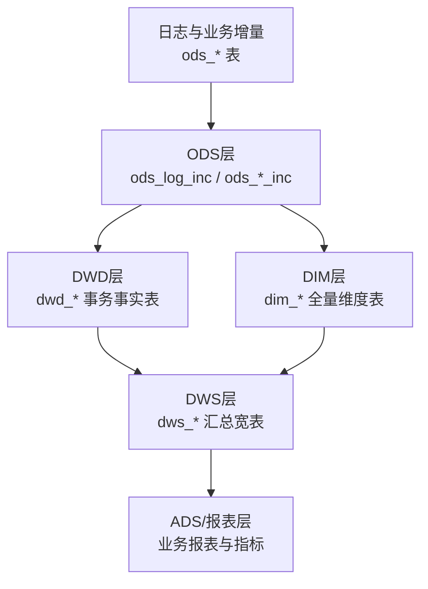
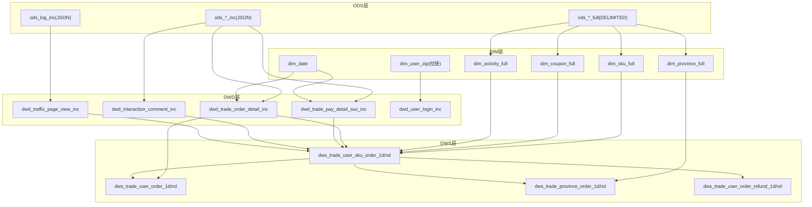
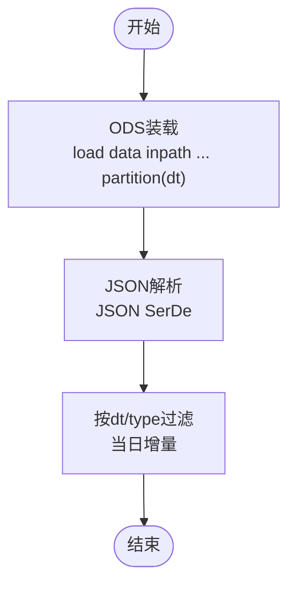
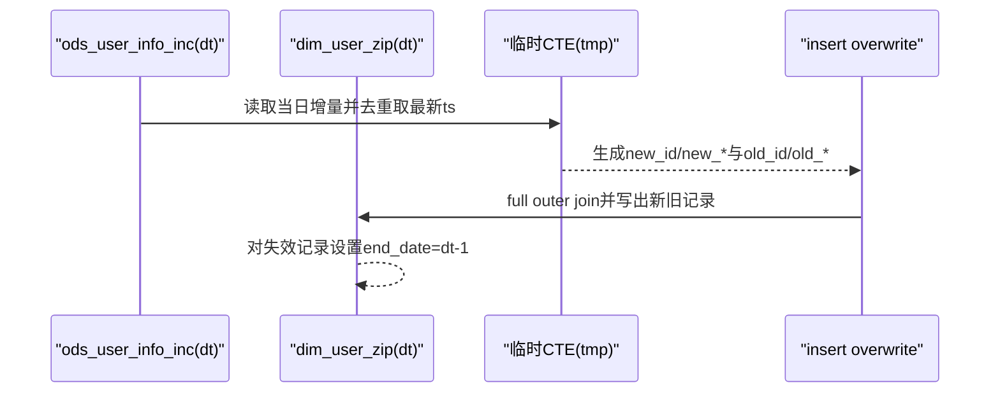
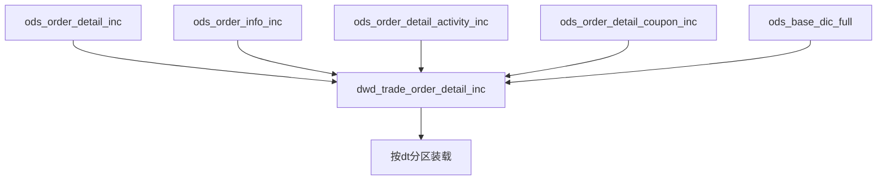
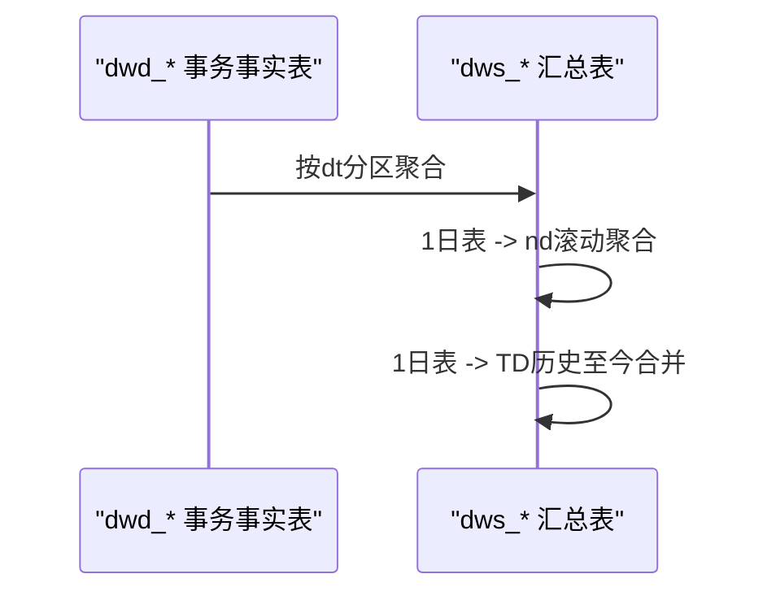
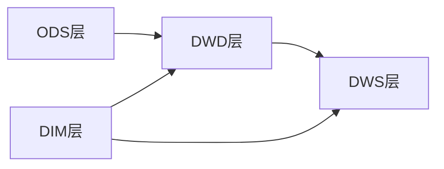

# ETL流程

<cite>
**本文引用的文件**
- [basic.sql](file://basic.sql)
- [console.sql](file://console.sql)
- [gmall-0906.sql](file://gmall-0906.sql)
- [high.sql](file://high.sql)
- [middle.sql](file://middle.sql)
</cite>

## 目录
1. [引言](#引言)
2. [项目结构](#项目结构)
3. [核心组件](#核心组件)
4. [架构总览](#架构总览)
5. [详细组件分析](#详细组件分析)
6. [依赖分析](#依赖分析)
7. [性能考量](#性能考量)
8. [故障排查指南](#故障排查指南)
9. [结论](#结论)
10. [附录](#附录)

## 引言
本技术文档围绕HQL仓库中的ETL流程展开，系统化阐述从日志与业务增量数据接入、全量装载，到维度建模与宽表汇总的事实表构建全过程。文档覆盖抽取策略（日志接入、增量处理、全量装载）、转换逻辑（清洗、标准化、字段映射、业务规则应用）、加载机制（分区更新、合并与冲突处理），并提供可复用的ETL脚本路径与执行流程说明，辅以性能优化与监控建议，帮助数据工程师高效落地与维护ETL。

## 项目结构
仓库包含多个SQL文件，分别承载不同层次的ETL能力：
- gmall-0906.sql：完整ETL流程的主干，涵盖ODS、DIM、DWD、DWS等层的建表与装载逻辑，体现典型的湖仓分层架构。
- basic.sql：基础函数与窗口函数示例，便于理解数据清洗与标准化常用手段。
- console.sql：教学练习与查询示例，展示JOIN、聚合、日期函数、排名等常用模式。
- middle.sql：订单、登录、用户行为等连续性分析与统计口径示例，体现业务规则与维度映射。
- high.sql：直播、页面浏览等事件序列与会话识别示例，强调时间窗口与连续性处理。

章节来源
- [gmall-0906.sql](file://gmall-0906.sql#L1-L120)
- [basic.sql](file://basic.sql#L1-L120)
- [console.sql](file://console.sql#L1-L120)
- [middle.sql](file://middle.sql#L1-L120)
- [high.sql](file://high.sql#L1-L40)

## 核心组件
- ODS层（ODS_LOG_INC、ODS_*_INC）
  - 日志接入：ods_log_inc采用JSON SerDe解析JSON日志；业务增量表ods_*_inc采用JSON SerDe或分隔符格式，按dt分区。
  - 数据装载：load data inpath ... into table ... partition(dt=...)用于全量装载；增量表通过type字段标识bootstrap-insert、insert、update等。
- DIM层（dim_*）
  - 全量维度表：dim_sku_full、dim_coupon_full、dim_activity_full、dim_province_full、dim_date、dim_user_zip等。
  - 维度装载：基于ods_*_full按dt分区全量装载；dim_user_zip采用拉链表策略，维护start_date/end_date。
- DWD层（dwd_*）
  - 事务事实表：dwd_trade_*（下单、支付、退单、退款）、dwd_interaction_*（收藏、评价）、dwd_traffic_*（页面、启动、动作、曝光、错误）、dwd_user_*（注册、登录）。
  - 装载策略：首日bootstrap-insert，后续按type过滤insert/update；跨表关联ods_*_inc与ods_*_full，完成字段映射与业务规则计算。
- DWS层（dws_*）
  - 汇总宽表：dws_trade_user_sku_order_1d/nd、dws_trade_user_order_1d/nd、dws_trade_province_order_1d/nd、dws_trade_user_order_refund_1d/nd等。
  - 装载策略：基于DWD层聚合，按dt分区装载；部分表采用滚动n日聚合与拉链历史TD表。

章节来源
- [gmall-0906.sql](file://gmall-0906.sql#L20-L120)
- [gmall-0906.sql](file://gmall-0906.sql#L800-L960)
- [gmall-0906.sql](file://gmall-0906.sql#L930-L1170)
- [gmall-0906.sql](file://gmall-0906.sql#L1170-L1930)
- [gmall-0906.sql](file://gmall-0906.sql#L3650-L4050)
- [gmall-0906.sql](file://gmall-0906.sql#L4030-L4790)

## 架构总览
下图展示从ODS到DWS的典型ETL路径，突出分区更新、维度映射与业务规则应用：

图表来源
- [gmall-0906.sql](file://gmall-0906.sql#L20-L120)
- [gmall-0906.sql](file://gmall-0906.sql#L800-L1200)
- [gmall-0906.sql](file://gmall-0906.sql#L1200-L2399)
- [gmall-0906.sql](file://gmall-0906.sql#L3650-L4790)

## 详细组件分析

### ODS层：日志接入与增量装载
- 日志接入
  - ods_log_inc采用JSON SerDe，按dt分区，字段包含common/page/actions/displays/start/err/ts等结构化与数组字段。
  - 数据装载使用load data inpath ... into table ... partition(dt=...)。
- 业务增量表
  - ods_*_inc采用JSON SerDe，包含type/ts/data/old等字段，其中type标识bootstrap-insert/insert/update/delete等。
  - 通过where dt=... and type=... 过滤当日增量数据，确保分区裁剪与增量装载。

图表来源
- [gmall-0906.sql](file://gmall-0906.sql#L20-L120)

章节来源
- [gmall-0906.sql](file://gmall-0906.sql#L20-L120)

### DIM层：全量维度装载与拉链表
- 全量维度表
  - dim_sku_full：由ods_sku_info_full、ods_spu_info_full、ods_base_categoryX_full、ods_base_trademark_full、ods_sku_attr_value_full、ods_sku_sale_attr_value_full等表左连接组装，按dt分区全量装载。
  - dim_coupon_full、dim_activity_full、dim_province_full、dim_date等亦采用类似全量装载策略。
- 拉链表（dim_user_zip）
  - 首日bootstrap-insert装载至dt='9999-12-31'，后续每日通过full outer join新老数据，生成新的有效区间，并对失效记录设置end_date=date_sub(dt,1)，实现维度历史追溯。

图表来源
- [gmall-0906.sql](file://gmall-0906.sql#L954-L1170)

章节来源
- [gmall-0906.sql](file://gmall-0906.sql#L800-L960)
- [gmall-0906.sql](file://gmall-0906.sql#L954-L1170)

### DWD层：事务事实表装载与业务规则
- 交易域
  - dwd_trade_order_detail_inc：首日bootstrap-insert，后续按type='insert'装载；跨ods_order_detail_inc、ods_order_info_inc、ods_order_detail_activity_inc、ods_order_detail_coupon_inc与ods_base_dic_full完成字段映射与金额拆分。
  - dwd_trade_pay_detail_suc_inc：按支付状态过滤（payment_status='1602'），完成支付成功事实表装载。
  - dwd_trade_cancel_detail_inc、dwd_trade_refund_pay_suc_inc：基于ods_order_info_inc/ods_refund_payment_inc与ods_order_refund_info_inc按状态过滤装载。
- 互动域与流量域
  - dwd_interaction_comment_inc：基于ods_comment_info_inc与ods_base_dic_full按parent_code='12'映射评价编码。
  - dwd_traffic_page_view_inc：从ods_log_inc lateral view explode(displays/actions)提取数组字段，构造session_id（基于last_value会话起点），并完成省份映射。
  - dwd_user_login_inc：从ods_log_inc筛选page.page_id='register'并映射省份。
- 字段映射与业务规则
  - 通过ods_base_dic_full按parent_code过滤字典项，完成编码到名称的映射。
  - 金额类字段采用拆分与汇总（split_original_amount、split_activity_amount、split_coupon_amount、split_total_amount）。

图表来源
- [gmall-0906.sql](file://gmall-0906.sql#L1280-L1930)

章节来源
- [gmall-0906.sql](file://gmall-0906.sql#L1280-L1930)

### DWS层：汇总宽表与滚动聚合
- dws_trade_user_sku_order_1d/nd：按user_id+sku_id聚合，计算最近1日/7日/30日下单次数、件数与金额（含原始金额、活动优惠、券优惠、最终金额）。
- dws_trade_user_order_1d/nd：按user_id聚合，计算下单次数、件数与金额。
- dws_trade_province_order_1d/nd：按province_id聚合，计算省份粒度订单指标。
- dws_trade_user_order_refund_1d/nd：按user_id+sku_id聚合退单次数、件数与金额。
- 历史至今TD表：dws_trade_user_order_td通过full outer join昨日TD与今日1日表，累加历史至今指标。

图表来源
- [gmall-0906.sql](file://gmall-0906.sql#L3650-L4790)

章节来源
- [gmall-0906.sql](file://gmall-0906.sql#L3650-L4790)

### 数据清洗与标准化要点
- 空值与缺失处理
  - 使用coalesce/nvl/ifnull等函数填充默认值，避免列相加时I/O放大。
- 时间字段标准化
  - 使用from_unixtime/date_format/date_sub/date_add统一时间格式与时区转换（GMT+8）。
- 结构化解析
  - JSON日志通过JSON SerDe解析，数组字段使用lateral view explode展开。
- 去重与连续性
  - 登录/下单连续性分析通过distinct、row_number、dense_rank、datediff、lag等实现。

章节来源
- [basic.sql](file://basic.sql#L1-L120)
- [console.sql](file://console.sql#L1-L120)
- [middle.sql](file://middle.sql#L1-L120)
- [high.sql](file://high.sql#L1-L120)

## 依赖分析
- 组件耦合
  - DWD层事实表依赖ODS层增量表与DIM层维度表，形成稳定的上游依赖链。
  - DWS层汇总表依赖DWD层与DIM层，形成自下而上的聚合依赖。
- 分区与裁剪
  - 通过dt分区与where dt=...实现分区裁剪，提升查询与装载效率。
- 动态分区
  - 使用hive.exec.dynamic.partition.mode=nonstrict支持动态分区写入。

图表来源
- [gmall-0906.sql](file://gmall-0906.sql#L954-L1170)
- [gmall-0906.sql](file://gmall-0906.sql#L1280-L1930)
- [gmall-0906.sql](file://gmall-0906.sql#L3650-L4790)

章节来源
- [gmall-0906.sql](file://gmall-0906.sql#L954-L1170)
- [gmall-0906.sql](file://gmall-0906.sql#L1280-L1930)
- [gmall-0906.sql](file://gmall-0906.sql#L3650-L4790)

## 性能考量
- 分区裁剪与列裁剪
  - 在where子句中显式指定dt分区，避免全表扫描。
- 动态分区与并行
  - 合理配置动态分区模式，减少小文件产生，提高写入吞吐。
- 字段映射与字典表
  - 通过ods_base_dic_full按parent_code过滤字典项，避免全表扫描。
- 时间函数与格式化
  - 统一使用date_format/from_unixtime等函数，减少格式转换成本。
- 窗口函数与排序
  - 使用row_number/dense_rank/last_value等窗口函数时，明确partition by与order by，避免不必要的排序开销。
- 存储格式
  - DIM层采用ORC压缩（snappy），提升读写性能与存储效率。

章节来源
- [gmall-0906.sql](file://gmall-0906.sql#L800-L960)
- [gmall-0906.sql](file://gmall-0906.sql#L1280-L1930)

## 故障排查指南
- JSON解析失败
  - 现象：字段为空或无结果。
  - 排查：检查JSON格式、字段命名大小写、SerDe配置与分区dt是否正确。
- 分区缺失或未裁剪
  - 现象：查询耗时异常。
  - 排查：确认where子句包含dt分区条件，检查分区是否存在。
- 字典映射不生效
  - 现象：编码未映射为名称。
  - 排查：确认ods_base_dic_full的parent_code过滤条件与dt分区一致。
- 拉链表失效记录未更新
  - 现象：dim_user_zip历史记录end_date未更新。
  - 排查：核对full outer join逻辑与end_date赋值分支。
- 金额拆分与汇总不一致
  - 现象：原始金额与拆分金额之和不等于最终金额。
  - 排查：检查split_*字段计算逻辑与nvl处理。

章节来源
- [gmall-0906.sql](file://gmall-0906.sql#L954-L1170)
- [gmall-0906.sql](file://gmall-0906.sql#L1280-L1930)

## 结论
本ETL体系以ODS/DIM/DWD/DWS分层为核心，结合JSON日志接入、增量装载与全量维度装载，实现了从原始事件到业务指标的完整闭环。通过分区裁剪、字典映射、窗口函数与拉链表等关键技术，既保证了数据质量与历史追溯，又兼顾了性能与可维护性。建议在实际落地中严格遵循分区策略、字段映射规范与业务规则校验，持续优化查询与装载性能。

## 附录
- ETL脚本路径参考
  - 日志接入与装载：[gmall-0906.sql](file://gmall-0906.sql#L20-L120)
  - 全量维度装载：[gmall-0906.sql](file://gmall-0906.sql#L800-L960)
  - 拉链表装载：[gmall-0906.sql](file://gmall-0906.sql#L954-L1170)
  - 交易域事实表装载：[gmall-0906.sql](file://gmall-0906.sql#L1280-L1930)
  - 互动与流量域事实表装载：[gmall-0906.sql](file://gmall-0906.sql#L2540-L3050)
  - 用户域事实表装载：[gmall-0906.sql](file://gmall-0906.sql#L3050-L3210)
  - 汇总宽表装载：[gmall-0906.sql](file://gmall-0906.sql#L3650-L4790)
- 常用清洗与标准化示例
  - 窗口函数与连续性分析：[basic.sql](file://basic.sql#L1-L120)、[high.sql](file://high.sql#L1-L120)、[middle.sql](file://middle.sql#L1-L120)
  - JOIN与聚合示例：[console.sql](file://console.sql#L1-L120)