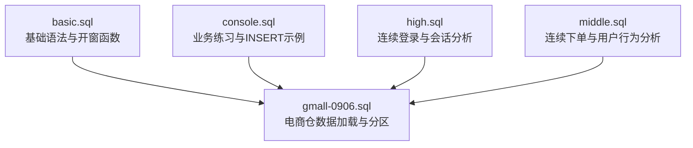
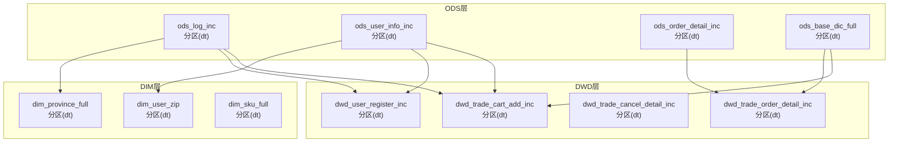
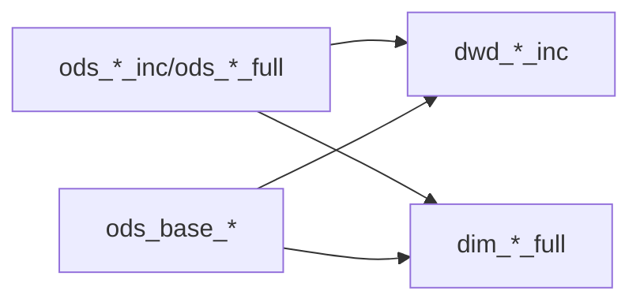

# 数据加载机制

<cite>
**本文引用的文件**
- [basic.sql](file://basic.sql)
- [console.sql](file://console.sql)
- [gmall-0906.sql](file://gmall-0906.sql)
- [high.sql](file://high.sql)
- [middle.sql](file://middle.sql)
</cite>

## 目录
1. [引言](#引言)
2. [项目结构](#项目结构)
3. [核心组件](#核心组件)
4. [架构总览](#架构总览)
5. [详细组件分析](#详细组件分析)
6. [依赖分析](#依赖分析)
7. [性能考虑](#性能考虑)
8. [故障排查指南](#故障排查指南)
9. [结论](#结论)
10. [附录](#附录)

## 引言
本文件面向HQL（Hive SQL）数据加载与分区管理，系统化梳理仓库中涉及的分区更新策略、动态分区插入、分区覆盖与合并逻辑、INSERT OVERWRITE与INSERT INTO的差异与性能考量、冲突处理（重复数据、一致性、并发控制）、完整数据加载脚本示例与执行流程、性能优化与监控方法，以及失败后的故障恢复与重试机制。文档以仓库现有SQL脚本为依据，结合实际代码路径进行说明，帮助读者快速理解并落地生产级数据加载实践。

## 项目结构
仓库包含多个SQL文件，分别覆盖HQL基础语法、业务场景练习、电商仓（ODS/DWD/DIM）数据加载与分区管理、连续登录与会话分析等主题。其中，电商仓脚本集中体现了分区加载、动态分区、覆盖与合并、事务事实表构建等关键机制。

图表来源
- [basic.sql](file://basic.sql#L1-L120)
- [console.sql](file://console.sql#L1-L120)
- [gmall-0906.sql](file://gmall-0906.sql#L1-L120)
- [high.sql](file://high.sql#L1-L40)
- [middle.sql](file://middle.sql#L1-L40)

章节来源
- [basic.sql](file://basic.sql#L1-L120)
- [console.sql](file://console.sql#L1-L120)
- [gmall-0906.sql](file://gmall-0906.sql#L1-L120)
- [high.sql](file://high.sql#L1-L40)
- [middle.sql](file://middle.sql#L1-L40)

## 核心组件
- 分区表与分区加载：通过PARTITIONED BY定义分区字段（如dt），在LOAD/INSERT中指定分区值，实现按天或按业务维度的分区装载。
- 动态分区：通过设置动态分区模式，允许INSERT语句根据SELECT结果自动推断分区列值，减少手工维护成本。
- 分区覆盖与合并：使用INSERT OVERWRITE覆盖指定分区；通过FULL OUTER JOIN、UNION ALL、RANK窗口函数等实现历史与新数据的合并，维持维度表的缓慢变化（SCD）。
- 事务事实表构建：基于增量表（ods_*_inc）与字典表（ods_base_*）进行JOIN，产出DWD层事务事实表，支持首日全量与每日增量。
- 数据一致性与去重：通过RANK窗口取最新记录、GROUP BY去重、条件过滤（type、状态字段）确保数据一致性与幂等性。

章节来源
- [gmall-0906.sql](file://gmall-0906.sql#L1-L120)
- [gmall-0906.sql](file://gmall-0906.sql#L956-L1078)
- [gmall-0906.sql](file://gmall-0906.sql#L1199-L1278)
- [gmall-0906.sql](file://gmall-0906.sql#L1399-L1479)
- [gmall-0906.sql](file://gmall-0906.sql#L1599-L1680)

## 架构总览
电商仓数据加载采用ODS-DWD-DIM三层架构，围绕分区与动态分区实现每日增量与历史覆盖，结合事务事实表与维度表的构建，形成稳定的数据流。

图表来源
- [gmall-0906.sql](file://gmall-0906.sql#L1-L120)
- [gmall-0906.sql](file://gmall-0906.sql#L1196-L1278)
- [gmall-0906.sql](file://gmall-0906.sql#L1311-L1479)
- [gmall-0906.sql](file://gmall-0906.sql#L1512-L1680)
- [gmall-0906.sql](file://gmall-0906.sql#L818-L848)
- [gmall-0906.sql](file://gmall-0906.sql#L496-L604)

## 详细组件分析

### 分区更新策略与动态分区插入
- 动态分区模式开启：通过设置动态分区模式为非严格模式，使INSERT语句能够根据SELECT结果自动推断分区列值，无需在INSERT中显式指定分区。
- 动态分区插入示例：
  - 首日全量装载：使用INSERT OVERWRITE覆盖目标分区dt='YYYY-MM-DD'，将ods_*表中dt='YYYY-MM-DD'的数据映射到DWD层。
  - 每日增量装载：使用INSERT OVERWRITE覆盖目标分区dt='YYYY-MM-DD'，仅选择ods_*表中type='insert'或特定状态的数据，避免重复处理。
- 代码路径参考：
  - [动态分区模式设置与每日增量装载](file://gmall-0906.sql#L956-L1078)
  - [每日增量装载（购物车事务）](file://gmall-0906.sql#L1199-L1278)
  - [每日增量装载（订单明细事务）](file://gmall-0906.sql#L1399-L1479)
  - [每日增量装载（取消订单事务）](file://gmall-0906.sql#L1599-L1680)

章节来源
- [gmall-0906.sql](file://gmall-0906.sql#L956-L1078)
- [gmall-0906.sql](file://gmall-0906.sql#L1199-L1278)
- [gmall-0906.sql](file://gmall-0906.sql#L1399-L1479)
- [gmall-0906.sql](file://gmall-0906.sql#L1599-L1680)

### 分区覆盖与分区合并逻辑
- 分区覆盖（INSERT OVERWRITE）：
  - 用于替换目标分区的全部数据，适用于每日增量或全量装载。
  - 示例：dim_user_zip每日装载，使用INSERT OVERWRITE覆盖dt分区。
- 分区合并（INSERT INTO + FULL OUTER JOIN + RANK）：
  - 通过FULL OUTER JOIN合并历史与新数据，使用RANK窗口函数取最新记录，实现维度表的缓慢变化（SCD Type 2）。
  - 示例：dim_user_zip每日装载，使用FULL OUTER JOIN与RANK取最新记录，并对历史记录设置截止日期，新记录设置有效期。
- 代码路径参考：
  - [维度表合并（用户维度）](file://gmall-0906.sql#L956-L1078)
  - [维度表合并（用户维度-思路二）](file://gmall-0906.sql#L1082-L1168)

章节来源
- [gmall-0906.sql](file://gmall-0906.sql#L956-L1078)
- [gmall-0906.sql](file://gmall-0906.sql#L1082-L1168)

### INSERT OVERWRITE 与 INSERT INTO 的使用场景与性能考量
- INSERT OVERWRITE：
  - 场景：每日增量装载、全量装载、维度表SCD合并。
  - 特点：覆盖目标分区，适合批量写入；需配合分区裁剪与条件过滤，避免重复数据。
  - 示例：dwd_trade_cart_add_inc、dwd_trade_order_detail_inc、dim_user_zip等。
- INSERT INTO：
  - 场景：向已有分区追加数据（非覆盖），通常用于临时或测试环境。
  - 注意：在生产中建议优先使用INSERT OVERWRITE以保证分区一致性与可重放性。
- 代码路径参考：
  - [INSERT OVERWRITE（购物车事务）](file://gmall-0906.sql#L1199-L1278)
  - [INSERT OVERWRITE（订单明细事务）](file://gmall-0906.sql#L1399-L1479)
  - [INSERT OVERWRITE（取消订单事务）](file://gmall-0906.sql#L1599-L1680)
  - [INSERT OVERWRITE（用户维度）](file://gmall-0906.sql#L956-L1078)

章节来源
- [gmall-0906.sql](file://gmall-0906.sql#L956-L1078)
- [gmall-0906.sql](file://gmall-0906.sql#L1199-L1278)
- [gmall-0906.sql](file://gmall-0906.sql#L1399-L1479)
- [gmall-0906.sql](file://gmall-0906.sql#L1599-L1680)

### 冲突处理方案：重复数据、一致性保证与并发控制
- 重复数据处理：
  - 使用RANK窗口函数按主键与时间戳排序，取rk=1的最新记录，避免重复写入。
  - 使用GROUP BY去重，确保同一业务键在同一天仅出现一次。
- 一致性保证：
  - 通过条件过滤（type、状态字段）确保仅处理有效事件（insert/update/bootstrap-insert等）。
  - 使用FULL OUTER JOIN合并历史与新数据，避免遗漏或重复。
- 并发控制策略：
  - 通过分区裁剪（dt='YYYY-MM-DD'）与条件过滤（type）实现幂等性，避免并发写入导致的数据重复。
  - 使用动态分区模式与分区裁剪，减少不必要的全表扫描与写入。
- 代码路径参考：
  - [RANK取最新记录（用户维度）](file://gmall-0906.sql#L1008-L1041)
  - [GROUP BY去重（连续登录）](file://middle.sql#L129-L140)
  - [条件过滤（订单明细事务）](file://gmall-0906.sql#L1433-L1436)

章节来源
- [gmall-0906.sql](file://gmall-0906.sql#L1008-L1041)
- [middle.sql](file://middle.sql#L129-L140)
- [gmall-0906.sql](file://gmall-0906.sql#L1433-L1436)

### 数据加载脚本示例与执行流程
- 首日装载（全量）：
  - 步骤：设置动态分区模式 → 读取ods_*中bootstrap-insert的数据 → JOIN字典表 → INSERT OVERWRITE到DWD/DIM目标表的dt分区。
  - 示例路径：[用户维度首日装载](file://gmall-0906.sql#L934-L951)、[购物车事务首日装载](file://gmall-0906.sql#L1199-L1238)、[订单明细事务首日装载](file://gmall-0906.sql#L1313-L1394)
- 每日增量装载：
  - 步骤：设置动态分区模式 → 读取ods_*中dt='YYYY-MM-DD'且type='insert'的数据 → JOIN字典表 → INSERT OVERWRITE到DWD/DIM目标表的dt分区。
  - 示例路径：[购物车事务每日增量](file://gmall-0906.sql#L1242-L1278)、[订单明细事务每日增量](file://gmall-0906.sql#L1399-L1479)、[取消订单事务每日增量](file://gmall-0906.sql#L1599-L1680)
- 维度表SCD合并：
  - 步骤：FULL OUTER JOIN历史与新数据 → RANK取最新记录 → INSERT OVERWRITE到dim_*表的dt分区。
  - 示例路径：[用户维度合并](file://gmall-0906.sql#L956-L1078)

章节来源
- [gmall-0906.sql](file://gmall-0906.sql#L934-L951)
- [gmall-0906.sql](file://gmall-0906.sql#L1199-L1278)
- [gmall-0906.sql](file://gmall-0906.sql#L1313-L1479)
- [gmall-0906.sql](file://gmall-0906.sql#L1599-L1680)
- [gmall-0906.sql](file://gmall-0906.sql#L956-L1078)

### 数据加载过程中的性能优化技巧与监控方法
- 性能优化技巧：
  - 分区裁剪：在WHERE中限定dt与type，减少扫描与写入数据量。
  - 条件过滤：仅处理有效事件（如type='insert'或状态字段满足条件）。
  - 字段裁剪：仅SELECT必要字段，避免不必要的列传输与存储。
  - 动态分区：启用非严格模式，减少手工维护分区值。
  - 存储格式：使用ORC并配置压缩（如snappy），提升读写性能。
- 监控方法：
  - 执行计划：使用EXPLAIN/EXPLAIN EXTENDED查看物理执行计划，定位热点与瓶颈。
  - 分区统计：通过SHOW PARTITIONS与DESCRIBE FORMATTED确认分区状态与表结构。
  - 日志与告警：结合外部调度系统（如Airflow/Superset）记录执行时间、失败重试次数与分区缺失情况。
- 代码路径参考：
  - [执行计划示例（basic.sql）](file://basic.sql#L237-L246)
  - [执行计划示例（console.sql）](file://console.sql#L3036-L3036)
  - [ORC压缩配置（gmall-0906.sql）](file://gmall-0906.sql#L490-L494)

章节来源
- [basic.sql](file://basic.sql#L237-L246)
- [console.sql](file://console.sql#L3036-L3036)
- [gmall-0906.sql](file://gmall-0906.sql#L490-L494)

### 数据加载失败的故障恢复与重试机制
- 失败恢复：
  - 分区回滚：当某天分区写入失败，可删除该分区后重新执行；或使用INSERT OVERWRITE覆盖该分区。
  - 数据修复：针对特定type或状态异常的数据，补充或修正后再重跑。
- 重试机制：
  - 通过调度系统设置重试策略（如最多重试N次、指数退避），并在重试前检查分区是否存在与数据完整性。
  - 幂等性保障：利用分区裁剪与条件过滤，确保重试不会产生重复数据。
- 代码路径参考：
  - [分区覆盖（INSERT OVERWRITE）](file://gmall-0906.sql#L956-L1078)
  - [分区覆盖（INSERT OVERWRITE）](file://gmall-0906.sql#L1199-L1278)

章节来源
- [gmall-0906.sql](file://gmall-0906.sql#L956-L1078)
- [gmall-0906.sql](file://gmall-0906.sql#L1199-L1278)

## 依赖分析
- 表依赖关系：
  - ODS层增量表（ods_*_inc）与全量表（ods_*_full）为DWD层事务事实表提供数据源。
  - 字典表（ods_base_*）为DWD层提供维度映射。
  - DIM层维度表依赖ODS层与字典表，用于历史与新数据的合并。
- 代码路径参考：
  - [DWD层事务事实表构建（购物车）](file://gmall-0906.sql#L1199-L1278)
  - [DWD层事务事实表构建（订单明细）](file://gmall-0906.sql#L1313-L1479)
  - [DWD层事务事实表构建（取消订单）](file://gmall-0906.sql#L1514-L1680)
  - [DIM层维度表构建（用户维度）](file://gmall-0906.sql#L934-L1078)
  - [DIM层维度表构建（省维度）](file://gmall-0906.sql#L818-L848)

图表来源
- [gmall-0906.sql](file://gmall-0906.sql#L1199-L1278)
- [gmall-0906.sql](file://gmall-0906.sql#L1313-L1479)
- [gmall-0906.sql](file://gmall-0906.sql#L1514-L1680)
- [gmall-0906.sql](file://gmall-0906.sql#L934-L1078)
- [gmall-0906.sql](file://gmall-0906.sql#L818-L848)

章节来源
- [gmall-0906.sql](file://gmall-0906.sql#L1199-L1278)
- [gmall-0906.sql](file://gmall-0906.sql#L1313-L1479)
- [gmall-0906.sql](file://gmall-0906.sql#L1514-L1680)
- [gmall-0906.sql](file://gmall-0906.sql#L934-L1078)
- [gmall-0906.sql](file://gmall-0906.sql#L818-L848)

## 性能考虑
- 分区裁剪与条件过滤：在WHERE中限定dt与type，减少I/O与CPU消耗。
- 动态分区：启用非严格模式，避免手工维护分区值，提高可扩展性。
- 存储格式与压缩：使用ORC并配置snappy压缩，提升读写性能与存储效率。
- 执行引擎切换：在特定场景下切换执行引擎（如MR/Spark），平衡稳定性与性能。
- 代码路径参考：
  - [ORC压缩配置](file://gmall-0906.sql#L490-L494)
  - [执行引擎切换示例](file://gmall-0906.sql#L2979-L3049)

章节来源
- [gmall-0906.sql](file://gmall-0906.sql#L490-L494)
- [gmall-0906.sql](file://gmall-0906.sql#L2979-L3049)

## 故障排查指南
- 常见问题与定位：
  - 分区缺失：使用SHOW PARTITIONS确认目标分区是否存在；若缺失，先创建分区再重跑。
  - 数据重复：检查WHERE条件与RANK逻辑，确保仅取最新记录；必要时清理重复数据后重跑。
  - 动态分区失败：检查动态分区模式设置与分区列值是否可推断；确保SELECT结果包含分区列。
  - 执行计划异常：使用EXPLAIN/EXPLAIN EXTENDED查看物理执行计划，识别全表扫描与JOIN顺序问题。
- 代码路径参考：
  - [执行计划示例（basic.sql）](file://basic.sql#L237-L246)
  - [执行计划示例（console.sql）](file://console.sql#L3036-L3036)

章节来源
- [basic.sql](file://basic.sql#L237-L246)
- [console.sql](file://console.sql#L3036-L3036)

## 结论
本仓库展示了基于HQL的完整数据加载体系：通过分区与动态分区实现高效增量与全量装载，通过INSERT OVERWRITE与FULL OUTER JOIN实现分区覆盖与SCD合并，通过RANK与条件过滤保障一致性与幂等性。结合执行计划分析与存储格式优化，可在生产环境中实现稳定、可重放、可监控的数据加载流程。建议在实际落地时，完善调度与告警机制，确保失败重试与分区回滚策略的自动化与可观测性。

## 附录
- 术语说明：
  - ODS：操作数据层，存放原始数据。
  - DWD：数据明细层，存放事务事实表。
  - DIM：维度层，存放维度表。
  - SCD：缓慢变化维度，用于维护历史版本。
- 参考路径：
  - [基础语法与开窗函数](file://basic.sql#L1-L120)
  - [业务练习与INSERT示例](file://console.sql#L1-L120)
  - [电商仓数据加载与分区](file://gmall-0906.sql#L1-L120)
  - [连续登录与会话分析](file://high.sql#L1-L40)
  - [连续下单与用户行为分析](file://middle.sql#L1-L40)