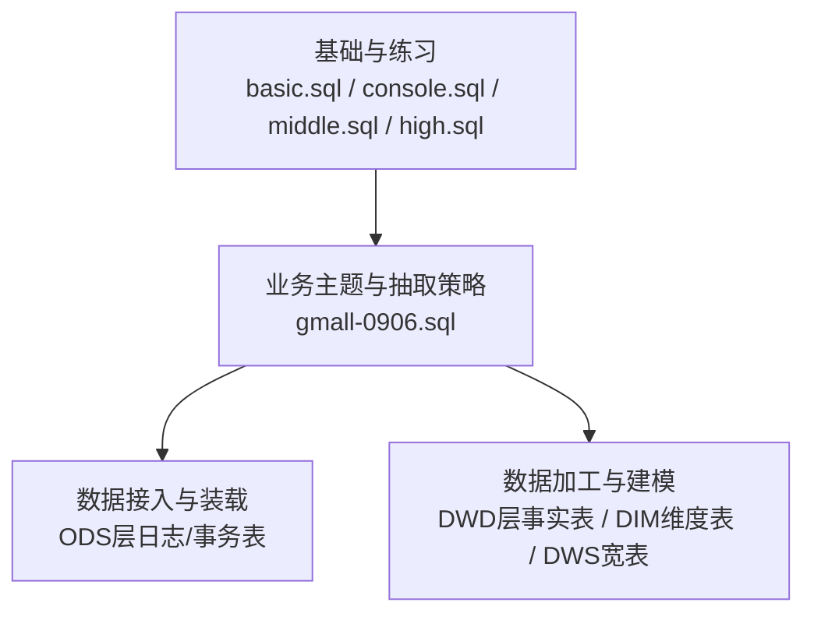
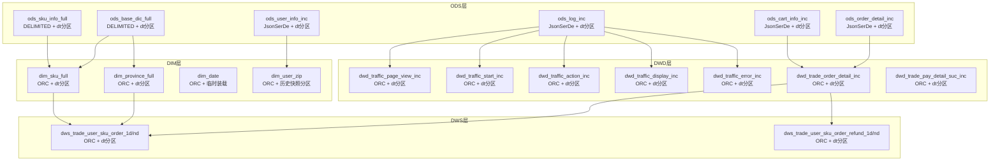
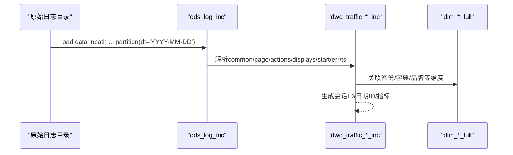
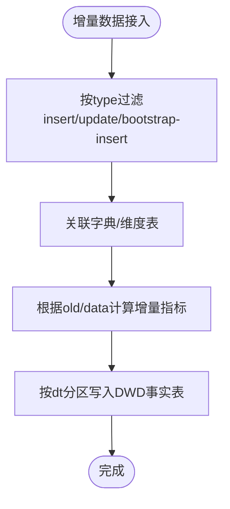
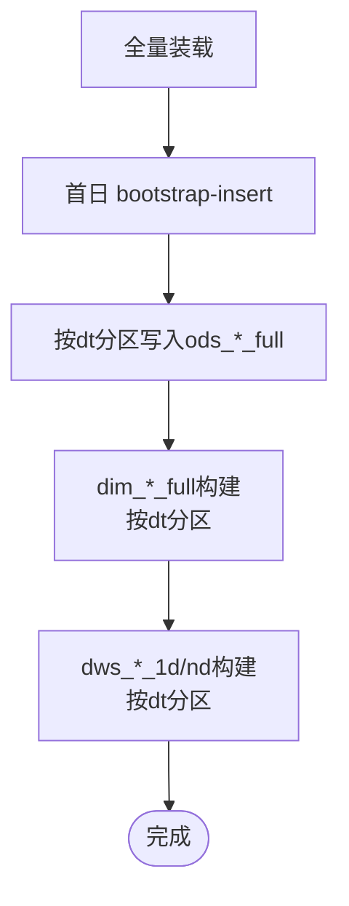
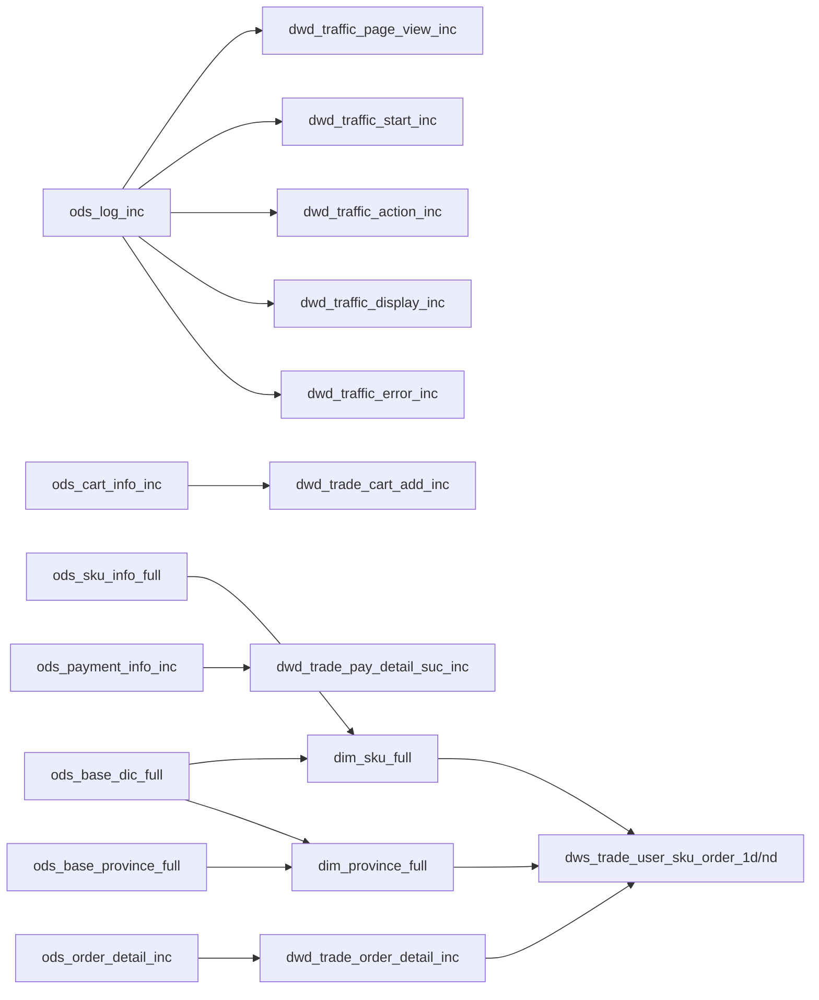

# 数据抽取策略

<cite>
**本文引用的文件**
- [gmall-0906.sql](file://gmall-0906.sql)
- [console.sql](file://console.sql)
- [basic.sql](file://basic.sql)
- [high.sql](file://high.sql)
- [middle.sql](file://middle.sql)
</cite>

## 目录
1. [引言](#引言)
2. [项目结构](#项目结构)
3. [核心组件](#核心组件)
4. [架构总览](#架构总览)
5. [详细组件分析](#详细组件分析)
6. [依赖分析](#依赖分析)
7. [性能考量](#性能考量)
8. [故障排查指南](#故障排查指南)
9. [结论](#结论)
10. [附录](#附录)

## 引言
本技术文档围绕HQL仓库中的数据抽取策略展开，系统性阐述日志数据接入机制、增量与全量数据装载流程、分区管理与数据同步策略，并提供可复用的脚本示例与最佳实践。文档面向不同层次读者，既包含高层架构说明，也提供代码级细节与可视化图示，帮助快速理解与落地实施。

## 项目结构
仓库包含多个SQL脚本文件，分别覆盖基础函数、控制台练习、业务主题（gmall）以及不同难度级别的实战案例。其中，gmall-0906.sql是数据抽取与建模的核心，涵盖ODS层日志与事务表、DWD层事实表、DIM维度表以及DWS宽表的完整链路。

[本图为概念性结构示意，不直接映射具体源文件，故无图表来源]

**章节来源**
- file://gmall-0906.sql#L1-L60

## 核心组件
本节聚焦ODS层日志与事务表、DWD层事实表、DIM维度表与DWS宽表的关键结构与职责。

- ODS层
  - 日志表：ods_log_inc，采用JsonSerDe序列化，按dt分区，承载页面浏览、启动、动作、曝光、错误等多类日志结构化。
  - 事务表：ods_*_inc系列，采用JsonSerDe序列化，承载业务事件的增量变更（type、ts、data、old），按dt分区。
  - 全量表：ods_*_full系列，采用DELIMITED FIELDS TERMINATED BY '\t'，按dt分区，用于周期性全量装载。

- DWD层
  - 事实表：dwd_*_inc/_full/_nd/_td等，按dt分区，完成数据清洗、维度关联、指标计算与落库。
  - 事实表示例：dwd_traffic_page_view_inc、dwd_traffic_start_inc、dwd_traffic_action_inc、dwd_traffic_display_inc、dwd_traffic_error_inc；dwd_trade_order_detail_inc、dwd_trade_pay_detail_suc_inc等。

- DIM层
  - 维度表：dim_sku_full、dim_province_full、dim_date、dim_user_zip等，按dt分区或历史快照分区（如end_date='9999-12-31'），支持缓慢变化维度（SCD）。

- DWS层
  - 宽表：dws_trade_user_sku_order_1d/nd、dws_trade_user_sku_order_refund_1d/nd等，按dt分区，提供多粒度汇总指标。

**章节来源**
- file://gmall-0906.sql#L20-L120
- file://gmall-0906.sql#L1170-L1390
- file://gmall-0906.sql#L1390-L1710
- file://gmall-0906.sql#L1710-L2100
- file://gmall-0906.sql#L2100-L2400
- file://gmall-0906.sql#L2400-L2750
- file://gmall-0906.sql#L2750-L3100
- file://gmall-0906.sql#L3100-L3400
- file://gmall-0906.sql#L3650-L3999

## 架构总览
下图展示从ODS到DWD/DIM/DWS的整体数据流，强调分区、序列化与事实/维度构建的关系。

**图表来源**
- [gmall-0906.sql](file://gmall-0906.sql#L20-L120)
- [gmall-0906.sql](file://gmall-0906.sql#L1170-L1710)
- [gmall-0906.sql](file://gmall-0906.sql#L1710-L2400)
- [gmall-0906.sql](file://gmall-0906.sql#L2400-L3100)
- [gmall-0906.sql](file://gmall-0906.sql#L3100-L3400)
- [gmall-0906.sql](file://gmall-0906.sql#L3650-L3999)

## 详细组件分析

### 日志数据接入机制（ods_log_inc）
- 序列化配置
  - 使用JsonSerDe，适配JSON格式的日志数据，便于直接解析common/page/actions/displays/start/err/ts等结构化字段。
- 表结构要点
  - common：设备、渠道、系统、会员等通用信息。
  - page：页面停留时长、来源类型、目标页面等。
  - actions：数组结构的动作集合，含动作ID、目标、类型、时间戳。
  - displays：数组结构的曝光集合，含曝光类型、目标、顺序、位置等。
  - start：启动入口、加载时长、广告相关字段。
  - err：错误码与错误信息。
  - ts：事件时间戳。
- 分区策略
  - 按dt字符串分区，便于按天装载与查询。
- 数据装载
  - 使用load data inpath加载指定日期目录至ods_log_inc分区。
- 典型加工
  - 将ods_log_inc拆分为dwd_traffic_page_view_inc、dwd_traffic_start_inc、dwd_traffic_action_inc、dwd_traffic_display_inc、dwd_traffic_error_inc等事实表，完成会话标识、维度关联与指标派生。

**图表来源**
- [gmall-0906.sql](file://gmall-0906.sql#L20-L60)
- [gmall-0906.sql](file://gmall-0906.sql#L2540-L2750)
- [gmall-0906.sql](file://gmall-0906.sql#L2750-L3050)

**章节来源**
- file://gmall-0906.sql#L20-L60
- file://gmall-0906.sql#L2540-L2750
- file://gmall-0906.sql#L2750-L3050

### 增量数据处理策略（ods_*_inc）
- 结构设计
  - 采用JsonSerDe，统一承载type（事件类型）、ts（事件时间）、data（新值）、old（旧值）字段，便于识别插入、更新、删除等变更。
- 典型表
  - ods_cart_info_inc、ods_comment_info_inc、ods_coupon_use_inc、ods_favor_info_inc、ods_order_detail_inc、ods_order_info_inc、ods_order_refund_info_inc、ods_order_status_log_inc、ods_payment_info_inc、ods_refund_payment_inc、ods_user_info_inc等。
- 数据接入方式
  - 按dt分区装载，结合type过滤（如bootstrap-insert、insert、update等）。
- 典型加工
  - dwd_trade_cart_add_inc：基于ods_cart_info_inc的增量，按type与old字段计算SKU数量变化，生成dwd层事务事实表。
  - dwd_trade_order_detail_inc、dwd_trade_pay_detail_suc_inc：多表关联（订单、支付、活动、优惠券）生成订单明细与支付成功事实表。
  - dwd_interaction_*、dwd_tool_*、dwd_user_*等：分别覆盖收藏、评价、优惠券使用、用户注册/登录等场景。

**图表来源**
- [gmall-0906.sql](file://gmall-0906.sql#L1170-L1390)
- [gmall-0906.sql](file://gmall-0906.sql#L1390-L1710)
- [gmall-0906.sql](file://gmall-0906.sql#L1710-L2100)
- [gmall-0906.sql](file://gmall-0906.sql#L2100-L2400)

**章节来源**
- file://gmall-0906.sql#L1170-L1390
- file://gmall-0906.sql#L1390-L1710
- file://gmall-0906.sql#L1710-L2100
- file://gmall-0906.sql#L2100-L2400

### 全量数据装载机制（ods_*_full）
- 表结构与序列化
  - 采用DELIMITED FIELDS TERMINATED BY '\t'，NULL定义为空字符串，便于与外部文本数据对接。
- 分区管理
  - 按dt分区，典型用法为按日期装载全量快照。
- 典型表
  - ods_sku_info_full、ods_base_dic_full、ods_base_province_full、ods_activity_info_full、ods_coupon_info_full等。
- 数据同步策略
  - 首日bootstrap-insert：一次性全量装载。
  - 每日增量：结合DWD层事实表或ods_*_inc的insert事件，按需补充或替换。

**图表来源**
- [gmall-0906.sql](file://gmall-0906.sql#L50-L120)
- [gmall-0906.sql](file://gmall-0906.sql#L460-L605)
- [gmall-0906.sql](file://gmall-0906.sql#L605-L710)
- [gmall-0906.sql](file://gmall-0906.sql#L3650-L3999)

**章节来源**
- file://gmall-0906.sql#L50-L120
- file://gmall-0906.sql#L460-L605
- file://gmall-0906.sql#L605-L710
- file://gmall-0906.sql#L3650-L3999

### 数据抽取脚本示例与配置说明
- 日志表装载
  - 示例路径：[日志装载示例](file://gmall-0906.sql#L44-L46)
  - 配置要点：JsonSerDe、dt分区、外部表location。
- 增量事实表装载
  - 示例路径：[购物车增量装载](file://gmall-0906.sql#L1196-L1278)，[订单明细增量装载](file://gmall-0906.sql#L1310-L1479)，[支付成功增量装载](file://gmall-0906.sql#L1713-L1927)
  - 配置要点：ORC存储、动态分区、字典表关联、按type过滤。
- 全量维度表装载
  - 示例路径：[商品维度装载](file://gmall-0906.sql#L496-L605)，[省份维度装载](file://gmall-0906.sql#L818-L848)，[用户维度装载（SCD）](file://gmall-0906.sql#L932-L1169)
  - 配置要点：ORC压缩、历史快照分区、full outer join与rank去重。
- 宽表装载
  - 示例路径：[用户商品订单1日宽表](file://gmall-0906.sql#L3652-L3791)，[用户商品退单1日宽表](file://gmall-0906.sql#L3857-L3980)
  - 配置要点：按dt分区、多表聚合与维度关联。

**章节来源**
- file://gmall-0906.sql#L44-L46
- file://gmall-0906.sql#L1196-L1278
- file://gmall-0906.sql#L1310-L1479
- file://gmall-0906.sql#L1713-L1927
- file://gmall-0906.sql#L496-L605
- file://gmall-0906.sql#L818-L848
- file://gmall-0906.sql#L932-L1169
- file://gmall-0906.sql#L3652-L3791
- file://gmall-0906.sql#L3857-L3980

### 不同数据源的接入方法与最佳实践
- JSON日志源（ods_log_inc）
  - 使用JsonSerDe，lateral view explode处理数组字段（actions/displays）。
  - 通过common字段与dim_base_province_full等维度表关联。
  - 会话标识：基于mid_id与时间戳last_value生成会话ID。
- 事务变更源（ods_*_inc）
  - 严格按type区分bootstrap-insert、insert、update，结合old字段计算增量。
  - 使用rank去重同一用户在同一时间的最新记录。
- 文本全量源（ods_*_full）
  - DELIMITED FIELDS TERMINATED BY '\t'，NULL定义为空字符串，确保与外部文本一致。
  - 按dt分区装载，避免跨分区扫描。

**章节来源**
- file://gmall-0906.sql#L2540-L2750
- file://gmall-0906.sql#L2750-L3050
- file://gmall-0906.sql#L1170-L1390
- file://gmall-0906.sql#L50-L120

## 依赖分析
- 组件耦合
  - ODS层依赖外部数据源（日志目录/事务系统）。
  - DWD层事实表依赖ODS层与DIM层维度表。
  - DIM层维度表依赖ODS层全量表与字典表。
  - DWS层宽表依赖DWD层事实表与DIM层维度表。
- 外部依赖
  - JsonSerDe用于JSON日志解析。
  - ORC存储与snappy压缩提升查询与存储效率。
  - 动态分区模式开启（hive.exec.dynamic.partition.mode=nonstrict）用于按dt分区写入。

**图表来源**
- [gmall-0906.sql](file://gmall-0906.sql#L20-L120)
- [gmall-0906.sql](file://gmall-0906.sql#L1170-L1710)
- [gmall-0906.sql](file://gmall-0906.sql#L1710-L2400)
- [gmall-0906.sql](file://gmall-0906.sql#L2400-L3100)
- [gmall-0906.sql](file://gmall-0906.sql#L3650-L3999)

**章节来源**
- file://gmall-0906.sql#L20-L120
- file://gmall-0906.sql#L1170-L1710
- file://gmall-0906.sql#L1710-L2400
- file://gmall-0906.sql#L2400-L3100
- file://gmall-0906.sql#L3650-L3999

## 性能考量
- 存储与压缩
  - DWD/DIM/DWS事实表采用ORC存储，并启用snappy压缩，显著降低I/O与存储成本。
- 分区策略
  - 按dt分区，避免全表扫描；对高频过滤字段（如user_id、sku_id、order_id）建议在DWD层建立复合分区或物化索引。
- 动态分区
  - 开启动态分区模式，减少手工分区维护成本。
- 字段分隔与NULL处理
  - 全量表使用DELIMITED FIELDS TERMINATED BY '\t'，NULL定义为空字符串，确保与外部系统一致。
- 会话与窗口函数
  - 使用last_value与row_number等窗口函数生成会话ID与去重，避免笛卡尔积与重复计算。
- 引擎选择
  - 错误日志表在特定阶段切换执行引擎（MR/Spark），以平衡稳定性与性能。

**章节来源**
- file://gmall-0906.sql#L1170-L1200
- file://gmall-0906.sql#L2540-L2750
- file://gmall-0906.sql#L2978-L3049

## 故障排查指南
- JSON解析失败
  - 现象：字段缺失或解析异常。
  - 排查：确认JsonSerDe配置、字段命名一致性、数组字段是否存在（actions/displays）。
- 分区缺失
  - 现象：查询无数据或分区扫描异常。
  - 排查：确认load data inpath与分区dt是否一致；检查动态分区模式配置。
- 会话ID异常
  - 现象：会话边界错误。
  - 排查：核对last_page_id为null的触发点与session_start_point生成逻辑。
- 增量计算偏差
  - 现象：订单/购物车数量与预期不符。
  - 排查：检查type过滤条件、old字段存在性、rank去重逻辑。
- 维度关联丢失
  - 现象：宽表缺少维度信息。
  - 排查：核对dim_*_full的dt分区与ods_*_full装载日期一致；检查字典表parent_code过滤。

**章节来源**
- file://gmall-0906.sql#L2540-L2750
- file://gmall-0906.sql#L1170-L1390
- file://gmall-0906.sql#L496-L605
- file://gmall-0906.sql#L932-L1169

## 结论
本仓库以gmall-0906.sql为核心，构建了从日志与事务增量到全量维度与宽表的完整数据抽取与建模体系。通过JsonSerDe与DELIMITED两种序列化策略、严格的dt分区管理、ORC存储与snappy压缩，以及基于type与old的增量计算，实现了高可靠、高性能的数据流水线。建议在生产环境中结合监控与告警，持续优化分区与索引策略，保障数据质量与时效性。

## 附录
- 常用命令参考
  - 创建外部表（JsonSerDe）：[示例](file://gmall-0906.sql#L20-L60)
  - 创建外部表（DELIMITED）：[示例](file://gmall-0906.sql#L50-L120)
  - 动态分区模式：[示例](file://gmall-0906.sql#L956-L960)
  - ORC存储与压缩：[示例](file://gmall-0906.sql#L490-L494)
- 实战练习参考
  - 会话与连续登录：[示例](file://high.sql#L1-L120)
  - 连续下单与去重：[示例](file://middle.sql#L1-L200)

**章节来源**
- file://gmall-0906.sql#L20-L60
- file://gmall-0906.sql#L50-L120
- file://gmall-0906.sql#L956-L960
- file://gmall-0906.sql#L490-L494
- file://high.sql#L1-L120
- file://middle.sql#L1-L200