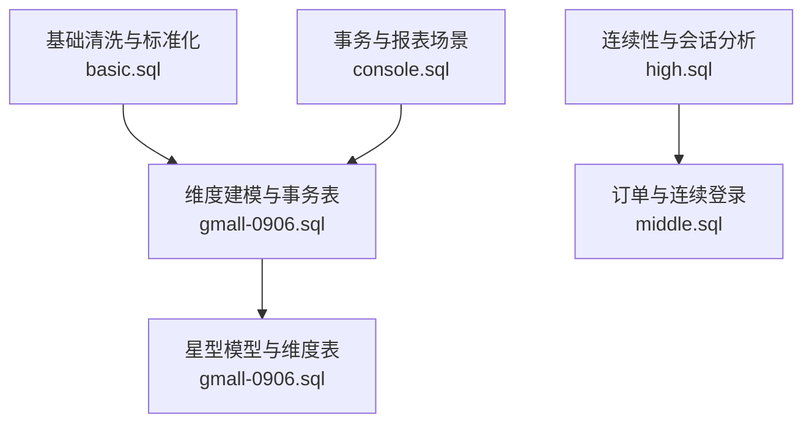
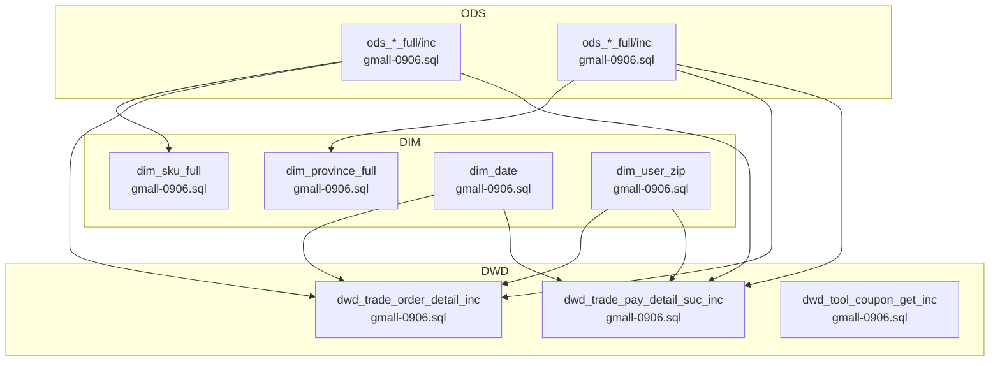
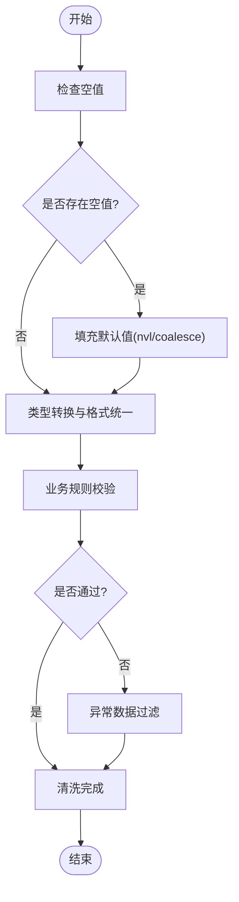
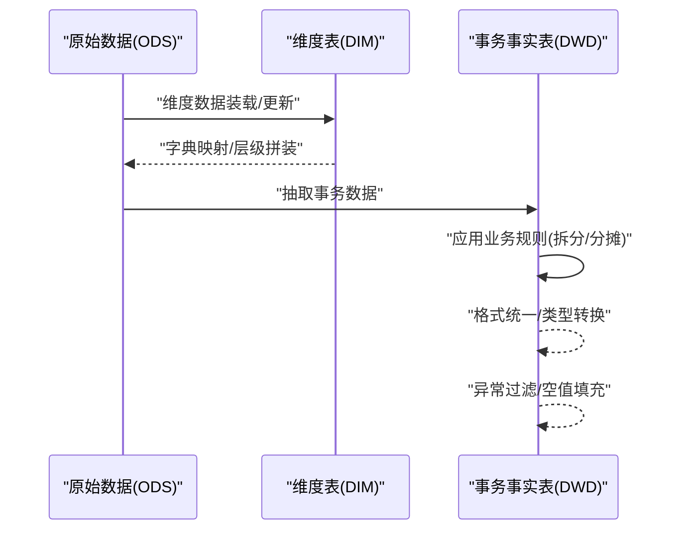
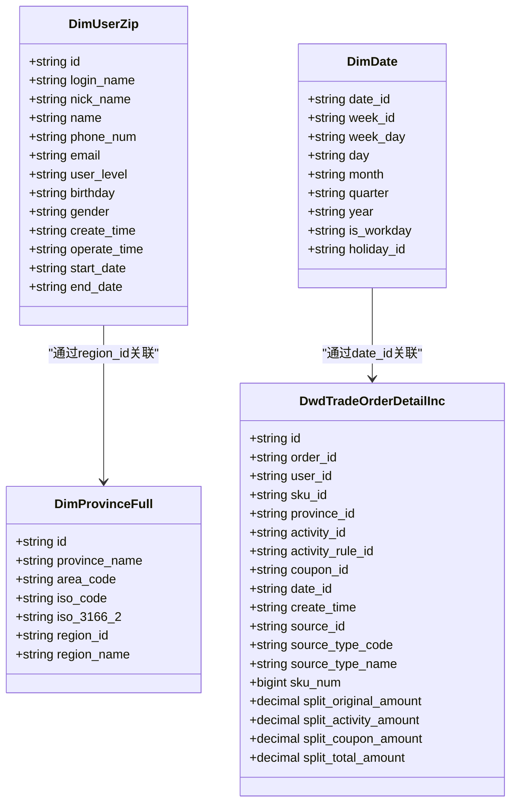
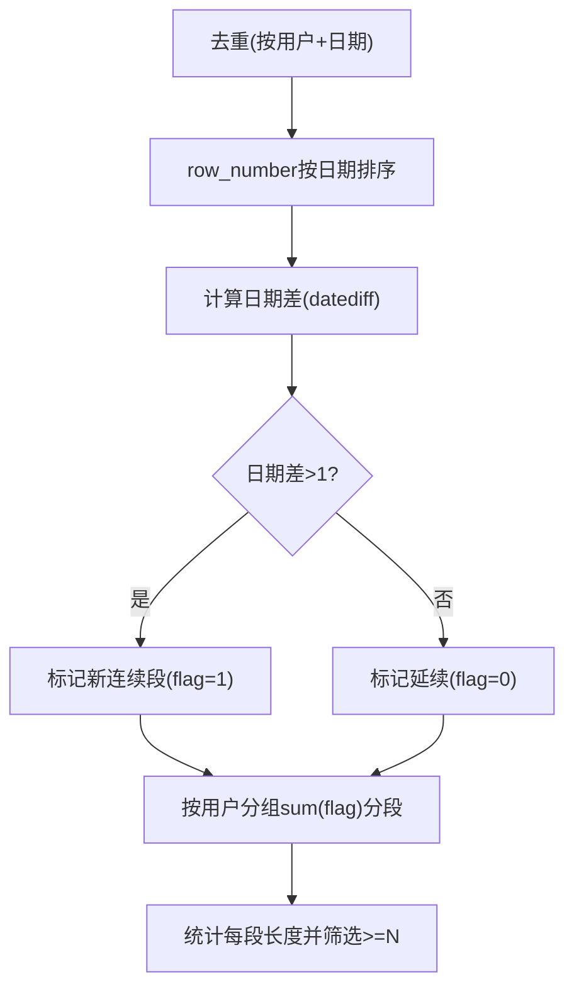
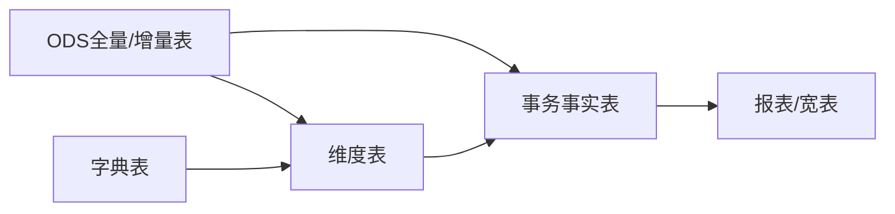

# 数据转换逻辑

<cite>
**本文引用的文件**
- [basic.sql](file://basic.sql)
- [console.sql](file://console.sql)
- [gmall-0906.sql](file://gmall-0906.sql)
- [high.sql](file://high.sql)
- [middle.sql](file://middle.sql)
</cite>

## 目录
1. [引言](#引言)
2. [项目结构](#项目结构)
3. [核心组件](#核心组件)
4. [架构总览](#架构总览)
5. [详细组件分析](#详细组件分析)
6. [依赖分析](#依赖分析)
7. [性能考量](#性能考量)
8. [故障排查指南](#故障排查指南)
9. [结论](#结论)
10. [附录](#附录)

## 引言
本文件围绕仓库中的HQL脚本，系统梳理数据转换逻辑，覆盖数据清洗策略（空值处理、类型转换、异常过滤）、数据标准化流程（字段映射、格式统一、业务规则）、维度建模转换（星型模型、缓慢变化维、维度关联）、ETL脚本示例与规则说明、性能优化技巧与质量控制方法，并提供常见数据质量问题的诊断与解决方案。

## 项目结构
仓库包含多个SQL脚本，分别演示不同主题的数据转换与建模实践：
- 基础数据清洗与标准化：basic.sql
- 事务与报表场景：console.sql
- 电商仓维表ETL：gmall-0906.sql
- 时间序列与连续性分析：high.sql、middle.sql

图表来源
- [basic.sql](file://basic.sql#L1-L120)
- [console.sql](file://console.sql#L1-L120)
- [gmall-0906.sql](file://gmall-0906.sql#L1-L120)
- [high.sql](file://high.sql#L1-L40)
- [middle.sql](file://middle.sql#L1-L40)

章节来源
- [basic.sql](file://basic.sql#L1-L200)
- [console.sql](file://console.sql#L1-L200)
- [gmall-0906.sql](file://gmall-0906.sql#L1-L200)
- [high.sql](file://high.sql#L1-L60)
- [middle.sql](file://middle.sql#L1-L60)

## 核心组件
- 清洗与标准化层
  - 空值处理：nvl/coalesce/ifnull等函数用于替换空值；对可空字段进行默认值填充。
  - 类型转换：字符串与日期格式转换、数值舍入与取整、JSON字段解析。
  - 异常过滤：基于业务规则的过滤（如课程不及格、日期格式校验）。
- 维度建模层
  - 星型模型：事实表与维度表分离，维度表采用规范命名与分区管理。
  - 缓慢变化维度（SCD）：通过开始/结束日期或全量装载实现版本化维度。
  - 维度关联：字典表映射、父子级维度拼装、时间维度表。
- 事务与报表层
  - 事务事实表：订单、支付、退款、购物车等事务事实表的抽取与清洗。
  - 报表与指标：开窗函数、聚合、行转列、连续性分析等。

章节来源
- [basic.sql](file://basic.sql#L680-L760)
- [gmall-0906.sql](file://gmall-0906.sql#L900-L1100)
- [console.sql](file://console.sql#L1100-L1400)

## 架构总览
整体ETL流程分为ODS（原始数据层）→ DIM（维度层）→ DWD（事务事实层），最终支撑DWS/DWT（汇总/宽表）与ADS（应用数据服务）。

图表来源
- [gmall-0906.sql](file://gmall-0906.sql#L460-L520)
- [gmall-0906.sql](file://gmall-0906.sql#L800-L900)
- [gmall-0906.sql](file://gmall-0906.sql#L908-L1100)
- [gmall-0906.sql](file://gmall-0906.sql#L1170-L1480)
- [gmall-0906.sql](file://gmall-0906.sql#L1680-L1920)

## 详细组件分析

### 数据清洗策略
- 空值处理
  - 使用nvl/coalesce/ifnull对可空字段设置默认值，避免统计与关联阶段的空值干扰。
  - 示例路径：[空值处理示例](file://basic.sql#L900-L920)
- 类型转换
  - 日期/时间：date_format、unix_timestamp/from_unixtime、to_date等统一格式。
  - 数值：round/bround、cast、取整与截断。
  - JSON：get_json_object、map_keys/map_values/array_contains等结构化解析。
  - 示例路径：[日期与数值转换示例](file://basic.sql#L700-L760)
- 异常过滤
  - 基于业务规则过滤（如不及格、日期格式错误、空值占比过高）。
  - 示例路径：[不及格过滤示例](file://console.sql#L1140-L1170)

图表来源
- [basic.sql](file://basic.sql#L680-L760)
- [console.sql](file://console.sql#L1140-L1170)

章节来源
- [basic.sql](file://basic.sql#L680-L920)
- [console.sql](file://console.sql#L1140-L1200)

### 数据标准化过程
- 字段映射与格式统一
  - 使用字典表映射编码为名称（如来源类型、支付类型），统一对外展示。
  - 示例路径：[字典映射示例](file://gmall-0906.sql#L1200-L1280)
- 业务规则应用
  - 订单金额拆分、优惠分摊、活动分摊等规则在事务事实表中体现。
  - 示例路径：[订单金额拆分示例](file://gmall-0906.sql#L1310-L1390)

图表来源
- [gmall-0906.sql](file://gmall-0906.sql#L1170-L1480)
- [gmall-0906.sql](file://gmall-0906.sql#L1680-L1920)

章节来源
- [gmall-0906.sql](file://gmall-0906.sql#L1170-L1480)
- [gmall-0906.sql](file://gmall-0906.sql#L1680-L1920)

### 维度建模转换
- 星型模型构建
  - 维度表：商品、地区、日期、用户等维度表，分区管理，ORC存储。
  - 事务事实表：订单明细、支付成功、退款成功等，与维度表通过key关联。
  - 示例路径：[维度表与事务表定义](file://gmall-0906.sql#L460-L520)
- 缓慢变化维度（SCD）
  - 用户维度采用开始/结束日期实现版本化，全量装载+去重+排序。
  - 示例路径：[用户维度SCD实现](file://gmall-0906.sql#L908-L1100)
- 维度表关联逻辑
  - 通过父子级维度拼装（如省→地区）、字典表映射、时间维度统一。
  - 示例路径：[省→地区维度拼装](file://gmall-0906.sql#L800-L880)

图表来源
- [gmall-0906.sql](file://gmall-0906.sql#L800-L900)
- [gmall-0906.sql](file://gmall-0906.sql#L908-L1100)
- [gmall-0906.sql](file://gmall-0906.sql#L1170-L1480)

章节来源
- [gmall-0906.sql](file://gmall-0906.sql#L800-L1100)
- [gmall-0906.sql](file://gmall-0906.sql#L1170-L1480)

### ETL转换脚本示例与规则说明
- 商品维度表构建（全量+左关联）
  - 规则：从多张ODS表抽取，使用collect_set/named_struct聚合属性，左关联拼装父子维度。
  - 示例路径：[商品维度构建](file://gmall-0906.sql#L460-L604)
- 用户维度SCD（全量+去重+排序）
  - 规则：按ts倒序rank去重，构造start_date/end_date，全量写入。
  - 示例路径：[用户维度SCD](file://gmall-0906.sql#L908-L1100)
- 事务事实表抽取（首日/每日）
  - 规则：根据type字段识别插入/更新/引导加载，按dt分区写入。
  - 示例路径：[订单明细抽取](file://gmall-0906.sql#L1310-L1399)

章节来源
- [gmall-0906.sql](file://gmall-0906.sql#L460-L604)
- [gmall-0906.sql](file://gmall-0906.sql#L908-L1100)
- [gmall-0906.sql](file://gmall-0906.sql#L1310-L1399)

### 连续性与会话分析（概念性流程）
- 连续登录/连续下单：通过row_number/datediff/flag标记，按用户分组统计连续天数。
- 会话划分：基于时间窗（如60秒）计算停留时长，使用lag/lead打标。
- 示例路径：[连续登录标记](file://high.sql#L146-L215)，[会话划分](file://high.sql#L86-L145)，[订单连续性](file://middle.sql#L1-L120)

图表来源
- [high.sql](file://high.sql#L146-L215)
- [middle.sql](file://middle.sql#L1-L120)

章节来源
- [high.sql](file://high.sql#L146-L215)
- [middle.sql](file://middle.sql#L1-L120)

## 依赖分析
- 组件耦合
  - 事务事实表依赖维度表（用户、商品、地区、日期），通过主外键关联。
  - 维度表依赖ODS全量/增量表，按dt分区装载。
- 外部依赖
  - 字典表（ods_base_dic_full）用于编码到名称映射。
  - JSON/分隔符文件格式（JsonSerDe/DELIMITED）影响ODS表结构与装载方式。

图表来源
- [gmall-0906.sql](file://gmall-0906.sql#L1-L120)
- [gmall-0906.sql](file://gmall-0906.sql#L460-L520)
- [gmall-0906.sql](file://gmall-0906.sql#L908-L1100)

章节来源
- [gmall-0906.sql](file://gmall-0906.sql#L1-L120)
- [gmall-0906.sql](file://gmall-0906.sql#L460-L520)
- [gmall-0906.sql](file://gmall-0906.sql#L908-L1100)

## 性能考量
- 存储与分区
  - 维度表采用ORC存储，提升压缩与查询性能；按dt分区便于增量装载与裁剪。
  - 示例路径：[ORC存储与分区](file://gmall-0906.sql#L460-L520)
- 动态分区与批量写入
  - 使用动态分区模式（hive.exec.dynamic.partition.mode=nonstrict）提高写入效率。
  - 示例路径：[动态分区设置](file://gmall-0906.sql#L956-L960)
- 开窗与聚合
  - 优先使用group by聚合，避免不必要的开窗；仅在需要明细列时使用开窗。
  - 示例路径：[聚合优先策略](file://console.sql#L1-L80)

章节来源
- [gmall-0906.sql](file://gmall-0906.sql#L460-L520)
- [gmall-0906.sql](file://gmall-0906.sql#L956-L960)
- [console.sql](file://console.sql#L1-L80)

## 故障排查指南
- 常见问题与定位
  - 日期格式错误：统一使用date_format/to_date，确保输入格式一致。
    - 示例路径：[日期格式转换](file://basic.sql#L700-L760)
  - 空值导致统计偏差：使用nvl/coalesce填充默认值，避免count(*)误判。
    - 示例路径：[空值填充](file://basic.sql#L900-L920)
  - 连续性分析异常：确认去重与row_number顺序，避免重复计算。
    - 示例路径：[连续登录标记](file://high.sql#L146-L215)
  - 维度版本冲突：检查SCD的start_date/end_date与全量装载逻辑。
    - 示例路径：[用户维度SCD](file://gmall-0906.sql#L908-L1100)
- 质量控制方法
  - 分区裁剪：按dt过滤，缩小扫描范围。
  - 执行计划：使用explain分析物理执行计划，定位热点。
  - 基线监控：对关键指标（去重前后行数、分区大小）建立基线。

章节来源
- [basic.sql](file://basic.sql#L700-L760)
- [basic.sql](file://basic.sql#L900-L920)
- [high.sql](file://high.sql#L146-L215)
- [gmall-0906.sql](file://gmall-0906.sql#L908-L1100)

## 结论
本仓库展示了从ODS到DIM再到DWD的完整数据转换路径，涵盖清洗、标准化、维度建模与事务抽取等关键环节。通过字典映射、SCD版本化、分区存储与批量写入等手段，既保证了数据质量，也兼顾了性能与可维护性。建议在实际落地中结合业务规则持续完善清洗策略与质量监控体系。

## 附录
- 术语说明
  - ODS：操作数据存储，存放原始数据。
  - DIM：维度表，提供维度信息与层级关系。
  - DWD：事务事实表，承载业务事件的原子粒度数据。
  - SCD：缓慢变化维度，用于记录维度的历史变更。
- 参考路径
  - [基础清洗与标准化](file://basic.sql#L680-L920)
  - [电商仓维ETL](file://gmall-0906.sql#L460-L1100)
  - [事务与报表场景](file://console.sql#L1100-L1400)
  - [连续性与会话分析](file://high.sql#L146-L215)
  - [订单与连续登录](file://middle.sql#L1-L120)