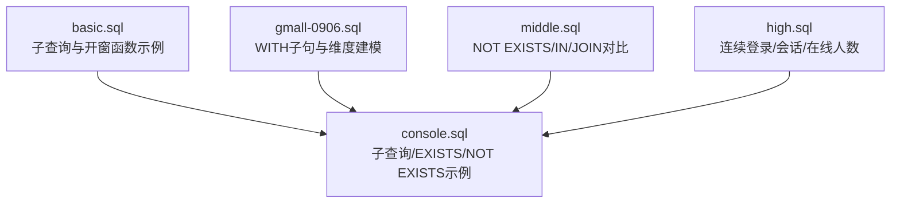
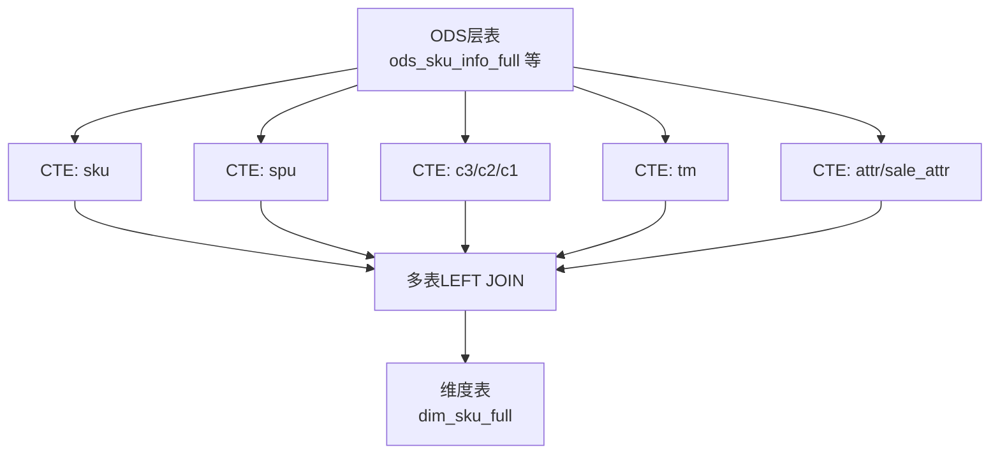
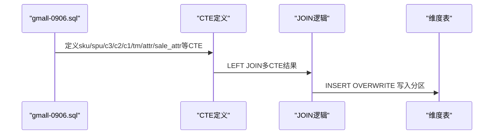
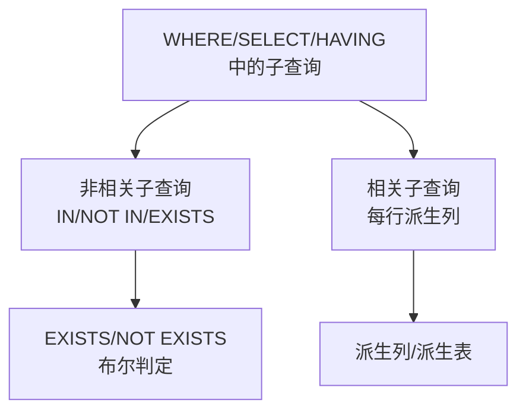
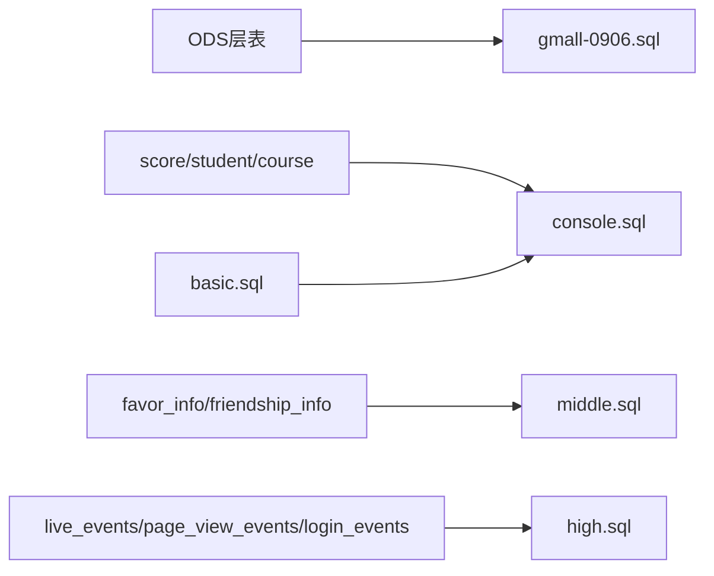

# CTE与子查询

<cite>
**本文引用的文件**
- [basic.sql](file://basic.sql)
- [console.sql](file://console.sql)
- [gmall-0906.sql](file://gmall-0906.sql)
- [middle.sql](file://middle.sql)
- [high.sql](file://high.sql)
</cite>

## 目录
1. [引言](#引言)
2. [项目结构](#项目结构)
3. [核心组件](#核心组件)
4. [架构总览](#架构总览)
5. [详细组件分析](#详细组件分析)
6. [依赖分析](#依赖分析)
7. [性能考量](#性能考量)
8. [故障排查指南](#故障排查指南)
9. [结论](#结论)
10. [附录](#附录)

## 引言
本指南围绕CTE（公用表表达式，WITH子句）与子查询展开，系统梳理WITH子句的使用方法与优势，详解相关/非相关子查询、EXISTS/NOT EXISTS子查询，并结合仓库中的真实SQL示例，给出复杂查询的拆解与重构思路、执行顺序与性能影响、嵌套查询最佳实践与常见陷阱、查询优化与调试方法，以及数据仓库场景下的典型应用。

## 项目结构
本仓库包含多个SQL脚本，覆盖基础查询、子查询与CTE、数据仓库维度建模与ETL、连续登录/会话/在线人数等分析场景。重点文件：
- basic.sql：包含大量开窗函数与子查询片段，体现子查询在筛选、聚合、派生列中的广泛使用。
- console.sql：涵盖大量子查询与EXISTS/NOT EXISTS示例，以及JOIN替代子查询的性能讨论。
- gmall-0906.sql：完整演示WITH子句在数据仓库维度建模中的应用，多CTE组合与窗口函数配合。
- middle.sql：包含NOT EXISTS、IN、LEFT JOIN等多类子查询与优化策略。
- high.sql：连续登录、会话划分、在线人数峰值等分析场景，涉及窗口与子查询的组合。

图示来源
- [basic.sql](file://basic.sql#L1500-L1520)
- [console.sql](file://console.sql#L1350-L1700)
- [gmall-0906.sql](file://gmall-0906.sql#L498-L604)
- [middle.sql](file://middle.sql#L1120-L1319)
- [high.sql](file://high.sql#L1-L120)

章节来源
- [basic.sql](file://basic.sql#L1500-L1520)
- [console.sql](file://console.sql#L1350-L1700)
- [gmall-0906.sql](file://gmall-0906.sql#L498-L604)
- [middle.sql](file://middle.sql#L1120-L1319)
- [high.sql](file://high.sql#L1-L120)

## 核心组件
- WITH子句（CTE）
  - 在数据仓库ETL中用于模块化构建维度表，提升可读性与复用性；示例见gmall-0906.sql的多CTE组合与最终INSERT OVERWRITE。
- 子查询
  - 相关/非相关子查询：在WHERE/HAVING/SELECT子句中作为过滤条件或派生列来源。
  - EXISTS/NOT EXISTS：用于判断是否存在满足条件的记录，常用于去重与排除。
  - IN/NOT IN：与子查询结合进行集合筛选。
- 开窗函数与子查询组合
  - 子查询派生列与窗口函数结合，实现滚动聚合、排名、连续性标记等分析。

章节来源
- [gmall-0906.sql](file://gmall-0906.sql#L498-L604)
- [console.sql](file://console.sql#L1350-L1700)
- [middle.sql](file://middle.sql#L1120-L1319)
- [basic.sql](file://basic.sql#L1500-L1520)

## 架构总览
下图展示WITH子句在数据仓库维度建模中的典型流程：抽取ODS层事实与维度表，通过多个CTE分别清洗与聚合，最终通过LEFT JOIN与INSERT OVERWRITE写入维度表。

图示来源
- [gmall-0906.sql](file://gmall-0906.sql#L498-L604)

章节来源
- [gmall-0906.sql](file://gmall-0906.sql#L498-L604)

## 详细组件分析

### WITH子句（CTE）与数据仓库建模
- 多CTE组合：将维度表的抽取、清洗、聚合拆分为独立CTE，便于维护与复用。
- 与窗口函数结合：在CTE内部使用窗口函数进行滚动聚合或集合收集，再在最终SELECT中拼接。
- 写入维度表：通过INSERT OVERWRITE将最终结果落库，分区写入。

图示来源
- [gmall-0906.sql](file://gmall-0906.sql#L498-L604)

章节来源
- [gmall-0906.sql](file://gmall-0906.sql#L498-L604)

### 子查询类型与实践
- 非相关子查询
  - 示例：在WHERE中使用IN/NOT IN与子查询进行集合筛选，如筛选特定课程不及格学生。
  - 片段路径：[console.sql](file://console.sql#L1423-L1448)
- 相关子查询（相关子查询）
  - 示例：在SELECT中使用子查询为每行派生列，如按学号关联课程成绩并填充缺失值。
  - 片段路径：[console.sql](file://console.sql#L6457-L6649)
- EXISTS/NOT EXISTS
  - 示例：判断好友收藏是否与自身收藏冲突，使用NOT EXISTS排除重复。
  - 片段路径：[middle.sql](file://middle.sql#L1128-L1204)

图示来源
- [console.sql](file://console.sql#L1423-L1448)
- [console.sql](file://console.sql#L6457-L6649)
- [middle.sql](file://middle.sql#L1128-L1204)

章节来源
- [console.sql](file://console.sql#L1423-L1448)
- [console.sql](file://console.sql#L6457-L6649)
- [middle.sql](file://middle.sql#L1128-L1204)

### 子查询执行顺序与性能影响
- 执行顺序参考：FROM → WHERE → GROUP BY → 聚合函数 → HAVING → SELECT → ORDER BY → LIMIT
- 子查询在WHERE/HAVING/SELECT中的位置会影响执行计划与性能：
  - JOIN通常优于子查询（尤其IN），但某些场景子查询更直观。
  - EXISTS/NOT EXISTS适合布尔判定，避免不必要的大结果集。
- 片段路径：[console.sql](file://console.sql#L563-L564)

章节来源
- [console.sql](file://console.sql#L563-L564)

### 嵌套查询最佳实践与常见陷阱
- 嵌套必须起别名，避免歧义与执行错误。
- 子查询中尽量减少列与行数，先WHERE后GROUP BY，必要时使用EXISTS替代IN。
- 使用EXISTS时，SELECT子句可使用常量/星号，不影响逻辑。
- 片段路径：
  - [basic.sql](file://basic.sql#L1504-L1520)
  - [console.sql](file://console.sql#L1352-L1356)
  - [console.sql](file://console.sql#L1687-L1700)

章节来源
- [basic.sql](file://basic.sql#L1504-L1520)
- [console.sql](file://console.sql#L1352-L1356)
- [console.sql](file://console.sql#L1687-L1700)

### 复杂查询的拆解与重构技巧
- 将大查询拆分为多个CTE，明确每一步的数据来源与加工逻辑。
- 使用窗口函数与子查询组合实现滚动聚合、排名、连续性标记等。
- 示例：
  - WITH子句+窗口函数：[gmall-0906.sql](file://gmall-0906.sql#L498-L604)
  - 相关子查询派生列：[console.sql](file://console.sql#L6457-L6649)
  - 连续登录/会话/在线人数：[high.sql](file://high.sql#L1-L120)

章节来源
- [gmall-0906.sql](file://gmall-0906.sql#L498-L604)
- [console.sql](file://console.sql#L6457-L6649)
- [high.sql](file://high.sql#L1-L120)

### 数据仓库场景中的典型应用
- 维度建模：通过多CTE抽取与清洗，最终LEFT JOIN写入维度表。
- 时间序列聚合：使用窗口函数在CTE内按日期滚动聚合，再统一汇总。
- 行转列/列转行：通过子查询与IF/聚合函数实现行列转换。
- 片段路径：
  - [gmall-0906.sql](file://gmall-0906.sql#L498-L604)
  - [console.sql](file://console.sql#L1352-L1386)

章节来源
- [gmall-0906.sql](file://gmall-0906.sql#L498-L604)
- [console.sql](file://console.sql#L1352-L1386)

## 依赖分析
- 文件间依赖关系
  - gmall-0906.sql依赖ODS层表与字典表，最终写入维度表。
  - console.sql与basic.sql中的子查询依赖score/student/course等业务表。
  - middle.sql中的NOT EXISTS依赖favor_info/friendship_info等表。
  - high.sql中的连续登录/会话/在线人数依赖live_events/page_view_events/login_events等事件表。

图示来源
- [gmall-0906.sql](file://gmall-0906.sql#L498-L604)
- [console.sql](file://console.sql#L1350-L1700)
- [basic.sql](file://basic.sql#L1500-L1520)
- [middle.sql](file://middle.sql#L1120-L1319)
- [high.sql](file://high.sql#L1-L120)

章节来源
- [gmall-0906.sql](file://gmall-0906.sql#L498-L604)
- [console.sql](file://console.sql#L1350-L1700)
- [basic.sql](file://basic.sql#L1500-L1520)
- [middle.sql](file://middle.sql#L1120-L1319)
- [high.sql](file://high.sql#L1-L120)

## 性能考量
- JOIN vs 子查询
  - 优先使用JOIN替代IN型子查询，避免重复扫描与大结果集。
  - 片段路径：[console.sql](file://console.sql#L28-L75)
- EXISTS/NOT EXISTS
  - 适合布尔判定，避免不必要的列与行，减少I/O。
  - 片段路径：[console.sql](file://console.sql#L1352-L1356)
- 子查询与窗口函数
  - 子查询派生列与窗口函数结合时，注意先派生再聚合，避免重复计算。
  - 片段路径：[console.sql](file://console.sql#L6457-L6649)
- 执行顺序
  - 明确WHERE/HAVING/SELECT的执行顺序，有助于设计子查询位置与过滤条件。
  - 片段路径：[console.sql](file://console.sql#L563-L564)

章节来源
- [console.sql](file://console.sql#L28-L75)
- [console.sql](file://console.sql#L1352-L1356)
- [console.sql](file://console.sql#L6457-L6649)
- [console.sql](file://console.sql#L563-L564)

## 故障排查指南
- 子查询别名缺失
  - 现象：编译错误或逻辑异常。
  - 处理：为子查询起别名，确保外层可引用。
  - 片段路径：[console.sql](file://console.sql#L1630-L1637)
- 子查询位置不当
  - 现象：执行慢或结果异常。
  - 处理：调整子查询至WHERE/HAVING/SELECT合适位置，必要时改用JOIN或EXISTS。
  - 片段路径：[console.sql](file://console.sql#L1687-L1700)
- 嵌套层次过深
  - 现象：可读性差、维护困难。
  - 处理：拆分为多个CTE，明确每一步职责。
  - 片段路径：[gmall-0906.sql](file://gmall-0906.sql#L498-L604)
- NOT EXISTS误用
  - 现象：结果集为空或数据量异常。
  - 处理：确认关联键与过滤条件，确保NOT EXISTS的判定逻辑正确。
  - 片段路径：[middle.sql](file://middle.sql#L1128-L1204)

章节来源
- [console.sql](file://console.sql#L1630-L1637)
- [console.sql](file://console.sql#L1687-L1700)
- [gmall-0906.sql](file://gmall-0906.sql#L498-L604)
- [middle.sql](file://middle.sql#L1128-L1204)

## 结论
- WITH子句（CTE）在数据仓库建模中具有显著优势：提升可读性、便于复用与维护、支持复杂多阶段聚合。
- 子查询在筛选、派生列、布尔判定等方面广泛应用，需根据场景选择相关/非相关、IN/EXISTS等策略。
- 性能方面，优先使用JOIN替代IN型子查询，合理利用EXISTS/NOT EXISTS，注意子查询与窗口函数的组合使用。
- 在数据仓库场景中，CTE与窗口函数的组合是实现滚动聚合、维度建模与复杂分析的重要手段。

## 附录
- 关键片段路径索引
  - WITH子句与维度建模：[gmall-0906.sql](file://gmall-0906.sql#L498-L604)
  - 子查询与EXISTS/NOT EXISTS：[console.sql](file://console.sql#L1350-L1700), [middle.sql](file://middle.sql#L1120-L1319)
  - 相关子查询派生列：[console.sql](file://console.sql#L6457-L6649)
  - 连续登录/会话/在线人数：[high.sql](file://high.sql#L1-L120)