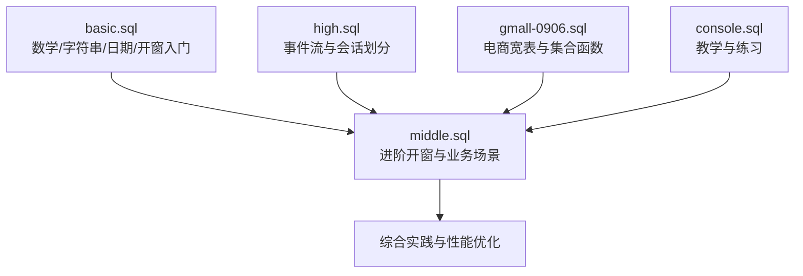
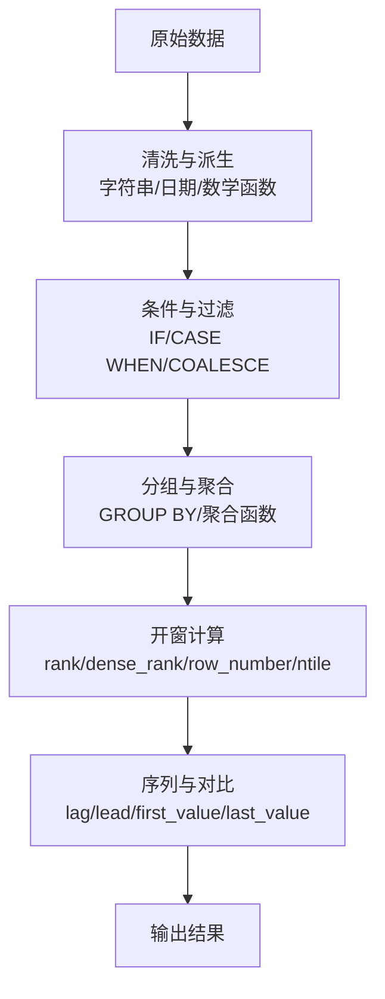
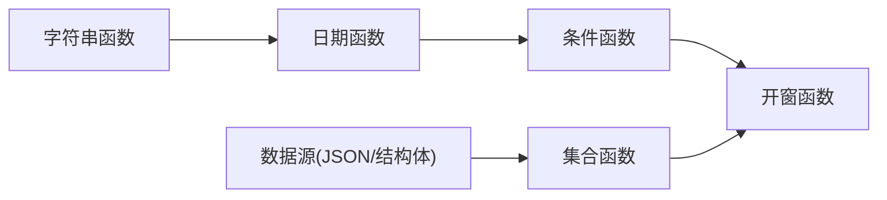

# Hive高级函数

<cite>
**本文引用的文件**
- [basic.sql](file://basic.sql)
- [middle.sql](file://middle.sql)
- [high.sql](file://high.sql)
- [gmall-0906.sql](file://gmall-0906.sql)
- [console.sql](file://console.sql)
</cite>

## 目录
1. [简介](#简介)
2. [项目结构](#项目结构)
3. [核心组件](#核心组件)
4. [架构总览](#架构总览)
5. [详细组件分析](#详细组件分析)
6. [依赖分析](#依赖分析)
7. [性能考量](#性能考量)
8. [故障排查指南](#故障排查指南)
9. [结论](#结论)
10. [附录](#附录)

## 简介
本参考文档系统梳理Hive SQL中的高级函数与常用实践，覆盖数学函数、字符串函数、日期函数、条件函数、集合函数（collect_set、collect_list）、开窗函数（rank、dense_rank、row_number、ntile、first_value、last_value、lag、lead）等。文档基于仓库中的真实SQL示例，逐类归纳函数的参数、返回值、典型用法与组合技巧，并提供性能优化建议与常见错误定位方法，帮助不同层次的用户快速掌握Hive函数在数据处理中的应用。

## 项目结构
仓库包含多个SQL脚本，分别展示了不同层级的函数使用与实战案例：
- basic.sql：基础数学、字符串、日期函数与开窗函数入门示例
- middle.sql：进阶开窗与业务场景（连续登录、排名、累计金额等）
- high.sql：复杂事件流与会话划分（在线人数峰值、会话标签、连续登录）
- gmall-0906.sql：电商主题宽表构建与集合函数（collect_set、collect_list、named_struct）
- console.sql：教学与练习场景（IF、字符串截取、日期差、行列转换）

图表来源
- [basic.sql](file://basic.sql#L1-L120)
- [middle.sql](file://middle.sql#L1-L120)
- [high.sql](file://high.sql#L1-L60)
- [gmall-0906.sql](file://gmall-0906.sql#L1-L120)
- [console.sql](file://console.sql#L1-L120)

章节来源
- [basic.sql](file://basic.sql#L1-L200)
- [middle.sql](file://middle.sql#L1-L200)
- [high.sql](file://high.sql#L1-L120)
- [gmall-0906.sql](file://gmall-0906.sql#L1-L200)
- [console.sql](file://console.sql#L1-L200)

## 核心组件
- 数学函数：幂、根、对数、常数、取整（round、bround）、绝对值、取模等
- 字符串函数：大小写、截取、拼接、去空白、JSON提取等
- 日期函数：当前时间、时间戳转换、日期运算、格式化、间隔计算等
- 条件函数：IF、CASE WHEN、COALESCE、ISNULL/NVL等
- 集合函数：collect_set、collect_list、named_struct等
- 开窗函数：rank、dense_rank、row_number、ntile、first_value、last_value、lag、lead、累计聚合等

章节来源
- [basic.sql](file://basic.sql#L1-L120)
- [console.sql](file://console.sql#L360-L420)
- [gmall-0906.sql](file://gmall-0906.sql#L550-L610)

## 架构总览
下图展示Hive函数在数据处理中的典型流程：输入数据经由字符串/日期/数学函数清洗与派生，再通过条件函数与集合函数进行分组与聚合，最终利用开窗函数实现排名、累计、前后项对比与会话划分。

图表来源
- [basic.sql](file://basic.sql#L370-L420)
- [middle.sql](file://middle.sql#L1480-L1540)
- [high.sql](file://high.sql#L86-L144)

## 详细组件分析

### 数学函数
- 幂与根：pow、sqrt
- 对数与自然常数：log、log10、log2、ln、exp、pi
- 取整与银行家舍入：round、bround
- 绝对值与取模：abs、pmod
- 示例路径
  - [幂与根](file://basic.sql#L15-L20)
  - [对数与常数](file://basic.sql#L7-L15)
  - [取整与绝对值](file://basic.sql#L36-L48)
  - [取模](file://basic.sql#L60-L62)

章节来源
- [basic.sql](file://basic.sql#L7-L62)

### 字符串函数
- 大小写与截取：upper、substr、substring
- 去空白与拼接：trim、concat、concat_ws
- JSON提取：get_json_object（示例中用于数组访问）
- 示例路径
  - [大小写与截取](file://basic.sql#L673-L678)
  - [去空白与拼接](file://basic.sql#L678-L687)
  - [JSON提取](file://basic.sql#L687-L693)

章节来源
- [basic.sql](file://basic.sql#L673-L693)

### 日期函数
- 时间戳与日期转换：unix_timestamp、from_unixtime、to_unix_timestamp、from_utc_timestamp
- 日期运算：date_add、add_months、date、current_date、current_timestamp
- 间隔计算：datediff、months_between、last_day、date_format
- 示例路径
  - [时间戳与日期转换](file://basic.sql#L67-L74)
  - [日期运算与格式化](file://basic.sql#L64-L74)
  - [间隔计算](file://basic.sql#L789-L800)
  - [日期函数综合示例](file://console.sql#L110-L156)

章节来源
- [basic.sql](file://basic.sql#L64-L80)
- [console.sql](file://console.sql#L110-L156)

### 条件函数
- IF与CASE WHEN：用于分支逻辑与派生列
- COALESCE与NVL：用于空值处理与默认值填充
- 示例路径
  - [IF分支与年龄计算](file://basic.sql#L772-L805)
  - [COALESCE与NVL](file://basic.sql#L682-L686)
  - [CASE WHEN与累计金额分级](file://middle.sql#L310-L324)

章节来源
- [basic.sql](file://basic.sql#L772-L805)
- [middle.sql](file://middle.sql#L310-L324)

### 集合函数
- collect_set：无序去重集合
- collect_list：有序列表（保持重复）
- named_struct：构造结构体，配合collect_set生成复杂集合
- 示例路径
  - [collect_set/collect_list基础](file://basic.sql#L212-L222)
  - [named_struct与collect_set](file://gmall-0906.sql#L560-L574)

章节来源
- [basic.sql](file://basic.sql#L212-L222)
- [gmall-0906.sql](file://gmall-0906.sql#L560-L574)

### 开窗函数
- 排名类：rank、dense_rank、row_number、ntile
- 边界与聚合：first_value、last_value、sum/count/avg over
- 前后项：lag、lead
- 示例路径
  - [row_number与累计](file://basic.sql#L223-L231)
  - [rank/dense_rank/row_number](file://basic.sql#L377-L390)
  - [ntile分组](file://basic.sql#L422-L449)
  - [first_value/last_value](file://basic.sql#L393-L421)
  - [lag/lead前后项对比](file://basic.sql#L343-L367)

章节来源
- [basic.sql](file://basic.sql#L223-L421)

### 业务场景与函数组合
- 连续登录：通过row_number或lag计算日期差，结合group by与having筛选连续区间
- 会话划分：基于时间间隔打标签，使用sum/if进行会话编号
- 在线人数峰值：事件入/出标记与累计求和，取最大值
- 示例路径
  - [连续登录（row_number）](file://middle.sql#L1480-L1540)
  - [连续登录（lag）](file://middle.sql#L1540-L1599)
  - [会话划分与标签](file://high.sql#L86-L144)
  - [在线人数峰值](file://high.sql#L8-L20)

章节来源
- [middle.sql](file://middle.sql#L1480-L1599)
- [high.sql](file://high.sql#L8-L20)

## 依赖分析
- 函数耦合关系
  - 日期函数与字符串函数常联合使用（如date_format、split）
  - 条件函数与开窗函数组合用于派生列与筛选
  - 集合函数与复杂结构（struct/array）配合，用于宽表构建
- 外部依赖
  - JSON/结构体数据源（gmall示例中使用JsonSerDe）
  - 分区表与动态分区（gmall示例中大量使用dt分区）

图表来源
- [gmall-0906.sql](file://gmall-0906.sql#L1-L120)

章节来源
- [gmall-0906.sql](file://gmall-0906.sql#L1-L120)

## 性能考量
- 优先使用聚合函数而非开窗：当仅需聚合结果时，group by + 聚合通常更高效
  - 参考：[聚合vs开窗](file://middle.sql#L38-L69)
- 避免在select中对列进行复杂计算后再相加：I/O与计算成本较高
  - 参考：[列相加效率提示](file://basic.sql#L344-L354)
- 使用EXPLAIN分析执行计划，对比不同写法的代价
  - 参考：[EXPLAIN示例](file://basic.sql#L237-L251)
- 合理使用分区字段：在where中使用分区字段可显著减少扫描
  - 参考：[分区过滤](file://gmall-0906.sql#L1-L60)
- 减少不必要的子查询与嵌套：能不嵌套就不嵌套，提升可读性与性能
  - 参考：[嵌套与别名](file://basic.sql#L496-L520)

章节来源
- [basic.sql](file://basic.sql#L237-L251)
- [basic.sql](file://basic.sql#L344-L354)
- [middle.sql](file://middle.sql#L38-L69)
- [gmall-0906.sql](file://gmall-0906.sql#L1-L60)

## 故障排查指南
- 日期函数返回null或无结果：检查输入格式是否正确
  - 参考：[日期格式注意事项](file://basic.sql#L80-L84)
- 开窗函数报空指针或异常：确认窗口子句与排序字段一致，避免在窗口子句中重复使用同一行导致动态边界
  - 参考：[窗口子句限制说明](file://basic.sql#L373-L376)
- 条件函数误判：注意IF/CASE WHEN的返回类型一致性；空值处理优先使用COALESCE/NVL
  - 参考：[空值处理](file://basic.sql#L682-L686)
- 集合函数结果异常：collect_set天然去重，collect_list保持重复；如需结构体，使用named_struct并配合collect_set
  - 参考：[集合函数差异](file://basic.sql#L212-L222)

章节来源
- [basic.sql](file://basic.sql#L80-L84)
- [basic.sql](file://basic.sql#L373-L376)
- [basic.sql](file://basic.sql#L682-L686)
- [basic.sql](file://basic.sql#L212-L222)

## 结论
本仓库提供了从基础到进阶的Hive函数实践范式，涵盖数学、字符串、日期、条件、集合与开窗函数的典型用法与组合技巧。通过EXPLAIN分析、合理使用聚合与分区、避免复杂列运算等手段，可在保证正确性的前提下显著提升查询性能。建议在实际项目中结合业务场景，优先采用聚合函数与简洁的开窗表达式，并充分利用分区与结构体能力构建高效宽表。

## 附录
- 常用函数速查
  - 数学：pow、sqrt、log、log10、log2、exp、pi、round、bround、abs、pmod
  - 字符串：upper、lower、substr、substring、trim、concat、concat_ws、get_json_object
  - 日期：unix_timestamp、from_unixtime、to_unix_timestamp、from_utc_timestamp、date、current_date、current_timestamp、date_add、add_months、datediff、months_between、last_day、date_format
  - 条件：if、case when、coalesce、nvl
  - 集合：collect_set、collect_list、named_struct
  - 开窗：rank、dense_rank、row_number、ntile、first_value、last_value、lag、lead、sum/count/avg over