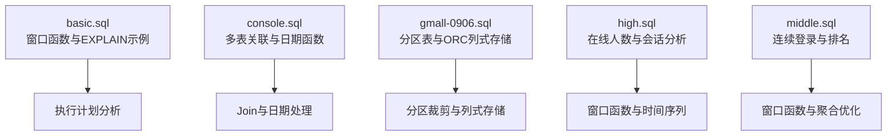
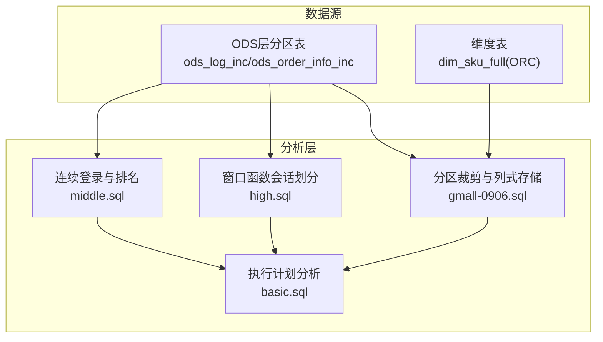
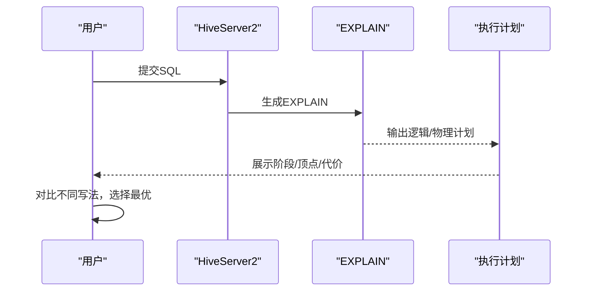
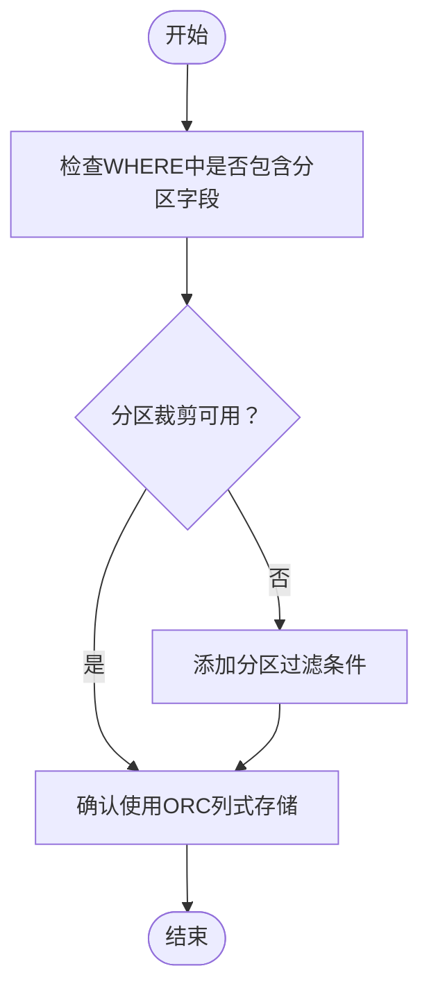
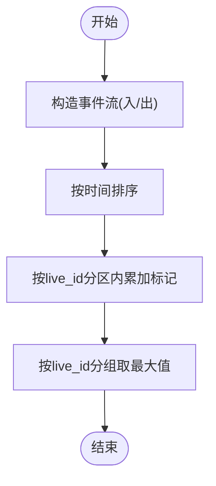
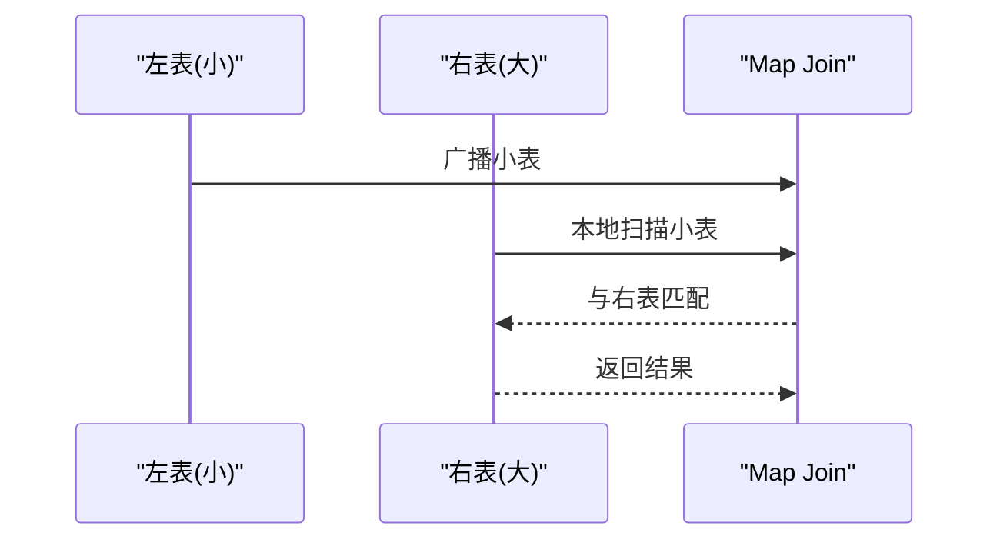
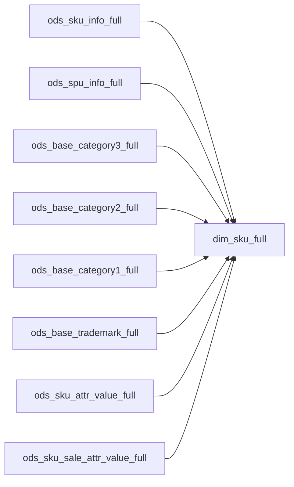

# SQL性能优化

<cite>
**本文引用的文件**
- [basic.sql](file://basic.sql)
- [console.sql](file://console.sql)
- [gmall-0906.sql](file://gmall-0906.sql)
- [high.sql](file://high.sql)
- [middle.sql](file://middle.sql)
</cite>

## 目录
1. [简介](#简介)
2. [项目结构](#项目结构)
3. [核心组件](#核心组件)
4. [架构总览](#架构总览)
5. [详细组件分析](#详细组件分析)
6. [依赖分析](#依赖分析)
7. [性能考量](#性能考量)
8. [故障排查指南](#故障排查指南)
9. [结论](#结论)
10. [附录](#附录)

## 简介
本文件面向Hive SQL性能优化，结合仓库中的示例脚本，系统梳理查询性能分析方法、执行计划解读与优化策略、分区表查询优化、数据倾斜识别与治理、Join优化（广播Join与Map Join）、索引与数据分布策略、内存与资源调优、以及大数据量场景下的监控与实践。内容以实际文件为依据，避免臆测，帮助读者建立可落地的优化方法论。

## 项目结构
仓库包含多个SQL脚本，覆盖基础函数、窗口函数、分区表与列式存储、连续登录与会话分析、电商订单与维度建模等主题。这些脚本既是学习材料，也是性能优化的实践案例来源。

**章节来源**
- file://basic.sql#L237-L246
- file://gmall-0906.sql#L38-L41
- file://gmall-0906.sql#L491-L494

## 核心组件
- 执行计划分析：通过EXPLAIN formatted/extended查看逻辑与物理执行计划，定位Shuffle、Join、聚合等热点阶段。
- 分区表与列式存储：使用分区字段过滤与ORC列式存储提升扫描效率。
- 窗口函数与时间序列：基于窗口函数实现会话划分、连续登录、累计指标等。
- 多表Join与日期处理：通过合理的Join顺序与日期函数使用，减少不必要的数据膨胀。
- 聚合与排名：使用dense_rank/row_number等窗口函数替代复杂子查询，提高可读性与性能。

**章节来源**
- file://basic.sql#L237-L246
- file://gmall-0906.sql#L38-L41
- file://gmall-0906.sql#L491-L494
- file://high.sql#L1-L84
- file://middle.sql#L1-L120

## 架构总览
下图展示仓库中与性能优化相关的核心流程：从分区表加载数据，到基于窗口函数的时间序列分析，再到Join与聚合优化。

**图表来源**
- [gmall-0906.sql](file://gmall-0906.sql#L38-L41)
- [gmall-0906.sql](file://gmall-0906.sql#L491-L494)
- [high.sql](file://high.sql#L1-L84)
- [middle.sql](file://middle.sql#L1-L120)
- [basic.sql](file://basic.sql#L237-L246)

## 详细组件分析

### 组件A：执行计划分析（EXPLAIN）
- 使用位置：basic.sql中多次使用EXPLAIN formatted与EXPLAIN extended，用于对比不同SQL的执行路径。
- 分析要点：
  - 观察顶点（vertices）与阶段（stage），识别Shuffle、Join、聚合等热点。
  - 对比“先过滤再聚合”与“先聚合再过滤”的代价差异。
  - 关注谓词下推、分区裁剪是否生效。
- 优化建议：
  - 将过滤条件尽量前置，减少输入数据量。
  - 使用EXPLAIN对比不同写法，选择代价更低的方案。

**图表来源**
- [basic.sql](file://basic.sql#L237-L246)
- [basic.sql](file://basic.sql#L505-L520)

**章节来源**
- file://basic.sql#L237-L246
- file://basic.sql#L505-L520

### 组件B：分区表查询优化（分区裁剪与列式存储）
- 分区表：gmall-0906.sql中大量表采用PARTITIONED BY dt分区字段，便于按天裁剪。
- 列式存储：dim_sku_full等表使用STORED AS ORC，并配置压缩属性，提升扫描与过滤效率。
- 优化策略：
  - 在WHERE中使用分区字段过滤，确保分区裁剪生效。
  - 优先使用列式存储表，减少I/O与解析成本。
  - 控制分区粒度，避免分区过多导致元数据压力。

**图表来源**
- [gmall-0906.sql](file://gmall-0906.sql#L38-L41)
- [gmall-0906.sql](file://gmall-0906.sql#L491-L494)

**章节来源**
- file://gmall-0906.sql#L38-L41
- file://gmall-0906.sql#L491-L494

### 组件C：窗口函数与时间序列分析
- 在high.sql中，通过union all构造事件流，使用SUM OVER(partition by live_id order by datetime)计算实时在线人数峰值。
- 在middle.sql中，使用row_number/dense_rank/lead/lag实现连续登录、会话划分、累计消费等分析。
- 优化建议：
  - 合理使用窗口函数替代复杂子查询，减少中间结果集。
  - 对时间序列分析，先去重再开窗，避免重复计算。

**图表来源**
- [high.sql](file://high.sql#L1-L84)

**章节来源**
- file://high.sql#L1-L84
- file://middle.sql#L1-L120

### 组件D：Join优化（广播Join与Map Join）
- 在console.sql中展示了多表Join的写法与注意事项，强调“先筛选再关联”的效率原则。
- 优化建议：
  - 将小表广播（broadcast）到各个节点，避免大表Shuffle。
  - 使用Map Join在满足条件时跳过Shuffle，降低网络与磁盘IO。
  - 明确Join顺序与ON条件，避免笛卡尔积与重复行。

**图表来源**
- [console.sql](file://console.sql#L21-L53)

**章节来源**
- file://console.sql#L21-L53

### 组件E：数据倾斜识别与治理
- 识别特征：某些分区或Key的数据量异常大，导致单个Reducer或单个Mapper长时间占用资源。
- 治理策略：
  - 引入随机前缀或采样，分散倾斜Key。
  - 使用二次聚合或Map端预聚合，降低倾斜影响。
  - 对倾斜Key单独处理或拆分任务。

[本节为通用实践总结，不直接分析具体文件]

### 组件F：索引与数据分布优化
- Hive原生不支持B-Tree索引，可通过物化视图或预聚合表实现近似索引效果。
- 数据分布优化：
  - 合理设计分区键，使热点数据均匀分布。
  - 使用桶表（CLUSTERED BY）配合Join字段，提升Join效率。
  - 控制文件大小与块大小，避免小文件泛滥。

[本节为通用实践总结，不直接分析具体文件]

### 组件G：内存与资源调优
- 调优方向：
  - 设置合适的map/reduce任务数与内存上限，避免OOM或资源浪费。
  - 启用压缩（ORC Snappy/LZO）降低网络与磁盘IO。
  - 合理设置并行度与本地化策略，减少跨节点数据传输。
- 监控指标：Shuffle Bytes、Spilled Records、GC时间、CPU利用率。

[本节为通用实践总结，不直接分析具体文件]

## 依赖分析
- 表依赖关系：
  - dim_sku_full等维度表依赖ods层全量/增量表，需确保分区dt一致。
  - order_detail与sku_info等事实表通过Join构建宽表分析。
- 执行依赖：
  - 窗口函数依赖排序字段与分区字段，顺序不当会导致重复计算或结果偏差。
  - Join顺序影响中间结果集规模，应优先过滤小表。

**图表来源**
- [gmall-0906.sql](file://gmall-0906.sql#L496-L604)

**章节来源**
- file://gmall-0906.sql#L496-L604

## 性能考量
- 扫描优化：优先使用分区裁剪与列式存储；避免SELECT *，仅取必要列。
- 计算优化：将过滤条件前置，减少中间结果集；使用窗口函数替代复杂子查询。
- 网络优化：小表广播、Map Join、桶表Join，降低Shuffle与跨节点传输。
- 存储优化：ORC列式存储+压缩，提升解析与过滤效率。
- 监控与回滚：通过EXPLAIN对比不同写法；建立基线指标，及时发现回归。

[本节为通用指导，不直接分析具体文件]

## 故障排查指南
- 执行缓慢：
  - 使用EXPLAIN对比不同写法，检查是否存在全表扫描或未生效的分区裁剪。
  - 检查Join顺序与小表广播设置，确认Map Join是否启用。
- 结果异常：
  - 核对窗口函数的partition by/order by是否正确，避免重复行导致的计数偏差。
  - 检查日期函数格式与NULL处理，避免因格式不匹配导致的过滤失效。
- 资源不足：
  - 调整map/reduce内存与并行度；启用压缩；合并小文件。

**章节来源**
- file://basic.sql#L237-L246
- file://high.sql#L1-L84
- file://middle.sql#L1-L120

## 结论
通过对仓库中执行计划、分区表、列式存储、窗口函数与Join等实践的系统梳理，可以形成一套可复用的Hive SQL性能优化方法论：以EXPLAIN为入口，以分区裁剪与列式存储为基础，以窗口函数与合理Join为手段，辅以内存与资源调优，最终在大数据量场景下实现稳定高效的查询性能。

## 附录
- 常用优化清单
  - 使用EXPLAIN对比不同写法，选择代价更低的方案。
  - WHERE中优先使用分区字段过滤，确保分区裁剪生效。
  - 事实表与维度表Join时，将维度表广播或使用Map Join。
  - 使用ORC列式存储并开启压缩，减少I/O。
  - 窗口函数替代复杂子查询，先去重再开窗。
  - 监控Shuffle Bytes、Spilled Records、GC时间等关键指标。

[本节为通用指导，不直接分析具体文件]