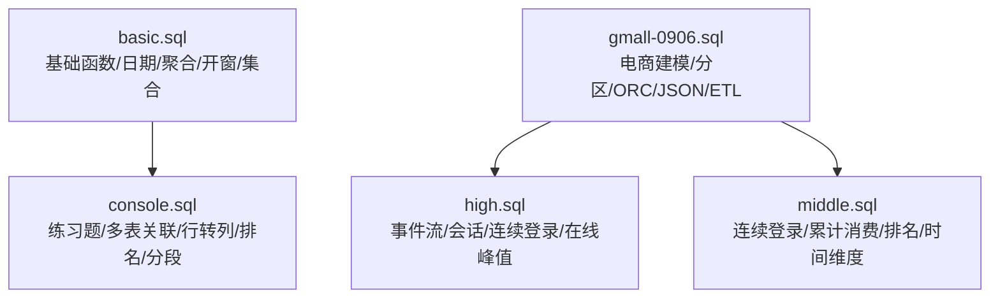
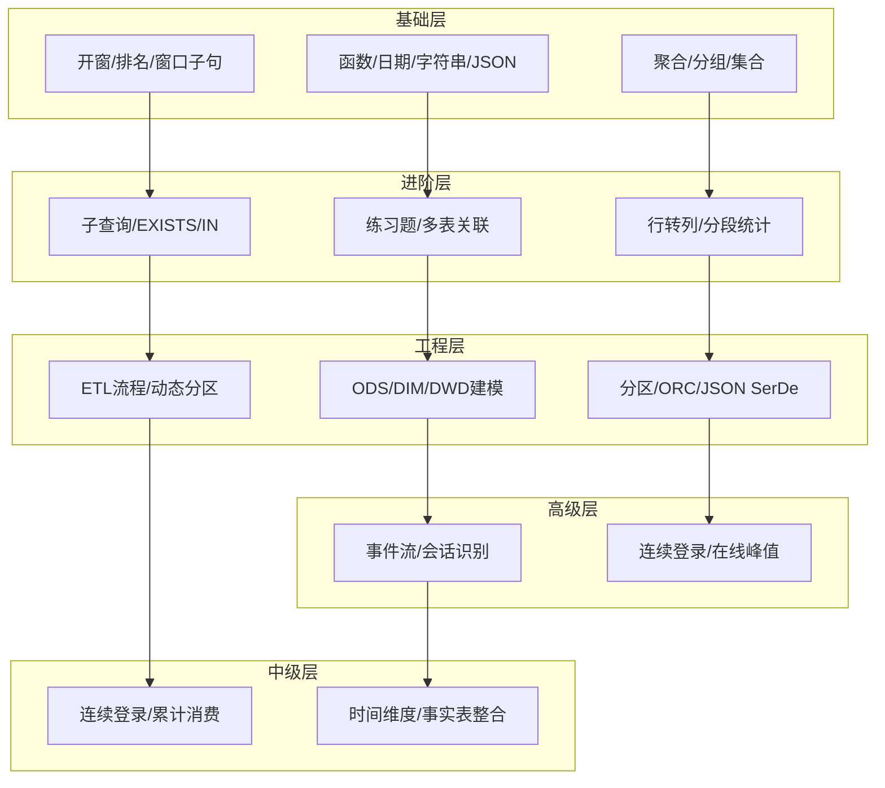
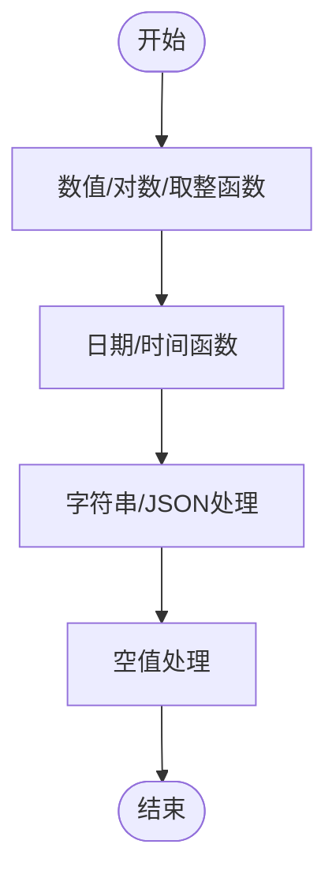
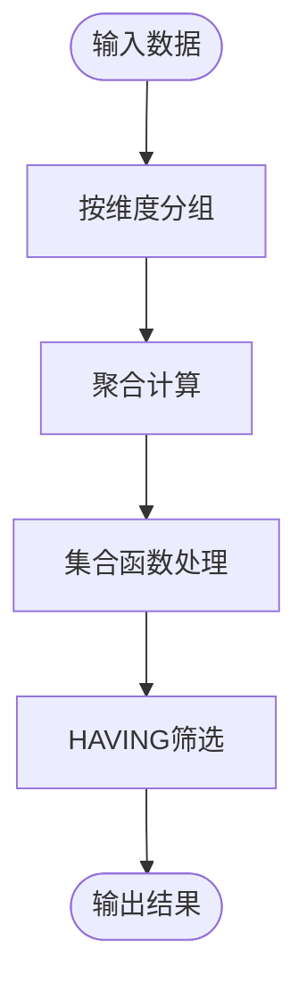
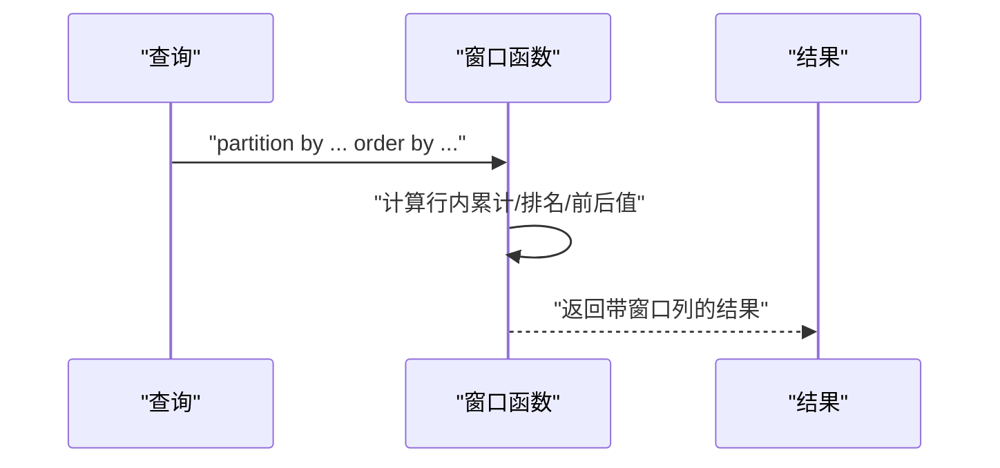
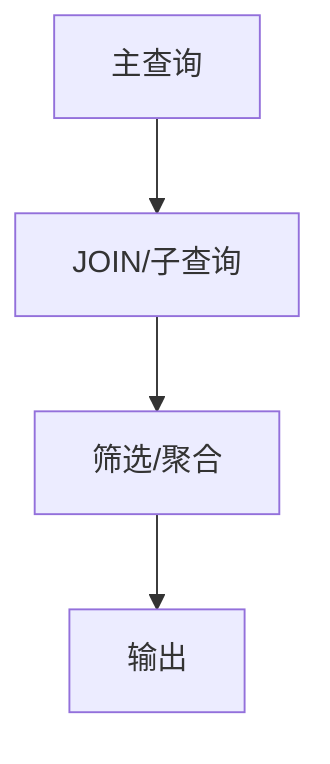
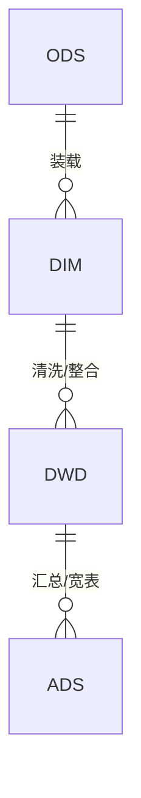
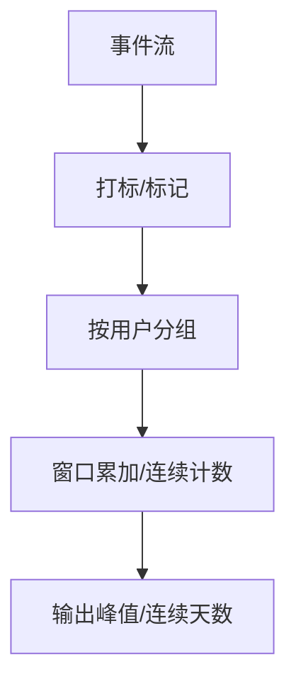
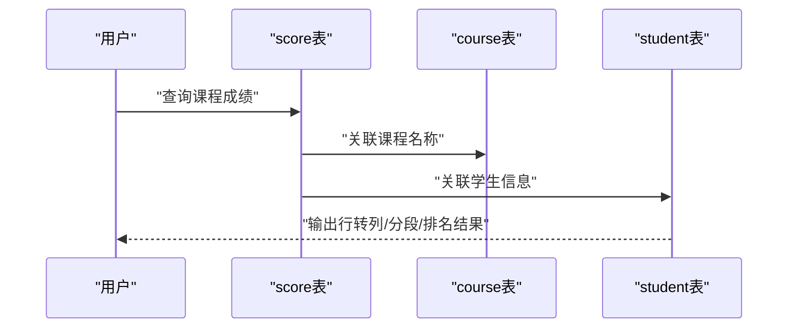
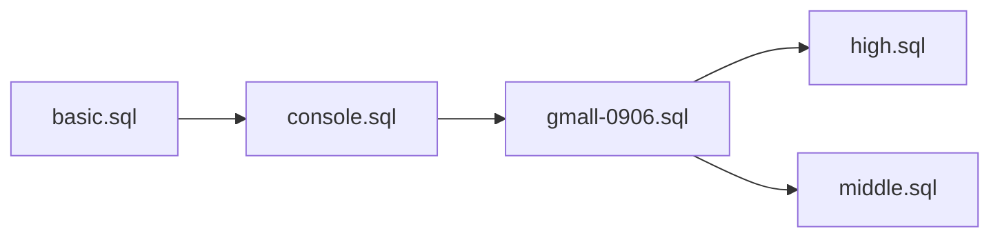

# SQL语法参考

<cite>
**本文引用的文件**
- [basic.sql](file://basic.sql)
- [console.sql](file://console.sql)
- [gmall-0906.sql](file://gmall-0906.sql)
- [high.sql](file://high.sql)
- [middle.sql](file://middle.sql)
</cite>

## 目录
1. [引言](#引言)
2. [项目结构](#项目结构)
3. [核心组件](#核心组件)
4. [架构总览](#架构总览)
5. [详细组件分析](#详细组件分析)
6. [依赖分析](#依赖分析)
7. [性能考量](#性能考量)
8. [故障排查指南](#故障排查指南)
9. [结论](#结论)
10. [附录](#附录)

## 引言
本参考文档面向Hive SQL（HQL）学习者与工程师，系统梳理基础语法、高级特性与工程实践，覆盖DDL、DML、查询优化、分区表、ORC存储格式、窗口函数、CTE、常见错误与调试方法，并提供从入门到进阶的示例路径与最佳实践建议。内容来源于仓库中的SQL脚本，所有示例均以“文件路径#行号范围”标注，便于溯源与复用。

## 项目结构
仓库包含五个SQL文件，分别聚焦不同主题：
- basic.sql：基础函数、日期处理、聚合与开窗、集合函数、常用模式
- console.sql：经典练习题与多表关联、行转列、排名与分段统计、子查询与EXISTS
- gmall-0906.sql：电商主题建模与事实表/维度表设计，展示分区表、ORC存储、JSON SerDe、ETL流程
- high.sql：复杂事件流与会话识别、连续登录、在线人数峰值分析
- middle.sql：连续登录、累计消费、排名与分组统计、时间维度与事实表整合

图示来源
- [basic.sql](file://basic.sql#L1-L120)
- [console.sql](file://console.sql#L1-L120)
- [gmall-0906.sql](file://gmall-0906.sql#L1-L120)
- [high.sql](file://high.sql#L1-L40)
- [middle.sql](file://middle.sql#L1-L40)

章节来源
- [basic.sql](file://basic.sql#L1-L120)
- [console.sql](file://console.sql#L1-L120)
- [gmall-0906.sql](file://gmall-0906.sql#L1-L120)
- [high.sql](file://high.sql#L1-L40)
- [middle.sql](file://middle.sql#L1-L40)

## 核心组件
- 基础语法与函数
  - 数值与对数、三角与幂运算、取整与舍入、取模、位运算
  - 日期时间函数：add_months、date_format、unix_timestamp、from_unixtime、datediff、to_date、last_day、floor_day/floor_month、months_between、current_date/current_timestamp
  - 字符串与JSON处理：concat、concat_ws、upper、trim、substr/substring、get_json_object、json解析
  - 空值处理：nvl/coalesce/ifnull
- 聚合与分组
  - count、sum、avg、min/max、collect_set/collect_list、size/map_keys/map_values/array_contains
  - group by、having、distinct、count(distinct)
- 窗口函数与排名
  - rank/dense_rank/row_number、ntile、first_value/last_value、lead/lag、聚合开窗
- 多表关联与子查询
  - join（内/左/半/外）、子查询、EXISTS、IN/LIST、left semi join
- DDL与存储
  - 创建外部表、分区表、指定分隔符、NULL定义、SerDe、ORC存储、TBLPROPERTIES
- CTE与执行计划
  - WITH子句、EXPLAIN/EXPLAIN EXTENDED/FORMATTED

章节来源
- [basic.sql](file://basic.sql#L1-L220)
- [console.sql](file://console.sql#L1-L220)
- [gmall-0906.sql](file://gmall-0906.sql#L1-L120)
- [high.sql](file://high.sql#L1-L40)
- [middle.sql](file://middle.sql#L1-L40)

## 架构总览
本仓库以“主题化SQL脚本”组织内容，体现从基础语法到复杂业务场景的演进：
- 基础层：函数与日期、聚合与开窗、集合与JSON
- 进阶层：练习题与多表关联、行转列与排名、分段统计
- 工程层：电商建模（ODS/DIM/DWD）、分区与ORC、JSON SerDe、ETL流程
- 高级层：事件流与会话、连续登录、在线峰值分析
- 中级层：连续登录、累计消费、时间维度与事实表整合

图示来源
- [basic.sql](file://basic.sql#L1-L220)
- [console.sql](file://console.sql#L1-L220)
- [gmall-0906.sql](file://gmall-0906.sql#L1-L200)
- [high.sql](file://high.sql#L1-L80)
- [middle.sql](file://middle.sql#L1-L120)

## 详细组件分析

### 组件A：基础语法与函数（数值、日期、字符串、JSON）
- 数值与对数：exp、ln、log10、log2、log(a,b)、pow、sqrt、abs、bin/hex/unhex、pmod、banker’s rounding（bround）
- 日期函数：date_add/add_months、unix_timestamp/from_unixtime、date/date_format、current_date/current_timestamp、datediff、to_unix_timestamp、from_utc_timestamp、last_day、floor_day/floor_month、months_between、date_sub、date_add
- 字符串与JSON：upper、concat/concat_ws、trim、substr/substring、get_json_object、json数组/对象访问
- 空值处理：nvl/coalesce/ifnull、if/else逻辑

图示来源
- [basic.sql](file://basic.sql#L1-L120)

章节来源
- [basic.sql](file://basic.sql#L1-L120)

### 组件B：聚合、分组与集合函数
- 聚合：count、sum、avg、min/max、count(distinct)
- 分组：group by、having、distinct
- 集合：collect_set、collect_list、size、map_keys、map_values、array_contains

图示来源
- [basic.sql](file://basic.sql#L880-L1000)

章节来源
- [basic.sql](file://basic.sql#L880-L1000)

### 组件C：窗口函数与排名
- 排名：rank、dense_rank、row_number、ntile
- 边界：first_value、last_value、lead/lag
- 窗口子句：rows between/unbounded preceding/unbounded following
- 常见用法：累计求和、滚动窗口、前后行对比、分组内排名

图示来源
- [basic.sql](file://basic.sql#L120-L220)
- [console.sql](file://console.sql#L2200-L2399)

章节来源
- [basic.sql](file://basic.sql#L120-L220)
- [console.sql](file://console.sql#L2200-L2399)

### 组件D：多表关联与子查询
- 关联：inner/left/right/full join，on条件与笛卡尔积风险
- 子查询：in、exists、相关子查询、with CTE
- 练习题覆盖：行转列、分段统计、排名TOP-N、包含/完全相同集合比较

图示来源
- [console.sql](file://console.sql#L1-L220)
- [console.sql](file://console.sql#L1600-L2000)

章节来源
- [console.sql](file://console.sql#L1-L220)
- [console.sql](file://console.sql#L1600-L2000)

### 组件E：DDL与存储（分区表、ORC、JSON SerDe）
- 创建外部表：字段类型、分隔符、NULL定义、位置
- 分区表：PARTITIONED BY
- 存储格式：STORED AS ORC、TBLPROPERTIES（压缩）
- JSON数据：ROW FORMAT SERDE '...JsonSerDe'
- ETL：动态分区、插入覆盖、按日期分区装载

图示来源
- [gmall-0906.sql](file://gmall-0906.sql#L1-L120)
- [gmall-0906.sql](file://gmall-0906.sql#L460-L520)
- [gmall-0906.sql](file://gmall-0906.sql#L800-L900)

章节来源
- [gmall-0906.sql](file://gmall-0906.sql#L1-L120)
- [gmall-0906.sql](file://gmall-0906.sql#L460-L520)
- [gmall-0906.sql](file://gmall-0906.sql#L800-L900)

### 组件F：复杂事件流与会话识别（在线人数、连续登录）
- 在线人数：事件入/出时间打标，窗口累加求峰值
- 会话识别：基于时间间隔（如60秒）打标，连续登录：row_number或lag+datediff
- 连续登录：去重后用row_number或lag-datediff做标记，按flag分组统计连续天数

图示来源
- [high.sql](file://high.sql#L1-L80)
- [high.sql](file://high.sql#L140-L215)
- [middle.sql](file://middle.sql#L1-L80)

章节来源
- [high.sql](file://high.sql#L1-L80)
- [high.sql](file://high.sql#L140-L215)
- [middle.sql](file://middle.sql#L1-L80)

### 组件G：练习题与业务场景（行转列、分段统计、排名）
- 行转列：sum+if/group by实现
- 分段统计：按区间聚合，union或flag方式
- 排名：course_id内rank/dense_rank/ntile，TOP-N筛选
- 集合比较：包含/完全相同，count比较或collect_set比较

图示来源
- [console.sql](file://console.sql#L1100-L1400)
- [console.sql](file://console.sql#L1400-L1700)
- [console.sql](file://console.sql#L2000-L2399)

章节来源
- [console.sql](file://console.sql#L1100-L1400)
- [console.sql](file://console.sql#L1400-L1700)
- [console.sql](file://console.sql#L2000-L2399)

## 依赖分析
- 文件内依赖
  - basic.sql与console.sql：基础函数与练习题相互印证，前者提供函数基础，后者以题目驱动应用
  - gmall-0906.sql：ODS层（原始日志/结构化表）→ DIM层（维度表）→ DWD层（事务/周期快照事实表），形成完整的数据血缘
  - high.sql与middle.sql：均涉及连续登录、会话识别，彼此可交叉验证实现思路
- 外部依赖
  - Hive版本与SerDe支持（JSON SerDe）
  - ORC压缩策略（snappy）
  - 动态分区配置（hive.exec.dynamic.partition.mode）

图示来源
- [basic.sql](file://basic.sql#L1-L120)
- [console.sql](file://console.sql#L1-L120)
- [gmall-0906.sql](file://gmall-0906.sql#L1-L120)
- [high.sql](file://high.sql#L1-L40)
- [middle.sql](file://middle.sql#L1-L40)

章节来源
- [basic.sql](file://basic.sql#L1-L120)
- [console.sql](file://console.sql#L1-L120)
- [gmall-0906.sql](file://gmall-0906.sql#L1-L120)
- [high.sql](file://high.sql#L1-L40)
- [middle.sql](file://middle.sql#L1-L40)

## 性能考量
- 优先使用聚合函数而非开窗：在仅需汇总时避免不必要的开窗
- 去重先行：连续登录/会话识别前先去重，减少后续计算量
- 子查询转JOIN：在可读性与性能之间权衡，必要时使用left semi join
- 分区裁剪：按分区字段过滤，减少扫描
- ORC压缩：合理设置压缩策略，平衡I/O与CPU
- 执行计划：使用EXPLAIN/EXPLAIN FORMATTED对比不同写法的成本差异

章节来源
- [basic.sql](file://basic.sql#L800-L920)
- [console.sql](file://console.sql#L2200-L2399)
- [gmall-0906.sql](file://gmall-0906.sql#L1-L120)

## 故障排查指南
- 常见错误与提示
  - 空值与格式：日期函数对格式敏感，返回null多因格式不符
  - 子查询限制：嵌套子查询报错时优先考虑先join
  - 排名与窗口：rank需配合order by；窗口子句与聚合函数组合时注意重复计算
  - 分区与SerDe：分区字段缺失、JSON SerDe不匹配会导致加载失败
- 调试方法
  - 使用EXPLAIN/EXPLAIN FORMATTED查看执行计划，定位热点阶段
  - 分步验证：先验证子查询/中间表，再拼接完整SQL
  - 样例数据：使用LIMIT或小范围数据快速验证逻辑

章节来源
- [basic.sql](file://basic.sql#L1-L120)
- [console.sql](file://console.sql#L1-L120)
- [gmall-0906.sql](file://gmall-0906.sql#L1-L120)

## 结论
本参考文档以仓库脚本为依据，构建了从基础语法到复杂业务场景的完整知识体系。通过函数、聚合、开窗、关联、DDL与存储、ETL流程与高级分析的系统梳理，读者可据此建立规范的SQL编写习惯与性能优化意识，并在实际项目中快速落地。

## 附录
- 示例路径索引（仅列出关键路径，便于溯源）
  - 基础函数与日期：[basic.sql](file://basic.sql#L1-L120)
  - 窗口函数与排名：[basic.sql](file://basic.sql#L120-L220)
  - 集合与JSON：[basic.sql](file://basic.sql#L880-L1000)
  - 练习题（行转列/分段/排名）：[console.sql](file://console.sql#L1100-L1400)
  - 子查询与EXISTS：[console.sql](file://console.sql#L1600-L2000)
  - 电商建模与分区/ORC/JSON：[gmall-0906.sql](file://gmall-0906.sql#L1-L120)
  - 事件流与连续登录：[high.sql](file://high.sql#L1-L80)
  - 中级场景（累计消费/时间维度）：[middle.sql](file://middle.sql#L1-L120)