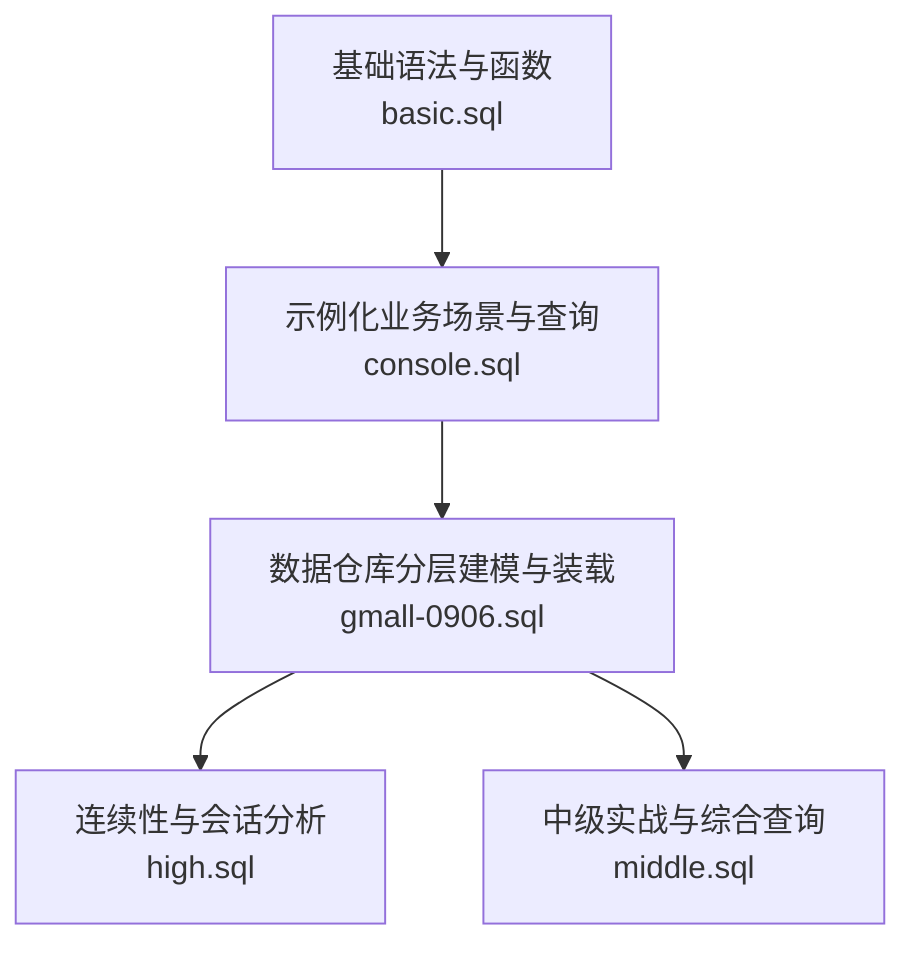
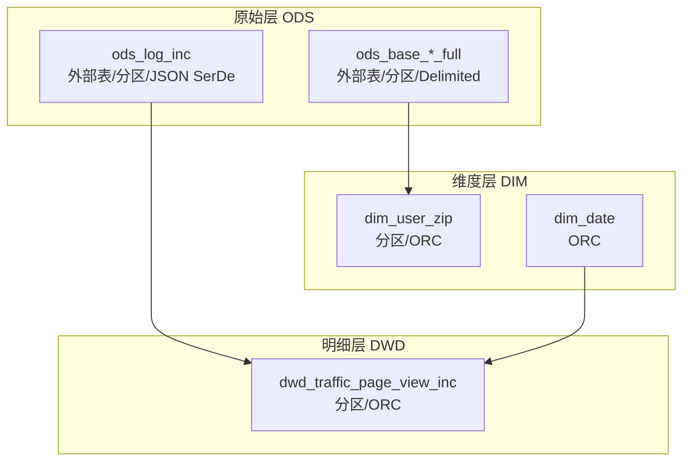
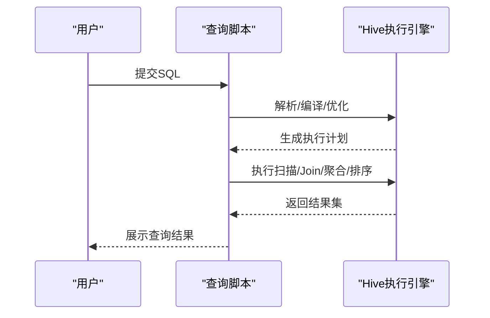
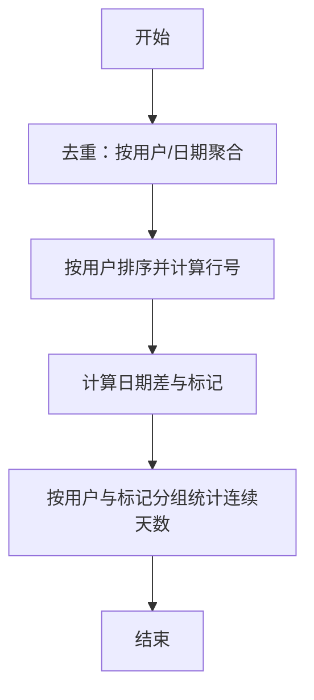
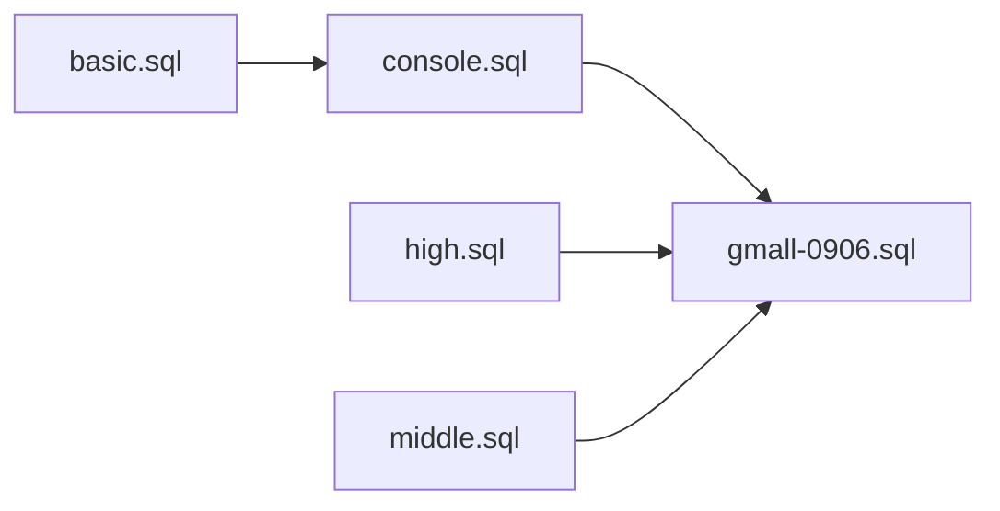

# 基础SQL语法

<cite>
**本文引用的文件**
- [basic.sql](file://basic.sql)
- [console.sql](file://console.sql)
- [gmall-0906.sql](file://gmall-0906.sql)
- [high.sql](file://high.sql)
- [middle.sql](file://middle.sql)
</cite>

## 目录
1. [引言](#引言)
2. [项目结构](#项目结构)
3. [核心组件](#核心组件)
4. [架构总览](#架构总览)
5. [详细组件分析](#详细组件分析)
6. [依赖分析](#依赖分析)
7. [性能考量](#性能考量)
8. [故障排查指南](#故障排查指南)
9. [结论](#结论)
10. [附录](#附录)

## 引言
本文件面向初学者与入门用户，系统梳理Hive SQL的基础语法与常见实践，覆盖DDL（数据定义语言）与DML（数据操作语言）的核心操作，并结合仓库中的实际脚本示例，给出可直接参考的路径与要点。内容包括：表的创建/修改/删除、数据装载与更新、分区表与存储格式选择、常见查询（SELECT/WHERE/GROUP BY/HAVING/ORDER BY）、开窗函数与聚合函数、日期与字符串处理、以及SQL书写规范与最佳实践。

## 项目结构
该仓库由多个SQL脚本组成，分别展示了不同层次的Hive SQL实践：
- 基础语法与函数：basic.sql
- 示例化业务场景与查询：console.sql
- 数据仓库分层建模与装载：gmall-0906.sql
- 连续性与会话分析：high.sql
- 中级实战与综合查询：middle.sql

图表来源
- [basic.sql](file://basic.sql#L1-L120)
- [console.sql](file://console.sql#L1-L120)
- [gmall-0906.sql](file://gmall-0906.sql#L1-L120)
- [high.sql](file://high.sql#L1-L40)
- [middle.sql](file://middle.sql#L1-L40)

章节来源
- [basic.sql](file://basic.sql#L1-L120)
- [console.sql](file://console.sql#L1-L120)
- [gmall-0906.sql](file://gmall-0906.sql#L1-L120)
- [high.sql](file://high.sql#L1-L40)
- [middle.sql](file://middle.sql#L1-L40)

## 核心组件
- 表管理（DDL）
  - 创建外部表与分区表：参见 [gmall-0906.sql](file://gmall-0906.sql#L24-L120)，展示分区字段、存储格式、SerDe配置与位置指定。
  - 删除与重建：参见 [gmall-0906.sql](file://gmall-0906.sql#L24-L40)。
- 数据装载（DML）
  - 插入覆盖与追加：参见 [gmall-0906.sql](file://gmall-0906.sql#L2570-L2587)、[console.sql](file://console.sql#L6391-L6436)。
  - 值插入与批量插入：参见 [console.sql](file://console.sql#L6391-L6436)。
- 查询与分析
  - 基础查询与排序：参见 [console.sql](file://console.sql#L52-L148)。
  - 聚合与分组：参见 [console.sql](file://console.sql#L414-L520)。
  - 开窗函数与排名：参见 [basic.sql](file://basic.sql#L128-L210)、[basic.sql](file://basic.sql#L419-L564)。
  - 连续性与会话：参见 [high.sql](file://high.sql#L1-L120)、[middle.sql](file://middle.sql#L1-L120)。
- 数据类型与分区
  - 复杂类型（数组、结构体、映射）：参见 [gmall-0906.sql](file://gmall-0906.sql#L24-L60)。
  - 分区表与存储格式（ORC、Delimited）：参见 [gmall-0906.sql](file://gmall-0906.sql#L490-L520)、[gmall-0906.sql](file://gmall-0906.sql#L630-L660)。

章节来源
- [gmall-0906.sql](file://gmall-0906.sql#L24-L120)
- [gmall-0906.sql](file://gmall-0906.sql#L490-L520)
- [gmall-0906.sql](file://gmall-0906.sql#L2570-L2587)
- [console.sql](file://console.sql#L6391-L6436)
- [console.sql](file://console.sql#L52-L148)
- [console.sql](file://console.sql#L414-L520)
- [basic.sql](file://basic.sql#L128-L210)
- [basic.sql](file://basic.sql#L419-L564)
- [high.sql](file://high.sql#L1-L120)
- [middle.sql](file://middle.sql#L1-L120)

## 架构总览
仓库中的SQL脚本体现了典型的“离线数据仓库”思路：通过外部表承载原始数据，按天分区；随后通过ETL过程将数据清洗、聚合、装载到不同层级的表中（ODS/DWD/DIM），最终支撑上层分析与报表。

图表来源
- [gmall-0906.sql](file://gmall-0906.sql#L24-L120)
- [gmall-0906.sql](file://gmall-0906.sql#L851-L922)
- [gmall-0906.sql](file://gmall-0906.sql#L2560-L2587)

章节来源
- [gmall-0906.sql](file://gmall-0906.sql#L24-L120)
- [gmall-0906.sql](file://gmall-0906.sql#L851-L922)
- [gmall-0906.sql](file://gmall-0906.sql#L2560-L2587)

## 详细组件分析

### 组件A：表的创建、修改、删除（DDL）
- 创建外部表与分区
  - 分区字段通常为日期字符串（如dt），便于按天切分与裁剪。
  - 存储格式可选ORC或Delimited，ORC具备压缩与列式存储优势。
  - JSON数据可用SerDe解析，字段终止符与NULL定义需与数据一致。
- 修改与重建
  - 通过DROP/CREATE实现表结构变更；分区表需重新加载数据。
- 示例路径
  - 外部表与分区：[gmall-0906.sql](file://gmall-0906.sql#L24-L120)
  - ORC存储与分区：[gmall-0906.sql](file://gmall-0906.sql#L490-L520)
  - JSON SerDe与分区：[gmall-0906.sql](file://gmall-0906.sql#L24-L60)

章节来源
- [gmall-0906.sql](file://gmall-0906.sql#L24-L120)
- [gmall-0906.sql](file://gmall-0906.sql#L490-L520)
- [gmall-0906.sql](file://gmall-0906.sql#L24-L60)

### 组件B：数据装载与更新（DML）
- 插入覆盖（Overwrite）
  - 将清洗后的数据写入目标分区，适合每日增量或全量替换。
  - 示例路径：[gmall-0906.sql](file://gmall-0906.sql#L2570-L2587)
- 值插入（Values）
  - 用于测试或小规模数据导入。
  - 示例路径：[console.sql](file://console.sql#L6391-L6436)
- 更新与删除
  - Hive不支持原生UPDATE/DELETE；可通过“插入覆盖+条件筛选”模拟更新，或使用ACID表（视集群版本支持情况）。

章节来源
- [gmall-0906.sql](file://gmall-0906.sql#L2570-L2587)
- [console.sql](file://console.sql#L6391-L6436)

### 组件C：查询与分析（SELECT/JOIN/聚合/排序）
- 基础查询与排序
  - 使用ORDER BY进行排序，注意字段与表达式的一致性。
  - 示例路径：[console.sql](file://console.sql#L52-L148)
- 聚合与分组
  - GROUP BY与聚合函数配合，HAVING用于对聚合结果过滤。
  - 示例路径：[console.sql](file://console.sql#L414-L520)
- 开窗函数与排名
  - 使用ROWS/RANGE窗口子句与PARTITION/ORDER BY组合，实现累计、排名、前后项差等分析。
  - 示例路径：[basic.sql](file://basic.sql#L128-L210)、[basic.sql](file://basic.sql#L419-L564)

图表来源
- [basic.sql](file://basic.sql#L128-L210)
- [basic.sql](file://basic.sql#L419-L564)
- [console.sql](file://console.sql#L414-L520)

章节来源
- [console.sql](file://console.sql#L52-L148)
- [console.sql](file://console.sql#L414-L520)
- [basic.sql](file://basic.sql#L128-L210)
- [basic.sql](file://basic.sql#L419-L564)

### 组件D：日期与字符串处理
- 日期函数族
  - 时间戳转换、日期加减、月份差、日期格式化等。
  - 示例路径：[console.sql](file://console.sql#L90-L148)、[basic.sql](file://basic.sql#L64-L90)
- 字符串与集合
  - 字符串拼接、截取、去空、集合收集与大小计算。
  - 示例路径：[console.sql](file://console.sql#L360-L420)、[basic.sql](file://basic.sql#L900-L945)

章节来源
- [console.sql](file://console.sql#L90-L148)
- [basic.sql](file://basic.sql#L64-L90)
- [console.sql](file://console.sql#L360-L420)
- [basic.sql](file://basic.sql#L900-L945)

### 组件E：连续性与会话分析
- 连续登录/下单
  - 使用LAG/ROW_NUMBER/DENSE_RANK与日期差计算，识别连续区间。
  - 示例路径：[high.sql](file://high.sql#L146-L215)、[middle.sql](file://middle.sql#L1-L120)
- 会话划分
  - 基于时间窗口（如60秒）打标，形成会话标识。
  - 示例路径：[high.sql](file://high.sql#L86-L120)

图表来源
- [high.sql](file://high.sql#L146-L215)
- [middle.sql](file://middle.sql#L1-L120)

章节来源
- [high.sql](file://high.sql#L86-L120)
- [high.sql](file://high.sql#L146-L215)
- [middle.sql](file://middle.sql#L1-L120)

### 组件F：数据类型与分区表
- 复杂类型
  - 结构体（STRUCT）、数组（ARRAY）、映射（MAP）等，适合半结构化数据。
  - 示例路径：[gmall-0906.sql](file://gmall-0906.sql#L24-L60)
- 分区表
  - 通过PARTITIONED BY定义分区字段，按dt等维度切分，提升查询效率。
  - 示例路径：[gmall-0906.sql](file://gmall-0906.sql#L24-L60)
- 存储格式
  - ORC列式存储+压缩，适合分析型查询；Delimited适合文本分隔。
  - 示例路径：[gmall-0906.sql](file://gmall-0906.sql#L490-L520)、[gmall-0906.sql](file://gmall-0906.sql#L630-L660)

章节来源
- [gmall-0906.sql](file://gmall-0906.sql#L24-L60)
- [gmall-0906.sql](file://gmall-0906.sql#L490-L520)
- [gmall-0906.sql](file://gmall-0906.sql#L630-L660)

## 依赖分析
- 文件间依赖
  - gmall-0906.sql构建ODS/DWD/DIM三层表，后续查询与分析多基于这些表。
  - basic.sql与console.sql提供通用函数与查询范式，可复用到其他脚本。
  - high.sql与middle.sql侧重连续性与会话分析，依赖日期与开窗函数。
- 外部依赖
  - JSON数据需匹配SerDe配置；分区字段需与数据源一致。
  - ORC表依赖HDFS与Hive元数据服务。

图表来源
- [basic.sql](file://basic.sql#L1-L120)
- [console.sql](file://console.sql#L1-L120)
- [gmall-0906.sql](file://gmall-0906.sql#L1-L120)
- [high.sql](file://high.sql#L1-L40)
- [middle.sql](file://middle.sql#L1-L40)

章节来源
- [basic.sql](file://basic.sql#L1-L120)
- [console.sql](file://console.sql#L1-L120)
- [gmall-0906.sql](file://gmall-0906.sql#L1-L120)
- [high.sql](file://high.sql#L1-L40)
- [middle.sql](file://middle.sql#L1-L40)

## 性能考量
- 分区裁剪
  - 在WHERE中使用分区字段（如dt）可显著减少扫描数据量。
  - 示例路径：[gmall-0906.sql](file://gmall-0906.sql#L2570-L2587)
- 存储格式
  - ORC列式存储+压缩（如snappy）可降低I/O与提升查询速度。
  - 示例路径：[gmall-0906.sql](file://gmall-0906.sql#L490-L520)
- 开窗函数与聚合
  - 合理使用PARTITION BY与ORDER BY，避免不必要的全局窗口。
  - 示例路径：[basic.sql](file://basic.sql#L128-L210)
- 执行计划
  - 使用EXPLAIN查看执行计划，定位热点与优化点。
  - 示例路径：[basic.sql](file://basic.sql#L238-L250)

章节来源
- [gmall-0906.sql](file://gmall-0906.sql#L2570-L2587)
- [gmall-0906.sql](file://gmall-0906.sql#L490-L520)
- [basic.sql](file://basic.sql#L128-L210)
- [basic.sql](file://basic.sql#L238-L250)

## 故障排查指南
- 日期格式错误
  - 日期函数返回NULL或无结果时，优先检查输入格式与分隔符。
  - 示例路径：[console.sql](file://console.sql#L90-L148)
- 空值处理
  - 使用NVL/COALESCE处理NULL，避免运算异常。
  - 示例路径：[console.sql](file://console.sql#L900-L945)
- 开窗函数报错
  - 窗口子句与函数组合需遵循语法约束；必要时拆分子查询。
  - 示例路径：[basic.sql](file://basic.sql#L370-L420)
- 分区字段不匹配
  - 分区字段与数据源不一致会导致查询失败或全表扫描。
  - 示例路径：[gmall-0906.sql](file://gmall-0906.sql#L24-L60)

章节来源
- [console.sql](file://console.sql#L90-L148)
- [console.sql](file://console.sql#L900-L945)
- [basic.sql](file://basic.sql#L370-L420)
- [gmall-0906.sql](file://gmall-0906.sql#L24-L60)

## 结论
本仓库提供了从DDL/DML到查询分析的完整实践路径，建议初学者先从basic.sql与console.sql入手，理解基础语法与函数；再结合gmall-0906.sql学习数据仓库分层与分区策略；最后通过high.sql与middle.sql掌握连续性与会话分析等进阶技巧。遵循分区裁剪、合理存储格式与开窗函数的最佳实践，可显著提升查询性能与可维护性。

## 附录
- 常用命令与示例路径
  - 显示数据库/表/函数：[basic.sql](file://basic.sql#L98-L120)
  - 描述表结构：[basic.sql](file://basic.sql#L323-L330)
  - EXPLAIN执行计划：[basic.sql](file://basic.sql#L238-L250)
- 实战练习建议
  - 从简单SELECT/ORDER BY开始，逐步引入JOIN、GROUP BY/HAVING、开窗函数。
  - 使用分区字段进行数据裁剪，优先采用ORC存储格式。
  - 对连续性分析问题，先去重再打标，最后按标记分组统计。