# 窗口函数详解

<cite>
**本文引用的文件**
- [basic.sql](file://basic.sql)
- [console.sql](file://console.sql)
- [high.sql](file://high.sql)
- [middle.sql](file://middle.sql)
- [gmall-0906.sql](file://gmall-0906.sql)
</cite>

## 目录
1. [引言](#引言)
2. [项目结构](#项目结构)
3. [核心组件](#核心组件)
4. [架构总览](#架构总览)
5. [详细组件分析](#详细组件分析)
6. [依赖分析](#依赖分析)
7. [性能考量](#性能考量)
8. [故障排查指南](#故障排查指南)
9. [结论](#结论)
10. [附录](#附录)

## 引言
本技术文档围绕仓库中的Hive SQL示例，系统梳理窗口函数的概念、语法与实战应用，重点覆盖：
- 排序类窗口函数：ROW_NUMBER、RANK、DENSE_RANK 的使用与差异
- 时间序列类窗口函数：LAG、LEAD 的实现原理与技巧
- ROWS BETWEEN 子句与 PARTITION BY、ORDER BY 的组合
- 窗口函数与传统聚合函数的区别与优势
- 复杂窗口计算案例：累计求和、移动平均、排名计算、连续登录识别、会话切分等
- 性能优化建议与最佳实践

## 项目结构
该仓库以多份SQL脚本呈现不同层次的窗口函数实践，涵盖基础语法、排序与时间序列分析、复杂业务场景（如连续登录、会话切分、累计消费）以及电商主题数据建模脚本。

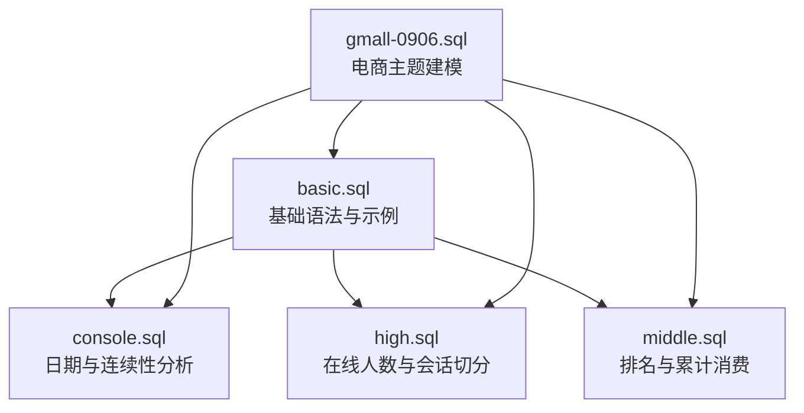

图表来源
- [basic.sql](file://basic.sql#L120-L210)
- [console.sql](file://console.sql#L210-L270)
- [high.sql](file://high.sql#L1-L40)
- [middle.sql](file://middle.sql#L1-L40)
- [gmall-0906.sql](file://gmall-0906.sql#L1-L60)

章节来源
- [basic.sql](file://basic.sql#L120-L210)
- [console.sql](file://console.sql#L210-L270)
- [high.sql](file://high.sql#L1-L40)
- [middle.sql](file://middle.sql#L1-L40)
- [gmall-0906.sql](file://gmall-0906.sql#L1-L60)

## 核心组件
- 基础语法与ROWS BETWEEN子句
  - 使用OVER子句定义窗口范围，支持UNBOUNDED PRECEDING、CURRENT ROW、UNBOUNDED FOLLOWING、N PRECEDING、N FOLLOWING等边界表达
  - 示例路径：[ROWS BETWEEN示例](file://basic.sql#L129-L143)，[分区+排序+窗口范围](file://basic.sql#L147-L151)

- 排序类窗口函数
  - ROW_NUMBER：按分区内的排序生成唯一递增序号
  - RANK：相同值并列，跳序
  - DENSE_RANK：相同值并列，不跳序
  - 示例路径：[ROW_NUMBER/RANK/DENSE_RANK](file://basic.sql#L381-L388)，[按总和排序的排名](file://basic.sql#L641-L646)

- 时间序列类窗口函数
  - LAG：取前N行的指定列值，默认可提供默认值
  - LEAD：取后N行的指定列值
  - 示例路径：[LAG/LEAD用法](file://basic.sql#L356-L366)，[按用户分区内排序的LEAD/LAG](file://basic.sql#L600-L603)

- 辅助函数
  - FIRST_VALUE/LAST_VALUE：取窗口内第一/最后一个值
  - NTILE：按排序将数据均匀分成N个桶
  - 示例路径：[FIRST_VALUE/LAST_VALUE](file://basic.sql#L393-L404)，[NTILE](file://basic.sql#L377-L379)

- 聚合与累计计算
  - SUM、COUNT等聚合函数配合OVER实现累计求和、累计计数
  - 示例路径：[累计求和](file://basic.sql#L262-L267)，[按日期累计](file://basic.sql#L584-L588)，[按用户累计](file://basic.sql#L589-L592)

章节来源
- [basic.sql](file://basic.sql#L129-L151)
- [basic.sql](file://basic.sql#L356-L366)
- [basic.sql](file://basic.sql#L381-L388)
- [basic.sql](file://basic.sql#L393-L404)
- [basic.sql](file://basic.sql#L584-L592)
- [basic.sql](file://basic.sql#L600-L603)
- [basic.sql](file://basic.sql#L641-L646)

## 架构总览
窗口函数在Hive中的执行流程可抽象为：数据扫描 -> 分区与排序 -> 窗口计算 -> 输出结果。通过EXPLAIN可观察执行计划，辅助优化。

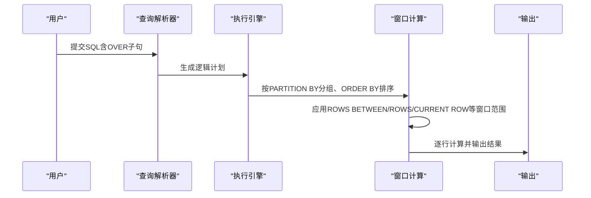

图表来源
- [basic.sql](file://basic.sql#L237-L245)
- [basic.sql](file://basic.sql#L505-L520)

章节来源
- [basic.sql](file://basic.sql#L237-L245)
- [basic.sql](file://basic.sql#L505-L520)

## 详细组件分析

### 排序函数：ROW_NUMBER、RANK、DENSE_RANK
- ROW_NUMBER：严格递增，适合生成唯一序号
- RANK：相同值并列，后续序号跳过
- DENSE_RANK：相同值并列，后续序号不跳过
- 使用要点
  - 与ORDER BY结合，支持多列排序
  - 可与PARTITION BY配合实现分区内独立排序
  - 示例路径：[分区内排序](file://basic.sql#L381-L388)，[按总和排序](file://basic.sql#L641-L646)

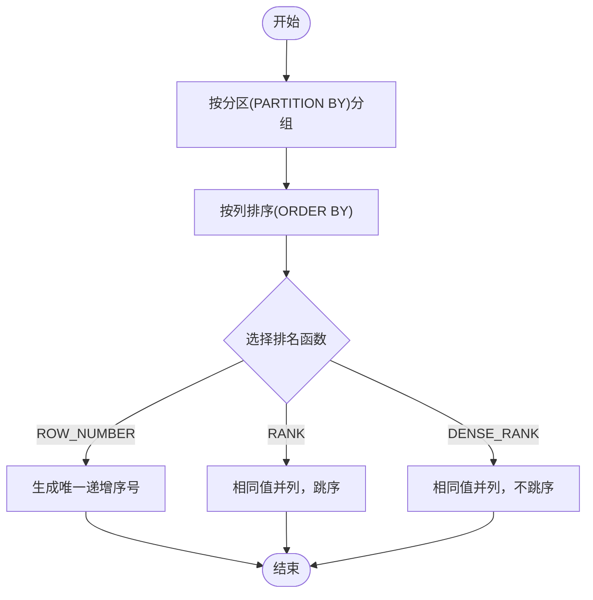

图表来源
- [basic.sql](file://basic.sql#L381-L388)
- [basic.sql](file://basic.sql#L641-L646)

章节来源
- [basic.sql](file://basic.sql#L381-L388)
- [basic.sql](file://basic.sql#L641-L646)

### 时间序列函数：LAG、LEAD
- LAG：取前N行的指定列值，可设置默认值
- LEAD：取后N行的指定列值
- 使用技巧
  - 与PARTITION BY、ORDER BY组合，确保同一分区内有序
  - 结合DATEDIFF、IF等函数进行间隔判断与标记
  - 示例路径：[LAG/LEAD基础用法](file://basic.sql#L356-L366)，[按用户分区内排序的LEAD/LAG](file://basic.sql#L600-L603)

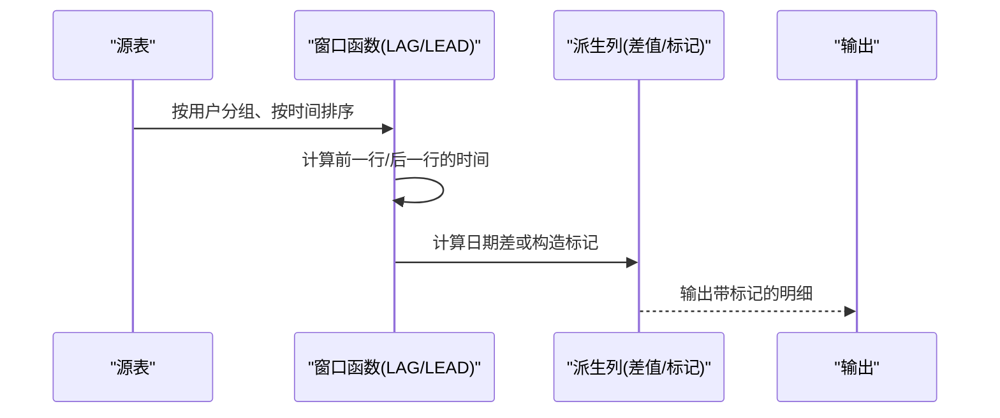

图表来源
- [basic.sql](file://basic.sql#L356-L366)
- [basic.sql](file://basic.sql#L600-L603)

章节来源
- [basic.sql](file://basic.sql#L356-L366)
- [basic.sql](file://basic.sql#L600-L603)

### ROWS BETWEEN 子句与组合应用
- 子句作用：定义窗口的动态范围，支持相对/绝对边界
- 常见模式
  - UNBOUNDED PRECEDING .. CURRENT ROW：累计到当前行
  - N PRECEDING .. CURRENT ROW：滑动窗口
  - CURRENT ROW .. UNBOUNDED FOLLOWING：从当前行到末尾
  - 示例路径：[累计到当前行](file://basic.sql#L155-L157)，[前后N行滑动](file://basic.sql#L138-L140)

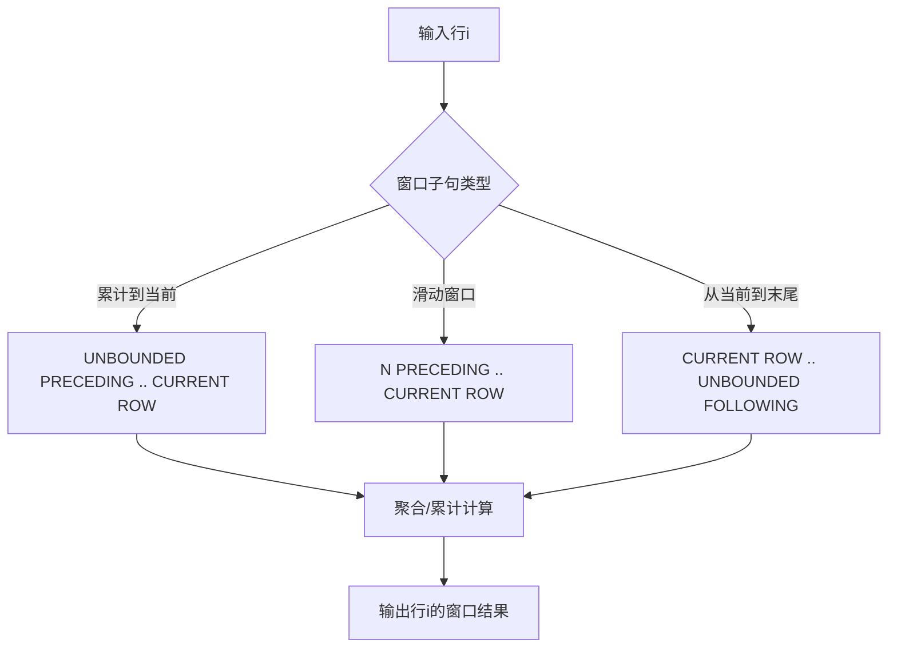

图表来源
- [basic.sql](file://basic.sql#L138-L140)
- [basic.sql](file://basic.sql#L155-L157)

章节来源
- [basic.sql](file://basic.sql#L138-L140)
- [basic.sql](file://basic.sql#L155-L157)

### 窗口函数与传统聚合函数的区别与优势
- 区别
  - 聚合函数通常与GROUP BY配合，产生聚合行；窗口函数保留明细行并附加计算列
  - 窗口函数可进行累计、移动、前后对比等复杂分析
- 优势
  - 无需多层嵌套或多次扫描数据
  - 便于在同一结果集中展示明细与汇总
- 示例路径：[开窗与聚合对比](file://basic.sql#L237-L245)，[保留明细的累计](file://basic.sql#L262-L267)

章节来源
- [basic.sql](file://basic.sql#L237-L245)
- [basic.sql](file://basic.sql#L262-L267)

### 复杂窗口计算案例

#### 累计求和与累计计数
- 按日期累计求和：PARTITION BY无分区，ORDER BY按日期
- 按用户累计求和：PARTITION BY用户，ORDER BY日期
- 示例路径：[按日期累计](file://basic.sql#L584-L588)，[按用户累计](file://basic.sql#L589-L592)

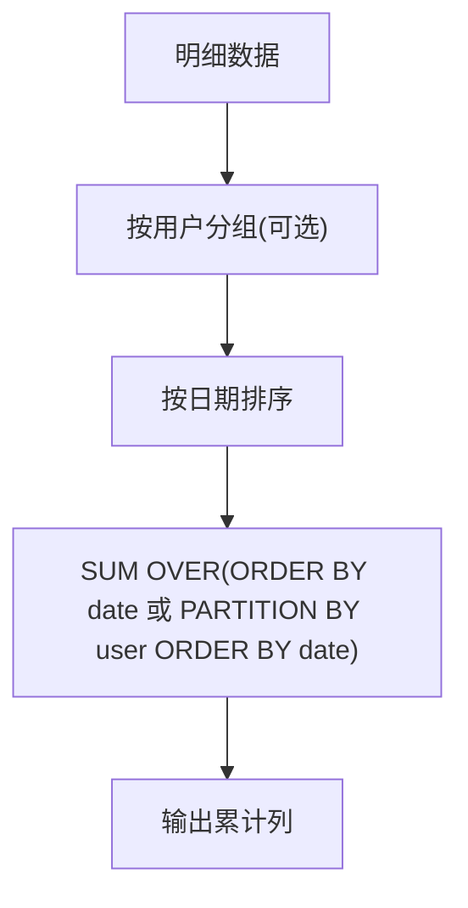

图表来源
- [basic.sql](file://basic.sql#L584-L592)

章节来源
- [basic.sql](file://basic.sql#L584-L592)

#### 移动平均与前后N行分析
- 使用ROWS BETWEEN N PRECEDING .. CURRENT ROW实现滑动窗口
- 示例路径：[前后N行滑动](file://basic.sql#L138-L140)，[上一次与当前消费之和](file://basic.sql#L330-L339)

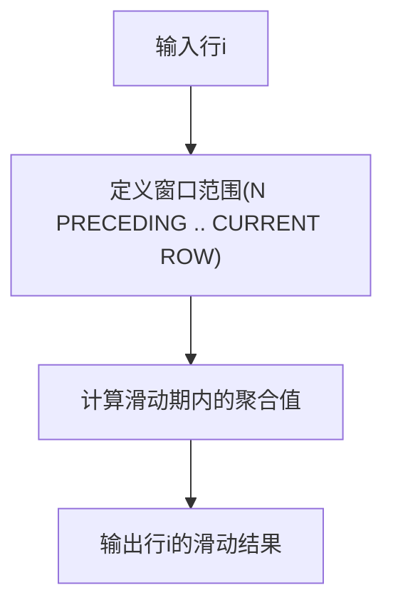

图表来源
- [basic.sql](file://basic.sql#L138-L140)
- [basic.sql](file://basic.sql#L330-L339)

章节来源
- [basic.sql](file://basic.sql#L138-L140)
- [basic.sql](file://basic.sql#L330-L339)

#### 排名计算与分桶
- 使用DENSE_RANK/RANK/ROW_NUMBER进行排名
- 使用NTILE按排序将数据均匀分成N个桶
- 示例路径：[分区内排名](file://basic.sql#L381-L388)，[按总和排名](file://basic.sql#L641-L646)，[NTILE分桶](file://basic.sql#L377-L379)

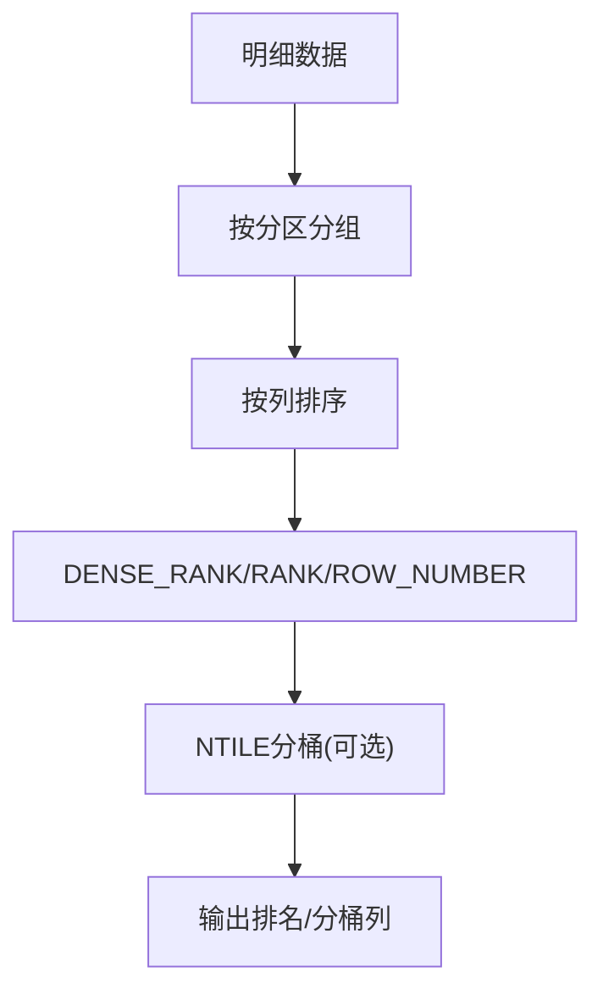

图表来源
- [basic.sql](file://basic.sql#L377-L379)
- [basic.sql](file://basic.sql#L381-L388)
- [basic.sql](file://basic.sql#L641-L646)

章节来源
- [basic.sql](file://basic.sql#L377-L379)
- [basic.sql](file://basic.sql#L381-L388)
- [basic.sql](file://basic.sql#L641-L646)

#### 连续登录识别与会话切分
- 连续登录：利用ROW_NUMBER或LAG计算日期差，构造标记后分组统计
- 会话切分：基于时间间隔阈值（如60秒）打标，SUM累计形成会话ID
- 示例路径：[连续登录（ROW_NUMBER）](file://middle.sql#L17-L22)，[连续登录（LAG）](file://middle.sql#L147-L175)，[会话切分（LAG间隔）](file://high.sql#L132-L144)

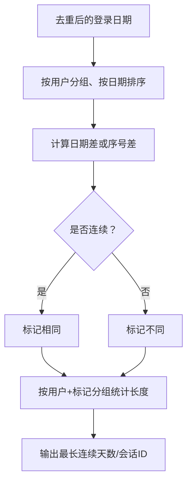

图表来源
- [middle.sql](file://middle.sql#L17-L22)
- [middle.sql](file://middle.sql#L147-L175)
- [high.sql](file://high.sql#L132-L144)

章节来源
- [middle.sql](file://middle.sql#L17-L22)
- [middle.sql](file://middle.sql#L147-L175)
- [high.sql](file://high.sql#L132-L144)

#### 在线人数峰值与会话统计
- 在线人数：将进入事件记为+1，离开事件记为-1，按时间排序后累计求和，取每直播间的最大值
- 示例路径：[在线人数累计](file://high.sql#L1-L18)，[按直播ID分组的最大值](file://high.sql#L20-L56)

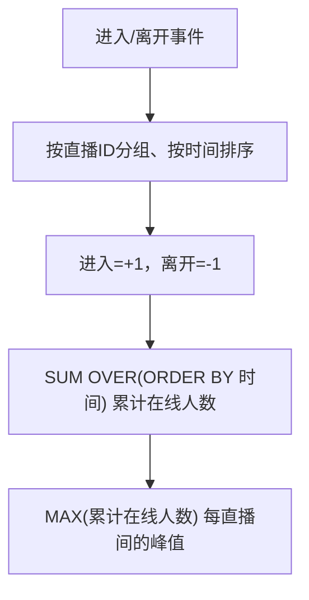

图表来源
- [high.sql](file://high.sql#L1-L18)
- [high.sql](file://high.sql#L20-L56)

章节来源
- [high.sql](file://high.sql#L1-L18)
- [high.sql](file://high.sql#L20-L56)

#### 累计消费与VIP等级
- 累计消费：按用户分组、按日期排序，SUM OVER生成累计金额
- VIP等级：根据累计金额区间映射等级
- 示例路径：[累计消费](file://middle.sql#L311-L324)

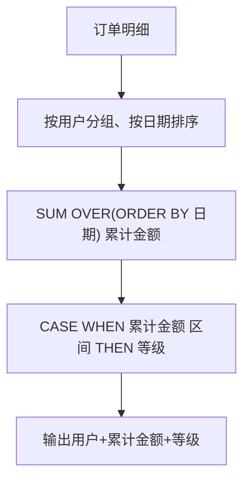

图表来源
- [middle.sql](file://middle.sql#L311-L324)

章节来源
- [middle.sql](file://middle.sql#L311-L324)

## 依赖分析
- 表依赖
  - business：用于基础窗口语法与累计求和示例
  - order_info/order_detail：用于累计消费、排名、连续登录等示例
  - user_login_detail：用于连续登录与会话切分示例
  - live_events/page_view_events：用于在线人数与会话切分示例
- 函数依赖
  - 日期函数：year、date、datediff、date_format等
  - 窗口函数：ROW_NUMBER、RANK、DENSE_RANK、LAG、LEAD、FIRST_VALUE、LAST_VALUE、NTILE
  - 聚合函数：SUM、COUNT、MIN、MAX、AVG等

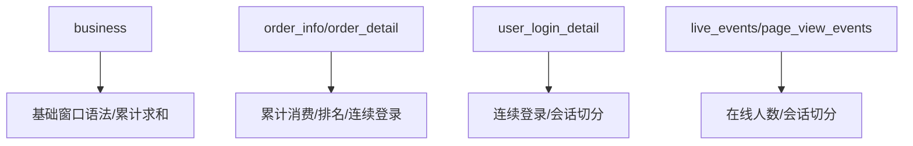

图表来源
- [basic.sql](file://basic.sql#L195-L206)
- [middle.sql](file://middle.sql#L311-L324)
- [high.sql](file://high.sql#L1-L40)

章节来源
- [basic.sql](file://basic.sql#L195-L206)
- [middle.sql](file://middle.sql#L311-L324)
- [high.sql](file://high.sql#L1-L40)

## 性能考量
- 使用EXPLAIN观察执行计划，定位热点与重复扫描
  - 示例路径：[EXPLAIN formatted](file://basic.sql#L237-L245)，[EXPLAIN extended](file://basic.sql#L505-L520)
- 窗口函数优化建议
  - 尽量在WHERE中提前过滤，减少窗口计算的数据量
  - 合理使用PARTITION BY与ORDER BY，避免不必要的全局排序
  - 对频繁使用的列建立合适的分区键，减少全表扫描
  - 使用ROWS BETWEEN限定窗口大小，避免全表扫描
  - 避免在SELECT中对窗口列进行复杂表达式计算，优先在派生层完成
- 电商主题建模中的ORC存储与分区策略有助于提升查询性能
  - 示例路径：[dim_sku_full建表与分区](file://gmall-0906.sql#L466-L494)

章节来源
- [basic.sql](file://basic.sql#L237-L245)
- [basic.sql](file://basic.sql#L505-L520)
- [gmall-0906.sql](file://gmall-0906.sql#L466-L494)

## 故障排查指南
- 窗口子句限制
  - 部分窗口函数不支持ROWS BETWEEN子句，需注意函数与子句的兼容性
  - 示例路径：[函数与子句兼容说明](file://basic.sql#L373-L376)
- NULL值处理
  - 使用COALESCE/NVL为LAG/LEAD设置默认值，避免NULL影响计算
  - 示例路径：[NULL处理与默认值](file://basic.sql#L344-L353)
- 执行计划对比
  - 使用EXPLAIN对比不同写法的执行代价，选择最优方案
  - 示例路径：[执行计划对比](file://basic.sql#L505-L520)

章节来源
- [basic.sql](file://basic.sql#L373-L376)
- [basic.sql](file://basic.sql#L344-L353)
- [basic.sql](file://basic.sql#L505-L520)

## 结论
本仓库提供了从基础语法到复杂业务场景的窗口函数实践，涵盖排序、时间序列、累计与排名、连续性识别等多个方面。通过合理使用PARTITION BY、ORDER BY与ROWS BETWEEN，结合EXPLAIN进行性能调优，可在Hive中高效实现多样化的窗口分析需求。

## 附录
- 常用窗口函数速查
  - 排序：ROW_NUMBER、RANK、DENSE_RANK
  - 时间序列：LAG、LEAD
  - 极值：FIRST_VALUE、LAST_VALUE
  - 分桶：NTILE
  - 聚合：SUM、COUNT、AVG、MIN、MAX
- 示例索引
  - 基础语法与ROWS BETWEEN：[示例路径](file://basic.sql#L129-L151)
  - 排名与分桶：[示例路径](file://basic.sql#L377-L379)，[示例路径](file://basic.sql#L381-L388)，[示例路径](file://basic.sql#L641-L646)
  - LAG/LEAD与日期差：[示例路径](file://basic.sql#L356-L366)，[示例路径](file://basic.sql#L600-L603)
  - 累计求和与累计计数：[示例路径](file://basic.sql#L584-L592)，[示例路径](file://basic.sql#L262-L267)
  - 连续登录与会话切分：[示例路径](file://middle.sql#L17-L22)，[示例路径](file://middle.sql#L147-L175)，[示例路径](file://high.sql#L132-L144)
  - 在线人数峰值：[示例路径](file://high.sql#L1-L18)，[示例路径](file://high.sql#L20-L56)
  - 累计消费与VIP等级：[示例路径](file://middle.sql#L311-L324)