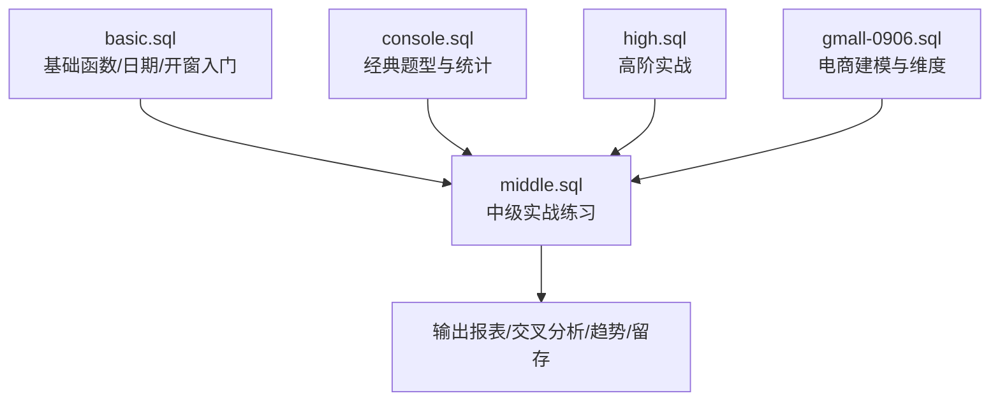
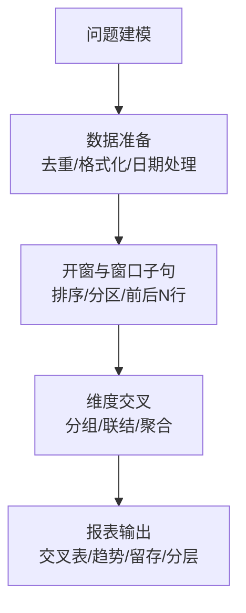
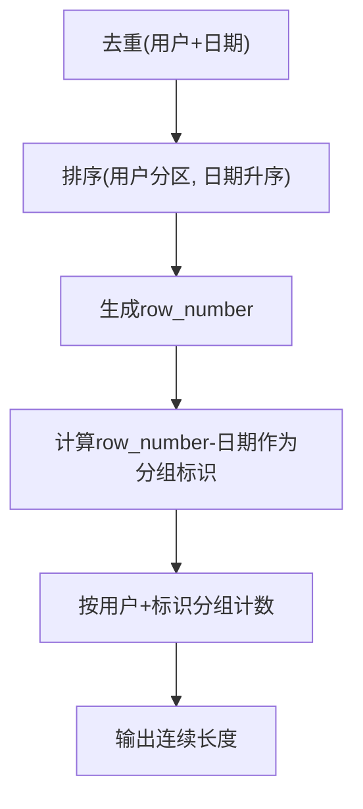
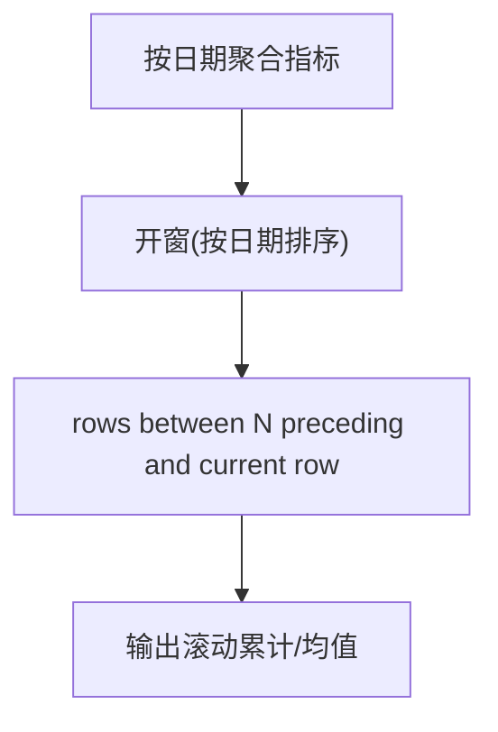
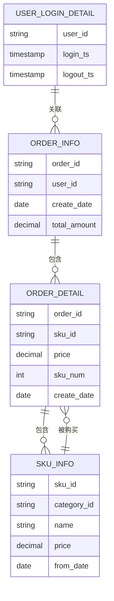
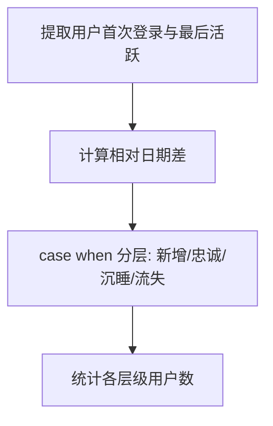
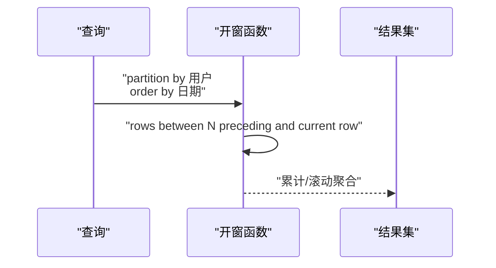
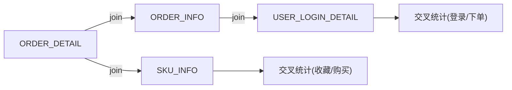
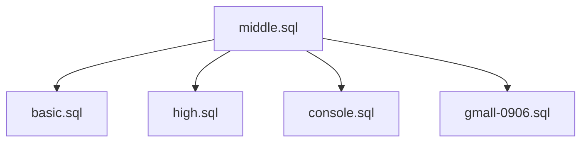

# 中级SQL练习

<cite>
**本文引用的文件**
- [basic.sql](file://basic.sql)
- [console.sql](file://console.sql)
- [gmall-0906.sql](file://gmall-0906.sql)
- [high.sql](file://high.sql)
- [middle.sql](file://middle.sql)
</cite>

## 目录
1. [引言](#引言)
2. [项目结构](#项目结构)
3. [核心组件](#核心组件)
4. [架构总览](#架构总览)
5. [详细组件分析](#详细组件分析)
6. [依赖分析](#依赖分析)
7. [性能考量](#性能考量)
8. [故障排查指南](#故障排查指南)
9. [结论](#结论)
10. [附录](#附录)

## 引言
本文件面向具有一定 SQL 基础的读者，系统梳理仓库中的中级 SQL 练习与实战案例，覆盖复杂业务场景与查询需求，包括但不限于：
- 数据转换与报表生成
- 交叉分析与分组聚合
- 时间序列与连续性分析
- 开窗函数与窗口子句的综合应用
- 多表关联与维度建模

通过对文件内容的归纳与图示化说明，帮助读者建立从“问题建模”到“SQL 实现”的完整思维链路，并总结常见陷阱与性能优化要点。

## 项目结构
仓库包含多个 SQL 文件，分别聚焦不同主题与难度层级：
- basic.sql：基础函数、日期处理、开窗函数入门与示例
- console.sql：经典教学题型（如学生成绩、课程、统计分析）
- middle.sql：中级实战练习，涵盖连续登录、留存、趋势分析、交叉分析、日期合并等
- high.sql：高阶实战（在线人数、会话划分、连续登录等）
- gmall-0906.sql：电商主题建模与维度表构建示例

[本图为概念性结构示意，不直接映射具体源码文件，故不提供图表来源]

**章节来源**
- file://middle.sql#L1-L120

## 核心组件
本节从“问题域”角度拆解中级练习的核心模块与实现要点：

- 连续性分析
  - 连续登录、连续下单、连续销售等，常用手段：去重 + 排序 + 标签（row_number/lag/datediff）+ 分组计数
  - 示例参考：连续登录、连续下单、连续销售、日期合并（促销周期）

- 趋势与滚动窗口
  - 日累计、最近N日滚动求和/均值、趋势分析
  - 示例参考：订单金额趋势分析、按日期滚动统计

- 交叉分析与报表
  - 按品类/日期/用户等维度交叉统计，如品类销量前三、同期对比、动销率/滞销率
  - 示例参考：品类销量前三、同期销售对比、国庆期间动销/滞销率

- 留存与用户分层
  - 新增、次日留存、7/30日活跃分层
  - 示例参考：新增用户与次日留存、用户活跃分层

- 开窗与窗口子句
  - 排名、累计、前后 N 行窗口、first_value/last_value 等
  - 示例参考：累计消费金额与 VIP 等级、最近三笔订单、窗口内聚合

- 多表关联与维度建模
  - 通过事实表与维度表的连接，实现复杂交叉统计
  - 示例参考：订单、用户、商品、收藏等多维统计

**章节来源**
- file://middle.sql#L1-L200
- file://high.sql#L1-L120

## 架构总览
下面以“问题建模 → 数据准备 → 开窗/窗口子句 → 维度交叉 → 报表输出”的流程展示中级练习的整体架构。

[本图为概念性流程示意，不直接映射具体源码文件，故不提供图表来源]

## 详细组件分析

### 组件A：连续性分析（登录/下单/销售）
- 思路要点
  - 去重：按用户+日期去重，避免重复计数
  - 排序：按用户分区、日期排序，生成 row_number
  - 标签：用 row_number 与日期相减得到分组标识，或用 lag/datediff 判断连续
  - 分组计数：按用户+分组标识统计连续长度
- 典型实现模式
  - row_number - 排名 = 标识，分组计数即连续长度
  - lag(datediff) 判断间隔是否为1或允许的间断
- 关键注意
  - 日期格式与 null 处理
  - 间断一天也算连续时，datediff > 1 作为分组边界
  - 连续性问题优先考虑去重与排序

**图表来源**
- [middle.sql](file://middle.sql#L1480-L1590)
- [middle.sql](file://middle.sql#L1600-L1680)
- [high.sql](file://high.sql#L146-L215)

**章节来源**
- file://middle.sql#L1480-L1590
- file://middle.sql#L1600-L1680
- file://high.sql#L146-L215

### 组件B：趋势与滚动窗口
- 思路要点
  - 按日期聚合每日指标
  - 使用开窗函数 rows between N preceding and current row 实现滚动窗口
  - 注意日期连续性：缺失日期需显式补齐或使用日期维度
- 典型实现模式
  - 订单金额最近3日累计与均值
  - 每日新增用户、留存率等

**图表来源**
- [middle.sql](file://middle.sql#L1642-L1700)
- [middle.sql](file://middle.sql#L1700-L1760)

**章节来源**
- file://middle.sql#L1642-L1700
- file://middle.sql#L1700-L1760

### 组件C：交叉分析与报表
- 思路要点
  - 事实表 + 维度表（品类、商品、用户）联结
  - 使用 group by + 聚合函数实现交叉统计
  - 使用 case when 或 rank/dense_rank 实现分类与排行
- 典型实现模式
  - 各品类销量前三
  - 同期销售对比（2020 vs 2021）
  - 动销率/滞销率（按品类/日期）

**图表来源**
- [middle.sql](file://middle.sql#L2117-L2161)
- [middle.sql](file://middle.sql#L2934-L3010)
- [middle.sql](file://middle.sql#L3371-L3480)

**章节来源**
- file://middle.sql#L2117-L2161
- file://middle.sql#L2934-L3010
- file://middle.sql#L3371-L3480

### 组件D：留存与用户分层
- 思路要点
  - 首次登录时间与次日登录判断
  - 基于当前日期的最大值进行相对时间计算
  - 使用 case when 对用户进行分层（新增/忠诚/沉睡/流失）
- 典型实现模式
  - 次日留存率
  - 近7/30日活跃分层统计

**图表来源**
- [middle.sql](file://middle.sql#L2506-L2565)
- [middle.sql](file://middle.sql#L3116-L3216)
- [middle.sql](file://middle.sql#L3218-L3293)

**章节来源**
- file://middle.sql#L2506-L2565
- file://middle.sql#L3116-L3216
- file://middle.sql#L3218-L3293

### 组件E：开窗与窗口子句
- 思路要点
  - partition by + order by 的组合决定窗口范围
  - 使用 rows between / range between 控制窗口边界
  - first_value/last_value/lead/lag 辅助前后对比
- 典型实现模式
  - 累计消费金额与 VIP 等级
  - 最近三笔订单
  - 累计销量与排名

**图表来源**
- [middle.sql](file://middle.sql#L296-L360)
- [middle.sql](file://middle.sql#L1756-L1777)
- [basic.sql](file://basic.sql#L370-L420)

**章节来源**
- file://middle.sql#L296-L360
- file://middle.sql#L1756-L1777
- file://basic.sql#L370-L420

### 组件F：多表关联与维度建模
- 思路要点
  - 明确事实表（订单、登录明细）与维度表（用户、商品、品类）
  - 使用 join 进行交叉统计，注意去重与日期格式
  - 使用 left join 保留无订单/收藏等场景
- 典型实现模式
  - 登录次数与下单次数交叉统计
  - 国庆期间收藏量与购买量统计

**图表来源**
- [middle.sql](file://middle.sql#L2650-L2741)
- [middle.sql](file://middle.sql#L3085-L3112)

**章节来源**
- file://middle.sql#L2650-L2741
- file://middle.sql#L3085-L3112

## 依赖分析
- 文件间依赖
  - middle.sql 作为核心练习集合，引用了大量基础函数与日期处理（来自 basic.sql）、经典题型（来自 console.sql）以及高阶实战（来自 high.sql）
  - gmall-0906.sql 提供电商维度建模示例，便于在真实业务中复用
- 组件耦合
  - 连续性分析与趋势分析高度依赖日期处理与开窗函数
  - 交叉分析依赖稳定的维度建模与 join 策略
- 外部依赖
  - 日期函数、开窗函数、字符串处理函数等为通用依赖

**图表来源**
- [middle.sql](file://middle.sql#L1-L120)
- [basic.sql](file://basic.sql#L1-L120)
- [high.sql](file://high.sql#L1-L60)
- [console.sql](file://console.sql#L1-L60)
- [gmall-0906.sql](file://gmall-0906.sql#L1-L60)

**章节来源**
- file://middle.sql#L1-L120
- file://basic.sql#L1-L120
- file://high.sql#L1-L60
- file://console.sql#L1-L60
- file://gmall-0906.sql#L1-L60

## 性能考量
- 优先使用聚合函数与 group by，避免不必要的开窗
- 在开窗前尽量过滤与去重，减少数据量
- 使用窗口子句时明确 partition by 与 order by，避免动态变化导致的性能波动
- 日期处理注意格式一致性，避免隐式转换带来的全表扫描
- 多表 join 时，先做维度表的预聚合，再与事实表联结
- 对于趋势类分析，尽量使用按日聚合后再开窗，减少重复计算

[本节为通用指导，不直接分析具体文件，故不提供章节来源]

## 故障排查指南
- 常见问题
  - 日期格式错误导致返回 null：检查输入格式与函数参数
  - 空值处理不当：使用 coalesce/nvl/IFNULL 等函数兜底
  - 排序与去重遗漏：导致连续性分析错误
  - 窗口子句与开窗混用：注意先后顺序与性能影响
- 定位方法
  - 分步验证：先验证基础数据（去重/格式化），再逐步加入开窗与联结
  - 使用 explain/执行计划对比不同实现的代价
  - 对异常结果进行抽样核对，定位具体环节

**章节来源**
- file://basic.sql#L680-L720
- file://middle.sql#L1-L120

## 结论
本仓库的中级 SQL 练习围绕“连续性分析、趋势与滚动、交叉分析、留存与分层、开窗与窗口子句、多表关联与维度建模”六大主题展开，既覆盖理论要点，又贴近真实业务场景。建议读者以“问题建模 → 数据准备 → 开窗/窗口子句 → 维度交叉 → 报表输出”的流程进行系统训练，并结合性能与排错指南持续优化。

[本节为总结性内容，不直接分析具体文件，故不提供章节来源]

## 附录
- 常用函数与技巧
  - 日期函数：year/month/date_format/datediff/date_sub/add_months
  - 开窗函数：rank/dense_rank/row_number/first_value/last_value/lead/lag
  - 字符串与集合：concat/concat_ws/collect_set/collect_list/array_contains
  - 聚合与条件：sum/count/avg/case when/if/with rollup
- 实战清单
  - 连续登录/下单/销售：去重 + 排序 + 标签 + 分组计数
  - 趋势分析：按日聚合 + rows between 滚动窗口
  - 交叉分析：事实表 + 维度表联结 + group by + 聚合
  - 留存与分层：首次登录 + 相对日期差 + case when
  - 报表生成：行列转换、条件聚合、百分比计算

[本节为补充性内容，不直接分析具体文件，故不提供章节来源]