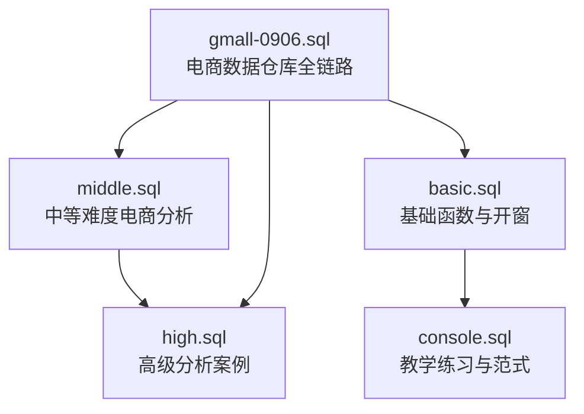
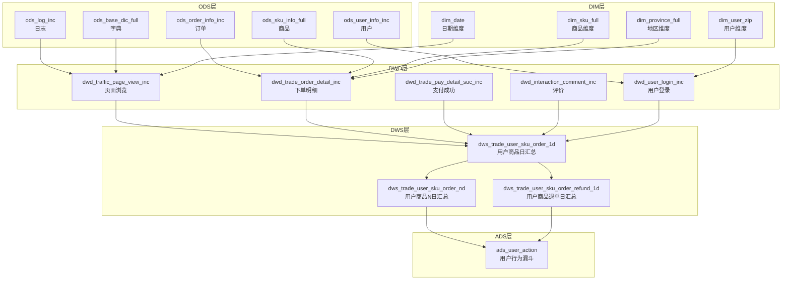
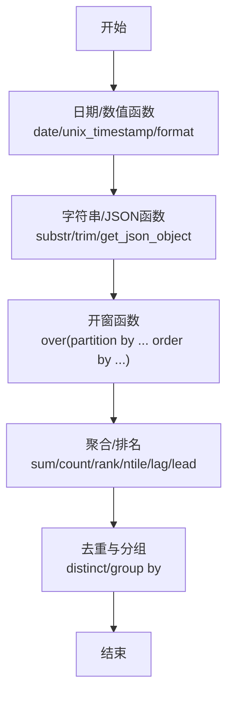
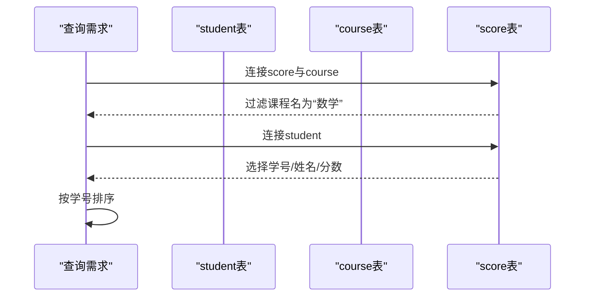
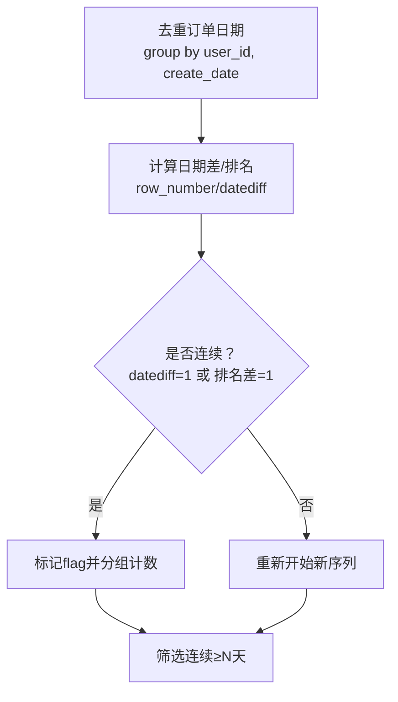
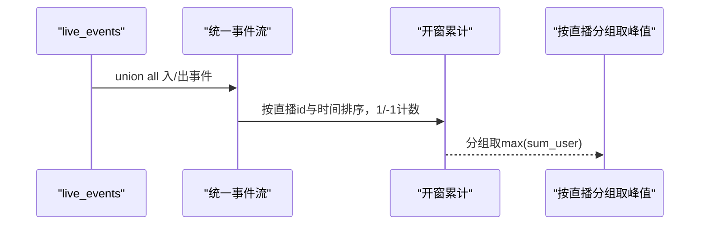
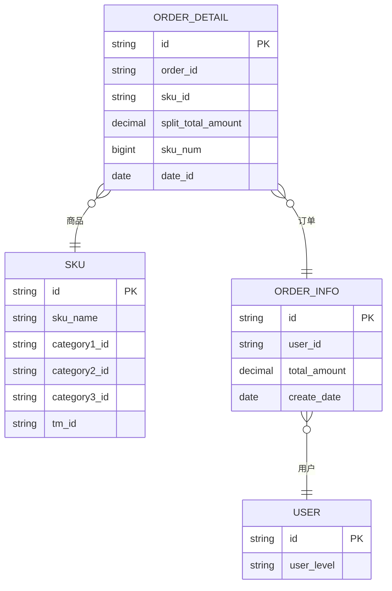

# 分析案例

<cite>
**本文引用的文件**
- [basic.sql](file://basic.sql)
- [console.sql](file://console.sql)
- [gmall-0906.sql](file://gmall-0906.sql)
- [high.sql](file://high.sql)
- [middle.sql](file://middle.sql)
</cite>

## 目录
1. [引言](#引言)
2. [项目结构](#项目结构)
3. [核心组件](#核心组件)
4. [架构总览](#架构总览)
5. [详细组件分析](#详细组件分析)
6. [依赖分析](#依赖分析)
7. [性能考量](#性能考量)
8. [故障排查指南](#故障排查指南)
9. [结论](#结论)
10. [附录](#附录)

## 引言
本综合文档围绕HQL数据分析案例展开，结合仓库中的多类SQL脚本与电商数据仓库实践，系统梳理从基础函数、开窗与聚合、到复杂业务分析（连续登录、会话划分、用户生命周期、漏斗分析）与电商指标（销售、退单、支付、收藏、评价、流量）的实现思路与优化策略。文档面向数据分析师与业务人员，提供可复用的查询模板、分析方法与最佳实践，帮助快速构建关键指标与趋势分析。

## 项目结构
仓库包含五个核心SQL文件：
- basic.sql：基础函数与开窗函数演示，覆盖日期、数值、字符串处理与开窗聚合。
- console.sql：教学型练习与学生/课程/成绩场景的SQL范式，强调执行顺序、去重与连接策略。
- middle.sql：中等难度电商分析案例，包括连续登录、累计消费、首次次日转化、品类Top、用户综合统计等。
- high.sql：高级分析案例，聚焦在线人数峰值、会话划分、连续登录天数统计等。
- gmall-0906.sql：完整的电商数据仓库（ODS/DWD/DIM/DWS/ADS）建模与装载脚本，覆盖日志、交易、工具、互动、流量、用户域等。

**图表来源**
- [basic.sql](file://basic.sql#L1-L120)
- [console.sql](file://console.sql#L1-L120)
- [middle.sql](file://middle.sql#L1-L120)
- [high.sql](file://high.sql#L1-L40)
- [gmall-0906.sql](file://gmall-0906.sql#L1-L120)

**章节来源**
- [basic.sql](file://basic.sql#L1-L120)
- [console.sql](file://console.sql#L1-L120)
- [middle.sql](file://middle.sql#L1-L120)
- [high.sql](file://high.sql#L1-L40)
- [gmall-0906.sql](file://gmall-0906.sql#L1-L120)

## 核心组件
- 基础函数与开窗：日期/数值/字符串函数、开窗聚合、rank/dense_rank/ntile、lag/lead、集合收集等。
- 电商指标与口径：订单、退款、支付、收藏、评价、流量、用户注册/登录等。
- 高级分析能力：在线并发、会话划分、连续登录、用户生命周期与价值分层、漏斗分析。
- 数据仓库分层：ODS（增量/全量）、DWD（事务事实）、DIM（维度）、DWS（主题宽表）、ADS（应用层）。

**章节来源**
- [basic.sql](file://basic.sql#L120-L220)
- [gmall-0906.sql](file://gmall-0906.sql#L460-L700)
- [middle.sql](file://middle.sql#L1-L120)
- [high.sql](file://high.sql#L1-L120)

## 架构总览
电商数据仓库采用分层建模，典型流程为：ODS层接入原始日志与事务数据，DWD层清洗与落事实，DIM层沉淀维度，DWS层按主题宽表汇总，ADS层面向应用与报表。

**图表来源**
- [gmall-0906.sql](file://gmall-0906.sql#L2540-L3200)
- [gmall-0906.sql](file://gmall-0906.sql#L3650-L3999)
- [gmall-0906.sql](file://gmall-0906.sql#L5200-L5369)

**章节来源**
- [gmall-0906.sql](file://gmall-0906.sql#L2540-L3200)
- [gmall-0906.sql](file://gmall-0906.sql#L3650-L3999)
- [gmall-0906.sql](file://gmall-0906.sql#L5200-L5369)

## 详细组件分析

### 组件A：基础函数与开窗（basic.sql）
- 日期与数值函数：日期运算、时间戳转换、取整/舍入、对数/幂/根等。
- 字符串与JSON处理：截取、拼接、空白处理、JSON提取。
- 开窗与聚合：rows between、partition by/order by、count/sum/first_value/last_value、ntile/rank/dense_rank/row_number、lag/lead。
- 去重与执行计划：distinct/group by、explain formatted/extended、执行顶点对比。

**图表来源**
- [basic.sql](file://basic.sql#L1-L120)
- [basic.sql](file://basic.sql#L120-L220)

**章节来源**
- [basic.sql](file://basic.sql#L1-L220)

### 组件B：教学练习与范式（console.sql）
- 学生成绩与课程场景：多表连接、子查询、聚合与排序、if/concat/日期差等。
- 执行顺序与性能：FROM-WHERE-GROUP BY-聚合-HAVING-SELECT-ORDER BY-LIMIT。
- 去重与连接策略：先筛选再关联、子查询替代join的效率差异。

**图表来源**
- [console.sql](file://console.sql#L1-L120)

**章节来源**
- [console.sql](file://console.sql#L1-L120)

### 组件C：中等难度电商分析（middle.sql）
- 连续登录：基于去重与row_number/dense_rank/日期差的连续性标记，统计连续天数与阈值。
- 累计消费与VIP分层：按用户累计金额分段，或使用开窗累计。
- 首次次日转化：按用户首次下单与次日下单的标记与计数。
- 品类Top与品类平均：按品类分组统计销量与平均值，筛选高于品类均值的商品。
- 用户综合统计：注册日期、登录次数、2021年登录/订单/金额统计。

**图表来源**
- [middle.sql](file://middle.sql#L1-L200)
- [middle.sql](file://middle.sql#L200-L420)

**章节来源**
- [middle.sql](file://middle.sql#L1-L420)

### 组件D：高级分析案例（high.sql）
- 在线并发：事件入/出合并，按时间排序，累计计数求峰值。
- 会话划分：基于用户访问时间差设定阈值（如60秒），标记会话ID。
- 连续登录（进阶）：利用lag/日期差与累计flag，统计最大连续天数。

**图表来源**
- [high.sql](file://high.sql#L1-L60)

**章节来源**
- [high.sql](file://high.sql#L1-L120)

### 组件E：电商数据仓库全链路（gmall-0906.sql）
- ODS层：日志（页面浏览/启动/动作/曝光/错误）、订单/支付/退款/优惠券/收藏/评价/用户等事务与维度表。
- DWD层：事实表落地与维度映射，含分区dt与ORC存储。
- DIM层：商品、地区、日期、用户等维度表。
- DWS层：用户-商品粒度订单/退单N日汇总，支持7/30日口径。
- ADS层：用户行为漏斗等应用层指标。

**图表来源**
- [gmall-0906.sql](file://gmall-0906.sql#L1280-L1480)
- [gmall-0906.sql](file://gmall-0906.sql#L3650-L3999)

**章节来源**
- [gmall-0906.sql](file://gmall-0906.sql#L1280-L1480)
- [gmall-0906.sql](file://gmall-0906.sql#L3650-L3999)

## 依赖分析
- 组件耦合与内聚：DWD事实表依赖DIM维度；DWS宽表依赖DWD与DIM；ADS依赖DWS。
- 外部依赖：分区字段dt、字典表（parent_code限定）、JSON/时间戳转换。
- 潜在循环依赖：按分层顺序推进，未见循环；需确保分区dt与日期维度一致性。

**图表来源**
- [gmall-0906.sql](file://gmall-0906.sql#L2540-L3200)
- [gmall-0906.sql](file://gmall-0906.sql#L3650-L3999)

**章节来源**
- [gmall-0906.sql](file://gmall-0906.sql#L2540-L3200)
- [gmall-0906.sql](file://gmall-0906.sql#L3650-L3999)

## 性能考量
- 分区与裁剪：优先按dt分区，过滤条件尽量落在where，避免全表扫描。
- 去重前置：连续性分析与去重先行，减少后续聚合数据量。
- 开窗与聚合：能聚合不开窗，必要时使用rows between限制窗口大小。
- 执行计划：使用explain观察顶点与shuffle，定位大表join与倾斜。
- 存储格式：ORC压缩，减少I/O与解析成本。
- 字段类型：合理使用decimal/bigint，避免隐式转换。

[本节为通用指导，无需特定文件引用]

## 故障排查指南
- 日期格式错误：常见于to_unix_timestamp/date_format，需严格匹配格式。
- 空值与null：coalesce/nvl/lag默认值设置，避免统计偏移。
- 执行计划异常：检查分区字段、join键是否一致、是否存在广播/shuffle瓶颈。
- 连续性误判：确认去重与排序键（user_id+date），日期差阈值设置。

**章节来源**
- [basic.sql](file://basic.sql#L60-L120)
- [console.sql](file://console.sql#L1-L120)
- [middle.sql](file://middle.sql#L1-L120)

## 结论
本仓库提供了从基础函数到复杂电商分析的完整实践路径。通过分层建模与开窗/聚合技巧，可高效产出关键指标与趋势分析；配合连续性与会话划分等高级分析，能够支撑用户行为洞察与运营策略制定。建议在生产环境中强化分区与去重策略，关注执行计划与存储格式，持续优化查询性能。

[本节为总结性内容，无需特定文件引用]

## 附录

### 附录A：中等难度SQL练习与参考路径
- 连续登录（至少连续N天）：参考路径 [middle.sql](file://middle.sql#L1-L200)
- 累计消费与VIP分层：参考路径 [middle.sql](file://middle.sql#L200-L320)
- 首次次日转化比率：参考路径 [middle.sql](file://middle.sql#L320-L420)
- 品类Top与高于品类均值商品：参考路径 [middle.sql](file://middle.sql#L420-L520)
- 用户综合统计（注册/登录/订单/金额）：参考路径 [middle.sql](file://middle.sql#L520-L720)

**章节来源**
- [middle.sql](file://middle.sql#L1-L720)

### 附录B：电商关键指标模板（路径指引）
- 日/7日/30日用户-商品订单汇总：参考路径 [gmall-0906.sql](file://gmall-0906.sql#L3650-L3999)
- 用户-商品退单汇总：参考路径 [gmall-0906.sql](file://gmall-0906.sql#L3857-L3980)
- 页面浏览/启动/动作/曝光/错误事实表：参考路径 [gmall-0906.sql](file://gmall-0906.sql#L2540-L3050)
- 用户登录/注册事实表：参考路径 [gmall-0906.sql](file://gmall-0906.sql#L3050-L3200)

**章节来源**
- [gmall-0906.sql](file://gmall-0906.sql#L2540-L3200)
- [gmall-0906.sql](file://gmall-0906.sql#L3650-L3999)
- [gmall-0906.sql](file://gmall-0906.sql#L3857-L3980)

### 附录C：高级分析模板（路径指引）
- 在线并发峰值：参考路径 [high.sql](file://high.sql#L1-L60)
- 会话划分（阈值60秒）：参考路径 [high.sql](file://high.sql#L80-L140)
- 连续登录（最大连续天数）：参考路径 [high.sql](file://high.sql#L140-L319)

**章节来源**
- [high.sql](file://high.sql#L1-L319)