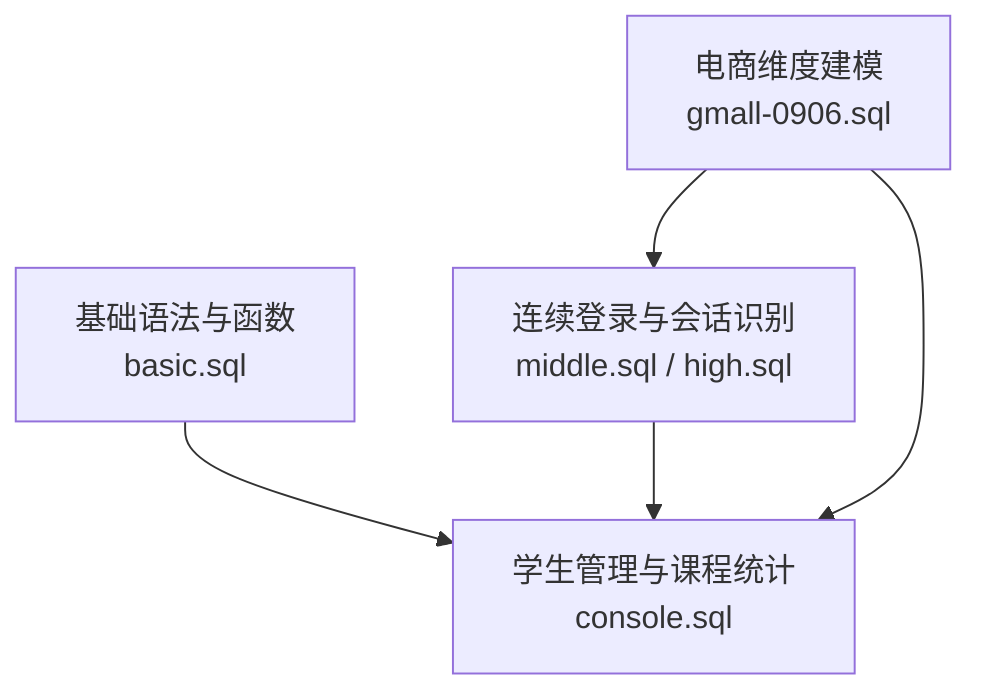
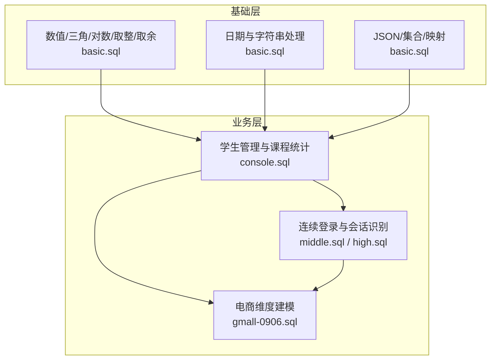
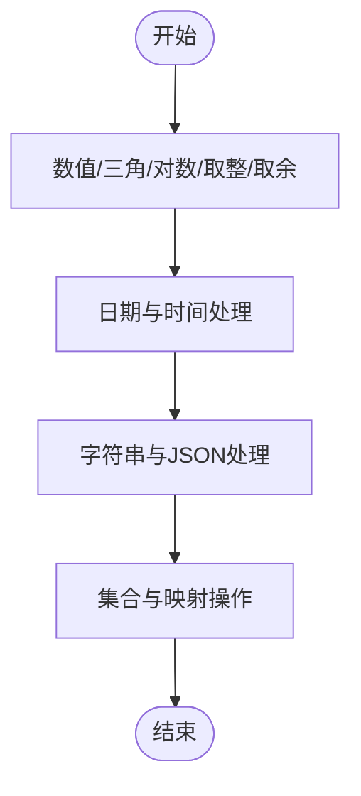
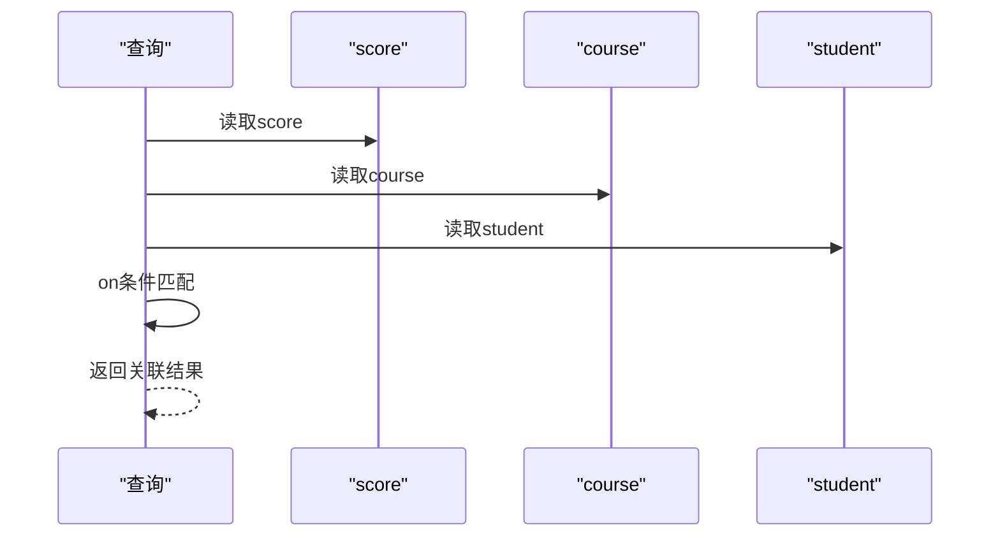
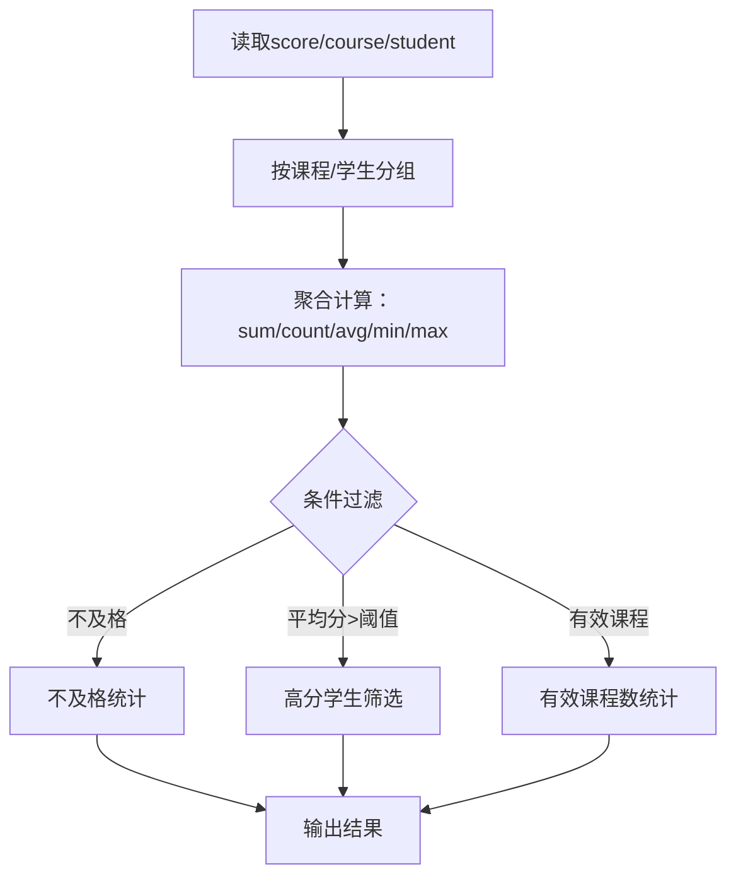
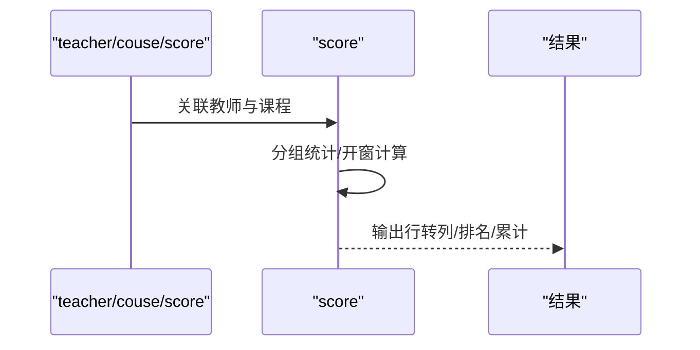
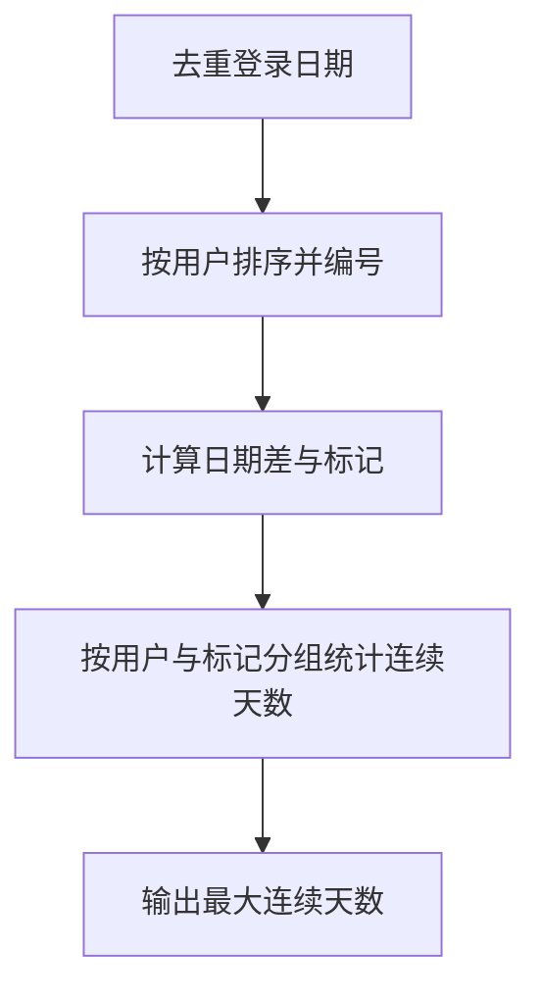
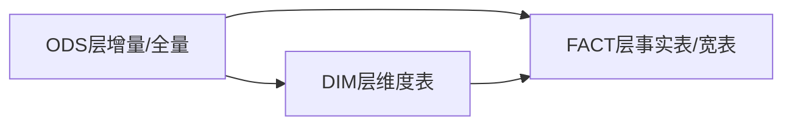
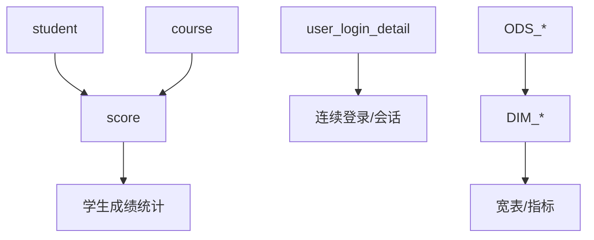

# 基础查询示例

<cite>
**本文引用的文件**
- [basic.sql](file://basic.sql)
- [console.sql](file://console.sql)
- [middle.sql](file://middle.sql)
- [high.sql](file://high.sql)
- [gmall-0906.sql](file://gmall-0906.sql)
</cite>

## 目录
1. [引言](#引言)
2. [项目结构](#项目结构)
3. [核心组件](#核心组件)
4. [架构总览](#架构总览)
5. [详细组件分析](#详细组件分析)
6. [依赖分析](#依赖分析)
7. [性能考量](#性能考量)
8. [故障排查指南](#故障排查指南)
9. [结论](#结论)
10. [附录](#附录)

## 引言
本文件面向初学者，系统梳理仓库中的Hive SQL基础查询示例，覆盖SQL基础语法、连接查询、聚合函数、分组统计、开窗函数、日期与字符串处理、行转列、连续登录与会话识别、以及电商维度建模等典型业务场景。通过逐类示例与图示，帮助读者建立从“能跑通”到“写得好、跑得快”的能力阶梯。

## 项目结构
仓库包含多个SQL脚本，分别聚焦不同主题：
- 基础语法与函数：basic.sql
- 学生管理与课程统计：console.sql
- 连续登录、会话识别与用户行为分析：middle.sql、high.sql
- 电商维度建模与宽表构建：gmall-0906.sql

图表来源
- [basic.sql](file://basic.sql#L1-L120)
- [console.sql](file://console.sql#L1-L120)
- [middle.sql](file://middle.sql#L1-L120)
- [high.sql](file://high.sql#L1-L40)
- [gmall-0906.sql](file://gmall-0906.sql#L1-L60)

章节来源
- [basic.sql](file://basic.sql#L1-L120)
- [console.sql](file://console.sql#L1-L120)
- [middle.sql](file://middle.sql#L1-L120)
- [high.sql](file://high.sql#L1-L40)
- [gmall-0906.sql](file://gmall-0906.sql#L1-L60)

## 核心组件
- 基础语法与函数：数值、三角、对数、取整、取余、日期时间、字符串处理、JSON解析、集合与映射操作等。
- 连接查询：内/外/半连接、多表关联、子查询改写、exists与in的性能权衡。
- 聚合与分组：count、sum、avg、min/max、count(distinct)、having、group by、order by、limit。
- 开窗函数：分区、排序、滑动窗口、rank/dense_rank/row_number、ntile、first_value/last_value、lag/lead、累计求和与排名。
- 行转列与列转行：if+sum、collect_set/list、数组与映射函数。
- 日期与字符串：日期格式化、截取、差值、月份替换、当前日期与时间戳。
- 业务场景：学生成绩查询、课程统计、学生信息检索、连续登录、会话切分、用户活跃度、商品销量与品类分析、推荐系统等。

章节来源
- [basic.sql](file://basic.sql#L1-L200)
- [console.sql](file://console.sql#L1-L200)
- [middle.sql](file://middle.sql#L1-L200)
- [high.sql](file://high.sql#L1-L120)
- [gmall-0906.sql](file://gmall-0906.sql#L1-L120)

## 架构总览
整体思路：先从基础语法与函数入手，再进入学生管理与课程统计的典型查询；随后引入连续登录与会话识别等进阶场景；最后以电商维度建模作为实战演练，串联多表宽表构建与指标计算。

图表来源
- [basic.sql](file://basic.sql#L1-L200)
- [console.sql](file://console.sql#L1-L200)
- [middle.sql](file://middle.sql#L1-L200)
- [high.sql](file://high.sql#L1-L120)
- [gmall-0906.sql](file://gmall-0906.sql#L1-L120)

## 详细组件分析

### 基础语法与函数（数值、三角、对数、取整、取余、日期时间、字符串处理）
- 数值与三角：幂、平方根、对数、pi、greatest/least、银行家舍入与常规舍入。
- 日期时间：日期加减、时间戳转换、当前日期/时间、日期差、月份替换、格式化。
- 字符串与JSON：大小写、截取、拼接、trim、JSON对象提取。
- 集合与映射：collect_set/list、map_keys/values、数组包含判断、size。

图表来源
- [basic.sql](file://basic.sql#L1-L120)
- [basic.sql](file://basic.sql#L800-L940)
- [basic.sql](file://basic.sql#L900-L1000)

章节来源
- [basic.sql](file://basic.sql#L1-L120)
- [basic.sql](file://basic.sql#L800-L940)
- [basic.sql](file://basic.sql#L900-L1000)

### 连接查询与子查询改写
- 连接策略：join顺序、on条件、别名规范、笛卡尔积风险。
- 子查询改写：in/exists、left semi join、with子句、先筛选再关联。
- 性能权衡：exists通常优于in，left semi在大数据场景更高效。

图表来源
- [console.sql](file://console.sql#L1-L120)
- [console.sql](file://console.sql#L800-L920)
- [console.sql](file://console.sql#L1040-L1100)

章节来源
- [console.sql](file://console.sql#L1-L120)
- [console.sql](file://console.sql#L800-L920)
- [console.sql](file://console.sql#L1040-L1100)

### 聚合与分组统计（学生成绩、课程统计、学生信息检索）
- 成绩查询：不及格统计、平均分、总分、有效课程数。
- 课程统计：每门课程的及格/不及格人数、分数段分布。
- 学生信息检索：按条件筛选、按学号/姓名排序、去重与聚合。

图表来源
- [console.sql](file://console.sql#L1100-L1220)
- [console.sql](file://console.sql#L1220-L1350)
- [console.sql](file://console.sql#L1350-L1470)

章节来源
- [console.sql](file://console.sql#L1100-L1220)
- [console.sql](file://console.sql#L1220-L1350)
- [console.sql](file://console.sql#L1350-L1470)

### 开窗函数与行转列
- 开窗函数：分区、排序、滑动窗口、累计求和、排名（dense_rank/row_number）、前后行比较（lag/lead）、首尾值（first_value/last_value）。
- 行转列：if+sum按课程拆分列，缺失值补0；列转行：collect_set/list与explode（如适用）。

图表来源
- [console.sql](file://console.sql#L1360-L1470)
- [console.sql](file://console.sql#L1470-L1599)
- [basic.sql](file://basic.sql#L130-L200)

章节来源
- [console.sql](file://console.sql#L1360-L1470)
- [console.sql](file://console.sql#L1470-L1599)
- [basic.sql](file://basic.sql#L130-L200)

### 连续登录与会话识别
- 连续登录：基于日期差与row_number打标，或使用lag/lead比较相邻日期，计算连续天数。
- 会话切分：以时间间隔阈值（如60秒）为界，使用lag/lead与if标记，形成会话ID。
- 最大连续登录天数：按用户与打标分组，计算首尾日期差+1。

图表来源
- [middle.sql](file://middle.sql#L1-L120)
- [middle.sql](file://middle.sql#L120-L220)
- [high.sql](file://high.sql#L120-L220)

章节来源
- [middle.sql](file://middle.sql#L1-L120)
- [middle.sql](file://middle.sql#L120-L220)
- [high.sql](file://high.sql#L120-L220)

### 电商维度建模与宽表构建
- 维度建表：商品、品牌、品类、地区、活动、优惠券等维度表。
- 宽表构建：多表left join，收集字段，使用collect_set等聚合函数构造数组/结构体。
- 指标计算：按日期/用户/商品维度聚合，计算销量、金额、均价等。

图表来源
- [gmall-0906.sql](file://gmall-0906.sql#L1-L120)
- [gmall-0906.sql](file://gmall-0906.sql#L460-L600)
- [gmall-0906.sql](file://gmall-0906.sql#L600-L740)

章节来源
- [gmall-0906.sql](file://gmall-0906.sql#L1-L120)
- [gmall-0906.sql](file://gmall-0906.sql#L460-L600)
- [gmall-0906.sql](file://gmall-0906.sql#L600-L740)

## 依赖分析
- 表依赖：学生管理场景依赖student、score、course；连续登录依赖user_login_detail；电商场景依赖多张ODS/DIM表。
- 函数依赖：日期函数、字符串函数、聚合函数、开窗函数、集合函数广泛使用。
- 性能依赖：join顺序、过滤下推、聚合前置、避免笛卡尔积、合理使用索引/分区键。

图表来源
- [console.sql](file://console.sql#L1-L120)
- [middle.sql](file://middle.sql#L1-L120)
- [gmall-0906.sql](file://gmall-0906.sql#L1-L120)

章节来源
- [console.sql](file://console.sql#L1-L120)
- [middle.sql](file://middle.sql#L1-L120)
- [gmall-0906.sql](file://gmall-0906.sql#L1-L120)

## 性能考量
- 优先使用聚合函数而非开窗：直接聚合通常更高效。
- 过滤下推：尽量在join前where过滤，减少数据量。
- 使用left semi join替代某些子查询，提升效率。
- 合理使用分区键与排序键，避免全表扫描。
- 避免select *，明确字段，减少I/O。
- 使用explain分析执行计划，定位瓶颈。

章节来源
- [console.sql](file://console.sql#L1040-L1100)
- [middle.sql](file://middle.sql#L1-L120)
- [basic.sql](file://basic.sql#L230-L290)

## 故障排查指南
- 日期格式错误：日期函数对格式敏感，返回null时检查格式。
- 子查询报错：嵌套子查询不支持时，改写为join或with子句。
- 排序与分组：having中不可使用select别名，需使用原表达式。
- 空值处理：nvl/coalesce消除null，避免统计偏差。
- 执行计划：使用explain查看顶点与阶段，定位shuffle与数据倾斜。

章节来源
- [basic.sql](file://basic.sql#L60-L120)
- [console.sql](file://console.sql#L950-L1000)
- [console.sql](file://console.sql#L1000-L1080)
- [basic.sql](file://basic.sql#L230-L290)

## 结论
本仓库提供了从基础语法到业务实战的完整Hive SQL示例。建议按“基础语法→连接与聚合→开窗与行转列→连续登录与会话→电商维度建模”的路径逐步深入，结合explain与性能优化建议，持续迭代查询质量与执行效率。

## 附录
- 常用函数速查：数值、三角、对数、取整、日期时间、字符串、JSON、集合与映射。
- 常见查询模式：行转列、连续登录、会话切分、宽表构建、指标聚合。
- 最佳实践清单：过滤下推、聚合优先、别名规范、explain分析、空值处理。