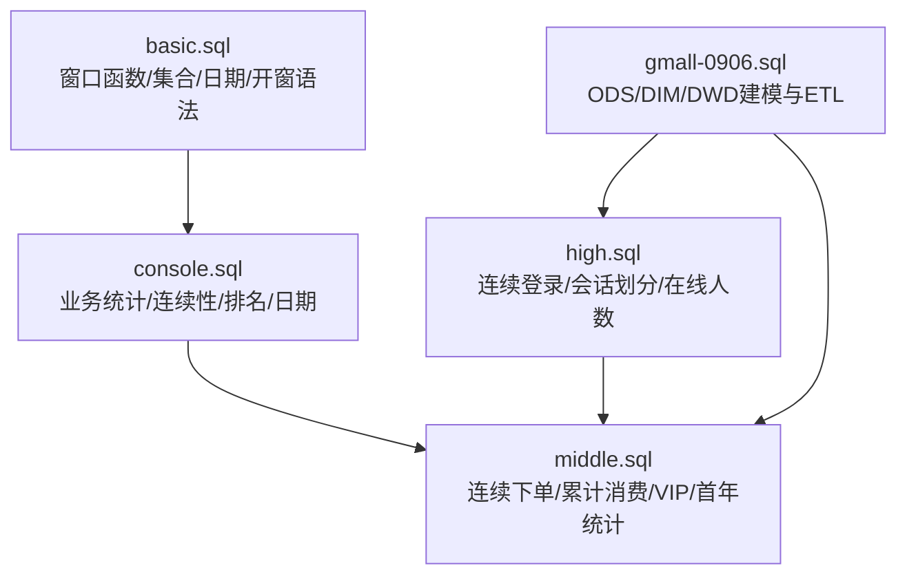
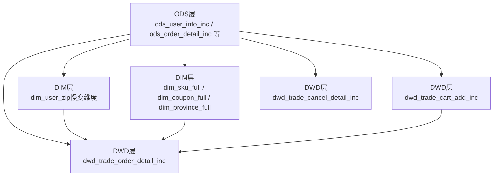
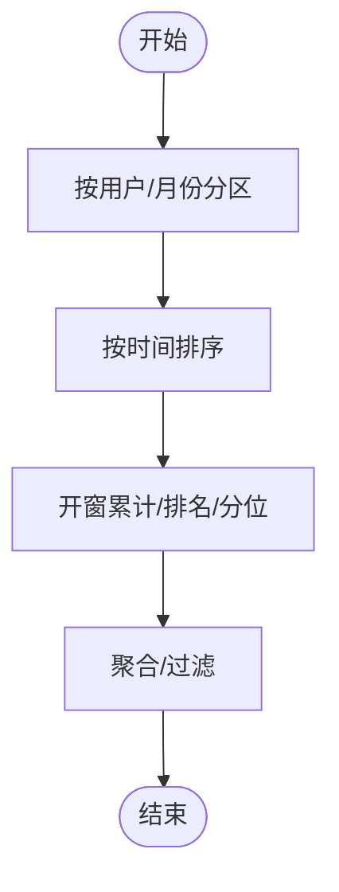
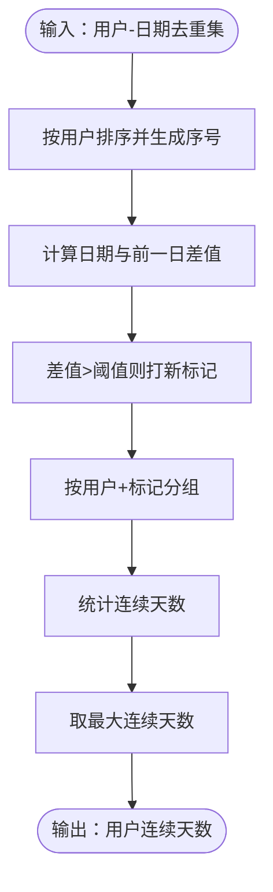
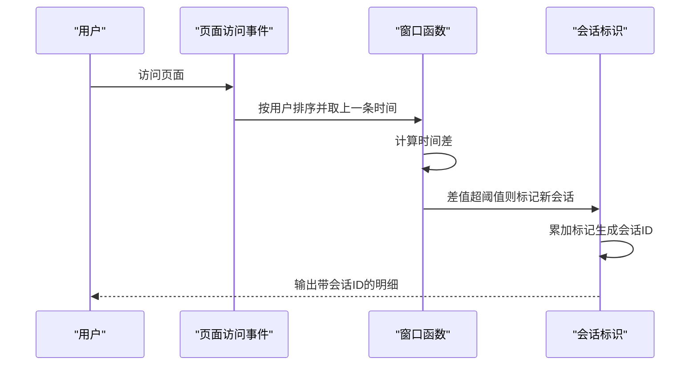
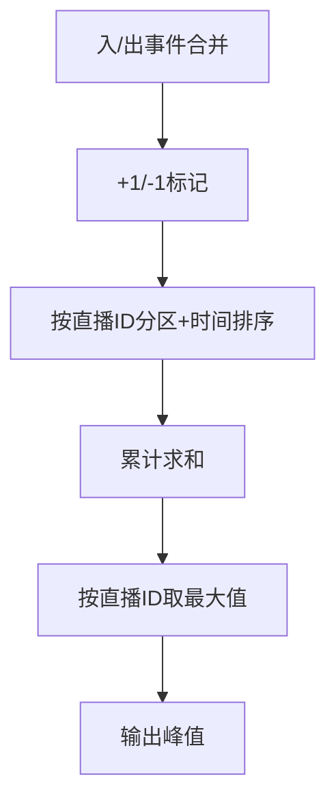
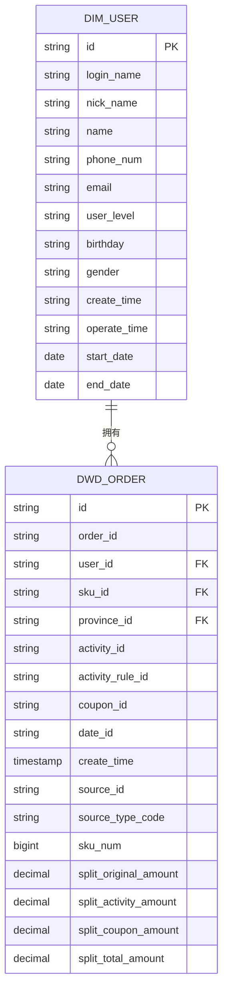
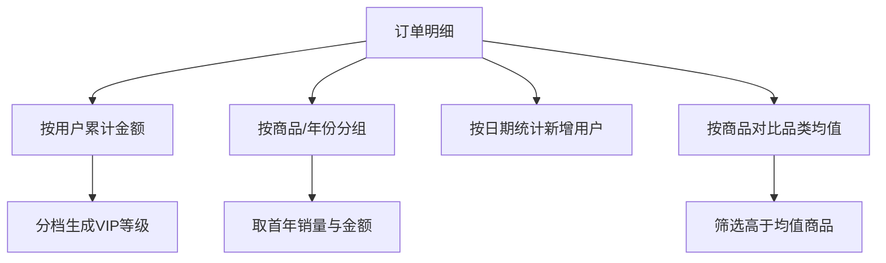
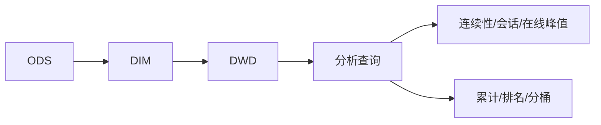

# 高级分析算法

<cite>
**本文引用的文件**
- [basic.sql](file://basic.sql)
- [console.sql](file://console.sql)
- [gmall-0906.sql](file://gmall-0906.sql)
- [high.sql](file://high.sql)
- [middle.sql](file://middle.sql)
</cite>

## 目录
1. [引言](#引言)
2. [项目结构](#项目结构)
3. [核心组件](#核心组件)
4. [架构总览](#架构总览)
5. [详细组件分析](#详细组件分析)
6. [依赖分析](#依赖分析)
7. [性能考量](#性能考量)
8. [故障排查指南](#故障排查指南)
9. [结论](#结论)
10. [附录](#附录)

## 引言
本文件面向Hive/HQL的高级分析与算法实践，围绕复杂数据分析与挖掘主题，系统梳理仓库中涉及的窗口函数、自连接、递归与会话划分、连续事件检测、分桶与排名、集合聚合等技术要点，并结合电商领域事实与维度建模示例，给出可复用的分析流程与最佳实践。文档既关注算法实现细节，也强调工程化落地与性能优化。

## 项目结构
仓库包含五个SQL脚本，分别覆盖基础窗口函数与集合聚合、典型业务场景（学生成绩、用户活跃、登录连续性）、电商宽表与维度建模、高阶连续事件与会话划分，以及中间层聚合与统计分析。整体呈现从“基础能力”到“业务建模”，再到“高级分析”的渐进式组织。

图示来源
- [basic.sql](file://basic.sql#L129-L207)
- [console.sql](file://console.sql#L248-L309)
- [gmall-0906.sql](file://gmall-0906.sql#L496-L604)
- [high.sql](file://high.sql#L146-L215)
- [middle.sql](file://middle.sql#L281-L324)

章节来源
- [basic.sql](file://basic.sql#L129-L207)
- [console.sql](file://console.sql#L248-L309)
- [gmall-0906.sql](file://gmall-0906.sql#L496-L604)
- [high.sql](file://high.sql#L146-L215)
- [middle.sql](file://middle.sql#L281-L324)

## 核心组件
- 窗口函数与开窗语法：行号、排名、分位、前后边界、累计与滚动聚合。
- 连续性检测：基于日期差分与行号/排名相减的“去重+打标”策略。
- 会话划分：基于时间窗阈值与页面跳转的会话标识。
- 在线人数：事件入/出时间的正负标记与累计求和。
- 集合聚合：collect_set/collect_list/struct/array等复杂类型的收集与展开。
- 电商建模：ODS/DIM/DWD分层与维度建模、慢变更维度处理、事务事实抽取。

章节来源
- [basic.sql](file://basic.sql#L129-L207)
- [high.sql](file://high.sql#L146-L215)
- [gmall-0906.sql](file://gmall-0906.sql#L954-L1078)

## 架构总览
下图展示从原始ODS到维度与事务事实表的建模过程，体现数据从增量/全量抽取、清洗、维度映射到最终分析宽表的关键步骤。

图示来源
- [gmall-0906.sql](file://gmall-0906.sql#L954-L1078)
- [gmall-0906.sql](file://gmall-0906.sql#L1174-L1278)
- [gmall-0906.sql](file://gmall-0906.sql#L1280-L1479)

## 详细组件分析

### 组件A：窗口函数与开窗语法
- 行号/排名/分位：row_number、rank、dense_rank、ntile等用于排序与分桶。
- 时间序列累计：按日期或用户分区的累计求和/计数。
- 前后边界：ROWS BETWEEN定义滑动窗口，支持unbounded/preceding/following/current row等。
- 集合聚合：collect_set/collect_list用于生成集合型字段，配合开窗进行分组内聚合。

图示来源
- [basic.sql](file://basic.sql#L129-L207)
- [basic.sql](file://basic.sql#L373-L405)
- [basic.sql](file://basic.sql#L186-L222)

章节来源
- [basic.sql](file://basic.sql#L129-L207)
- [basic.sql](file://basic.sql#L373-L405)
- [basic.sql](file://basic.sql#L186-L222)

### 组件B：连续性检测（登录/下单）
- 去重策略：先对用户-日期组合去重，确保一天仅计一次。
- 打标方法：使用row_number或dense_rank，或lag函数计算日期差，设定阈值（如1天/3天）作为连续性标志。
- 分组统计：按用户与flag分组统计连续长度，取最大值或筛选满足阈值的连续段。

图示来源
- [middle.sql](file://middle.sql#L130-L170)
- [middle.sql](file://middle.sql#L170-L215)
- [high.sql](file://high.sql#L146-L215)

章节来源
- [middle.sql](file://middle.sql#L130-L215)
- [high.sql](file://high.sql#L146-L215)

### 组件C：会话划分（页面浏览）
- 时间窗阈值：以相邻访问时间差作为会话切分依据（如超过阈值则新开会话）。
- 标记与串联：使用lag获取上一次访问时间，计算时间差并打标；通过累计和生成会话ID。
- 页面跳转：结合next_page_id等字段，识别页面流转。

图示来源
- [high.sql](file://high.sql#L86-L145)
- [gmall-0906.sql](file://gmall-0906.sql#L5092-L5122)

章节来源
- [high.sql](file://high.sql#L86-L145)
- [gmall-0906.sql](file://gmall-0906.sql#L5092-L5122)

### 组件D：在线人数峰值（事件入/出）
- 正负标记：进入事件记+1，离开事件记-1，统一按时间排序。
- 累计求和：按直播ID分区累计，得到任意时刻在线人数。
- 峰值提取：对每个直播ID取最大累计值即为峰值。

图示来源
- [high.sql](file://high.sql#L1-L56)

章节来源
- [high.sql](file://high.sql#L1-L56)

### 组件E：电商建模与慢变维度
- ODS层：抽取增量/全量数据，清洗字段与类型。
- DIM层：构建维度表，含慢变维度（逐日拉链），通过rank/全量join实现版本控制。
- DWD层：抽取事务事实表，映射来源类型、省份、活动/优惠券等维度编码。

图示来源
- [gmall-0906.sql](file://gmall-0906.sql#L909-L949)
- [gmall-0906.sql](file://gmall-0906.sql#L1280-L1394)

章节来源
- [gmall-0906.sql](file://gmall-0906.sql#L909-L949)
- [gmall-0906.sql](file://gmall-0906.sql#L1280-L1394)

### 组件F：业务统计与高级分析
- 累计消费与VIP等级：按用户累计金额分档，形成动态等级。
- 首年销售统计：按商品与年份分组，取首年销量与金额。
- 新增用户统计：按首次登录时间统计新增用户数。
- 商品销量与品类对比：计算商品销量与品类均值，筛选高于均值的商品。

图示来源
- [middle.sql](file://middle.sql#L296-L324)
- [middle.sql](file://middle.sql#L447-L501)
- [middle.sql](file://middle.sql#L578-L610)
- [middle.sql](file://middle.sql#L670-L703)

章节来源
- [middle.sql](file://middle.sql#L296-L324)
- [middle.sql](file://middle.sql#L447-L501)
- [middle.sql](file://middle.sql#L578-L610)
- [middle.sql](file://middle.sql#L670-L703)

## 依赖分析
- 组件耦合
  - DWD层依赖DIM层维度映射，形成稳定的分析基表。
  - 连续性与会话分析依赖于去重与排序的稳定性（row_number/dense_rank/lag）。
  - 在线人数峰值依赖事件入/出标记与累计求和的正确性。
- 外部依赖
  - JSON/文本格式的ODS表需正确解析字段与分区。
  - Hive/ORC存储与动态分区配置影响加载性能与并发度。

图示来源
- [gmall-0906.sql](file://gmall-0906.sql#L954-L1078)
- [high.sql](file://high.sql#L146-L215)
- [middle.sql](file://middle.sql#L281-L324)

章节来源
- [gmall-0906.sql](file://gmall-0906.sql#L954-L1078)
- [high.sql](file://high.sql#L146-L215)
- [middle.sql](file://middle.sql#L281-L324)

## 性能考量
- 数据去重优先：连续性与会话分析务必先去重，避免重复计数导致结果偏差与性能浪费。
- 窗口函数顺序：partition by + order by尽量靠近数据源，减少中间层排序成本。
- 动态分区与存储：合理设置动态分区模式与ORC压缩，提升写入与扫描效率。
- 分桶与分区裁剪：按日期分区与热点字段分桶，充分利用WHERE与分区裁剪。
- 避免不必要的子查询：能用开窗解决的问题尽量避免多层嵌套，减少I/O与中间结果集。

## 故障排查指南
- 空值与默认值：使用coalesce/nvl/lead/lag的默认参数，避免NULL传播影响计算。
- 日期格式：日期函数对格式敏感，返回NULL时优先检查格式与字段类型。
- 窗口边界：ROWS BETWEEN的边界表达需与业务意图一致，避免误用current row/unbounded。
- 执行计划：通过EXPLAIN定位排序、聚合与连接的热点节点，针对性优化。

章节来源
- [basic.sql](file://basic.sql#L342-L367)
- [basic.sql](file://basic.sql#L681-L700)
- [console.sql](file://console.sql#L2836-L2881)

## 结论
本仓库以实战为导向，系统展示了Hive/HQL在窗口函数、连续性检测、会话划分、在线人数峰值、电商建模与业务统计方面的综合能力。建议在实际项目中遵循“先去重、再排序、后开窗”的范式，结合分桶与分区策略，持续优化执行计划与存储格式，以获得稳定高效的分析结果。

## 附录
- 推荐系统与风险评估：可在现有DWD/DIM基础上，引入协同过滤/矩阵分解等离线特征，结合实时流式计算进行召回与排序，但本仓库未包含具体ML实现片段，建议参考通用建模流程扩展。
- 数据挖掘与机器学习：可利用collect_set/collect_list等聚合函数构造样本特征，再结合外部ML平台进行训练与推理，本仓库未包含具体ML实现片段。