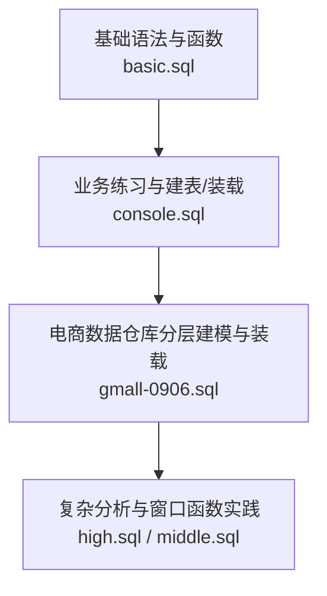
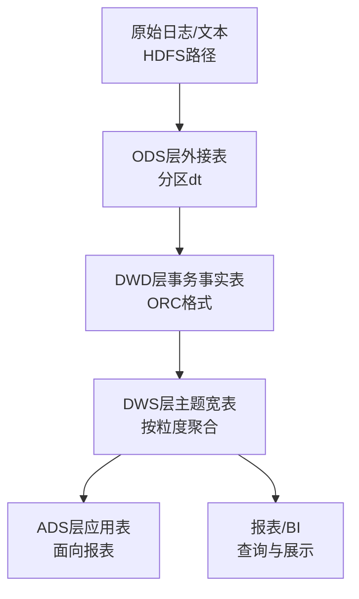
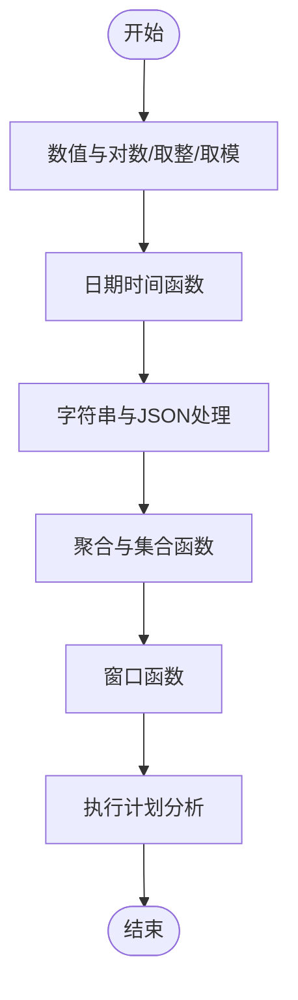
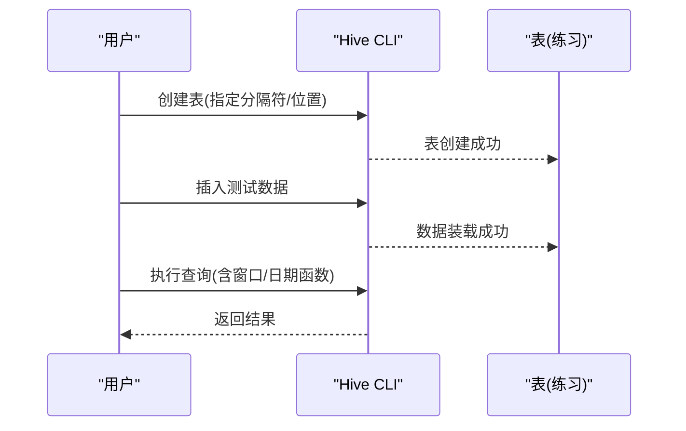
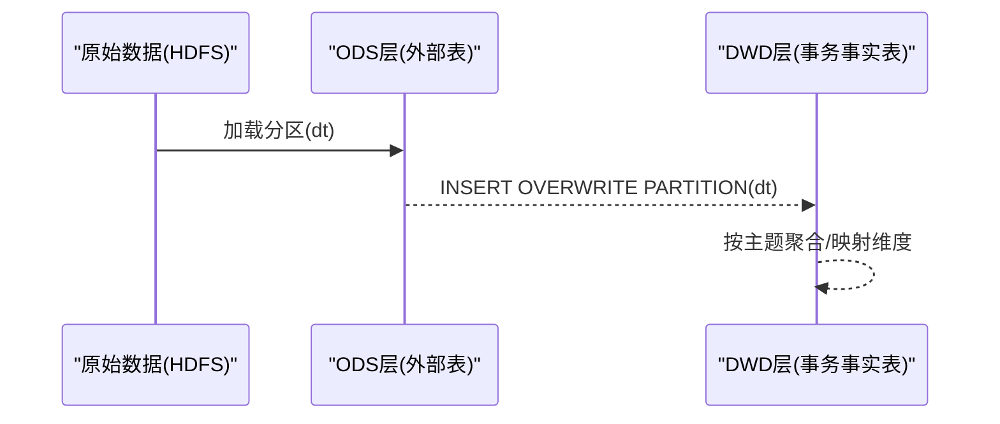
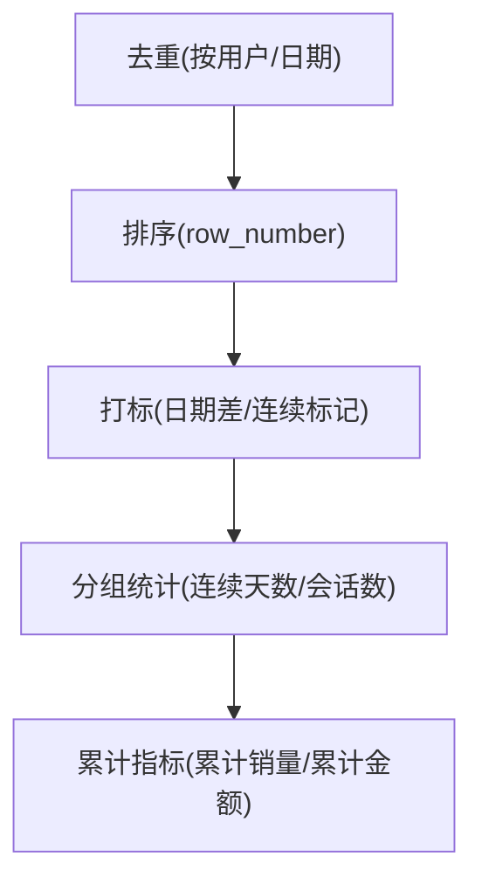

# 快速开始

<cite>
**本文引用的文件**
- [basic.sql](file://basic.sql)
- [console.sql](file://console.sql)
- [gmall-0906.sql](file://gmall-0906.sql)
- [high.sql](file://high.sql)
- [middle.sql](file://middle.sql)
</cite>

## 目录
1. [简介](#简介)
2. [项目结构](#项目结构)
3. [核心组件](#核心组件)
4. [架构概览](#架构概览)
5. [详细组件分析](#详细组件分析)
6. [依赖分析](#依赖分析)
7. [性能考虑](#性能考虑)
8. [故障排查指南](#故障排查指南)
9. [结论](#结论)
10. [附录](#附录)

## 简介
本指南面向希望快速上手HQL（Hive SQL）的用户，结合仓库中的SQL脚本，提供从环境准备、数据仓库部署与初始化、表结构定义、初始数据装载，到基本查询验证的完整流程。文档同时给出不同技术背景用户的入门路径建议，并总结常见初始化命令与配置参数说明，帮助新用户尽快完成第一个查询示例。

## 项目结构
仓库包含多个SQL脚本，分别覆盖HQL基础语法、业务场景练习、电商数据仓库（ODS/DWD/DWS/ADS）分层建模与装载、以及复杂分析场景（连续登录、会话切分、累计指标等）。整体呈现“从基础到进阶再到实战”的学习路径。

图表来源
- [basic.sql](file://basic.sql#L1-L120)
- [console.sql](file://console.sql#L150-L230)
- [gmall-0906.sql](file://gmall-0906.sql#L1-L120)
- [high.sql](file://high.sql#L1-L60)
- [middle.sql](file://middle.sql#L1-L60)

章节来源
- [basic.sql](file://basic.sql#L1-L120)
- [console.sql](file://console.sql#L150-L230)
- [gmall-0906.sql](file://gmall-0906.sql#L1-L120)
- [high.sql](file://high.sql#L1-L60)
- [middle.sql](file://middle.sql#L1-L60)

## 核心组件
- 数据仓库分层（ODS/DWD/DWS/ADS）
  - ODS层：外部表，接入原始日志/文本，分区按日期存储，典型字段包含JSON结构或制表符分隔字段。
  - DWD层：事务事实表，清洗、映射维度字段，分区按日期存储，常用ORC格式压缩。
  - DWS层：主题宽表，按粒度（如省份/城市/品类）聚合，便于分析。
  - ADS层：应用层，面向报表与BI展示。
- 常见表结构与装载
  - 外部表建表：分区字段dt，ROW FORMAT指定分隔符或JSON SerDe，LOCATION指向HDFS路径。
  - 插入装载：INSERT OVERWRITE PARTITION，支持静态/动态分区；可设置动态分区模式。
- Hive配置与优化
  - 执行引擎切换：set hive.execution.engine=spark。
  - 动态分区模式：set hive.exec.dynamic.partition.mode=nonstrict。
  - 本地模式开关：set hive.exec.mode.local.auto=true/false。
  - 小表广播：set hive.mapjoin.smalltable.filesize。
  - 任务推测执行：mapred.map/reduce.tasks.speculative.execution。

章节来源
- [gmall-0906.sql](file://gmall-0906.sql#L1-L120)
- [gmall-0906.sql](file://gmall-0906.sql#L3040-L3239)
- [gmall-0906.sql](file://gmall-0906.sql#L2550-L2567)
- [console.sql](file://console.sql#L3250-L3270)
- [console.sql](file://console.sql#L3260-L3264)
- [console.sql](file://console.sql#L3325-L3327)
- [basic.sql](file://basic.sql#L850-L870)

## 架构概览
下图展示了从原始数据到分析结果的典型流程：原始日志/文本经ODS接入，清洗映射后写入DWD，再按主题聚合到DWS，最终用于报表或进一步分析。

图表来源
- [gmall-0906.sql](file://gmall-0906.sql#L1-L120)
- [gmall-0906.sql](file://gmall-0906.sql#L2550-L2567)
- [gmall-0906.sql](file://gmall-0906.sql#L3040-L3239)

## 详细组件分析

### 组件A：基础语法与函数（basic.sql）
- 覆盖内容
  - 数值与对数、三角函数、取整与舍入、取模、幂与根、十六进制转换等。
  - 日期时间函数：当前日期/时间、Unix时间戳、日期格式化、日期差、月份/年份提取、日期加减、季度末、周数等。
  - 字符串与JSON处理：大小写、截取、拼接、去空、JSON对象提取。
  - 聚合与集合：collect_set、collect_list、数组/映射操作。
  - 窗口函数：count开窗、row_number、ntile、first_value、last_value、rank/dense_rank等。
  - explain与执行计划：formatted/extended。
- 入门建议
  - 新手先从数值与字符串函数入手，再逐步学习日期函数与窗口函数。
  - 结合实际表结构（如employee、business）进行练习，验证函数行为。

图表来源
- [basic.sql](file://basic.sql#L1-L120)
- [basic.sql](file://basic.sql#L120-L240)
- [basic.sql](file://basic.sql#L240-L420)
- [basic.sql](file://basic.sql#L420-L600)
- [basic.sql](file://basic.sql#L600-L800)
- [basic.sql](file://basic.sql#L800-L1049)

章节来源
- [basic.sql](file://basic.sql#L1-L120)
- [basic.sql](file://basic.sql#L120-L240)
- [basic.sql](file://basic.sql#L240-L420)
- [basic.sql](file://basic.sql#L420-L600)
- [basic.sql](file://basic.sql#L600-L800)
- [basic.sql](file://basic.sql#L800-L1049)

### 组件B：业务练习与建表/装载（console.sql）
- 覆盖内容
  - 建表：指定字段类型、分隔符、NULL定义、HDFS位置。
  - 插入：INSERT VALUES批量装载。
  - 窗口函数与排名：dense_rank、row_number等。
  - 日期与时间：current_date/current_timestamp、datediff、date_format等。
  - Hive配置：本地模式开关、推测执行。
- 入门建议
  - 先创建练习表，再插入少量测试数据，验证窗口函数与日期函数。
  - 使用explain formatted观察执行计划，理解优化点。

图表来源
- [console.sql](file://console.sql#L150-L230)
- [console.sql](file://console.sql#L250-L320)
- [console.sql](file://console.sql#L3250-L3270)
- [console.sql](file://console.sql#L3260-L3264)
- [console.sql](file://console.sql#L3325-L3327)

章节来源
- [console.sql](file://console.sql#L150-L230)
- [console.sql](file://console.sql#L250-L320)
- [console.sql](file://console.sql#L3250-L3270)
- [console.sql](file://console.sql#L3260-L3264)
- [console.sql](file://console.sql#L3325-L3327)

### 组件C：电商数据仓库分层建模与装载（gmall-0906.sql）
- 覆盖内容
  - ODS层：外部表，JSON SerDe或制表符分隔，分区dt，HDFS路径。
  - DWD层：事务事实表，ORC格式，分区dt，TBLPROPERTIES设置压缩。
  - 装载：INSERT OVERWRITE PARTITION，动态分区模式开启，按日期装载。
  - Hive配置：执行引擎切换为Spark，动态分区模式。
- 入门建议
  - 先在HDFS上准备原始数据目录，再执行建表与装载。
  - 使用分区dt进行数据隔离与增量更新。

图表来源
- [gmall-0906.sql](file://gmall-0906.sql#L1-L120)
- [gmall-0906.sql](file://gmall-0906.sql#L2550-L2567)
- [gmall-0906.sql](file://gmall-0906.sql#L3040-L3239)
- [gmall-0906.sql](file://gmall-0906.sql#L3048-L3049)
- [gmall-0906.sql](file://gmall-0906.sql#L3076-L3077)

章节来源
- [gmall-0906.sql](file://gmall-0906.sql#L1-L120)
- [gmall-0906.sql](file://gmall-0906.sql#L2550-L2567)
- [gmall-0906.sql](file://gmall-0906.sql#L3040-L3239)
- [gmall-0906.sql](file://gmall-0906.sql#L3048-L3049)
- [gmall-0906.sql](file://gmall-0906.sql#L3076-L3077)

### 组件D：复杂分析与窗口函数实践（high.sql / middle.sql）
- 覆盖内容
  - 连续登录/会话切分：基于日期差与row_number打标，计算连续天数与会话标识。
  - 累计指标：按用户/日期累计消费金额、累计销量等。
  - 排名与分桶：ntile、dense_rank、rank、row_number等。
- 入门建议
  - 先理解“去重+排序+打标”的通用套路，再扩展到复杂场景。
  - 使用explain分析执行计划，关注窗口函数的开销。

图表来源
- [high.sql](file://high.sql#L146-L215)
- [high.sql](file://high.sql#L218-L319)
- [middle.sql](file://middle.sql#L1-L120)
- [middle.sql](file://middle.sql#L120-L250)

章节来源
- [high.sql](file://high.sql#L146-L215)
- [high.sql](file://high.sql#L218-L319)
- [middle.sql](file://middle.sql#L1-L120)
- [middle.sql](file://middle.sql#L120-L250)

## 依赖分析
- 组件耦合
  - ODS层依赖HDFS上的原始数据目录与分区dt。
  - DWD层依赖ODS层的分区数据，需进行字段映射与清洗。
  - DWS层依赖DWD层的事务事实表，按主题粒度聚合。
- 外部依赖
  - Hive执行引擎：可通过配置切换为Spark。
  - HDFS：所有表的LOCATION均指向HDFS路径。
- 潜在循环依赖
  - 本仓库未见建模层之间的循环依赖，但需注意分区dt的一致性与数据装载顺序。

图表来源
- [gmall-0906.sql](file://gmall-0906.sql#L1-L120)
- [gmall-0906.sql](file://gmall-0906.sql#L2550-L2567)
- [gmall-0906.sql](file://gmall-0906.sql#L3040-L3239)

章节来源
- [gmall-0906.sql](file://gmall-0906.sql#L1-L120)
- [gmall-0906.sql](file://gmall-0906.sql#L2550-L2567)
- [gmall-0906.sql](file://gmall-0906.sql#L3040-L3239)

## 性能考虑
- 执行引擎
  - set hive.execution.engine=spark：提升大规模数据处理性能。
- 动态分区
  - set hive.exec.dynamic.partition.mode=nonstrict：允许动态分区，简化装载流程。
- 本地模式
  - set hive.exec.mode.local.auto=true/false：在小数据集上启用本地模式，减少调度开销。
- 小表广播
  - set hive.mapjoin.smalltable.filesize：控制小表广播阈值，避免大表误广播。
- 推测执行
  - mapred.map.tasks.speculative.execution=true
  - mapred.reduce.tasks.speculative.execution=true：加速慢任务。

章节来源
- [gmall-0906.sql](file://gmall-0906.sql#L3048-L3049)
- [gmall-0906.sql](file://gmall-0906.sql#L3076-L3077)
- [console.sql](file://console.sql#L3260-L3264)
- [console.sql](file://console.sql#L3325-L3327)
- [basic.sql](file://basic.sql#L850-L870)

## 故障排查指南
- 常见问题与定位
  - 日期函数返回NULL：检查输入格式是否符合预期，使用date_format/replace等预处理。
  - 窗口函数报错：确认OVER子句与聚合函数配合，避免在WHERE中直接使用开窗结果。
  - 分区装载失败：确认分区dt是否存在且命名一致，动态分区模式已开启。
  - 执行计划异常：使用explain formatted/extended分析，关注shuffle与排序节点。
- 建议步骤
  - 先用小数据集验证逻辑，再扩大到全量数据。
  - 逐步添加窗口/聚合，观察执行计划变化。
  - 对于复杂连续登录/会话切分，优先去重与排序，再打标与分组统计。

章节来源
- [basic.sql](file://basic.sql#L800-L1049)
- [console.sql](file://console.sql#L3250-L3270)
- [gmall-0906.sql](file://gmall-0906.sql#L3076-L3077)

## 结论
通过本仓库的脚本，用户可以系统地掌握HQL基础语法、业务建模与装载流程、复杂分析场景的实现思路，并结合Hive配置优化查询性能。建议按“基础语法→业务练习→数据仓库分层→复杂分析”的路径循序渐进，先完成环境准备与数据装载，再进行查询验证与性能调优。

## 附录

### 环境准备与Hive/HDFS说明
- Hive安装与配置
  - 安装Hive服务端与客户端，配置metastore与HDFS访问权限。
  - 设置执行引擎为Spark（可选），以获得更好的性能表现。
- HDFS准备
  - 在HDFS上创建数据仓库目录结构，如/warehouse/gmall/，并为各层表设置相应LOCATION。
  - 确保写入权限与分区目录存在，避免装载时报错。
- 建议的最小化环境
  - 单机伪分布式Hadoop/Hive，或容器化Hadoop/Hive集群。
  - 准备少量测试数据，验证建表、装载与查询流程。

[本节为通用指导，不直接分析具体文件]

### 初始化命令与配置参数清单
- 常用初始化命令
  - 创建数据库：create database gmall;
  - 设置动态分区模式：set hive.exec.dynamic.partition.mode=nonstrict;
  - 切换执行引擎：set hive.execution.engine=spark;
  - 启用本地模式：set hive.exec.mode.local.auto=true;
  - 小表广播阈值：set hive.mapjoin.smalltable.filesize=...
  - 推测执行：mapred.map/reduce.tasks.speculative.execution=true
- 常用建表参数
  - 分区字段dt：PARTITIONED BY (dt STRING)
  - 行格式：ROW FORMAT DELIMITED FIELDS TERMINATED BY '\t'
  - JSON SerDe：ROW FORMAT SERDE 'org.apache.hadoop.hive.serde2.JsonSerDe'
  - 存储格式：STORED AS ORC，TBLPROPERTIES ('orc.compress'='snappy')
  - HDFS位置：LOCATION '/warehouse/gmall/...'

章节来源
- [gmall-0906.sql](file://gmall-0906.sql#L1-L120)
- [gmall-0906.sql](file://gmall-0906.sql#L2550-L2567)
- [gmall-0906.sql](file://gmall-0906.sql#L3048-L3049)
- [gmall-0906.sql](file://gmall-0906.sql#L3076-L3077)
- [console.sql](file://console.sql#L3260-L3264)
- [console.sql](file://console.sql#L3325-L3327)
- [basic.sql](file://basic.sql#L850-L870)

### 基本SQL查询示例（路径指引）
- 基础函数与窗口函数
  - 数值/对数/取整/取模/幂/根/十六进制转换：参考路径
    - [basic.sql](file://basic.sql#L1-L120)
    - [basic.sql](file://basic.sql#L120-L240)
  - 日期时间函数：参考路径
    - [basic.sql](file://basic.sql#L60-L120)
    - [basic.sql](file://basic.sql#L800-L1049)
  - 窗口函数与排名：参考路径
    - [basic.sql](file://basic.sql#L120-L240)
    - [basic.sql](file://basic.sql#L240-L420)
- 业务练习与建表/装载
  - 练习表创建与装载：参考路径
    - [console.sql](file://console.sql#L150-L230)
    - [console.sql](file://console.sql#L250-L320)
  - 窗口函数与日期函数：参考路径
    - [console.sql](file://console.sql#L3250-L3270)
- 数据仓库分层建模与装载
  - ODS层外部表与DWD层事务事实表：参考路径
    - [gmall-0906.sql](file://gmall-0906.sql#L1-L120)
    - [gmall-0906.sql](file://gmall-0906.sql#L2550-L2567)
    - [gmall-0906.sql](file://gmall-0906.sql#L3040-L3239)
  - 装载与分区：参考路径
    - [gmall-0906.sql](file://gmall-0906.sql#L3048-L3049)
    - [gmall-0906.sql](file://gmall-0906.sql#L3076-L3077)
- 复杂分析与窗口函数实践
  - 连续登录与会话切分：参考路径
    - [high.sql](file://high.sql#L146-L215)
    - [high.sql](file://high.sql#L218-L319)
  - 累计指标与排名：参考路径
    - [middle.sql](file://middle.sql#L1-L120)
    - [middle.sql](file://middle.sql#L120-L250)

章节来源
- [basic.sql](file://basic.sql#L1-L120)
- [basic.sql](file://basic.sql#L60-L120)
- [basic.sql](file://basic.sql#L120-L240)
- [basic.sql](file://basic.sql#L240-L420)
- [basic.sql](file://basic.sql#L800-L1049)
- [console.sql](file://console.sql#L150-L230)
- [console.sql](file://console.sql#L250-L320)
- [console.sql](file://console.sql#L3250-L3270)
- [gmall-0906.sql](file://gmall-0906.sql#L1-L120)
- [gmall-0906.sql](file://gmall-0906.sql#L2550-L2567)
- [gmall-0906.sql](file://gmall-0906.sql#L3040-L3239)
- [gmall-0906.sql](file://gmall-0906.sql#L3048-L3049)
- [gmall-0906.sql](file://gmall-0906.sql#L3076-L3077)
- [high.sql](file://high.sql#L146-L215)
- [high.sql](file://high.sql#L218-L319)
- [middle.sql](file://middle.sql#L1-L120)
- [middle.sql](file://middle.sql#L120-L250)