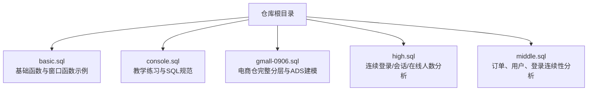
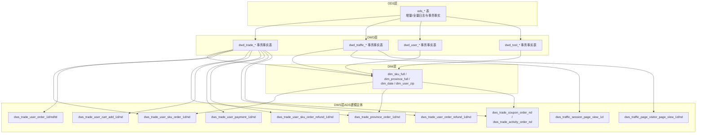
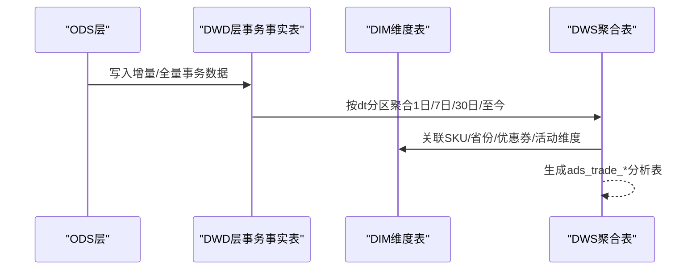
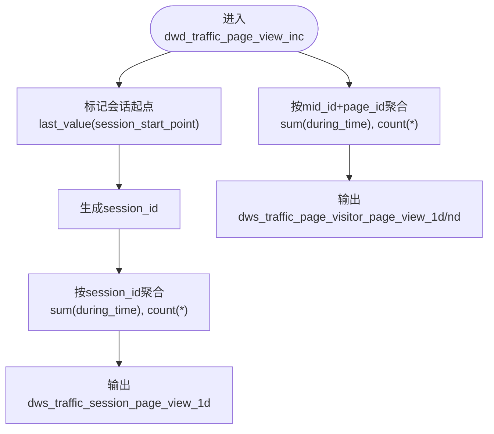
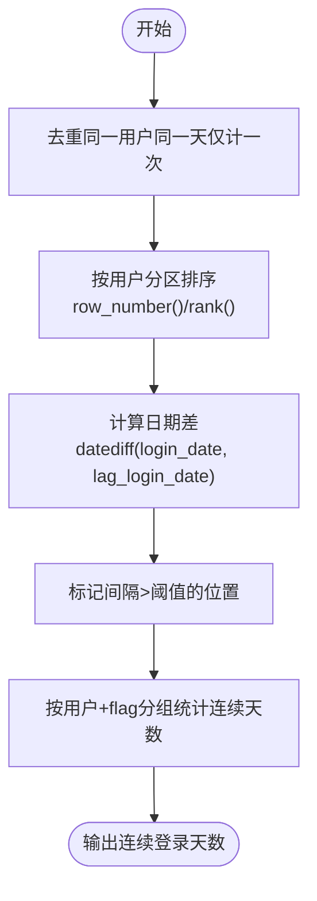
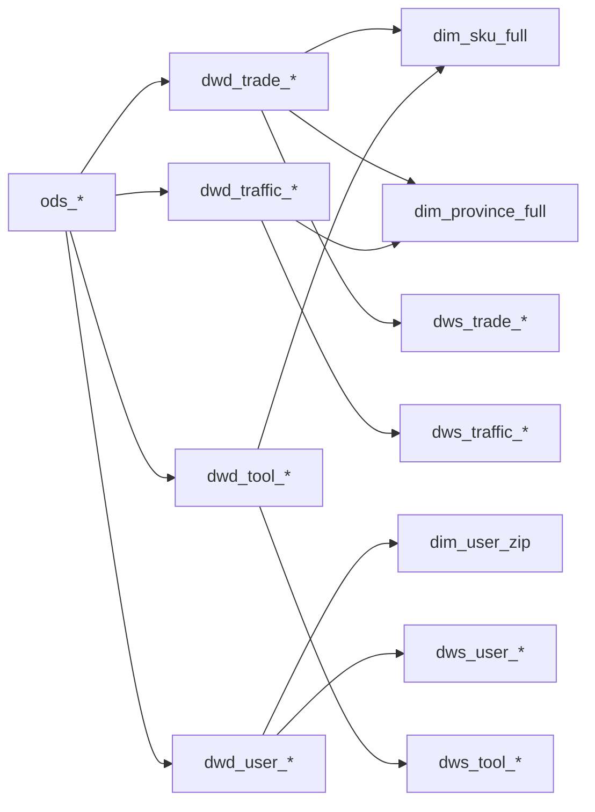

# ADS层（应用数据层）

<cite>
**本文引用的文件**
- [basic.sql](file://basic.sql)
- [console.sql](file://console.sql)
- [gmall-0906.sql](file://gmall-0906.sql)
- [high.sql](file://high.sql)
- [middle.sql](file://middle.sql)
</cite>

## 目录
1. [引言](#引言)
2. [项目结构](#项目结构)
3. [核心组件](#核心组件)
4. [架构总览](#架构总览)
5. [详细组件分析](#详细组件分析)
6. [依赖分析](#依赖分析)
7. [性能考量](#性能考量)
8. [故障排查指南](#故障排查指南)
9. [结论](#结论)
10. [附录](#附录)

## 引言
本技术文档面向HQL数据仓库ADS层（应用数据层），系统化阐述交易域、流量域与用户行为域的分析表建模方法与实现策略，覆盖聚合表设计原则、指标计算逻辑、数据汇总策略，并给出查询优化、缓存与性能调优建议。文档同时提供分析指标定义与典型SQL示例路径，帮助读者快速落地到实际业务场景。

## 项目结构
本仓库包含多份SQL脚本，分别覆盖基础函数与窗口函数实践、教学练习、通用分析模板与电商仓（gmall）的完整分层建模。其中，gmall-0906.sql是ADS层建模与聚合事实表的主干，涵盖交易域、流量域、用户域与工具域的dws层聚合表；basic.sql、console.sql、high.sql、middle.sql提供了丰富的窗口函数、连续性分析、日期与会话处理等范式，可直接复用到ADS层的指标构建中。

图示来源
- [gmall-0906.sql](file://gmall-0906.sql#L3282-L3791)
- [basic.sql](file://basic.sql#L1-L120)
- [console.sql](file://console.sql#L1-L120)
- [high.sql](file://high.sql#L1-L120)
- [middle.sql](file://middle.sql#L1-L120)

章节来源
- [gmall-0906.sql](file://gmall-0906.sql#L3282-L3791)
- [basic.sql](file://basic.sql#L1-L120)
- [console.sql](file://console.sql#L1-L120)
- [high.sql](file://high.sql#L1-L120)
- [middle.sql](file://middle.sql#L1-L120)

## 核心组件
- 交易域分析表（ads_trade_*）
  - 用户商品粒度：dws_trade_user_sku_order_1d/nd、dws_trade_user_sku_order_refund_1d/nd
  - 用户粒度：dws_trade_user_order_1d/nd、dws_trade_user_order_refund_1d/nd、dws_trade_user_order_td
  - 省份粒度：dws_trade_province_order_1d/nd
  - 优惠券/活动粒度：dws_trade_coupon_order_nd、dws_trade_activity_order_nd
  - 加购/支付粒度：dws_trade_user_cart_add_1d/nd、dws_trade_user_payment_1d/nd
- 流量域分析表（ads_traffic_*）
  - 会话粒度：dws_traffic_session_page_view_1d
  - 访客-页面粒度：dws_traffic_page_visitor_page_view_1d/nd
- 用户行为分析表（ads_user_*）
  - 登录连续性、新增用户、累计消费等指标均可基于dwd层事实表与窗口函数在dws层聚合产出

章节来源
- [gmall-0906.sql](file://gmall-0906.sql#L3652-L4793)
- [high.sql](file://high.sql#L146-L319)
- [middle.sql](file://middle.sql#L1-L200)

## 架构总览
ADS层以dwd层事务事实表为基础，结合dim维度表，通过dws层聚合事实表沉淀高频分析口径，支撑上层报表与应用查询。

图示来源
- [gmall-0906.sql](file://gmall-0906.sql#L3282-L4793)

章节来源
- [gmall-0906.sql](file://gmall-0906.sql#L3282-L4793)

## 详细组件分析

### 交易域分析表（ads_trade_*）
- 用户商品粒度（dws_trade_user_sku_order_1d/nd）
  - 设计要点：以用户+商品为粒度，按1日/7日/30日窗口聚合下单次数、件数、原始金额、活动优惠、券优惠、最终金额。
  - 指标计算：使用sum、count、nvl处理空值；通过dwd层拆分金额字段（原始/活动/券/最终）进行归集。
  - 数据汇总：dws层按dt分区，每日增量更新；nd表通过跨日聚合生成滚动窗口指标。
- 用户粒度（dws_trade_user_order_1d/nd/td）
  - 设计要点：按用户聚合下单次数、件数、金额，td表维护历史至今累计。
  - 指标计算：count(distinct order_id)、sum(sku_num)、sum(拆分金额)。
- 省份粒度（dws_trade_province_order_1d/nd）
  - 设计要点：按省份维度聚合，关联dim_province_full补充省名与编码。
- 优惠券/活动粒度（dws_trade_coupon_order_nd / dws_trade_activity_order_nd）
  - 设计要点：与dwd层订单明细关联，按30日窗口聚合使用下单原始金额与优惠金额。
- 加购/支付粒度（dws_trade_user_cart_add_1d/nd、dws_trade_user_payment_1d/nd）
  - 设计要点：加购按dwd_trade_cart_add_1d聚合；支付按dwd_trade_pay_detail_suc_inc聚合，使用拆分支付金额。

图示来源
- [gmall-0906.sql](file://gmall-0906.sql#L3652-L4793)

章节来源
- [gmall-0906.sql](file://gmall-0906.sql#L3652-L4793)

### 流量域分析表（ads_traffic_*）
- 会话粒度（dws_traffic_session_page_view_1d）
  - 设计要点：基于dwd_traffic_page_view_inc按session_id聚合访问时长与页面数。
  - 会话识别：通过窗口函数last_value或标记位生成会话ID。
- 访客-页面粒度（dws_traffic_page_visitor_page_view_1d/nd）
  - 设计要点：按mid_id+page_id聚合浏览时长与访问次数，nd表生成7/30日滚动指标。

图示来源
- [gmall-0906.sql](file://gmall-0906.sql#L2540-L2751)
- [gmall-0906.sql](file://gmall-0906.sql#L2753-L3048)
- [gmall-0906.sql](file://gmall-0906.sql#L4492-L4597)

章节来源
- [gmall-0906.sql](file://gmall-0906.sql#L2540-L3048)
- [gmall-0906.sql](file://gmall-0906.sql#L4492-L4597)

### 用户行为分析表（ads_user_*）
- 连续登录与新增用户
  - 连续登录：利用row_number、lag、datediff、flag分组统计连续天数。
  - 新增用户：按用户首次登录时间聚合，取rk=1的最早日期。
- 累计消费与VIP等级
  - 使用sum over按用户+时间窗口累计消费金额，配合case分支映射VIP等级。

图示来源
- [high.sql](file://high.sql#L146-L319)
- [middle.sql](file://middle.sql#L1-L200)

章节来源
- [high.sql](file://high.sql#L146-L319)
- [middle.sql](file://middle.sql#L1-L200)

## 依赖分析
- 维度依赖
  - 商品维度：dim_sku_full（品牌、品类、属性集合）
  - 地区维度：dim_province_full（省名、编码、ISO）
  - 时间维度：dim_date（周/季度/工作日等）
  - 用户维度：dim_user_zip（用户画像字段）
- 事实表依赖
  - 交易域：dwd_trade_order_detail_inc、dwd_trade_pay_detail_suc_inc、dwd_trade_refund_pay_suc_inc、dwd_trade_cart_add_inc、dwd_trade_order_refund_inc
  - 流量域：dwd_traffic_page_view_inc、dwd_traffic_action_inc、dwd_traffic_display_inc、dwd_traffic_start_inc、dwd_traffic_error_inc
  - 用户域：dwd_user_login_inc、dwd_user_register_inc
  - 工具域：dwd_tool_coupon_get_inc、dwd_tool_coupon_order_inc、dwd_tool_coupon_pay_inc、dwd_interaction_favor_add_inc、dwd_interaction_comment_inc

图示来源
- [gmall-0906.sql](file://gmall-0906.sql#L800-L1170)
- [gmall-0906.sql](file://gmall-0906.sql#L1174-L3199)
- [gmall-0906.sql](file://gmall-0906.sql#L3200-L4793)

章节来源
- [gmall-0906.sql](file://gmall-0906.sql#L800-L1170)
- [gmall-0906.sql](file://gmall-0906.sql#L1174-L3199)
- [gmall-0906.sql](file://gmall-0906.sql#L3200-L4793)

## 性能考量
- 分区与裁剪
  - 优先按dt分区，查询时显式过滤分区，避免全表扫描。
  - 对大表（如dwd_trade_order_detail_inc）按日期与关键维度裁剪后再聚合。
- 窗口函数优化
  - 合理使用rows between与order by，避免不必要的全局排序。
  - 使用sum over等开窗聚合替代多层子查询，减少IO与临时结果集。
- 字段与类型
  - 金额类字段使用decimal，避免浮点误差。
  - 维度表采用ORC存储并开启压缩，提升读写性能。
- 连续性分析
  - 连续登录/访问等场景，先去重再开窗，减少数据量与计算成本。
- 执行引擎
  - 针对复杂窗口与大表场景，可切换执行引擎以获得更优计划。

章节来源
- [gmall-0906.sql](file://gmall-0906.sql#L2540-L2751)
- [gmall-0906.sql](file://gmall-0906.sql#L3200-L3280)
- [high.sql](file://high.sql#L146-L319)
- [middle.sql](file://middle.sql#L1-L200)

## 故障排查指南
- 常见问题
  - 窗口函数未生效：检查是否遗漏partition by或order by，确认窗口子句与聚合字段匹配。
  - 连续性统计异常：确认去重逻辑（group by或distinct）是否前置，避免重复计数。
  - 日期格式错误：统一使用from_unixtimestamp/unix_timestamp/date_format，确保格式一致。
  - 空值导致聚合异常：使用nvl/coalesce处理空值，避免sum/count误判。
- 调试建议
  - 使用explain查看执行计划，定位大表扫描与shuffle热点。
  - 分步验证：先验证dwd层数据质量，再逐步向上聚合至dws层。
  - 使用小分区dt进行回归测试，快速定位问题。

章节来源
- [basic.sql](file://basic.sql#L1-L120)
- [high.sql](file://high.sql#L146-L319)
- [middle.sql](file://middle.sql#L1-L200)

## 结论
ADS层通过dws层聚合事实表沉淀高频分析口径，结合dim维度表实现强一致的业务指标。围绕交易域、流量域与用户行为域的关键指标，采用窗口函数、日期与会话处理、连续性分析等策略，既满足查询性能，又便于扩展与维护。建议在生产环境中严格控制分区裁剪、字段类型与执行引擎配置，持续监控执行计划与资源占用，保障稳定性与可扩展性。

## 附录
- 分析指标定义与SQL示例路径（示例仅指明文件与行号，不展示具体代码）
  - 用户商品粒度（1日/7日/30日）
    - [dws_trade_user_sku_order_1d](file://gmall-0906.sql#L3652-L3791)
    - [dws_trade_user_sku_order_nd](file://gmall-0906.sql#L3792-L3855)
  - 用户粒度（1日/7日/30日/至今）
    - [dws_trade_user_order_1d](file://gmall-0906.sql#L4038-L4082)
    - [dws_trade_user_order_nd](file://gmall-0906.sql#L4085-L4128)
    - [dws_trade_user_order_td](file://gmall-0906.sql#L4714-L4793)
  - 省份粒度（1日/7日/30日）
    - [dws_trade_province_order_1d](file://gmall-0906.sql#L4266-L4365)
    - [dws_trade_province_order_nd](file://gmall-0906.sql#L4368-L4416)
  - 优惠券/活动粒度（30日）
    - [dws_trade_coupon_order_nd](file://gmall-0906.sql#L4600-L4655)
    - [dws_trade_activity_order_nd](file://gmall-0906.sql#L4658-L4712)
  - 加购/支付粒度（1日/7日/30日）
    - [dws_trade_user_cart_add_1d](file://gmall-0906.sql#L4131-L4163)
    - [dws_trade_user_cart_add_nd](file://gmall-0906.sql#L4166-L4193)
    - [dws_trade_user_payment_1d](file://gmall-0906.sql#L4195-L4230)
    - [dws_trade_user_payment_nd](file://gmall-0906.sql#L4233-L4263)
  - 流量域（会话/访客-页面）
    - [dws_traffic_session_page_view_1d](file://gmall-0906.sql#L4492-L4528)
    - [dws_traffic_page_visitor_page_view_1d](file://gmall-0906.sql#L4529-L4559)
    - [dws_traffic_page_visitor_page_view_nd](file://gmall-0906.sql#L4562-L4597)
  - 用户行为（连续登录/新增用户/累计消费）
    - [连续登录（去重+rank/row_number）](file://high.sql#L146-L319)
    - [新增用户（min over）](file://middle.sql#L578-L610)
    - [累计消费与VIP等级（sum over + case）](file://middle.sql#L296-L324)