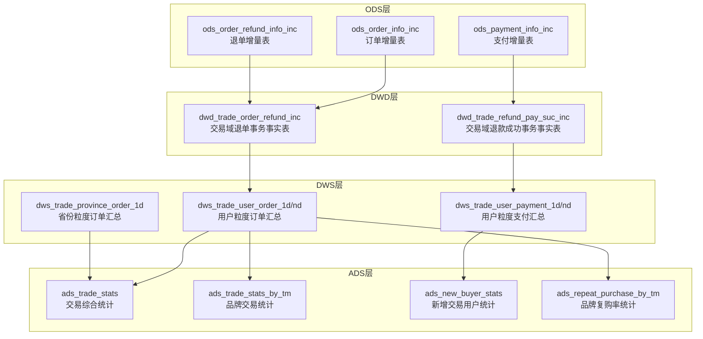
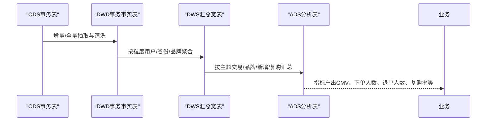
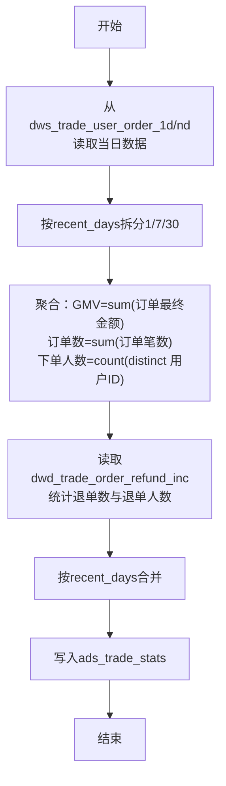
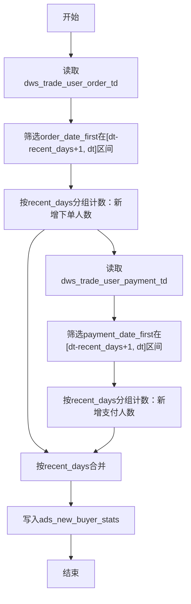
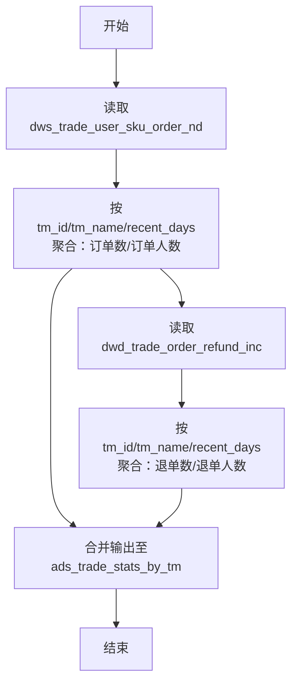
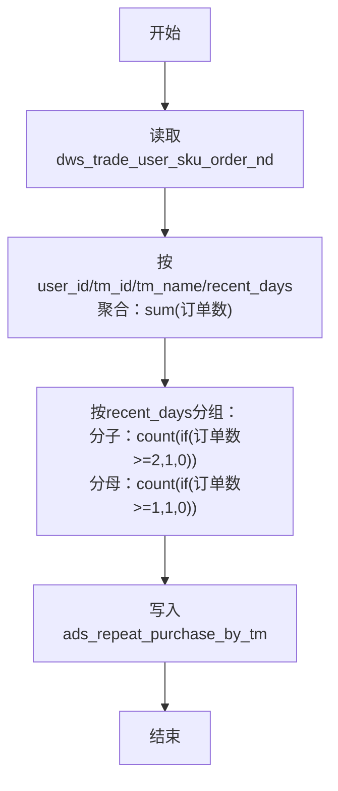
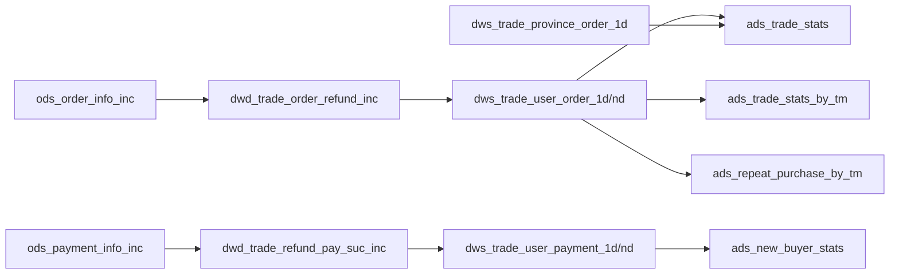

# 交易域分析表

<cite>
**本文引用的文件**
- [gmall-0906.sql](file://gmall-0906.sql)
- [basic.sql](file://basic.sql)
- [console.sql](file://console.sql)
- [high.sql](file://high.sql)
- [middle.sql](file://middle.sql)
</cite>

## 目录
1. [引言](#引言)
2. [项目结构](#项目结构)
3. [核心组件](#核心组件)
4. [架构总览](#架构总览)
5. [详细组件分析](#详细组件分析)
6. [依赖分析](#依赖分析)
7. [性能考量](#性能考量)
8. [故障排查指南](#故障排查指南)
9. [结论](#结论)
10. [附录](#附录)

## 引言
本文件面向HQL数据仓库交易域分析表，系统化梳理订单、支付、退款三大分析主题的建模方法与实现逻辑，覆盖ADS层核心分析表（如ads_trade_stats、ads_trade_stats_by_tm等），并给出关键指标（GMV、下单人数、退单人数、复购率、新增交易用户等）的统计口径、计算公式、数据来源与ETL流程。文档同时提供性能优化建议与常见问题排查思路，帮助读者快速理解与落地交易域分析。

## 项目结构
仓库包含多个SQL脚本，分别承载基础函数示例、交易域ODS/DWD/DWS/ADS各层建模与ETL逻辑。交易域分析表主要集中在gmall-0906.sql中，涵盖：
- ODS层：日志与增量/全量事务表（如ods_order_info_inc、ods_payment_info_inc、ods_order_refund_info_inc等）
- DWD层：交易域事务事实表（如dwd_trade_order_refund_inc、dwd_trade_refund_pay_suc_inc等）
- DWS层：粒度汇总宽表（如dws_trade_user_order_1d/nd、dws_trade_user_payment_1d/nd、dws_trade_province_order_1d等）
- ADS层：主题分析表（如ads_trade_stats、ads_trade_stats_by_tm、ads_new_buyer_stats、ads_repeat_purchase_by_tm等）

图示来源
- [gmall-0906.sql](file://gmall-0906.sql#L1930-L2077)
- [gmall-0906.sql](file://gmall-0906.sql#L4196-L4262)
- [gmall-0906.sql](file://gmall-0906.sql#L4427-L4490)
- [gmall-0906.sql](file://gmall-0906.sql#L5650-L5663)

章节来源
- [gmall-0906.sql](file://gmall-0906.sql#L1930-L2077)
- [gmall-0906.sql](file://gmall-0906.sql#L4196-L4262)
- [gmall-0906.sql](file://gmall-0906.sql#L4427-L4490)
- [gmall-0906.sql](file://gmall-0906.sql#L5650-L5663)

## 核心组件
本节聚焦交易域分析表的表结构、字段含义与数据来源，明确各表在数据链路中的定位与职责。

- ads_trade_stats（交易综合统计）
  - 字段要点：统计日期、最近N天、订单总额（GMV）、订单数、下单人数、退单数、退单人数
  - 数据来源：由DWS层用户粒度订单汇总与支付汇总经ADS层聚合生成
  - ETL路径：dws_trade_user_order_1d/nd → ads_trade_stats

- ads_trade_stats_by_tm（品牌交易统计）
  - 字段要点：统计日期、最近N天、品牌ID/名称、订单数、订单人数、退单数、退单人数
  - 数据来源：dws_trade_user_sku_order_nd（按用户-品牌聚合）→ ads_trade_stats_by_tm

- ads_new_buyer_stats（新增交易用户统计）
  - 字段要点：统计日期、最近N天、新增下单人数、新增支付人数
  - 数据来源：dws_trade_user_order_td、dws_trade_user_payment_td（基于首次交易日期判断新增）

- ads_repeat_purchase_by_tm（品牌复购率统计）
  - 字段要点：统计日期、最近N天、品牌ID/名称、复购率
  - 计算口径：近N天内下单≥2次的用户数 / 近N天内下单≥1次的用户数

章节来源
- [gmall-0906.sql](file://gmall-0906.sql#L5650-L5663)
- [gmall-0906.sql](file://gmall-0906.sql#L5612-L5627)
- [gmall-0906.sql](file://gmall-0906.sql#L5500-L5526)
- [gmall-0906.sql](file://gmall-0906.sql#L5528-L5586)

## 架构总览
交易域分析表的ETL流程自下而上分为ODS→DWD→DWS→ADS四个层次，最终形成面向主题的分析宽表与指标表，支撑业务看板与报表。

图示来源
- [gmall-0906.sql](file://gmall-0906.sql#L1930-L2077)
- [gmall-0906.sql](file://gmall-0906.sql#L4196-L4262)
- [gmall-0906.sql](file://gmall-0906.sql#L5650-L5663)

## 详细组件分析

### 订单分析表（ads_trade_stats）
- 统计口径
  - GMV（订单总额）：按自然日/最近N日聚合的订单最终金额之和
  - 订单数：按自然日/最近N日聚合的订单笔数
  - 下单人数：按自然日/最近N日聚合的去重下单用户数
  - 退单数/退单人数：来自退单事务事实表的退单笔数与去重退单用户数
- 数据来源与ETL
  - 来源于dws_trade_user_order_1d/nd与dws_trade_province_order_1d等汇总表
  - ADS层按dt与recent_days进行聚合，输出ads_trade_stats
- 关键实现参考
  - 用户粒度订单汇总（1日/7日/30日）：dws_trade_user_order_1d/nd
  - 省份粒度订单汇总：dws_trade_province_order_1d
  - ADS装载：ads_trade_stats

图示来源
- [gmall-0906.sql](file://gmall-0906.sql#L4039-L4123)
- [gmall-0906.sql](file://gmall-0906.sql#L4266-L4316)
- [gmall-0906.sql](file://gmall-0906.sql#L5650-L5663)

章节来源
- [gmall-0906.sql](file://gmall-0906.sql#L4039-L4123)
- [gmall-0906.sql](file://gmall-0906.sql#L4266-L4316)
- [gmall-0906.sql](file://gmall-0906.sql#L5650-L5663)

### 支付分析表（ads_new_buyer_stats）
- 统计口径
  - 新增下单人数：在最近N天内首次下单的用户数
  - 新增支付人数：在最近N天内首次支付的用户数
- 计算方法
  - 基于dws_trade_user_order_td与dws_trade_user_payment_td的历史至今汇总表，筛选order_date_first或payment_date_first落在[dt-recent_days+1, dt]区间内的用户
- 关键实现参考
  - 用户粒度订单历史至今汇总：dws_trade_user_order_td
  - 用户粒度支付历史至今汇总：dws_trade_user_payment_td
  - ADS装载：ads_new_buyer_stats

图示来源
- [gmall-0906.sql](file://gmall-0906.sql#L4794-L4832)
- [gmall-0906.sql](file://gmall-0906.sql#L5500-L5526)

章节来源
- [gmall-0906.sql](file://gmall-0906.sql#L4794-L4832)
- [gmall-0906.sql](file://gmall-0906.sql#L5500-L5526)

### 退款分析表（ads_trade_stats_by_tm）
- 统计口径
  - 品牌粒度：订单数、订单人数、退单数、退单人数
- 计算方法
  - 先按用户-品牌粒度聚合（dws_trade_user_sku_order_nd），再按tm_id/tm_name与recent_days汇总
  - 退单人数/退单数来源于退单事务事实表（dwd_trade_order_refund_inc）按用户-品牌聚合
- 关键实现参考
  - 品牌交易统计：ads_trade_stats_by_tm
  - 用户-品牌订单汇总：dws_trade_user_sku_order_nd
  - 退单事务事实表：dwd_trade_order_refund_inc

图示来源
- [gmall-0906.sql](file://gmall-0906.sql#L5580-L5611)
- [gmall-0906.sql](file://gmall-0906.sql#L5612-L5627)

章节来源
- [gmall-0906.sql](file://gmall-0906.sql#L5580-L5611)
- [gmall-0906.sql](file://gmall-0906.sql#L5612-L5627)

### 复购率分析表（ads_repeat_purchase_by_tm）
- 统计口径
  - 复购率 = 近N天下单≥2次的用户数 / 近N天下单≥1次的用户数
- 计算方法
  - 基于dws_trade_user_sku_order_nd按用户-品牌聚合后，按recent_days分组统计
- 关键实现参考
  - 复购率统计：ads_repeat_purchase_by_tm
  - 用户-品牌订单汇总：dws_trade_user_sku_order_nd

图示来源
- [gmall-0906.sql](file://gmall-0906.sql#L5541-L5578)
- [gmall-0906.sql](file://gmall-0906.sql#L5580-L5611)

章节来源
- [gmall-0906.sql](file://gmall-0906.sql#L5541-L5578)
- [gmall-0906.sql](file://gmall-0906.sql#L5580-L5611)

### 关键指标与计算公式
- GMV（订单总额）
  - 定义：自然日/最近N日订单最终金额之和
  - 来源：dws_trade_user_order_1d/nd或dws_trade_province_order_1d
- 下单人数
  - 定义：自然日/最近N日去重下单用户数
  - 来源：dws_trade_user_order_1d/nd
- 退单人数/退单数
  - 定义：自然日/最近N日退单用户数与退单笔数
  - 来源：dwd_trade_order_refund_inc
- 新增交易用户
  - 定义：在最近N天内首次下单/支付的用户数
  - 来源：dws_trade_user_order_td、dws_trade_user_payment_td
- 复购率
  - 定义：近N天下单≥2次的用户数 / 近N天下单≥1次的用户数
  - 来源：dws_trade_user_sku_order_nd

章节来源
- [gmall-0906.sql](file://gmall-0906.sql#L4039-L4123)
- [gmall-0906.sql](file://gmall-0906.sql#L4794-L4832)
- [gmall-0906.sql](file://gmall-0906.sql#L5528-L5586)
- [gmall-0906.sql](file://gmall-0906.sql#L5612-L5627)

## 依赖分析
交易域分析表之间的依赖关系如下：

图示来源
- [gmall-0906.sql](file://gmall-0906.sql#L1930-L2077)
- [gmall-0906.sql](file://gmall-0906.sql#L4196-L4262)
- [gmall-0906.sql](file://gmall-0906.sql#L4427-L4490)
- [gmall-0906.sql](file://gmall-0906.sql#L5650-L5663)

章节来源
- [gmall-0906.sql](file://gmall-0906.sql#L1930-L2077)
- [gmall-0906.sql](file://gmall-0906.sql#L4196-L4262)
- [gmall-0906.sql](file://gmall-0906.sql#L4427-L4490)
- [gmall-0906.sql](file://gmall-0906.sql#L5650-L5663)

## 性能考量
- 分区裁剪
  - 优先按dt分区过滤，减少扫描数据量；在ads层按recent_days拆分时，仅加载所需时间窗口
- 聚合前置
  - 在DWS层完成按用户/品牌/省份的聚合，避免ADS层重复计算
- 去重策略
  - 使用count(distinct)前确保数据已去重（如按用户-日期去重），避免重复计数导致指标偏大
- 动态分区
  - 启用非严格模式进行动态分区写入，提升批量装载效率
- 窗口与开窗
  - 合理使用开窗函数进行累计/滚动聚合，避免多层子查询嵌套带来的I/O放大

章节来源
- [gmall-0906.sql](file://gmall-0906.sql#L4435-L4457)
- [gmall-0906.sql](file://gmall-0906.sql#L4477-L4490)
- [gmall-0906.sql](file://gmall-0906.sql#L4039-L4123)

## 故障排查指南
- 常见问题
  - 指标异常偏大：检查是否存在重复去重或重复聚合
  - 时间维度错位：确认dt分区与recent_days拆分逻辑一致
  - 缺失数据：核对ODS→DWD→DWS的逐层ETL是否成功，分区是否正确
- 排查步骤
  - 校验ODS层分区与数据完整性
  - 校验DWD层事实表是否正确关联维度与字典
  - 校验DWS层聚合是否按粒度正确
  - 校验ADS层按recent_days拆分与合并逻辑
- 参考示例
  - 窗口与开窗函数的使用与性能注意事项可参考basic.sql与high.sql中的示例

章节来源
- [basic.sql](file://basic.sql#L120-L200)
- [high.sql](file://high.sql#L1-L80)

## 结论
交易域分析表通过ODS→DWD→DWS→ADS的分层建模，实现了GMV、下单人数、退单人数、新增交易用户与复购率等核心指标的稳定产出。遵循分区裁剪、聚合前置、去重策略与动态分区等最佳实践，可在保证准确性的同时显著提升性能。建议在生产环境中持续监控各层ETL执行计划与分区状态，确保数据新鲜度与一致性。

## 附录
- 术语说明
  - GMV：Gross Merchandise Volume，商品交易总额
  - N日汇总：按最近N天（如7/30）滚动聚合
  - 历史至今汇总：基于用户首次交易日期的累计统计
- 参考SQL路径
  - 用户粒度订单汇总（1日/7日/30日）：[gmall-0906.sql](file://gmall-0906.sql#L4039-L4123)
  - 用户粒度支付汇总（1日/7日/30日）：[gmall-0906.sql](file://gmall-0906.sql#L4196-L4262)
  - 省份粒度订单汇总：[gmall-0906.sql](file://gmall-0906.sql#L4266-L4316)
  - 退单事务事实表与用户粒度退单汇总：[gmall-0906.sql](file://gmall-0906.sql#L4427-L4490)
  - 交易综合统计（ads_trade_stats）：[gmall-0906.sql](file://gmall-0906.sql#L5650-L5663)
  - 品牌交易统计（ads_trade_stats_by_tm）：[gmall-0906.sql](file://gmall-0906.sql#L5612-L5627)
  - 新增交易用户统计（ads_new_buyer_stats）：[gmall-0906.sql](file://gmall-0906.sql#L5500-L5526)
  - 品牌复购率统计（ads_repeat_purchase_by_tm）：[gmall-0906.sql](file://gmall-0906.sql#L5528-L5586)