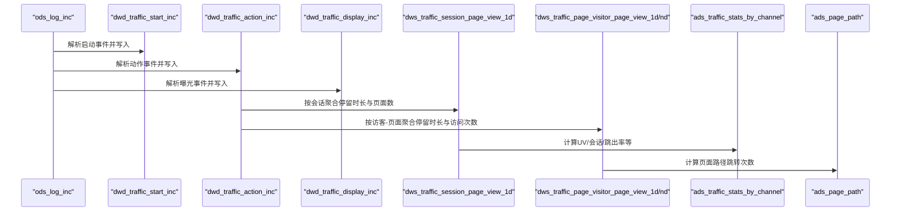
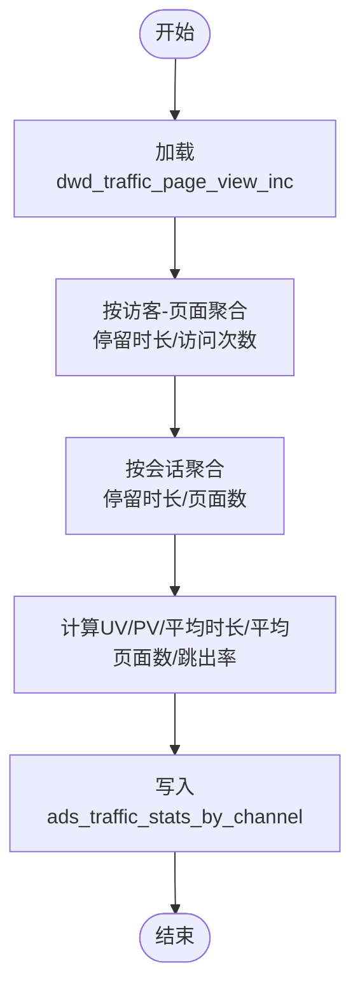
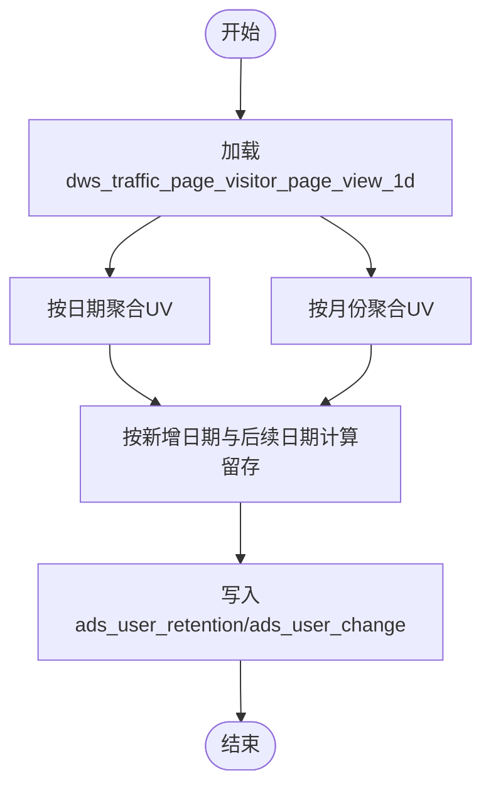
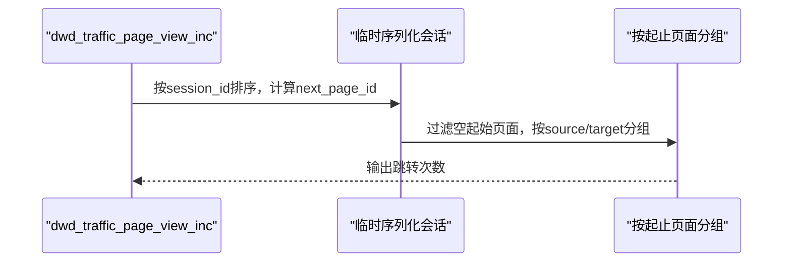
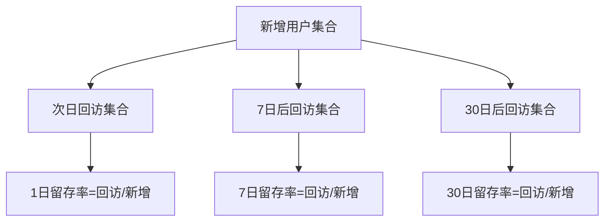
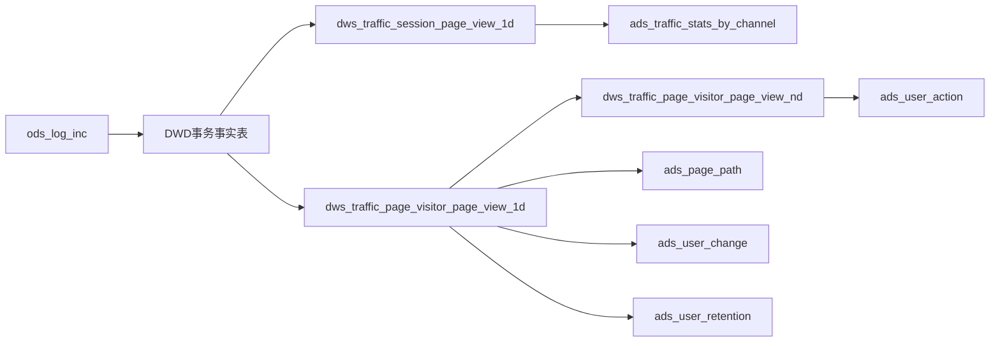

# 流量域分析表

<cite>
**本文引用的文件**
- [gmall-0906.sql](file://gmall-0906.sql)
- [high.sql](file://high.sql)
- [middle.sql](file://middle.sql)
- [console.sql](file://console.sql)
- [basic.sql](file://basic.sql)
</cite>

## 目录
1. [引言](#引言)
2. [项目结构](#项目结构)
3. [核心组件](#核心组件)
4. [架构总览](#架构总览)
5. [详细组件分析](#详细组件分析)
6. [依赖分析](#依赖分析)
7. [性能考量](#性能考量)
8. [故障排查指南](#故障排查指南)
9. [结论](#结论)
10. [附录](#附录)

## 引言
本技术文档围绕HQL数据仓库中的流量域分析表展开，系统梳理页面访问分析表（ads_traffic_page）、用户访问分析表（ads_traffic_user）、设备分析表（ads_traffic_device）等的实现原理与建模策略，重点解释PV/UV统计、页面跳转分析、用户路径分析、日活/月活与留存率等关键指标的计算逻辑，并提供查询示例、数据聚合策略与性能调优建议。文档面向不同层次读者，既包含高层架构说明，也提供代码级图示与路径定位，便于快速定位实现细节。

## 项目结构
本仓库以业务域划分SQL脚本，流量域相关实现集中在gmall-0906.sql中，配套使用high.sql、middle.sql、console.sql、basic.sql中的通用函数与模式作为支撑。

- 流量域事实与汇总层
  - 事务事实表：dwd_traffic_start_inc、dwd_traffic_action_inc、dwd_traffic_display_inc、dwd_traffic_error_inc
  - 会话粒度汇总：dws_traffic_session_page_view_1d
  - 访客-页面粒度汇总：dws_traffic_page_visitor_page_view_1d、dws_traffic_page_visitor_page_view_nd
- 流量域ADS层
  - 渠道流量统计：ads_traffic_stats_by_channel
  - 页面路径分析：ads_page_path
  - 用户变动与留存：ads_user_change、ads_user_retention
  - 用户行为汇总：ads_user_action（用于页面行为口径聚合）

```mermaid
graph TB
subgraph "ODS层"
ODS_LOG["ods_log_inc<br/>JSON日志"]
end
subgraph "DWD层"
DWD_START["dwd_traffic_start_inc<br/>启动事务事实"]
DWD_ACTION["dwd_traffic_action_inc<br/>动作事务事实"]
DWD_DISPLAY["dwd_traffic_display_inc<br/>曝光事务事实"]
DWD_ERROR["dwd_traffic_error_inc<br/>错误事务事实"]
end
subgraph "DWS层"
DWS_SESSION["dws_traffic_session_page_view_1d<br/>会话粒度汇总"]
DWS_PAGE_VIS["dws_traffic_page_visitor_page_view_1d<br/>访客-页面粒度汇总"]
DWS_PAGE_VIS_N["dws_traffic_page_visitor_page_view_nd<br/>N日滚动汇总"]
end
subgraph "ADS层"
ADS_CHANNEL["ads_traffic_stats_by_channel<br/>渠道流量统计"]
ADS_PATH["ads_page_path<br/>页面路径分析"]
ADS_USER_CHANGE["ads_user_change<br/>用户变动统计"]
ADS_USER_RETENTION["ads_user_retention<br/>用户留存率"]
ADS_USER_ACTION["ads_user_action<br/>用户行为汇总"]
end
ODS_LOG --> DWD_START
ODS_LOG --> DWD_ACTION
ODS_LOG --> DWD_DISPLAY
ODS_LOG --> DWD_ERROR
DWD_ACTION --> DWS_SESSION
DWD_ACTION --> DWS_PAGE_VIS
DWS_PAGE_VIS --> DWS_PAGE_VIS_N
DWS_SESSION --> ADS_CHANNEL
DWS_PAGE_VIS --> ADS_PATH
DWS_PAGE_VIS_N --> ADS_USER_ACTION
DWS_PAGE_VIS --> ADS_USER_CHANGE
DWS_PAGE_VIS --> ADS_USER_RETENTION
```

图表来源
- [gmall-0906.sql](file://gmall-0906.sql#L2672-L3002)
- [gmall-0906.sql](file://gmall-0906.sql#L4495-L4601)
- [gmall-0906.sql](file://gmall-0906.sql#L4959-L5200)

章节来源
- [gmall-0906.sql](file://gmall-0906.sql#L2672-L3002)
- [gmall-0906.sql](file://gmall-0906.sql#L4495-L4601)
- [gmall-0906.sql](file://gmall-0906.sql#L4959-L5200)

## 核心组件
- 事务事实表（DWD）
  - dwd_traffic_start_inc：启动事件事实，包含省份、品牌、渠道、设备、用户、版本、入口、广告时长等字段，按dt分区。
  - dwd_traffic_action_inc：动作事件事实，包含页面上下文、动作上下文、时间戳等，按dt分区。
  - dwd_traffic_display_inc：曝光事件事实，包含曝光类型、对象、顺序、位置等，按dt分区。
  - dwd_traffic_error_inc：错误事件事实，包含错误码、消息等，按dt分区。
- 汇总表（DWS）
  - dws_traffic_session_page_view_1d：按会话聚合的最近1日停留时长与页面数。
  - dws_traffic_page_visitor_page_view_1d：按访客-页面聚合的最近1日停留时长与访问次数。
  - dws_traffic_page_visitor_page_view_nd：按访客-页面聚合的最近7/30日停留时长与访问次数。
- ADS层
  - ads_traffic_stats_by_channel：按渠道统计UV、平均会话时长、平均页面数、会话数、跳出率。
  - ads_page_path：页面路径分析，统计起止页面间的跳转次数。
  - ads_user_change：用户变动统计，流失与回流用户数。
  - ads_user_retention：用户留存率，按新增日期与留存天数统计。
  - ads_user_action：用户行为汇总，按最近1/7/30日统计首页、详情页、购物车、下单、支付等页面行为。

章节来源
- [gmall-0906.sql](file://gmall-0906.sql#L2672-L3002)
- [gmall-0906.sql](file://gmall-0906.sql#L4495-L4601)
- [gmall-0906.sql](file://gmall-0906.sql#L4959-L5200)

## 架构总览
流量域从原始日志（ods_log_inc）抽取启动、动作、曝光、错误等事件，写入DWD层事务事实表；随后在DWS层按会话与访客-页面维度进行聚合；最终在ADS层产出面向分析的指标表，支撑页面访问分析、用户访问分析、设备分析与路径分析等主题。

图表来源
- [gmall-0906.sql](file://gmall-0906.sql#L2672-L3002)
- [gmall-0906.sql](file://gmall-0906.sql#L4495-L4601)
- [gmall-0906.sql](file://gmall-0906.sql#L4959-L5200)

## 详细组件分析

### 页面访问分析表（ads_traffic_page）
- 指标定义
  - PV：页面访问次数，按访客-页面粒度的访问次数汇总。
  - UV：独立访客数，按访客-页面粒度去重后的访客数。
  - 平均停留时长：按访客-页面粒度的平均停留时长。
  - 平均页面数：按访客-页面粒度的平均页面访问数。
  - 跳出率：仅访问1个页面的会话占比。
- 数据来源与口径
  - 采用dws_traffic_page_visitor_page_view_1d与dws_traffic_page_visitor_page_view_nd作为基础，结合dws_traffic_session_page_view_1d计算会话维度指标。
  - 通过最近1/7/30日滚动聚合，形成多周期口径。
- 计算要点
  - PV/UV：基于访客-页面粒度的访问次数与访客去重。
  - 平均停留时长/页面数：按会话维度聚合后取平均。
  - 跳出率：会话中页面数为1的会话占比。
- 查询示例路径
  - 渠道流量统计（含UV/平均时长/平均页面数/会话数/跳出率）：[ads_traffic_stats_by_channel](file://gmall-0906.sql#L4959-L5060)
  - 页面路径分析（起止页面跳转次数）：[ads_page_path](file://gmall-0906.sql#L5062-L5131)
  - 用户行为汇总（首页/详情页/购物车/下单/支付）：[ads_user_action](file://gmall-0906.sql#L5380-L5421)

图表来源
- [gmall-0906.sql](file://gmall-0906.sql#L4495-L4601)
- [gmall-0906.sql](file://gmall-0906.sql#L4959-L5060)

章节来源
- [gmall-0906.sql](file://gmall-0906.sql#L4495-L4601)
- [gmall-0906.sql](file://gmall-0906.sql#L4959-L5060)
- [gmall-0906.sql](file://gmall-0906.sql#L5062-L5131)
- [gmall-0906.sql](file://gmall-0906.sql#L5380-L5421)

### 用户访问分析表（ads_traffic_user）
- 指标定义
  - 日活（DAU）：当日活跃用户数（访客去重）。
  - 月活（MAU）：当月活跃用户数（访客去重）。
  - 留存率：新增用户在后续指定天数内的回访比例。
- 数据来源与口径
  - 日活：基于dws_traffic_page_visitor_page_view_1d按日期聚合访客数。
  - 月活：基于dws_traffic_page_visitor_page_view_1d按月份聚合访客数。
  - 留存：基于dws_user_user_login_td或dws_traffic_page_visitor_page_view_1d的登录日期维度计算。
- 计算要点
  - 日活/月活：按日期/月份对访客ID去重计数。
  - 留存：新增日期与后续留存日期的交叉计数，结合总新增数计算留存率。
- 查询示例路径
  - 用户变动统计（流失/回流）：[ads_user_change](file://gmall-0906.sql#L5132-L5175)
  - 用户留存率（新增日期-留存天数口径）：[ads_user_retention](file://gmall-0906.sql#L5176-L5200)

图表来源
- [gmall-0906.sql](file://gmall-0906.sql#L5132-L5200)

章节来源
- [gmall-0906.sql](file://gmall-0906.sql#L5132-L5200)

### 设备分析表（ads_traffic_device）
- 指标定义
  - 设备维度的PV/UV、平均会话时长、平均页面数、会话数、跳出率。
- 数据来源与口径
  - 采用dwd_traffic_action_inc与dws_traffic_session_page_view_1d，按设备（brand/model/os/version_code/channel）维度聚合。
- 计算要点
  - 通过dws层按设备维度聚合，再在ads层统一口径输出。
- 查询示例路径
  - 渠道流量统计（含设备维度字段）：[ads_traffic_stats_by_channel](file://gmall-0906.sql#L4959-L5060)

章节来源
- [gmall-0906.sql](file://gmall-0906.sql#L4959-L5060)

### PV/UV统计
- PV（页面浏览量）：按访客-页面粒度的访问次数之和。
- UV（独立访客）：按访客-页面粒度对访客ID去重计数。
- 计算依据
  - dws_traffic_page_visitor_page_view_1d提供访问次数与停留时长，ads_traffic_stats_by_channel提供UV与会话维度指标。
- 查询示例路径
  - UV与会话数：[ads_traffic_stats_by_channel](file://gmall-0906.sql#L4959-L5060)

章节来源
- [gmall-0906.sql](file://gmall-0906.sql#L4959-L5060)

### 页面跳转分析
- 指标定义
  - 页面路径分析：统计起始页面与下一页面之间的跳转次数，过滤空起始页面，避免环路。
- 计算依据
  - 基于dwd_traffic_page_view_inc按会话排序，使用lead函数获取下一页面，再按起止页面分组计数。
- 查询示例路径
  - 页面路径分析（简化版/完整版）：[ads_page_path](file://gmall-0906.sql#L5062-L5131)

图表来源
- [gmall-0906.sql](file://gmall-0906.sql#L5062-L5131)

章节来源
- [gmall-0906.sql](file://gmall-0906.sql#L5062-L5131)

### 用户路径分析
- 指标定义
  - 用户在多日窗口内的页面访问序列，用于构建用户路径。
- 计算依据
  - 使用lead(row_number)在会话内生成步骤序列，拼接“step-n:page_id”作为路径节点。
- 查询示例路径
  - 页面路径分析（含多窗口recent_days）：[ads_page_path](file://gmall-0906.sql#L5102-L5131)

章节来源
- [gmall-0906.sql](file://gmall-0906.sql#L5102-L5131)

### 日活、月活、留存率
- 日活（DAU）
  - 按日期对访客ID去重计数。
- 月活（MAU）
  - 按月份对访客ID去重计数。
- 留存率
  - 新增用户在后续日期的回访比例，可按1/7/30日窗口计算。
- 查询示例路径
  - 用户变动统计（流失/回流）：[ads_user_change](file://gmall-0906.sql#L5132-L5175)
  - 用户留存率（新增日期-留存天数）：[ads_user_retention](file://gmall-0906.sql#L5176-L5200)

图表来源
- [gmall-0906.sql](file://gmall-0906.sql#L5176-L5200)

章节来源
- [gmall-0906.sql](file://gmall-0906.sql#L5176-L5200)

## 依赖分析
- 组件耦合
  - ODS层日志经DWD层清洗后进入DWS层聚合，最终由ADS层产出指标。
  - DWS层表之间存在滚动依赖（1日->N日），需确保上游表按时产出。
- 外部依赖
  - 日期函数、开窗函数、数组展开（lateral view explode）广泛使用，需关注分区与数据倾斜风险。
- 潜在循环依赖
  - 本流程为单向流水线，未见循环依赖迹象。

图表来源
- [gmall-0906.sql](file://gmall-0906.sql#L2672-L3002)
- [gmall-0906.sql](file://gmall-0906.sql#L4495-L4601)
- [gmall-0906.sql](file://gmall-0906.sql#L4959-L5200)

章节来源
- [gmall-0906.sql](file://gmall-0906.sql#L2672-L3002)
- [gmall-0906.sql](file://gmall-0906.sql#L4495-L4601)
- [gmall-0906.sql](file://gmall-0906.sql#L4959-L5200)

## 性能考量
- 分区与裁剪
  - 所有DWD/DWS/ADS表均按dt分区，查询时务必限定分区，避免全表扫描。
- 开窗与聚合
  - 使用开窗函数（如lead/lag/row_number）时，尽量配合partition by与order by，减少不必要的全局排序。
- 数组展开
  - lateral view explode在大表上可能引发数据膨胀，应结合where条件提前过滤。
- 去重策略
  - 日活/月活/留存等场景优先使用distinct或group by去重，避免count(*)误计。
- 时间函数
  - 使用date_add/date_sub等函数时，注意时区与格式一致性，避免隐式转换导致的性能问题。
- 日期维度
  - high.sql/middle.sql/console.sql中提供了大量日期函数与连续性分析模式，可复用以提升开发效率与稳定性。

章节来源
- [high.sql](file://high.sql#L1-L319)
- [middle.sql](file://middle.sql#L1-L800)
- [console.sql](file://console.sql#L1-L800)
- [basic.sql](file://basic.sql#L1-L800)

## 故障排查指南
- 常见问题
  - 分区缺失：检查dt分区是否正确传入，避免全表扫描。
  - 数组展开异常：确认lateral view explode的输入数组非空，避免数据膨胀。
  - 日期格式错误：核对from_unixtime/date_format等函数的格式串，避免null。
  - 连续性分析失败：确认去重与排序顺序，row_number/dense_rank/lead/lag的使用是否一致。
- 参考示例
  - 连续登录与去重模式：[连续登录与去重](file://high.sql#L148-L215)
  - 日期差与标记：[datediff与标记](file://middle.sql#L147-L215)
  - 用户等级与留存率计算：[用户等级与留存](file://console.sql#L6749-L6783)

章节来源
- [high.sql](file://high.sql#L148-L215)
- [middle.sql](file://middle.sql#L147-L215)
- [console.sql](file://console.sql#L6749-L6783)

## 结论
流量域分析表通过“事务事实->汇总->指标”的三层架构，实现了从原始日志到页面访问、用户访问、设备分析与路径分析的完整链路。PV/UV、页面跳转、用户路径、日活/月活与留存率等关键指标均有明确的数据口径与实现路径。建议在实际落地时严格控制分区裁剪、合理使用开窗与聚合、重视去重与连续性分析的正确性，并结合仓库中的日期与连续性模式提升开发效率与稳定性。

## 附录
- 查询示例路径
  - 渠道流量统计（UV/平均时长/平均页面数/会话数/跳出率）：[ads_traffic_stats_by_channel](file://gmall-0906.sql#L4959-L5060)
  - 页面路径分析（起止页面跳转次数）：[ads_page_path](file://gmall-0906.sql#L5062-L5131)
  - 用户变动统计（流失/回流）：[ads_user_change](file://gmall-0906.sql#L5132-L5175)
  - 用户留存率（新增日期-留存天数）：[ads_user_retention](file://gmall-0906.sql#L5176-L5200)
  - 用户行为汇总（首页/详情页/购物车/下单/支付）：[ads_user_action](file://gmall-0906.sql#L5380-L5421)
- 日期与连续性模式参考
  - 连续登录与去重：[连续登录与去重](file://high.sql#L148-L215)
  - 日期差与标记：[datediff与标记](file://middle.sql#L147-L215)
  - 用户等级与留存率计算：[用户等级与留存](file://console.sql#L6749-L6783)