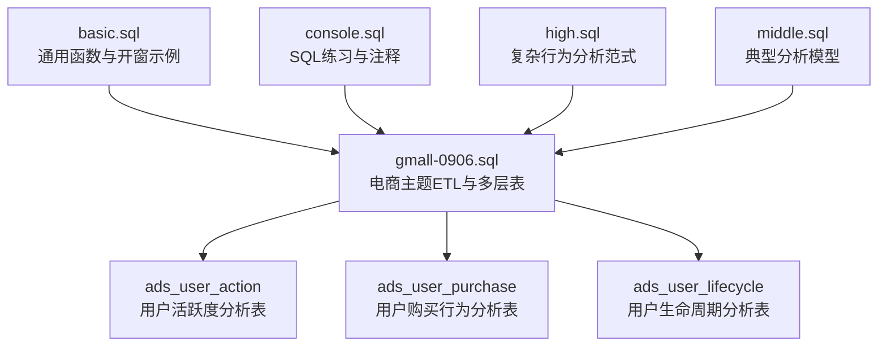
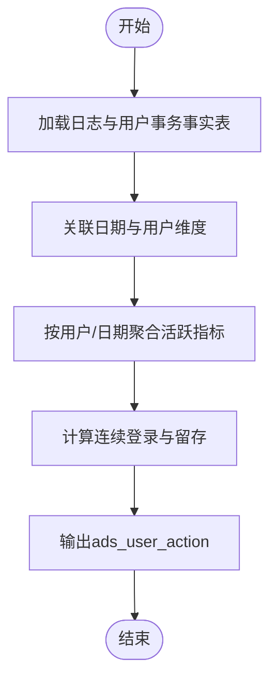
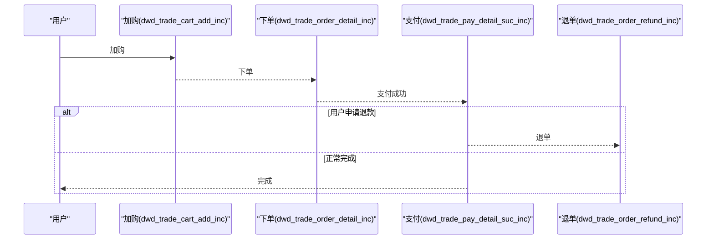
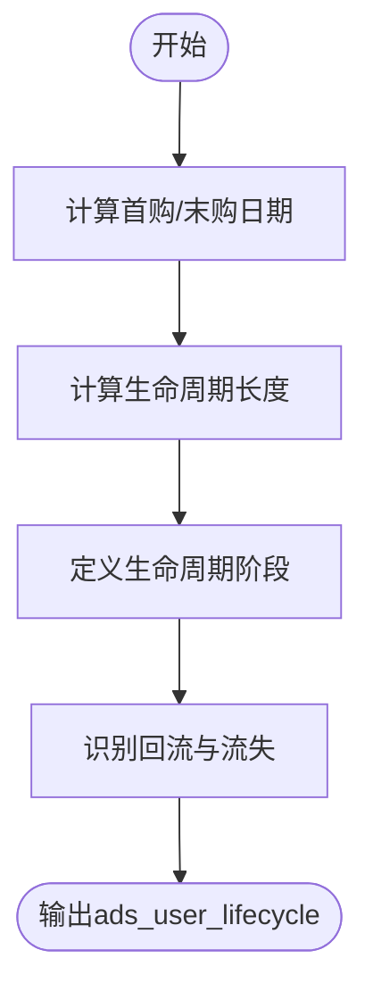

# 用户行为分析表

<cite>
**本文引用的文件**
- [basic.sql](file://basic.sql)
- [console.sql](file://console.sql)
- [gmall-0906.sql](file://gmall-0906.sql)
- [high.sql](file://high.sql)
- [middle.sql](file://middle.sql)
</cite>

## 目录
1. [引言](#引言)
2. [项目结构](#项目结构)
3. [核心组件](#核心组件)
4. [架构总览](#架构总览)
5. [详细组件分析](#详细组件分析)
6. [依赖分析](#依赖分析)
7. [性能考量](#性能考量)
8. [故障排查指南](#故障排查指南)
9. [结论](#结论)
10. [附录](#附录)

## 引言
本技术文档围绕HQL数据仓库中的用户行为分析主题，系统梳理与用户行为分析密切相关的事实表与宽表设计，重点覆盖以下目标：
- 用户活跃度分析表（ads_user_action）
- 用户购买行为分析表（ads_user_purchase）
- 用户生命周期分析表（ads_user_lifecycle）
- 用户行为轨迹分析、购买转化漏斗、用户价值评估等关键分析模型
- 用户分群策略、行为标签体系与个性化推荐指标的实现方法
- 提供可复用的SQL实现路径、性能优化技巧与业务应用案例

本仓库以电商场景为主，包含日志域、交易域、流量域、工具域、用户域等多类事务事实表与宽表，为构建用户行为分析表提供了丰富的数据基础。

## 项目结构
仓库采用按主题域划分的文件组织方式，便于定位与复用：
- basic.sql：通用函数、开窗与日期处理示例，支撑行为分析中的时间序列与窗口聚合
- console.sql：教学性质的SQL练习与注释，体现JOIN、聚合、日期与排名等常用模式
- gmall-0906.sql：电商主题的完整ETL流程，包含ODS、DIM、DWD、DWS等多层表，涵盖用户、商品、订单、流量、互动、支付、退单等事务事实表
- high.sql：直播/在线人数、页面浏览会话切分、连续登录等复杂行为分析范式
- middle.sql：订单连续性、累计消费、首次下单后连续下单比例、品类销量Top、用户注册/登录/下单综合统计等典型分析模型

[此图为概念性结构示意，不直接映射具体源码文件，故不提供图表来源]

## 核心组件
本节聚焦于与用户行为分析直接相关的事实表与宽表，以及用于构建分析表的中间层与维度层。

- 事务事实表（DWD层）
  - 用户域：dwd_user_register_inc（注册）、dwd_user_login_inc（登录）
  - 交易域：dwd_trade_order_detail_inc（下单明细）、dwd_trade_pay_detail_suc_inc（支付成功）、dwd_trade_order_refund_inc（退单）、dwd_trade_refund_pay_suc_inc（退款成功）
  - 流量域：dwd_traffic_page_view_inc（页面浏览）、dwd_traffic_action_inc（动作）、dwd_traffic_display_inc（曝光）、dwd_traffic_error_inc（错误）
  - 工具域：dwd_tool_coupon_get_inc（领券）、dwd_tool_coupon_order_inc（下单用券）、dwd_tool_coupon_pay_inc（支付用券）
  - 互动域：dwd_interaction_favor_add_inc（收藏）、dwd_interaction_comment_inc（评价）
  - 交易域购物车：dwd_trade_cart_add_inc（加购）

- 维度表（DIM层）
  - 商品维度：dim_sku_full
  - 地区维度：dim_province_full
  - 时间维度：dim_date
  - 用户维度：dim_user_zip
  - 优惠券维度：dim_coupon_full
  - 活动维度：dim_activity_full

- 汇总宽表（DWS层）
  - 用户粒度订单：dws_trade_user_order_1d、dws_trade_user_order_nd、dws_trade_user_order_td
  - 用户粒度加购：dws_trade_user_cart_add_1d、dws_trade_user_cart_add_nd
  - 用户粒度支付：dws_trade_user_payment_1d、dws_trade_user_payment_nd
  - 用户粒度退单：dws_trade_user_order_refund_1d、dws_trade_user_order_refund_nd
  - 用户-商品粒度订单：dws_trade_user_sku_order_1d、dws_trade_user_sku_order_nd
  - 用户-商品粒度退单：dws_trade_user_sku_order_refund_1d、dws_trade_user_sku_order_refund_nd
  - 省份粒度订单：dws_trade_province_order_1d、dws_trade_province_order_nd
  - 流量域会话/访客页面：dws_traffic_session_page_view_1d、dws_traffic_page_visitor_page_view_1d、dws_traffic_page_visitor_page_view_nd

以上表结构与命名体现了典型的星型/雪花模型，为ads表的构建提供了可靠的数据来源与维度支撑。

**章节来源**
- file://gmall-0906.sql#L909-L1170
- file://gmall-0906.sql#L1174-L1927
- file://gmall-0906.sql#L1929-L2234
- file://gmall-0906.sql#L2268-L2399
- file://gmall-0906.sql#L2404-L2537
- file://gmall-0906.sql#L2540-L3049
- file://gmall-0906.sql#L3052-L3196
- file://gmall-0906.sql#L3200-L3999
- file://gmall-0906.sql#L4000-L4799

## 架构总览
下图展示从原始日志/事务数据到用户行为分析表的典型路径：ODS清洗 -> DIM维度建模 -> DWD事务事实 -> DWS宽表汇总 -> ADS分析表。

```mermaid
graph TB
subgraph "ODS层"
O1["ods_log_inc<br/>日志"]
O2["ods_user_info_inc<br/>用户"]
O3["ods_order_detail_inc<br/>订单明细"]
O4["ods_payment_info_inc<br/>支付"]
O5["ods_order_refund_info_inc<br/>退单"]
O6["ods_comment_info_inc<br/>评价"]
O7["ods_favor_info_inc<br/>收藏"]
O8["ods_cart_info_inc<br/>购物车"]
O9["ods_coupon_use_inc<br/>优惠券"]
end
subgraph "DIM层"
D1["dim_sku_full<br/>商品维度"]
D2["dim_province_full<br/>地区维度"]
D3["dim_date<br/>时间维度"]
D4["dim_user_zip<br/>用户维度"]
D5["dim_coupon_full<br/>优惠券维度"]
D6["dim_activity_full<br/>活动维度"]
end
subgraph "DWD层"
W1["dwd_traffic_page_view_inc"]
W2["dwd_traffic_action_inc"]
W3["dwd_traffic_display_inc"]
W4["dwd_user_login_inc"]
W5["dwd_user_register_inc"]
W6["dwd_trade_order_detail_inc"]
W7["dwd_trade_pay_detail_suc_inc"]
W8["dwd_trade_order_refund_inc"]
W9["dwd_interaction_comment_inc"]
W10["dwd_interaction_favor_add_inc"]
W11["dwd_tool_coupon_get_inc"]
W12["dwd_tool_coupon_order_inc"]
W13["dwd_tool_coupon_pay_inc"]
W14["dwd_trade_cart_add_inc"]
end
subgraph "DWS层"
S1["dws_trade_user_order_1d/nd/td"]
S2["dws_trade_user_cart_add_1d/nd"]
S3["dws_trade_user_payment_1d/nd"]
S4["dws_trade_user_order_refund_1d/nd"]
S5["dws_trade_user_sku_order_1d/nd"]
S6["dws_trade_user_sku_order_refund_1d/nd"]
S7["dws_trade_province_order_1d/nd"]
S8["dws_traffic_session_page_view_1d"]
S9["dws_traffic_page_visitor_page_view_1d/nd"]
end
subgraph "ADS层"
A1["ads_user_action"]
A2["ads_user_purchase"]
A3["ads_user_lifecycle"]
end
O1 --> W1
O1 --> W2
O1 --> W3
O2 --> W4
O2 --> W5
O3 --> W6
O4 --> W7
O5 --> W8
O6 --> W9
O7 --> W10
O8 --> W14
O9 --> W11
O9 --> W12
O9 --> W13
D1 --> W6
D1 --> W10
D1 --> W12
D1 --> W13
D2 --> W6
D2 --> W7
D2 --> W8
D3 --> W1
D3 --> W2
D3 --> W3
D3 --> W4
D3 --> W5
D4 --> W4
D4 --> W5
D4 --> W6
D4 --> W7
D4 --> W8
D5 --> W11
D5 --> W12
D5 --> W13
D6 --> W6
W1 --> S8
W2 --> S8
W3 --> S8
W4 --> S1
W5 --> S1
W6 --> S1
W7 --> S3
W8 --> S4
W9 --> S1
W10 --> S1
W11 --> S1
W12 --> S5
W13 --> S5
W14 --> S2
S1 --> A2
S2 --> A2
S3 --> A2
S4 --> A2
S5 --> A2
S6 --> A2
S7 --> A2
S8 --> A1
S9 --> A1
S1 --> A3
S2 --> A3
S3 --> A3
S4 --> A3
```

**图表来源**
- [gmall-0906.sql](file://gmall-0906.sql#L909-L1170)
- [gmall-0906.sql](file://gmall-0906.sql#L1174-L1927)
- [gmall-0906.sql](file://gmall-0906.sql#L1929-L2399)
- [gmall-0906.sql](file://gmall-0906.sql#L2404-L3049)
- [gmall-0906.sql](file://gmall-0906.sql#L3052-L3999)
- [gmall-0906.sql](file://gmall-0906.sql#L4000-L4799)

## 详细组件分析

### 用户活跃度分析表（ads_user_action）
目标：刻画用户在日/周/月等维度上的活跃特征，支持连续登录、会话时长、页面访问频次等指标。

- 数据来源与口径
  - 日志域：dwd_traffic_page_view_inc（页面浏览）、dwd_traffic_action_inc（动作）、dwd_traffic_display_inc（曝光）
  - 用户域：dwd_user_login_inc（登录）、dwd_user_register_inc（注册）
  - 维度：dim_date（日期维度）、dim_user_zip（用户维度）

- 关键指标与实现要点
  - 登录活跃：基于dwd_user_login_inc按用户与日期聚合，生成日活、周活、月活
  - 页面访问活跃：基于dwd_traffic_page_view_inc统计UV、PV、平均访问时长、访问页面数
  - 会话活跃：基于dwd_traffic_page_view_inc的会话切分逻辑，结合窗口函数生成会话级指标
  - 连续登录：参考high.sql中的连续登录范式，使用row_number或lag/datediff打标，统计连续N日登录用户
  - 新用户次日留存：基于dwd_user_register_inc与dwd_user_login_inc，计算注册次日仍登录的比例

- SQL实现路径参考
  - 登录活跃与连续登录：参见[middle.sql](file://middle.sql#L1-L200)中的连续登录与次日留存思路
  - 页面访问与会话：参见[high.sql](file://high.sql#L1-L120)中的会话切分与在线人数计算
  - 维度关联：参见[gmall-0906.sql](file://gmall-0906.sql#L2540-L2751)中的页面浏览与维度关联

- 行为轨迹分析
  - 通过dwd_traffic_page_view_inc与dwd_traffic_action_inc，可还原用户在页面间的跳转与动作序列，结合会话ID进行轨迹聚类

**图表来源**
- [gmall-0906.sql](file://gmall-0906.sql#L2540-L2751)
- [high.sql](file://high.sql#L1-L120)
- [middle.sql](file://middle.sql#L1-L200)

**章节来源**
- file://gmall-0906.sql#L2540-L2751
- file://high.sql#L1-L120
- file://middle.sql#L1-L200

### 用户购买行为分析表（ads_user_purchase）
目标：刻画用户在购买路径上的行为与转化，支持购买频次、客单价、购买金额、优惠使用、退单等指标。

- 数据来源与口径
  - 交易域：dwd_trade_order_detail_inc（下单明细）、dwd_trade_pay_detail_suc_inc（支付成功）、dwd_trade_order_refund_inc（退单）
  - 工具域：dwd_tool_coupon_get_inc（领券）、dwd_tool_coupon_order_inc（下单用券）、dwd_tool_coupon_pay_inc（支付用券）
  - 维度：dim_sku_full（商品维度）、dim_coupon_full（优惠券维度）、dim_date（日期维度）

- 关键指标与实现要点
  - 购买频次与金额：基于dwd_trade_order_detail_inc按用户聚合订单数、件数、原始金额、活动/券优惠分摊、最终金额
  - 客单价与转化链路：计算人均订单数、件数、客单价；结合dwd_trade_cart_add_inc计算加购-下单转化
  - 优惠使用：基于dwd_tool_coupon_*系列表，统计领券、用券、支付用券的转化与优惠贡献
  - 退单分析：基于dwd_trade_order_refund_inc统计退单次数、件数、金额，并与订单明细关联

- 购买转化漏斗
  - 加购 -> 下单 -> 支付 -> 完成/退款
  - 漏斗口径：以用户为粒度，按阶段统计人数与转化率，支持按时间窗口与品类/品牌拆分

- SQL实现路径参考
  - 用户粒度订单与支付：参见[gmall-0906.sql](file://gmall-0906.sql#L4038-L4263)中的dws层用户粒度汇总
  - 用户-商品粒度订单与退单：参见[gmall-0906.sql](file://gmall-0906.sql#L3652-L3999)中的dws层用户-商品粒度汇总
  - 优惠券使用：参见[gmall-0906.sql](file://gmall-0906.sql#L2268-L2399)中的dwd_tool_*表与dws层优惠券粒度汇总

**图表来源**
- [gmall-0906.sql](file://gmall-0906.sql#L1174-L1927)
- [gmall-0906.sql](file://gmall-0906.sql#L2268-L2399)
- [gmall-0906.sql](file://gmall-0906.sql#L3652-L3999)
- [gmall-0906.sql](file://gmall-0906.sql#L4038-L4263)

**章节来源**
- file://gmall-0906.sql#L1174-L1927
- file://gmall-0906.sql#L2268-L2399
- file://gmall-0906.sql#L3652-L3999
- file://gmall-0906.sql#L4038-L4263

### 用户生命周期分析表（ads_user_lifecycle）
目标：刻画用户从首次购买到最后购买的时间跨度、购买频次、金额等，识别新、老、流失、回流等生命周期阶段。

- 数据来源与口径
  - 用户粒度订单：dws_trade_user_order_1d/nd/td
  - 用户域：dwd_user_register_inc（注册）、dwd_user_login_inc（登录）

- 关键指标与实现要点
  - 首购时间、末购时间、生命周期长度：基于dws_trade_user_order_td或dws_trade_user_order_1d聚合
  - 购买频次与金额：累计订单数、累计件数、累计原始金额、累计优惠与最终金额
  - 生命周期阶段：定义新用户（首购时间<=N日）、成熟用户（近N日有购买）、流失用户（超过M日未购买）等
  - 回流识别：对流失用户在后续窗口内再次购买的用户进行回流标记

- SQL实现路径参考
  - 用户粒度订单TD汇总：参见[gmall-0906.sql](file://gmall-0906.sql#L4714-L4799)中的dws_trade_user_order_td
  - 用户注册与登录：参见[gmall-0906.sql](file://gmall-0906.sql#L3052-L3196)中的dwd_user_*表

**图表来源**
- [gmall-0906.sql](file://gmall-0906.sql#L4714-L4799)
- [gmall-0906.sql](file://gmall-0906.sql#L3052-L3196)

**章节来源**
- file://gmall-0906.sql#L4714-L4799
- file://gmall-0906.sql#L3052-L3196

### 用户分群策略、行为标签体系与个性化推荐指标
- 用户分群策略
  - 基于购买频次与金额：高价值、中价值、低价值用户
  - 基于活跃度：高活跃、中活跃、低活跃用户
  - 基于生命周期：新用户、成熟用户、流失用户、回流用户
  - 基于转化：加购-下单-支付-完成/退款的漏斗转化率分层

- 行为标签体系
  - 活跃标签：日/周/月活、连续登录天数、会话时长、页面访问深度
  - 购买标签：购买频次、客单价、品类偏好、品牌偏好、优惠敏感度
  - 流失预警标签：最近N日未购买、浏览但未下单、加购未支付等

- 个性化推荐指标
  - 协同过滤相似度、内容相似度、热门度、新颖度、多样性、时效性等
  - 结合用户画像与实时行为，构建召回、粗排、精排的指标体系

- SQL实现路径参考
  - 连续登录与留存：参见[middle.sql](file://middle.sql#L1-L200)
  - 用户综合统计：参见[middle.sql](file://middle.sql#L704-L786)
  - 页面访问与会话：参见[high.sql](file://high.sql#L1-L120)

**章节来源**
- file://middle.sql#L1-L200
- file://middle.sql#L704-L786
- file://high.sql#L1-L120

## 依赖分析
- 组件耦合与层次
  - ODS层负责原始日志与事务数据的抽取与清洗
  - DIM层提供稳定维度，确保跨域分析的一致性
  - DWD层沉淀事务事实，统一口径与口径校验
  - DWS层按主题域进行宽表汇总，降低ADS层计算压力
  - ADS层面向分析与报表，提供最终指标

- 外部依赖与集成点
  - JSON日志解析：ods_log_inc采用JsonSerDe，需确保字段映射与分区管理
  - 维度表更新：dim_user_zip采用缓慢变更维度（SCD），需关注start_date/end_date与全量装载/增量更新
  - 分区策略：按dt分区，建议统一日期格式与分区命名规范

[此图为概念性依赖示意，不直接映射具体源码文件，故不提供图表来源]

**章节来源**
- file://gmall-0906.sql#L909-L1170
- file://gmall-0906.sql#L1174-L1927
- file://gmall-0906.sql#L1929-L2399
- file://gmall-0906.sql#L2404-L3049
- file://gmall-0906.sql#L3052-L3999
- file://gmall-0906.sql#L4000-L4799

## 性能考量
- 分区与裁剪
  - 严格按dt分区，查询时务必带分区过滤，避免全表扫描
  - 对大表进行谓词下推与列裁剪，减少I/O与网络传输

- 窗口函数与排序
  - 使用row_number/dense_rank时，明确partition by与order by，避免重复排序
  - 对日期类计算使用datediff等函数时，确保输入格式一致，避免隐式转换

- 聚合与去重
  - 连续性分析（如连续登录）优先去重后再开窗，减少数据量
  - 使用sum/avg等聚合函数时，尽量在group by中一次性完成，避免多层嵌套

- 维度关联
  - 维度表与事实表关联时，优先将小表广播，减少Shuffle
  - 对频繁使用的维度建立物化视图或缓存，降低重复计算

- 执行引擎与调优
  - 对复杂窗口与多表Join，可考虑调整hive.exec.dynamic.partition等参数
  - 对JSON解析与lateral view explode，注意数据倾斜与分区策略

[本节为通用性能指导，不直接分析具体代码文件，故不提供章节来源]

## 故障排查指南
- 常见问题与定位
  - 空值与格式问题：日期函数返回NULL多因格式不匹配，检查输入格式与分区字段
  - 窗口函数异常：开窗未partition by导致结果异常，确认分区与排序字段
  - 连续性分析偏差：未去重导致连续天数偏大，确保先group by去重再开窗
  - 维度更新不一致：SCD维度未正确维护end_date/start_date，导致历史数据错配

- 排查步骤
  - 核对分区dt与数据日期一致性
  - 检查Join键是否缺失或存在脏数据
  - 对关键指标进行抽样验证，逐步缩小范围
  - 关注JSON字段映射与SerDe配置

**章节来源**
- file://gmall-0906.sql#L909-L1170
- file://gmall-0906.sql#L1174-L1927
- file://gmall-0906.sql#L1929-L2399
- file://gmall-0906.sql#L2404-L3049
- file://gmall-0906.sql#L3052-L3999
- file://gmall-0906.sql#L4000-L4799

## 结论
本仓库以电商场景为核心，提供了从原始日志到用户行为分析表的完整数据通路。通过DWD层统一事务事实、DWS层宽表汇总、ADS层面向分析的建模方式，能够高效支撑用户活跃度、购买行为与生命周期等关键分析需求。结合连续登录、会话切分、转化漏斗与用户分群等范式，可进一步扩展为个性化推荐与精细化运营的指标体系。

## 附录
- SQL实现路径参考
  - 用户活跃度：[high.sql](file://high.sql#L1-L120)、[middle.sql](file://middle.sql#L1-L200)
  - 购买行为：[gmall-0906.sql](file://gmall-0906.sql#L3652-L3999)、[gmall-0906.sql](file://gmall-0906.sql#L4038-L4263)
  - 生命周期：[gmall-0906.sql](file://gmall-0906.sql#L4714-L4799)
  - 维度建模：[gmall-0906.sql](file://gmall-0906.sql#L909-L1170)