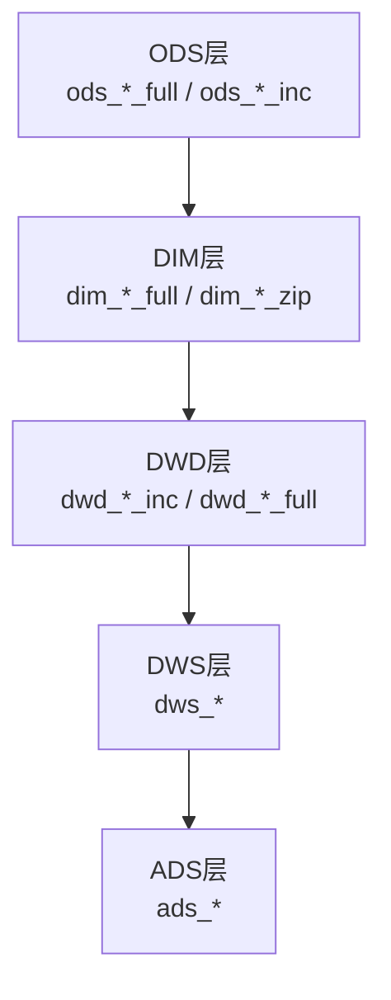
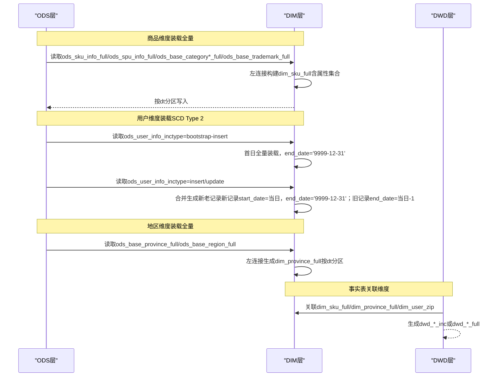
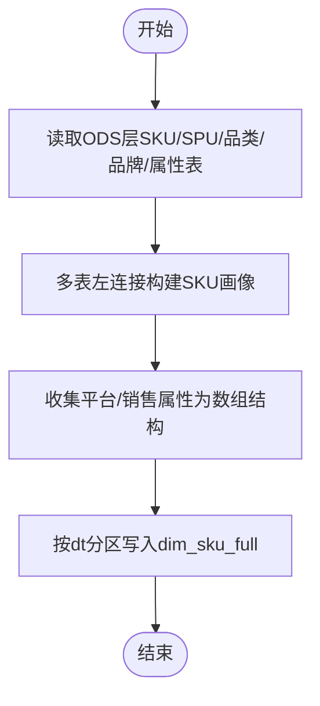
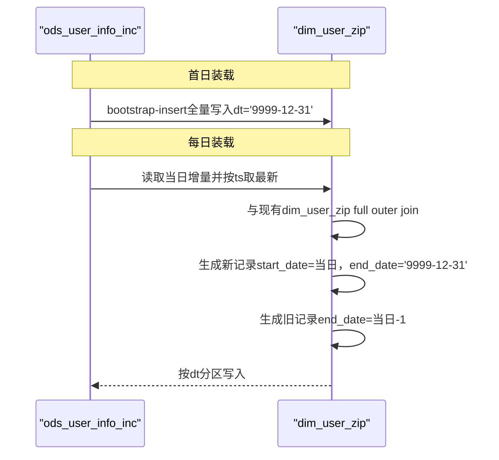
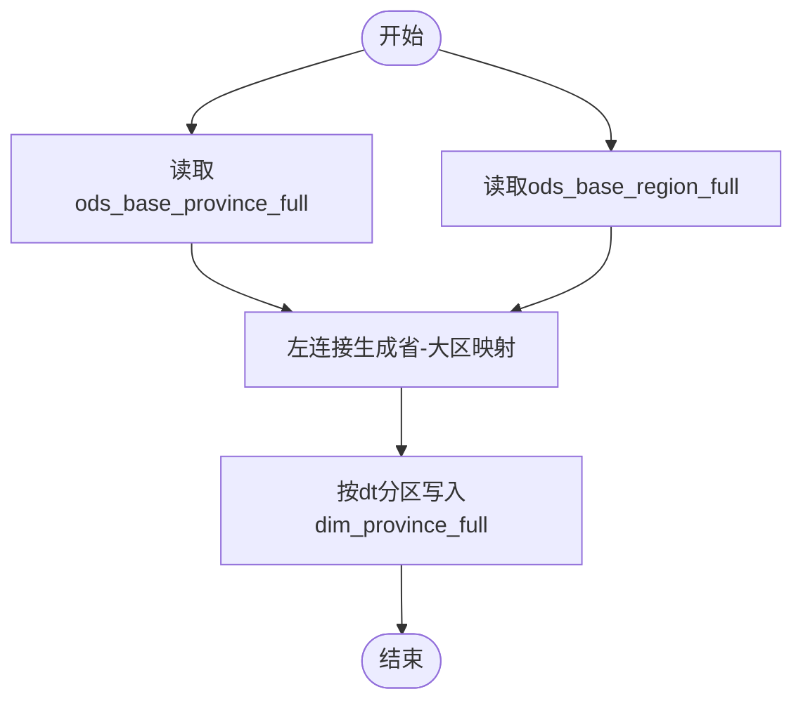
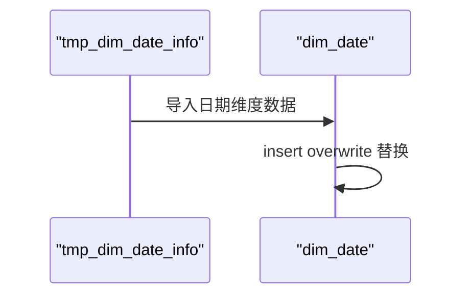
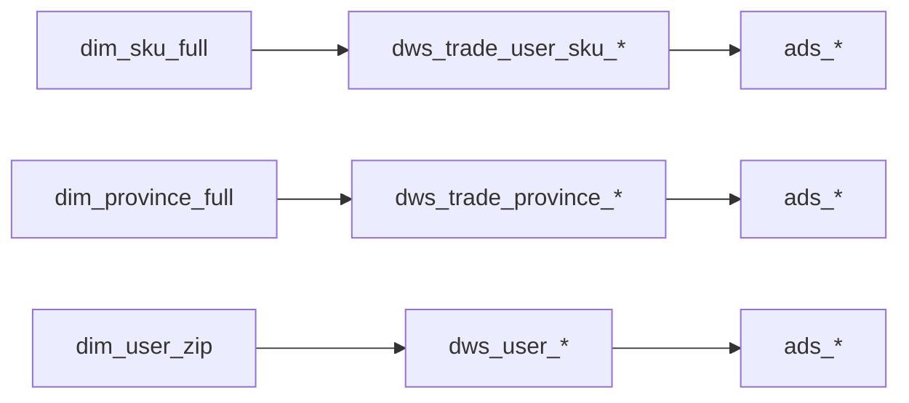

# DIM层（维度数据层）

<cite>
**本文引用的文件**
- [gmall-0906.sql](file://gmall-0906.sql)
- [basic.sql](file://basic.sql)
- [console.sql](file://console.sql)
- [high.sql](file://high.sql)
- [middle.sql](file://middle.sql)
</cite>

## 目录
1. [引言](#引言)
2. [项目结构](#项目结构)
3. [核心组件](#核心组件)
4. [架构总览](#架构总览)
5. [组件深度解析](#组件深度解析)
6. [依赖关系分析](#依赖关系分析)
7. [性能考量](#性能考量)
8. [故障排查指南](#故障排查指南)
9. [结论](#结论)
10. [附录](#附录)

## 引言
本文件面向HQL数据仓库DIM层（维度数据层），系统化阐述维度建模理念与实现方法，聚焦以下维度表：
- 商品维度表：dim_sku_full
- 用户维度表：dim_user_zip
- 地区维度表：dim_province_full
- 时间维度表：dim_date

围绕维度建模最佳实践，本文覆盖：
- SCD（缓慢变化维度）处理策略
- 维度表全量更新机制与历史数据追踪
- 表结构设计规范与数据一致性保障
- 典型建模示例与性能优化建议

## 项目结构
本仓库以业务域脚本为主，DIM层建模集中在gmall-0906.sql中，涵盖ODS层到DWD/DWS/ADS层的完整链路。本文重点聚焦于dim_sku_full、dim_user_zip、dim_province_full、dim_date的建表与装载逻辑。

[本图为概念性结构示意，不直接映射具体源文件，故不附图示来源]

**章节来源**
- [gmall-0906.sql](file://gmall-0906.sql#L465-L907)

## 核心组件
本节概述四个关键维度表的职责与设计要点。

- 商品维度表 dim_sku_full
  - 职责：刻画SKU的静态与半静态属性，包含SPU、品类、品牌、平台属性与销售属性等上下文信息。
  - 设计要点：宽表化整合，使用数组结构承载多值属性；分区dt用于全量装载。
  - 更新策略：按日全量装载，基于ODS层当日快照构建。

- 用户维度表 dim_user_zip
  - 职责：刻画用户身份与基础属性，采用SCD Type 2（有效区间）记录历史变更。
  - 设计要点：引入start_date/end_date标识生效区间；end_date统一指向未来（如'9999-12-31'）。
  - 更新策略：首日bootstrap-insert全量装载；后续每日基于增量ods_user_info_inc进行合并，生成新老两条记录。

- 地区维度表 dim_province_full
  - 职责：刻画省/直辖市与大区的关系，提供标准化编码与名称。
  - 设计要点：通过ods_base_province_full与ods_base_region_full双表关联，形成省-大区映射。
  - 更新策略：按日全量装载，维护dt分区。

- 时间维度表 dim_date
  - 职责：提供日期维度属性（周、季度、工作日等），支撑时间序列分析。
  - 设计要点：独立维护dim_date表与临时表tmp_dim_date_info，装载完成后替换。
  - 更新策略：通过临时表批量导入，再整体替换至dim_date。

**章节来源**
- [gmall-0906.sql](file://gmall-0906.sql#L465-L907)

## 架构总览
下图展示DIM层到DWD层的典型维度装载流程，突出SCD与全量装载的关键节点。

**图示来源**
- [gmall-0906.sql](file://gmall-0906.sql#L465-L907)
- [gmall-0906.sql](file://gmall-0906.sql#L908-L1170)
- [gmall-0906.sql](file://gmall-0906.sql#L800-L848)

**章节来源**
- [gmall-0906.sql](file://gmall-0906.sql#L465-L907)
- [gmall-0906.sql](file://gmall-0906.sql#L908-L1170)
- [gmall-0906.sql](file://gmall-0906.sql#L800-L848)

## 组件深度解析

### 商品维度表 dim_sku_full
- 建模策略
  - 宽表化：将SPU、品类、品牌、平台属性、销售属性等信息汇聚到一张表，便于下游事实表直接关联。
  - 属性集合：使用数组结构收集多值属性，提升查询灵活性。
- 数据来源与装载
  - 来源：ods_sku_info_full、ods_spu_info_full、ods_base_category1/2/3_full、ods_base_trademark_full、ods_sku_attr_value_full、ods_sku_sale_attr_value_full。
  - 装载：按dt分区全量写入，左连接构建完整SKU画像。
- 性能与一致性
  - 使用ORC存储与snappy压缩，提升IO效率。
  - 通过分区dt确保可追溯性与可回滚性。

**图示来源**
- [gmall-0906.sql](file://gmall-0906.sql#L465-L604)

**章节来源**
- [gmall-0906.sql](file://gmall-0906.sql#L465-L604)

### 用户维度表 dim_user_zip（SCD Type 2）
- SCD策略
  - 有效区间：通过start_date与end_date标识记录生效时间段，end_date统一使用'9999-12-31'表示当前有效。
  - 新老记录：当用户属性变更时，生成新记录（start_date=当日，end_date='9999-12-31'）与旧记录（end_date=当日-1）。
- 数据来源与装载
  - 首日：读取ods_user_info_inc中type='bootstrap-insert'的记录，一次性全量装载。
  - 每日：对ods_user_info_inc当日增量按ts倒序取最新一条，与现有dim_user_zip进行full outer join，生成新老记录并写入dt分区。
- 一致性与可追溯
  - 通过rank窗口函数取最新值，确保同一用户ID仅保留一条当前有效记录。
  - 分区dt='9999-12-31'作为当前有效视图的入口，便于下游事实表关联。

**图示来源**
- [gmall-0906.sql](file://gmall-0906.sql#L908-L1170)

**章节来源**
- [gmall-0906.sql](file://gmall-0906.sql#L908-L1170)

### 地区维度表 dim_province_full
- 建模策略
  - 省-大区映射：将省表与大区表关联，输出标准化编码与名称。
- 数据来源与装载
  - 来源：ods_base_province_full、ods_base_region_full。
  - 装载：按dt分区全量写入dim_province_full。

**图示来源**
- [gmall-0906.sql](file://gmall-0906.sql#L800-L848)

**章节来源**
- [gmall-0906.sql](file://gmall-0906.sql#L800-L848)

### 时间维度表 dim_date
- 建模策略
  - 独立维护：通过临时表tmp_dim_date_info批量导入，再整体替换至dim_date，保证原子性。
  - 字段覆盖：包含日期ID、周/月/季度/年、工作日标识、节假日等。
- 数据来源与装载
  - 来源：临时表tmp_dim_date_info（文本格式）。
  - 装载：insert overwrite dim_date select * from tmp_dim_date_info。

**图示来源**
- [gmall-0906.sql](file://gmall-0906.sql#L850-L907)

**章节来源**
- [gmall-0906.sql](file://gmall-0906.sql#L850-L907)

## 依赖关系分析
- 维度到事实的依赖
  - dws_*与ads_*层广泛依赖dim_sku_full、dim_province_full、dim_user_zip进行聚合与报表输出。
- 维度内部依赖
  - dim_sku_full依赖多张ODS层基础维度表；dim_province_full依赖省与大区表；dim_user_zip依赖用户增量表。
- 分区与存储
  - DIM层普遍采用分区dt与ORC存储，提升查询与写入效率。

[本图为概念性依赖示意，不直接映射具体源文件，故不附图示来源]

**章节来源**
- [gmall-0906.sql](file://gmall-0906.sql#L3652-L4793)

## 性能考量
- 存储与压缩
  - DIM层广泛采用ORC存储与snappy压缩，显著降低I/O成本，适合大规模全量装载与宽表查询。
- 分区策略
  - 按dt分区写入，便于按日期回溯与增量装载；同时支持按dt裁剪扫描，提高查询效率。
- 连接与聚合
  - 使用左连接与collect_set等聚合函数，避免不必要的笛卡尔积；在SCD场景中，通过rank取最新值减少重复数据。
- 窗口函数与去重
  - 在连续登录、会话识别等场景中，合理使用row_number、rank、lead/lag与去重，可显著降低重复计算与内存压力。
- 日期维度
  - 独立维护dim_date，避免在事实表中重复计算日期属性，提升查询性能与一致性。

[本节为通用性能建议，不直接分析具体源文件，故不附章节来源]

## 故障排查指南
- 常见问题定位
  - 分区缺失：确认dim_*表是否按dt分区写入；检查ods_*表是否存在对应dt分区数据。
  - SCD未生效：核对dim_user_zip的start_date/end_date是否正确更新；检查ods_user_info_inc的type与ts字段是否齐全。
  - 连接异常：核对dim_sku_full与ods_*表的关联键是否一致；确认collect_set生成的数组结构是否为空。
  - 日期维度不一致：检查tmp_dim_date_info与dim_date的替换流程是否成功执行。
- 调试建议
  - 使用中间CTE或临时视图逐步验证连接与聚合逻辑。
  - 在SCD场景中，先对ods_user_info_inc按ts倒序取最新值，再与现有dim_user_zip进行full outer join，观察新老记录生成情况。
  - 对日期维度，先验证tmp_dim_date_info的字段完整性，再执行替换。

**章节来源**
- [gmall-0906.sql](file://gmall-0906.sql#L908-L1170)
- [gmall-0906.sql](file://gmall-0906.sql#L465-L604)
- [gmall-0906.sql](file://gmall-0906.sql#L800-L907)

## 结论
- DIM层通过宽表化与SCD Type 2策略，既满足业务对历史数据的追溯需求，又兼顾查询性能与维护成本。
- 商品、用户、地区、时间四大维度表分别采用全量装载与有效区间管理，形成稳定的数据基座。
- 建议在实际落地中严格遵循分区与存储规范，配合窗口函数与聚合优化，确保维度表质量与查询效率。

[本节为总结性内容，不直接分析具体源文件，故不附章节来源]

## 附录
- 相关SQL能力参考
  - 窗口函数与开窗聚合：用于连续登录、会话识别、排名与累计计算等场景。
  - 日期函数与格式化：用于日期维度构造与时间序列分析。
  - 集合与数组：用于属性集合的收集与宽表化建模。

**章节来源**
- [basic.sql](file://basic.sql#L1-L200)
- [console.sql](file://console.sql#L1-L200)
- [high.sql](file://high.sql#L1-L120)
- [middle.sql](file://middle.sql#L1-L120)