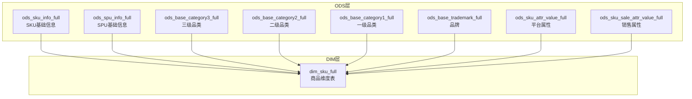
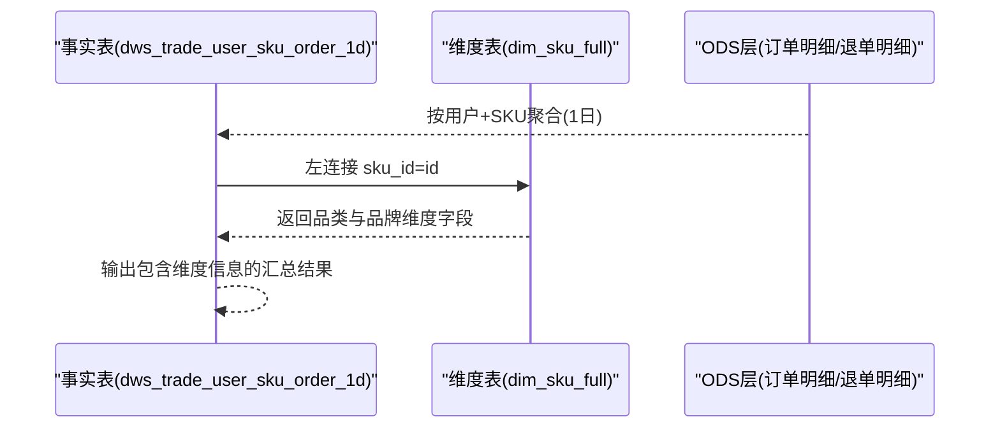
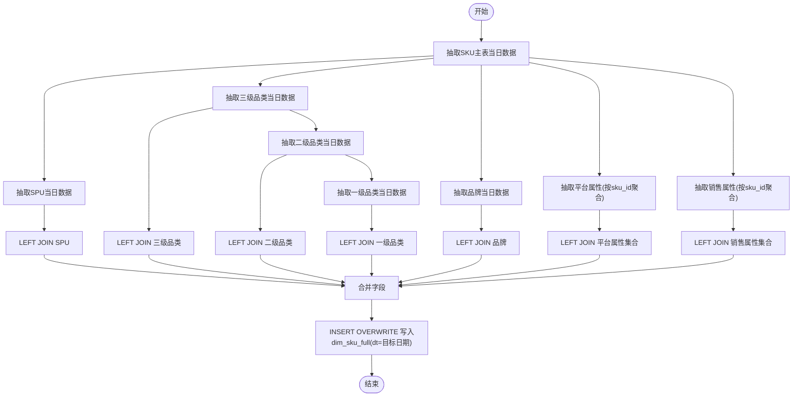
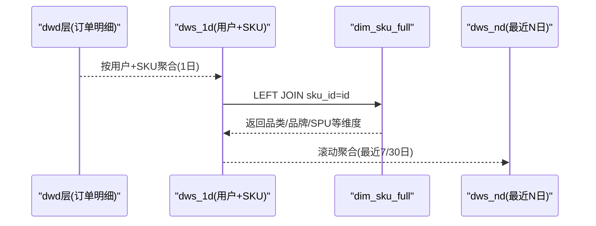
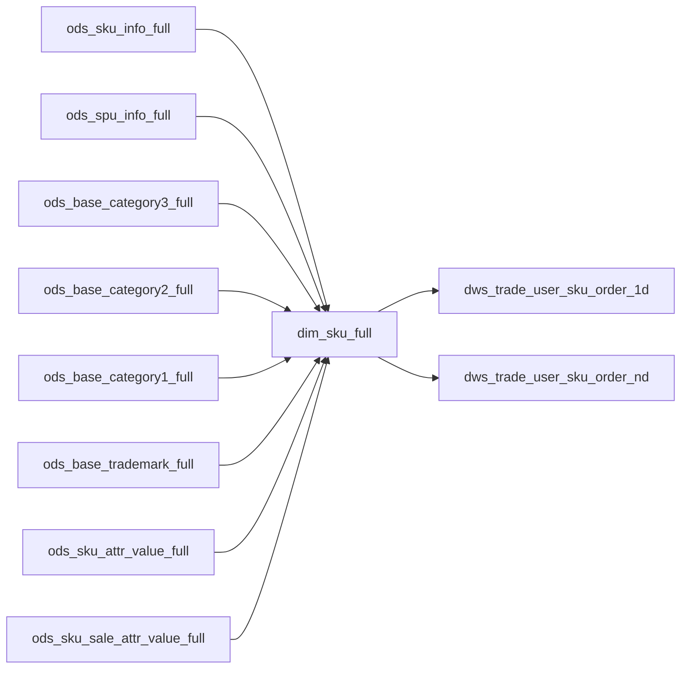

# 商品维度表（dim_sku_full）

<cite>
**本文引用的文件**
- [gmall-0906.sql](file://gmall-0906.sql)
- [basic.sql](file://basic.sql)
- [middle.sql](file://middle.sql)
- [high.sql](file://high.sql)
</cite>

## 目录
1. [引言](#引言)
2. [项目结构](#项目结构)
3. [核心组件](#核心组件)
4. [架构总览](#架构总览)
5. [详细组件分析](#详细组件分析)
6. [依赖分析](#依赖分析)
7. [性能考量](#性能考量)
8. [故障排查指南](#故障排查指南)
9. [结论](#结论)
10. [附录](#附录)

## 引言
本文件围绕商品维度表（dim_sku_full）展开，系统化阐述其设计理念、字段定义、数据来源整合流程（来自ods层多张表的关联）、全量更新机制，以及在星型模型中的角色与与事实表的关联关系。同时给出ETL逻辑与性能优化建议，并提供面向销售分析与库存管理等业务场景的支持说明。

## 项目结构
本仓库包含多个SQL脚本文件，其中与商品维度表直接相关的是gmall-0906.sql，内含dim_sku_full的建表与ETL逻辑；其他文件如basic.sql、middle.sql、high.sql提供了Hive/HQL常用函数与分析范式示例，有助于理解本仓库中的数据处理模式。

图表来源
- [gmall-0906.sql](file://gmall-0906.sql#L235-L282)
- [gmall-0906.sql](file://gmall-0906.sql#L466-L493)

章节来源
- [gmall-0906.sql](file://gmall-0906.sql#L235-L282)
- [gmall-0906.sql](file://gmall-0906.sql#L466-L493)

## 核心组件
- 商品维度表（dim_sku_full）：面向销售分析与库存管理的宽表，包含SKU、SPU、三级品类、二级品类、一级品类、品牌、平台属性与销售属性等多维信息。
- ODS层相关表：
  - ods_sku_info_full：SKU基础信息（含spu_id、category3_id、tm_id、is_sale等）
  - ods_spu_info_full：SPU基础信息（含spu_name）
  - ods_base_categoryX_full：三级、二级、一级品类
  - ods_base_trademark_full：品牌
  - ods_sku_attr_value_full：SKU平台属性集合
  - ods_sku_sale_attr_value_full：SKU销售属性集合

章节来源
- [gmall-0906.sql](file://gmall-0906.sql#L235-L282)
- [gmall-0906.sql](file://gmall-0906.sql#L466-L493)

## 架构总览
dim_sku_full在数据仓库中作为维度表，服务于事实表（如dws_trade_user_sku_order_1d、dws_trade_user_sku_order_nd等）。事实表通过sku_id与dim_sku_full进行左连接，从而获得品类与品牌等维度信息，支撑销售分析、库存管理等业务主题。

图表来源
- [gmall-0906.sql](file://gmall-0906.sql#L3700-L3790)
- [gmall-0906.sql](file://gmall-0906.sql#L3934-L3979)

章节来源
- [gmall-0906.sql](file://gmall-0906.sql#L3700-L3790)
- [gmall-0906.sql](file://gmall-0906.sql#L3934-L3979)

## 详细组件分析

### 设计理念与建模策略
- 多层级维度建模：dim_sku_full将SKU作为最细粒度的事实载体，向上映射至SPU、三级品类、二级品类、一级品类，并关联品牌，形成完整的商品层级体系。
- 属性建模：平台属性与销售属性采用集合结构（ARRAY<STRUCT<...>>），便于在宽表中直接使用，减少后续查询时的多次JOIN。
- 全量更新：dim_sku_full按天分区，采用“全量覆盖”的ETL策略，确保维度状态的可追溯性与一致性。

章节来源
- [gmall-0906.sql](file://gmall-0906.sql#L466-L493)
- [gmall-0906.sql](file://gmall-0906.sql#L498-L603)

### 字段定义与含义
- 基础标识与状态
  - id：SKU编号
  - spu_id/spu_name：SPU编号与名称
  - is_sale：是否在售（布尔）
  - create_time：创建时间
- 商品信息
  - price、sku_name、sku_desc、weight：价格、名称、描述、重量
- 品类层级
  - category3_id/category3_name、category2_id/category2_name、category1_id/category1_name
- 品牌
  - tm_id/tm_name
- 属性集合
  - sku_attr_values：平台属性集合（attr_id、value_id、attr_name、value_name）
  - sku_sale_attr_values：销售属性集合（sale_attr_id、sale_attr_value_id、sale_attr_name、sale_attr_value_name）
- 分区
  - dt：分区字段，按天存储

章节来源
- [gmall-0906.sql](file://gmall-0906.sql#L466-L493)

### 数据来源与ETL逻辑
- 数据来源
  - SKU主表：ods_sku_info_full（抽取id、spu_id、category3_id、tm_id、is_sale、create_time等）
  - SPU：ods_spu_info_full（抽取spu_name）
  - 品类：ods_base_category3_full、ods_base_category2_full、ods_base_category1_full（抽取id、name、上级id）
  - 品牌：ods_base_trademark_full（抽取tm_name）
  - 属性：ods_sku_attr_value_full、ods_sku_sale_attr_value_full（按sku_id聚合为集合）
- ETL流程
  - 使用WITH子句分别抽取各源表当日数据
  - 以SKU为主表，依次LEFT JOIN SPU、三级品类、二级品类、一级品类、品牌
  - 使用collect_set+named_struct将属性聚合为结构体数组
  - INSERT OVERWRITE写入dim_sku_full，按dt分区

图表来源
- [gmall-0906.sql](file://gmall-0906.sql#L498-L603)

章节来源
- [gmall-0906.sql](file://gmall-0906.sql#L498-L603)

### 与事实表的关联关系
- 事实表dws_trade_user_sku_order_1d在每日聚合后，通过sku_id与dim_sku_full进行LEFT JOIN，补充品类与品牌维度信息，用于后续销售分析。
- 事实表dws_trade_user_sku_order_nd基于1日表进行滚动聚合，同样依赖dim_sku_full提供维度上下文。

图表来源
- [gmall-0906.sql](file://gmall-0906.sql#L3700-L3790)
- [gmall-0906.sql](file://gmall-0906.sql#L3827-L3854)

章节来源
- [gmall-0906.sql](file://gmall-0906.sql#L3700-L3790)
- [gmall-0906.sql](file://gmall-0906.sql#L3827-L3854)

### 在星型模型中的作用
- 维度表：dim_sku_full提供稳定的商品维度上下文，降低事实表的复杂度与重复数据。
- 星型模型：事实表（如dws_trade_user_sku_order_1d/nd）以用户+SKU为核心粒度，通过LEFT JOIN维度表获得品类、品牌、SPU等信息，支撑销售分析、库存管理等主题分析。

章节来源
- [gmall-0906.sql](file://gmall-0906.sql#L3700-L3790)
- [gmall-0906.sql](file://gmall-0906.sql#L3827-L3854)

### 业务场景支持
- 销售分析：按SKU、SPU、品类、品牌等维度进行销量、件数、金额等指标分析。
- 库存管理：结合在售状态（is_sale）与品类/品牌维度，进行库存结构与滞销分析。
- 营销分析：配合活动/优惠券维度表，分析不同品类或品牌的促销效果。

章节来源
- [gmall-0906.sql](file://gmall-0906.sql#L3700-L3790)
- [gmall-0906.sql](file://gmall-0906.sql#L3827-L3854)

## 依赖分析
- 维度表依赖ODS层多表：SKU主表、SPU、品类、品牌、属性表。
- 事实表依赖维度表：通过sku_id与dim_sku_full建立LEFT JOIN，确保即使维度缺失也能保留事实记录。
- 分区策略：dim_sku_full按dt分区，便于按天全量更新与回溯。

图表来源
- [gmall-0906.sql](file://gmall-0906.sql#L235-L282)
- [gmall-0906.sql](file://gmall-0906.sql#L466-L493)
- [gmall-0906.sql](file://gmall-0906.sql#L3700-L3790)
- [gmall-0906.sql](file://gmall-0906.sql#L3827-L3854)

章节来源
- [gmall-0906.sql](file://gmall-0906.sql#L235-L282)
- [gmall-0906.sql](file://gmall-0906.sql#L466-L493)
- [gmall-0906.sql](file://gmall-0906.sql#L3700-L3790)
- [gmall-0906.sql](file://gmall-0906.sql#L3827-L3854)

## 性能考量
- 存储格式：ORC + snappy压缩，提升读写性能与存储效率。
- 分区策略：按dt分区，便于按天全量更新与裁剪扫描。
- 聚合策略：属性使用collect_set+named_struct聚合为结构体数组，减少后续JOIN次数。
- 连接顺序：以SKU主表为驱动，LEFT JOIN维度表，避免大表全量JOIN带来的资源压力。
- 去重与分组：属性聚合阶段按sku_id分组，确保同一SKU的属性集合唯一。

章节来源
- [gmall-0906.sql](file://gmall-0906.sql#L466-L493)
- [gmall-0906.sql](file://gmall-0906.sql#L498-L603)

## 故障排查指南
- 字段缺失或为空
  - 现象：维度字段为空
  - 排查：确认对应ODS表当日分区是否存在数据；检查LEFT JOIN条件是否正确
- 属性集合为空
  - 现象：sku_attr_values或sku_sale_attr_values为空
  - 排查：确认ods_sku_attr_value_full/ods_sku_sale_attr_value_full当日分区数据；检查按sku_id分组聚合逻辑
- 分区写入失败
  - 现象：INSERT OVERWRITE失败
  - 排查：确认目标分区目录存在且权限正常；检查分区dt是否与目标日期一致
- 性能异常
  - 现象：ETL耗时长
  - 排查：检查磁盘IO与网络带宽；确认ORC压缩配置；评估分区裁剪是否生效

章节来源
- [gmall-0906.sql](file://gmall-0906.sql#L498-L603)

## 结论
dim_sku_full通过清晰的多层级维度建模与全量更新机制，为销售分析与库存管理提供了稳定、高效的维度支撑。其与事实表的LEFT JOIN设计既保证了分析完整性，又兼顾了性能与可维护性。建议在实际生产中持续关注分区管理、属性聚合与连接顺序等关键环节，以确保ETL稳定性与查询性能。

## 附录
- 示例参考（不展示具体代码内容，仅提供路径）
  - 建表与ETL：[dim_sku_full建表与全量装载](file://gmall-0906.sql#L466-L603)
  - 事实表与维度表关联：[dws_1d与dim_sku_full关联](file://gmall-0906.sql#L3700-L3790)、[dws_nd与dim_sku_full关联](file://gmall-0906.sql#L3827-L3854)
  - 常用函数与开窗范式参考：[basic.sql](file://basic.sql#L1-L200)、[middle.sql](file://middle.sql#L1-L200)、[high.sql](file://high.sql#L1-L120)