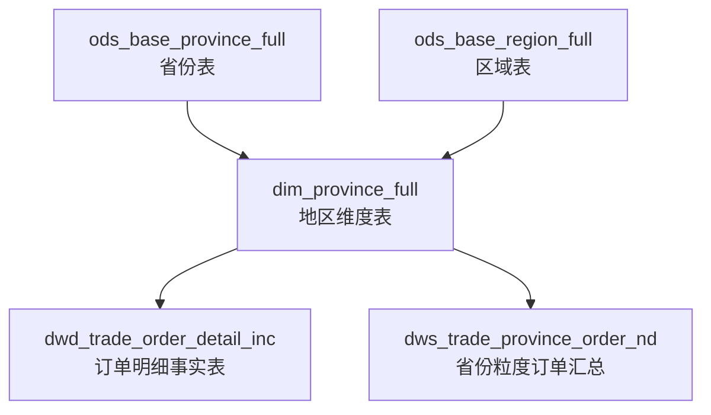
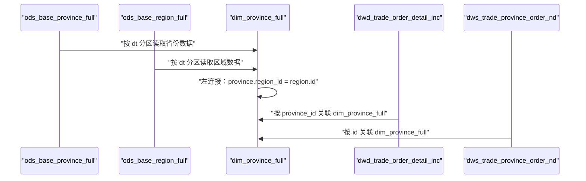
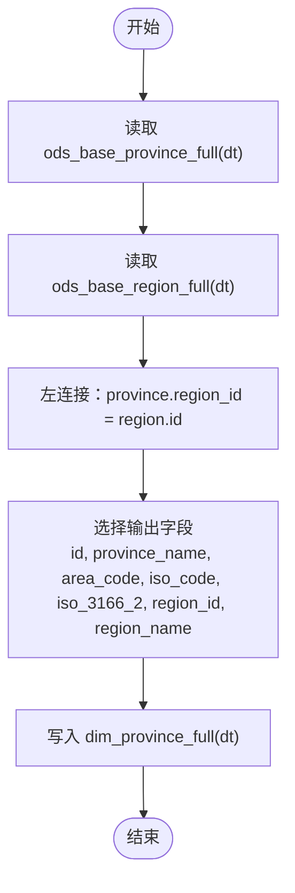
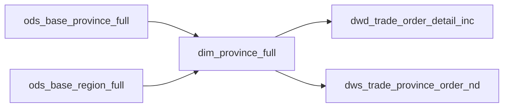

# 地区维度表（dim_province_full）

<cite>
**本文引用的文件**
- [gmall-0906.sql](file://gmall-0906.sql)
- [basic.sql](file://basic.sql)
- [high.sql](file://high.sql)
- [middle.sql](file://middle.sql)
</cite>

## 目录
1. [引言](#引言)
2. [项目结构](#项目结构)
3. [核心组件](#核心组件)
4. [架构总览](#架构总览)
5. [详细组件分析](#详细组件分析)
6. [依赖分析](#依赖分析)
7. [性能考量](#性能考量)
8. [故障排查指南](#故障排查指南)
9. [结论](#结论)
10. [附录](#附录)

## 引言
本文件围绕地区维度表（dim_province_full）展开，系统化阐述其设计思路、字段定义、行政区划编码体系（含ISO标准）、与区域表（dim_region）的关联关系，以及在销售分析、物流配送、市场分析等业务场景中的作用。同时，结合仓库中现有脚本，给出数据来源整合过程（ODS层省份表与区域表的抽取与转换逻辑）、建表语句、ETL实现要点与数据质量保障建议。

## 项目结构
仓库包含多个SQL脚本文件，其中与地区维度表密切相关的建表与ETL逻辑集中在 gmall-0906.sql 中；其他文件用于演示HQL语法、开窗函数与通用分析实践。dim_province_full 的建表与加载流程如下：
- ODS层：ods_base_province_full（省份表）、ods_base_region_full（区域表）
- DIM层：dim_province_full（地区维度表）
- DWD/DWS层：存在基于省份维度的事实表与汇总表，体现地区维度在销售分析中的实际应用

图表来源
- [gmall-0906.sql](file://gmall-0906.sql#L133-L158)
- [gmall-0906.sql](file://gmall-0906.sql#L800-L848)
- [gmall-0906.sql](file://gmall-0906.sql#L4329-L4392)

章节来源
- [gmall-0906.sql](file://gmall-0906.sql#L133-L158)
- [gmall-0906.sql](file://gmall-0906.sql#L800-L848)
- [gmall-0906.sql](file://gmall-0906.sql#L4329-L4392)

## 核心组件
- 地区维度表（dim_province_full）：面向销售分析、物流配送、市场分析等场景，提供省份级地理维度信息，包含地区编码与ISO标准编码字段，便于跨系统可视化与报表集成。
- ODS层省份表（ods_base_province_full）：承载省份维度的原始数据，包含地区编码与ISO标准编码字段。
- ODS层区域表（ods_base_region_full）：承载大区/区域维度的原始数据，用于与省份表进行关联，补充“大区”层面的地理上下文。
- 事实与汇总层：dwd_trade_order_detail_inc 与 dws_trade_province_order_nd 等表，均以 province_id 作为地理维度键，体现 dim_province_full 在销售分析中的关键作用。

章节来源
- [gmall-0906.sql](file://gmall-0906.sql#L133-L158)
- [gmall-0906.sql](file://gmall-0906.sql#L800-L848)
- [gmall-0906.sql](file://gmall-0906.sql#L4329-L4392)

## 架构总览
地区维度表的ETL流程采用“全量拉取 + 左连接”的方式，将省份表与区域表按 dt 分区进行关联，生成维度表。随后，事实表通过 province_id 与 dim_province_full 进行关联，支撑销售分析与汇总。

图表来源
- [gmall-0906.sql](file://gmall-0906.sql#L818-L848)
- [gmall-0906.sql](file://gmall-0906.sql#L4329-L4392)

## 详细组件分析

### 地区维度表（dim_province_full）设计与字段定义
- 设计目标
  - 提供标准化的省份级地理维度，支持销售分析、物流配送、市场分析等场景。
  - 保留地区编码与ISO标准编码，便于跨系统可视化与报表集成。
- 字段说明
  - id：省份标识，作为 dim_province_full 的主键。
  - province_name：省份名称。
  - area_code：地区编码（来源于ods_base_province_full）。
  - iso_code：旧版ISO-3166-2编码（供可视化使用）。
  - iso_3166_2：新版ISO-3166-2编码（供可视化使用）。
  - region_id：所属区域ID（来源于ods_base_province_full）。
  - region_name：区域名称（来源于ods_base_region_full）。
- 存储与分区
  - 存储格式：ORC，压缩算法：snappy。
  - 分区字段：dt（日期分区），便于按天增量或全量装载。

章节来源
- [gmall-0906.sql](file://gmall-0906.sql#L800-L814)

### ODS层数据源与字段映射
- ods_base_province_full（省份表）
  - 字段：id、name、region_id、area_code、iso_code、iso_3166_2。
  - 用途：提供省份维度的原始数据，包含地区编码与ISO标准编码。
- ods_base_region_full（区域表）
  - 字段：id、region_name。
  - 用途：提供区域维度的原始数据，用于与省份表进行关联。

章节来源
- [gmall-0906.sql](file://gmall-0906.sql#L133-L158)

### ETL实现与数据来源整合
- 全量建表与加载
  - 采用“左连接”方式，将 ods_base_province_full 与 ods_base_region_full 按 dt 分区进行关联，生成 dim_province_full。
  - 关联键：province.region_id = region.id。
  - 输出字段：id、province_name、area_code、iso_code、iso_3166_2、region_id、region_name。
- 事实表与汇总表的使用
  - 订单明细事实表（dwd_trade_order_detail_inc）与省份粒度订单汇总表（dws_trade_province_order_nd）均以 province_id 与 dim_province_full 关联，支撑销售分析。

图表来源
- [gmall-0906.sql](file://gmall-0906.sql#L818-L848)

章节来源
- [gmall-0906.sql](file://gmall-0906.sql#L818-L848)

### 与区域表（dim_region）的关联关系
- 关联方式：dim_province_full 通过 region_id 与区域表（ods_base_region_full）进行关联，补充“大区/区域”层面的地理上下文。
- 关联目的：在销售分析中，既可按省份分析，也可按区域聚合，满足不同管理层级的分析需求。

章节来源
- [gmall-0906.sql](file://gmall-0906.sql#L818-L848)

### 业务场景中的作用
- 销售分析：dwd_trade_order_detail_inc 与 dws_trade_province_order_nd 通过 province_id 与 dim_province_full 关联，支持按省份统计订单数、原始金额、优惠金额、最终金额等指标。
- 物流配送：订单事实表中包含 province_id，便于按省份进行物流调度与成本分析。
- 市场分析：结合地区编码与ISO标准编码，支持跨系统可视化与报表集成，便于进行区域市场表现评估。

章节来源
- [gmall-0906.sql](file://gmall-0906.sql#L4329-L4392)

### 数据质量保证措施
- 分区一致性：dim_province_full 与 ODS层表均按 dt 分区，确保按天装载的一致性与可追溯性。
- 字段完整性：在 dim_province_full 中保留 area_code 与 ISO 编码字段，便于后续校验与跨系统对接。
- 关联完整性：通过 region_id 左连接区域表，避免因区域缺失导致的维度信息丢失。
- 可观测性：dim_province_full 作为事实表与汇总表的上游维度，建议在ETL过程中增加字段级校验与空值告警，确保维度键的唯一性与一致性。

章节来源
- [gmall-0906.sql](file://gmall-0906.sql#L800-L814)
- [gmall-0906.sql](file://gmall-0906.sql#L818-L848)

## 依赖分析
- 组件耦合
  - dim_province_full 依赖 ods_base_province_full 与 ods_base_region_full 的 dt 分区数据。
  - 事实表与汇总表依赖 dim_province_full 的 province_id 字段。
- 外部依赖
  - Hive/ORC 存储格式与 snappy 压缩配置。
  - 分区字段 dt 的统一管理与维护。

图表来源
- [gmall-0906.sql](file://gmall-0906.sql#L800-L848)
- [gmall-0906.sql](file://gmall-0906.sql#L4329-L4392)

章节来源
- [gmall-0906.sql](file://gmall-0906.sql#L800-L848)
- [gmall-0906.sql](file://gmall-0906.sql#L4329-L4392)

## 性能考量
- 存储格式：ORC列式存储，配合 snappy 压缩，有利于查询与写入性能。
- 分区策略：按 dt 分区，便于按天增量装载与清理历史数据。
- 连接优化：左连接区域表，避免因区域缺失导致的过滤与回退成本。
- 字段裁剪：仅选择必要的字段写入维度表，减少IO与存储压力。

章节来源
- [gmall-0906.sql](file://gmall-0906.sql#L800-L814)
- [gmall-0906.sql](file://gmall-0906.sql#L818-L848)

## 故障排查指南
- 常见问题
  - 维度键缺失：检查 ods_base_province_full 的 region_id 是否为空，避免左连接后出现空值。
  - 分区不一致：确认 dim_province_full 与 ODS层表的 dt 分区是否一致，避免数据错配。
  - 字段类型不匹配：核对 area_code、iso_code、iso_3166_2 等字段类型与长度，确保与下游事实表一致。
- 排查步骤
  - 校验 ODS层数据：检查 dt 分区下的省份表与区域表是否存在空值或异常。
  - 校验维度表：检查 dim_province_full 的 dt 分区是否成功写入，字段是否完整。
  - 校验事实表：检查 dwd_trade_order_detail_inc 与 dws_trade_province_order_nd 是否能正确关联 dim_province_full。

章节来源
- [gmall-0906.sql](file://gmall-0906.sql#L818-L848)
- [gmall-0906.sql](file://gmall-0906.sql#L4329-L4392)

## 结论
dim_province_full 作为地区维度的核心表，承担着为销售分析、物流配送、市场分析提供标准化地理维度信息的关键职责。通过与 ODS层省份表与区域表的稳定关联，结合ORC存储与分区策略，实现了高效、可维护的维度建模。建议在ETL过程中持续完善数据质量校验与监控，确保维度表的稳定性与准确性。

## 附录
- 建表语句与ETL路径
  - 地区维度表建表与加载：参见 [gmall-0906.sql](file://gmall-0906.sql#L800-L848)
  - ODS层省份表与区域表建表：参见 [gmall-0906.sql](file://gmall-0906.sql#L133-L158)
  - 事实表与汇总表示例（省份粒度）：参见 [gmall-0906.sql](file://gmall-0906.sql#L4329-L4392)