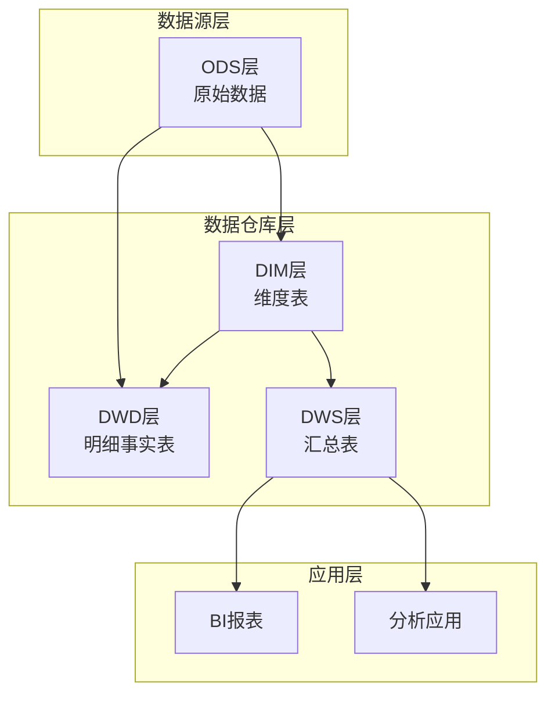
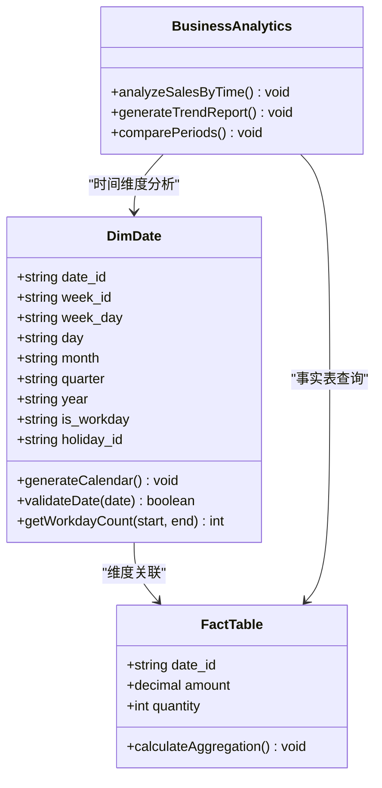
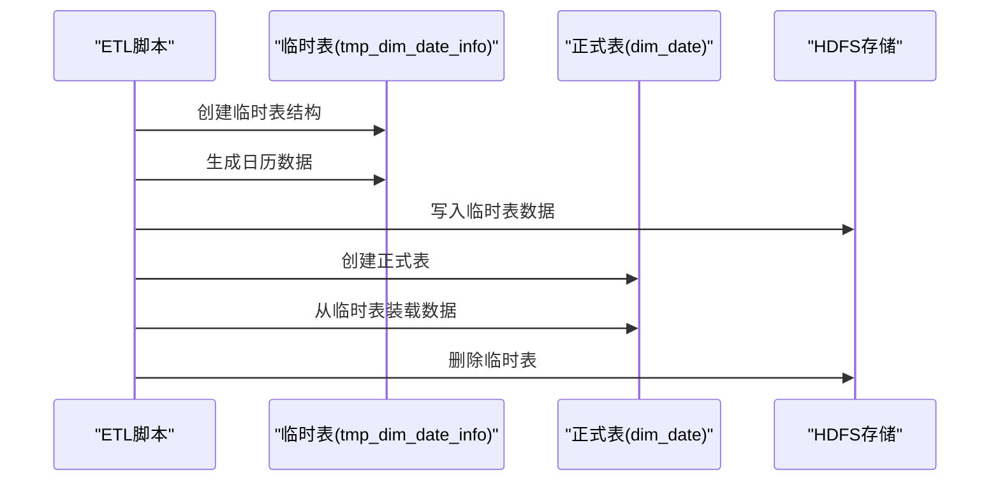
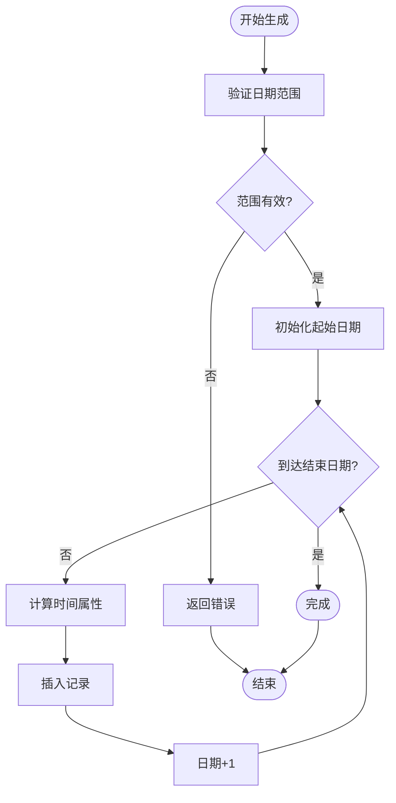
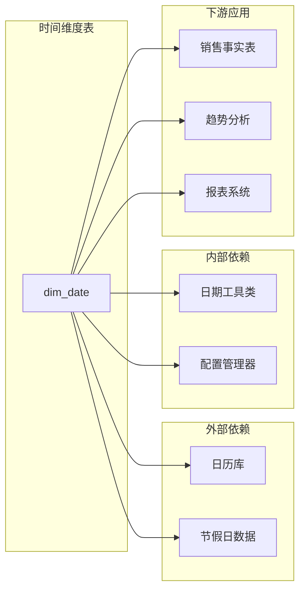

# 时间维度表（dim_date）

<cite>
**本文档引用的文件**
- [gmall-0906.sql](file://gmall-0906.sql)
- [basic.sql](file://basic.sql)
- [console.sql](file://console.sql)
- [high.sql](file://high.sql)
- [middle.sql](file://middle.sql)
</cite>

## 目录
1. [简介](#简介)
2. [项目结构](#项目结构)
3. [核心组件](#核心组件)
4. [架构概览](#架构概览)
5. [详细组件分析](#详细组件分析)
6. [依赖关系分析](#依赖关系分析)
7. [性能考虑](#性能考虑)
8. [故障排除指南](#故障排除指南)
9. [结论](#结论)

## 简介

时间维度表（dim_date）是数据仓库中最重要的维度表之一，为销售分析、趋势预测、节假日分析等业务场景提供统一的时间基准。本文档深入解析HQL数据仓库中时间维度表的设计原理、实现方法和最佳实践，涵盖日历维度的完整构建策略、字段设计、自动生成机制、数据完整性保证和性能优化策略。

## 项目结构

该项目采用典型的HQL数据仓库分层架构，包含ODS（操作数据存储）、DWD（数据仓库明细层）、DIM（维度层）和DWS（数据仓库汇总层）等层次结构。时间维度表作为基础维度表，为整个数据仓库提供时间基准。

**图表来源**
- [gmall-0906.sql](file://gmall-0906.sql#L851-L906)

**章节来源**
- [gmall-0906.sql](file://gmall-0906.sql#L851-L906)

## 核心组件

### 时间维度表结构设计

时间维度表采用星型模式设计，包含以下核心字段：

| 字段名称 | 数据类型 | 描述 | 用途 |
|---------|---------|------|-----|
| date_id | STRING | 日期ID | 主键标识 |
| week_id | STRING | 周ID | 周级分析 |
| week_day | STRING | 周几 | 工作日分析 |
| day | STRING | 每月第几天 | 月度分析 |
| month | STRING | 年中第几月 | 季度分析 |
| quarter | STRING | 年中第几季度 | 年度分析 |
| year | STRING | 年份 | 年度分析 |
| is_workday | STRING | 是否工作日 | 业务分析 |
| holiday_id | STRING | 节假日ID | 节假日分析 |

### 字段设计原理

时间维度表的字段设计遵循以下原则：

1. **多层次时间属性**：支持从年到日的全层级时间分析
2. **业务相关性**：包含工作日和节假日标识
3. **查询友好性**：字段命名直观易懂
4. **扩展性**：预留未来扩展空间

**章节来源**
- [gmall-0906.sql](file://gmall-0906.sql#L851-L886)

## 架构概览

时间维度表在整个数据仓库架构中扮演着关键角色，为所有事实表提供时间维度关联。

**图表来源**
- [gmall-0906.sql](file://gmall-0906.sql#L851-L906)

## 详细组件分析

### 时间维度表创建流程

时间维度表的创建采用两阶段策略：临时表生成和正式表装载。

**图表来源**
- [gmall-0906.sql](file://gmall-0906.sql#L888-L905)

### 日历维度生成算法

时间维度表的日历生成采用递归算法，确保覆盖完整的日期范围。

**图表来源**
- [gmall-0906.sql](file://gmall-0906.sql#L888-L905)

### 字段计算逻辑

每个时间字段的计算遵循特定的业务规则：

#### 年度字段计算
- **year**: 直接提取年份
- **quarter**: 基于月份计算季度
- **month**: 直接提取月份

#### 周度字段计算
- **week_id**: ISO 8601标准周标识
- **week_day**: 星期几标识（1-7）

#### 日期字段计算
- **day**: 月份中的第几天
- **is_workday**: 工作日判断逻辑
- **holiday_id**: 节假日标识

**章节来源**
- [gmall-0906.sql](file://gmall-0906.sql#L851-L906)

### 数据完整性保证机制

时间维度表通过多种机制确保数据完整性：

1. **主键约束**: date_id作为唯一标识
2. **范围检查**: 确保日期在合理范围内
3. **一致性校验**: 各字段间的逻辑关系验证
4. **重复防护**: 防止重复数据插入

### 性能优化策略

#### 存储优化
- **ORC格式**: 提供高效的压缩和查询性能
- **分区策略**: 按需分区提高查询效率
- **列式存储**: 优化分析查询性能

#### 查询优化
- **索引策略**: 合理的字段索引设计
- **缓存机制**: 频繁访问字段的缓存
- **批量操作**: 减少I/O操作次数

**章节来源**
- [gmall-0906.sql](file://gmall-0906.sql#L865-L886)

## 依赖关系分析

时间维度表与其他组件的依赖关系如下：

**图表来源**
- [gmall-0906.sql](file://gmall-0906.sql#L851-L906)

**章节来源**
- [gmall-0906.sql](file://gmall-0906.sql#L851-L906)

## 性能考虑

### 查询性能优化

1. **索引策略**: 为常用查询字段建立合适索引
2. **分区裁剪**: 利用分区字段进行数据裁剪
3. **谓词下推**: 将过滤条件尽可能下推到存储层

### 存储性能优化

1. **文件格式选择**: ORC格式提供最佳压缩比和查询性能
2. **分桶策略**: 按时间维度进行分桶存储
3. **数据倾斜处理**: 避免热点日期的数据倾斜

### ETL性能优化

1. **并行处理**: 利用Hadoop生态系统的并行能力
2. **内存管理**: 合理控制内存使用避免溢出
3. **网络优化**: 减少不必要的数据传输

## 故障排除指南

### 常见问题及解决方案

#### 数据生成失败
- **症状**: ETL过程中断或数据为空
- **原因**: 日期范围配置错误或权限问题
- **解决**: 检查日期范围配置和HDFS权限

#### 数据不一致
- **症状**: 不同查询结果不一致
- **原因**: 缓存未刷新或并发更新问题
- **解决**: 清理缓存并检查并发控制

#### 性能问题
- **症状**: 查询响应时间过长
- **原因**: 缺少必要的索引或分区
- **解决**: 添加索引和优化分区策略

### 监控指标

1. **数据质量指标**: 完整性、准确性、一致性
2. **性能指标**: 查询延迟、吞吐量、资源利用率
3. **可用性指标**: 系统可用性、故障恢复时间

**章节来源**
- [gmall-0906.sql](file://gmall-0906.sql#L851-L906)

## 结论

时间维度表（dim_date）作为数据仓库的核心基础设施，为整个数据分析体系提供了统一的时间基准。通过合理的架构设计、完善的字段体系和严格的性能优化，时间维度表能够满足从日常运营到战略决策的各种分析需求。

该实现方案具有以下优势：
- **完整性**: 覆盖所有必要的时间维度属性
- **扩展性**: 易于添加新的时间属性和业务规则
- **性能**: 优化的存储和查询策略
- **可靠性**: 完善的数据完整性保证机制

建议在实际部署中结合具体的业务需求进行定制化调整，并持续监控和优化性能表现。