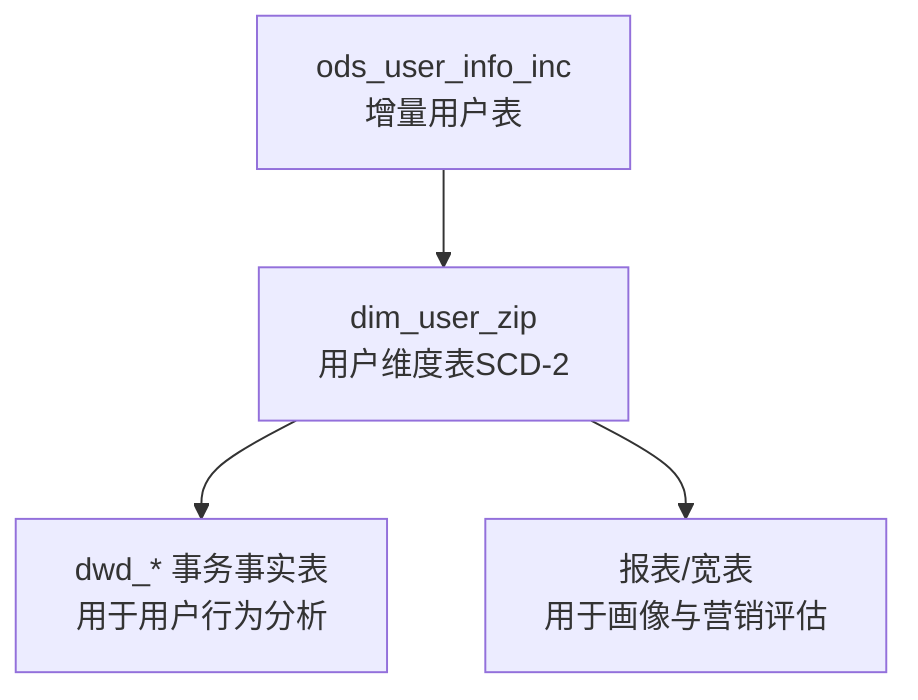
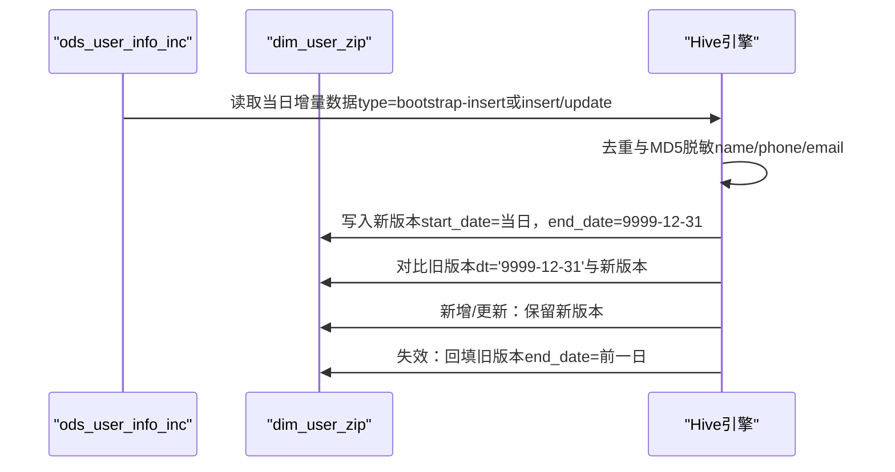
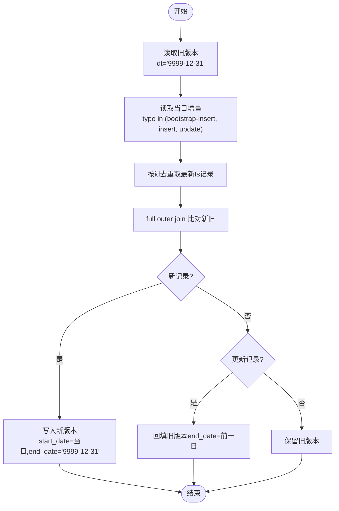
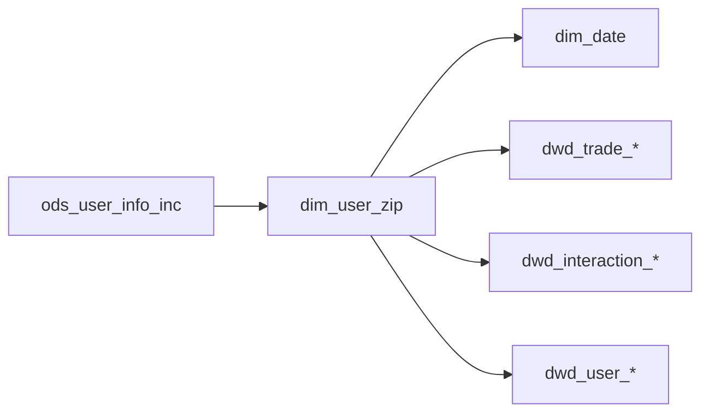

# 用户维度表（dim_user_full）

<cite>
**本文引用的文件**
- [gmall-0906.sql](file://gmall-0906.sql)
- [basic.sql](file://basic.sql)
- [high.sql](file://high.sql)
- [middle.sql](file://middle.sql)
- [console.sql](file://console.sql)
</cite>

## 目录
1. [引言](#引言)
2. [项目结构](#项目结构)
3. [核心组件](#核心组件)
4. [架构总览](#架构总览)
5. [详细组件分析](#详细组件分析)
6. [依赖分析](#依赖分析)
7. [性能考量](#性能考量)
8. [故障排查指南](#故障排查指南)
9. [结论](#结论)
10. [附录](#附录)

## 引言
本文件面向HQL数据仓库中的用户维度表（dim_user_full），系统化梳理其设计原理、建模方法与ETL实现，重点覆盖：
- 用户基本信息、用户等级、注册信息等维度属性的建模与派生
- 缓慢变化维度（SCD）处理策略、历史数据追踪与版本控制
- 数据来源整合过程：从增量表ods_user_info_inc到全量维度表dim_user_full的转换逻辑
- 在用户行为分析、用户画像构建、营销效果评估等场景中的应用
- 完整的建表语句、ETL流程与最佳实践建议

## 项目结构
本仓库包含多类SQL脚本，涵盖基础函数示例、业务主题建模与ETL流程。与用户维度表密切相关的实现集中在gmall-0906.sql中，其中定义了用户维度表的建表语句、首日装载与每日增量更新逻辑，并提供了大量与日期、开窗函数、MD5脱敏等相关的辅助能力，便于理解与复用。

图示来源
- [gmall-0906.sql](file://gmall-0906.sql#L908-L1168)

章节来源
- [gmall-0906.sql](file://gmall-0906.sql#L908-L1168)

## 核心组件
- 用户维度表（dim_user_zip）：采用SCD-2策略，通过start_date/end_date维护版本生命周期，配合分区dt实现历史快照。
- 数据来源（ods_user_info_inc）：增量表，包含用户变更事件（bootstrap-insert、insert、update等），用于驱动dim_user_zip的每日更新。
- 日期维度（dim_date）：提供统一日期维度，便于跨表时间对齐与分析。
- 事实表与宽表：围绕用户维度表构建的dwd_*事务事实表与报表宽表，支撑用户行为分析、画像与营销评估。

章节来源
- [gmall-0906.sql](file://gmall-0906.sql#L908-L1168)
- [gmall-0906.sql](file://gmall-0906.sql#L850-L907)

## 架构总览
用户维度表的ETL架构遵循“增量采集—维度建模—分区归档”的模式，核心流程如下：
- 首日装载：从ods_user_info_inc抽取bootstrap-insert事件，初始化dim_user_zip，end_date固定为未来长期有效。
- 每日更新：基于full outer join比对新旧版本，识别新增、更新与失效记录；对更新记录关闭旧版本并开启新版本；对失效记录回填截止日期。
- 版本控制：通过start_date/end_date与分区dt实现SCD-2，确保历史可追溯与时间点一致性。

图示来源
- [gmall-0906.sql](file://gmall-0906.sql#L934-L1078)
- [gmall-0906.sql](file://gmall-0906.sql#L1081-L1168)

## 详细组件分析

### 用户维度表（dim_user_zip）设计与建模
- 表结构要点
  - 主键：id
  - 维度属性：login_name、nick_name、name（MD5脱敏）、phone_num（MD5脱敏）、email（MD5脱敏）、user_level、birthday、gender、create_time、operate_time
  - SCD-2关键字段：start_date、end_date
  - 分区字段：dt（用于历史快照与版本归档）
- 设计原则
  - MD5脱敏：对敏感字段（name、phone_num、email）进行MD5处理，满足合规与安全要求。
  - SCD-2：通过start_date/end_date标识有效区间，配合分区dt实现历史版本归档。
  - 分区dt：日常写入时统一写入'9999-12-31'作为当前有效版本，历史版本回填真实截止日期。

章节来源
- [gmall-0906.sql](file://gmall-0906.sql#L908-L931)

### 数据来源与转换逻辑（ods_user_info_inc → dim_user_zip）
- 首日装载
  - 条件：dt=当日且type='bootstrap-insert'
  - 处理：抽取data.id、data.login_name、data.nick_name、data.name、data.phone_num、data.email、data.user_level、data.birthday、data.gender、data.create_time、data.operate_time
  - 脱敏：对name、phone_num、email执行MD5
  - 版本：start_date=首日日期，end_date='9999-12-31'
- 每日更新（两种实现思路）
  - 思路一：full outer join比对旧版本与新版本
    - 旧版本：从dim_user_zip中筛选dt='9999-12-31'的有效版本
    - 新版本：对ods_user_info_inc按id分组取最新ts记录（rank() over (partition by id order by ts desc) rk=1）
    - 合并：新增/更新保留新版本；失效记录回填旧版本end_date=前一日
  - 思路二：先union all合并当前有效版本与当日最新版本，再按id按start_date倒序rank，rk=1保留有效版本，其余回填截止日期

图示来源
- [gmall-0906.sql](file://gmall-0906.sql#L956-L1078)
- [gmall-0906.sql](file://gmall-0906.sql#L1081-L1168)

章节来源
- [gmall-0906.sql](file://gmall-0906.sql#L934-L1168)

### SCD-2策略与历史追踪
- 版本控制
  - 有效版本：end_date='9999-12-31'
  - 历史版本：end_date回填为前一日
  - 分区dt：有效版本写入'9999-12-31'，历史版本写入真实日期
- 历史追踪
  - 通过full outer join识别新增、更新与失效
  - 通过rank() over (partition by id order by start_date desc)判定有效版本
- 合规与安全
  - 敏感字段MD5脱敏，避免明文存储

章节来源
- [gmall-0906.sql](file://gmall-0906.sql#L956-L1168)

### 维度属性建模与派生
- 基本信息：login_name、nick_name、name（MD5）、phone_num（MD5）、email（MD5）、gender、birthday
- 用户等级：user_level
- 注册信息：create_time、operate_time
- 时间维度：start_date、end_date
- 以上属性来源于ods_user_info_inc，经MD5脱敏与去重后写入dim_user_zip

章节来源
- [gmall-0906.sql](file://gmall-0906.sql#L934-L1168)

### 应用场景
- 用户行为分析：结合dwd_trade_*、dwd_interaction_*等事务事实表，基于user_id进行维度关联，分析用户购买、收藏、评价等行为。
- 用户画像构建：以dim_user_zip为基础，结合订单、支付、退款等事实表，构建用户消费能力、偏好、生命周期等画像指标。
- 营销效果评估：以注册、登录、下单等事实表为输入，结合dim_user_zip的用户属性，评估渠道、活动、优惠券等营销效果。

章节来源
- [gmall-0906.sql](file://gmall-0906.sql#L3052-L3199)

## 依赖分析
- 维度表依赖
  - dim_user_zip依赖ods_user_info_inc（增量源）
  - dim_user_zip依赖dim_date（日期维度）
- 事实表依赖
  - dwd_trade_*、dwd_interaction_*、dwd_user_*等事实表依赖dim_user_zip（用户维度）
- 外部依赖
  - Hive SerDe/JsonSerDe用于ods_user_info_inc的JSON解析
  - ORC存储与snappy压缩提升读写性能

图示来源
- [gmall-0906.sql](file://gmall-0906.sql#L908-L1168)
- [gmall-0906.sql](file://gmall-0906.sql#L1174-L1480)

章节来源
- [gmall-0906.sql](file://gmall-0906.sql#L908-L1480)

## 性能考量
- 存储格式与压缩
  - 使用ORC存储与snappy压缩，降低I/O成本，提升扫描与写入性能
- 动态分区
  - 在每日更新中启用动态分区模式，避免静态分区带来的作业数量膨胀
- 去重与MD5
  - 按id去重取最新ts记录，减少重复数据写入
  - MD5脱敏在ETL阶段完成，避免运行时重复计算
- 分区策略
  - 有效版本统一写入'9999-12-31'，历史版本按实际日期写入，便于按需裁剪与回溯

章节来源
- [gmall-0906.sql](file://gmall-0906.sql#L908-L1168)

## 故障排查指南
- 常见问题
  - 字段缺失或类型不一致：检查ods_user_info_inc的字段映射与脱敏逻辑
  - 重复数据导致版本冲突：确认按id去重与ts排序逻辑
  - 分区写入异常：检查动态分区配置与分区dt赋值
- 调试建议
  - 分步验证：先验证ods_user_info_inc到dim_user_zip的单日装载，再验证full outer join比对逻辑
  - 样例核对：选取少量用户id，核对start_date/end_date与分区dt的一致性
  - 日志定位：关注rank() over与full outer join的输出，定位新增/更新/失效分支

章节来源
- [gmall-0906.sql](file://gmall-0906.sql#L956-L1168)

## 结论
dim_user_zip通过SCD-2策略实现了用户维度的历史追踪与版本控制，结合MD5脱敏与分区归档，既满足合规要求，又具备良好的可维护性与扩展性。其与事实表的紧密耦合，为用户行为分析、画像构建与营销评估提供了坚实的数据基础。

## 附录

### 建表语句与ETL流程清单
- 用户维度表（SCD-2）
  - 建表语句：参见路径
    - [gmall-0906.sql](file://gmall-0906.sql#L908-L931)
  - 首日装载：参见路径
    - [gmall-0906.sql](file://gmall-0906.sql#L934-L952)
  - 每日更新（思路一）：参见路径
    - [gmall-0906.sql](file://gmall-0906.sql#L956-L1078)
  - 每日更新（思路二）：参见路径
    - [gmall-0906.sql](file://gmall-0906.sql#L1081-L1168)

### 日期维度（dim_date）
- 建表与装载：参见路径
  - [gmall-0906.sql](file://gmall-0906.sql#L850-L907)

### 相关辅助能力（日期、开窗、MD5）
- 日期函数与开窗函数示例：参见路径
  - [basic.sql](file://basic.sql#L1-L200)
- 连续登录、会话划分等分析范式：参见路径
  - [high.sql](file://high.sql#L1-L120)
  - [middle.sql](file://middle.sql#L1-L120)