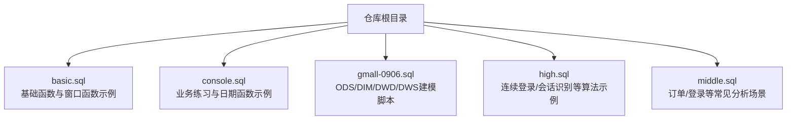
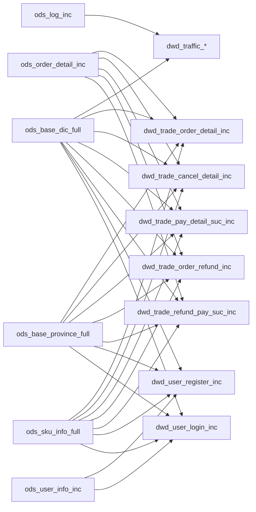

# DWD层（明细数据层）

<cite>
**本文引用的文件列表**
- [basic.sql](file://basic.sql)
- [console.sql](file://console.sql)
- [gmall-0906.sql](file://gmall-0906.sql)
- [high.sql](file://high.sql)
- [middle.sql](file://middle.sql)
</cite>

## 目录
1. [引言](#引言)
2. [项目结构](#项目结构)
3. [核心组件](#核心组件)
4. [架构总览](#架构总览)
5. [详细组件分析](#详细组件分析)
6. [依赖分析](#依赖分析)
7. [性能考量](#性能考量)
8. [故障排查指南](#故障排查指南)
9. [结论](#结论)
10. [附录](#附录)

## 引言
本技术文档围绕HQL数据仓库DWD层（明细数据层）展开，系统阐述事务事实表（dwd_*_inc）与周期快照表（dwd_*_full）的设计原则、建模策略与ETL实现要点。文档结合仓库中的实际SQL脚本，总结数据清洗、标准化、去重、转换流程，解释维度退化、字段派生与数据质量保障机制，并给出分区策略、存储配置与性能优化建议，帮助读者快速理解并落地DWD层建设。

## 项目结构
仓库包含多个SQL脚本，涵盖基础函数与窗口函数示例、业务场景练习、以及电商仓（gmall）的ODS/DIM/DWD/DWS等分层建模脚本。其中，gmall-0906.sql集中展示了DWD层的事务事实表与周期快照表的完整建模与装载逻辑，是本篇文档的重点参考。

图表来源
- [gmall-0906.sql](file://gmall-0906.sql#L1-L200)
- [basic.sql](file://basic.sql#L1-L120)
- [console.sql](file://console.sql#L1-L120)
- [high.sql](file://high.sql#L1-L60)
- [middle.sql](file://middle.sql#L1-L60)

章节来源
- [gmall-0906.sql](file://gmall-0906.sql#L1-L200)
- [basic.sql](file://basic.sql#L1-L120)
- [console.sql](file://console.sql#L1-L120)
- [high.sql](file://high.sql#L1-L60)
- [middle.sql](file://middle.sql#L1-L60)

## 核心组件
- 事务事实表（dwd_*_inc）：记录业务事件的最小粒度明细，通常按天分区，支持增量装载；典型表包括交易域加购、下单、支付、退单、退款、互动域收藏与评价、流量域页面浏览/启动/动作/曝光/错误、用户域注册/登录等。
- 周期快照表（dwd_*_full）：记录某一时点的状态快照，通常按天分区，每日全量装载；典型表包括交易域购物车周期快照。

章节来源
- [gmall-0906.sql](file://gmall-0906.sql#L2236-L2265)
- [gmall-0906.sql](file://gmall-0906.sql#L1174-L1480)
- [gmall-0906.sql](file://gmall-0906.sql#L1481-L2077)
- [gmall-0906.sql](file://gmall-0906.sql#L2080-L2235)
- [gmall-0906.sql](file://gmall-0906.sql#L2268-L2354)
- [gmall-0906.sql](file://gmall-0906.sql#L2357-L2401)
- [gmall-0906.sql](file://gmall-0906.sql#L2404-L2444)
- [gmall-0906.sql](file://gmall-0906.sql#L2447-L2537)
- [gmall-0906.sql](file://gmall-0906.sql#L2539-L2940)
- [gmall-0906.sql](file://gmall-0906.sql#L2941-L3051)
- [gmall-0906.sql](file://gmall-0906.sql#L3052-L3175)
- [gmall-0906.sql](file://gmall-0906.sql#L3177-L3280)

## 架构总览
DWD层承接ODS层的原始数据，完成清洗、标准化、维度退化、字段派生与去重，形成面向主题的事实表，支撑后续DWS层的轻度汇总与ADS层的宽表/指标构建。

```mermaid
graph TB
subgraph "ODS层"
O1["ods_log_inc<br/>日志表(JSON)"]
O2["ods_order_detail_inc<br/>订单明细增量"]
O3["ods_user_info_inc<br/>用户增量"]
O4["ods_base_dic_full<br/>字典全量"]
O5["ods_base_province_full<br/>省份全量"]
O6["ods_sku_info_full<br/>SKU全量"]
end
subgraph "DWD层"
D1["dwd_trade_cart_add_inc<br/>加购事务事实表"]
D2["dwd_trade_order_detail_inc<br/>下单事务事实表"]
D3["dwd_trade_cancel_detail_inc<br/>取消订单事务事实表"]
D4["dwd_trade_pay_detail_suc_inc<br/>支付成功事务事实表"]
D5["dwd_trade_order_refund_inc<br/>退单事务事实表"]
D6["dwd_trade_refund_pay_suc_inc<br/>退款成功事务事实表"]
D7["dwd_trade_cart_full<br/>购物车周期快照"]
D8["dwd_tool_coupon_get_inc<br/>领券事务事实表"]
D9["dwd_tool_coupon_order_inc<br/>用券下单事务事实表"]
D10["dwd_tool_coupon_pay_inc<br/>用券支付事务事实表"]
D11["dwd_interaction_favor_add_inc<br/>收藏事务事实表"]
D12["dwd_interaction_comment_inc<br/>评价事务事实表"]
D13["dwd_traffic_page_view_inc<br/>页面浏览事务事实表"]
D14["dwd_traffic_start_inc<br/>启动事务事实表"]
D15["dwd_traffic_action_inc<br/>动作事务事实表"]
D16["dwd_traffic_display_inc<br/>曝光事务事实表"]
D17["dwd_traffic_error_inc<br/>错误事务事实表"]
D18["dwd_user_register_inc<br/>用户注册事务事实表"]
D19["dwd_user_login_inc<br/>用户登录事务事实表"]
end
O1 --> D13
O1 --> D14
O1 --> D15
O1 --> D16
O1 --> D17
O2 --> D2
O2 --> D3
O2 --> D4
O2 --> D5
O2 --> D6
O3 --> D18
O3 --> D19
O4 --> D1
O4 --> D2
O4 --> D3
O4 --> D4
O4 --> D5
O4 --> D6
O4 --> D8
O4 --> D9
O4 --> D10
O4 --> D11
O4 --> D12
O4 --> D13
O4 --> D14
O4 --> D15
O4 --> D16
O4 --> D17
O5 --> D1
O5 --> D2
O5 --> D3
O5 --> D4
O5 --> D5
O5 --> D6
O5 --> D7
O6 --> D1
O6 --> D2
O6 --> D3
O6 --> D4
O6 --> D5
O6 --> D6
O6 --> D7
```

图表来源
- [gmall-0906.sql](file://gmall-0906.sql#L1174-L2077)
- [gmall-0906.sql](file://gmall-0906.sql#L2080-L2401)
- [gmall-0906.sql](file://gmall-0906.sql#L2404-L2940)
- [gmall-0906.sql](file://gmall-0906.sql#L2941-L3175)

## 详细组件分析

### 事务事实表（dwd_*_inc）建模策略
- 设计原则
  - 明细粒度：每条记录代表一次业务事件，包含事件主体（用户/商品/订单）、事件属性（时间、来源、数量、金额）与维度退化字段（如日期ID、来源类型名称）。
  - 增量装载：按天分区，采用insert overwrite覆盖当日分区；首日可使用bootstrap-insert或全量装载，后续每日仅处理当天变更。
  - 字段派生：基于ODS层JSON/结构化字段派生日期ID、金额拆分、来源类型映射等。
  - 去重与一致性：对更新型事件，通过type与old字段判断插入/更新/删除，必要时进行去重与窗口排序确保最新状态。

- 典型表与装载逻辑
  - 交易域加购事务事实表（dwd_trade_cart_add_inc）
    - 首日装载：抽取ods_cart_info_inc中bootstrap-insert记录，派生date_id与来源类型名称，写入dwd表分区。
    - 每日装载：根据type过滤insert/update，结合old字段计算sku_num变化，派生时间字段与来源类型名称。
  - 交易域下单事务事实表（dwd_trade_order_detail_inc）
    - 首日装载：联合ods_order_detail_inc、ods_order_info_inc、ods_order_detail_activity_inc、ods_order_detail_coupon_inc与ods_base_dic_full，派生活动/优惠券/来源类型等维度退化字段。
    - 每日装载：仅处理insert事件，派生金额拆分字段与日期ID。
  - 交易域取消订单事务事实表（dwd_trade_cancel_detail_inc）
    - 首日装载：筛选ods_order_info_inc中订单状态为取消的记录，联合明细与字典表派生维度字段。
    - 每日装载：监听ods_order_info_inc中状态由非取消变为取消的update事件，联合明细与字典表派生维度字段。
  - 交易域支付成功事务事实表（dwd_trade_pay_detail_suc_inc）
    - 首日装载：联合ods_order_detail_inc、ods_payment_info_inc、ods_order_info_inc与字典表，派生支付类型与来源类型等维度字段。
    - 每日装载：监听ods_payment_info_inc中支付状态为成功的update事件，联合订单与明细派生维度字段。
  - 交易域退单事务事实表（dwd_trade_order_refund_inc）
    - 首日装载：从ods_order_refund_info_inc与ods_order_info_inc派生维度字段。
    - 每日装载：监听ods_order_refund_info_inc中insert事件，或监听ods_order_info_inc中订单状态为退单的update事件，派生维度字段。
  - 交易域退款成功事务事实表（dwd_trade_refund_pay_suc_inc）
    - 首日装载：从ods_refund_payment_inc与ods_order_info_inc、ods_order_refund_info_inc派生维度字段。
    - 每日装载：监听ods_refund_payment_inc中退款状态为成功的update事件，联合订单与退单明细派生维度字段。
  - 工具域优惠券事务事实表
    - 领券（dwd_tool_coupon_get_inc）、用券下单（dwd_tool_coupon_order_inc）、用券支付（dwd_tool_coupon_pay_inc）：均按天分区，首日与每日分别处理bootstrap-insert与insert/update事件，派生日期ID与来源类型名称。
  - 互动域事务事实表
    - 收藏（dwd_interaction_favor_add_inc）、评价（dwd_interaction_comment_inc）：按天分区，首日与每日分别处理bootstrap-insert与insert事件，派生日期ID与评价类型名称。
  - 流量域事务事实表
    - 页面浏览（dwd_traffic_page_view_inc）、启动（dwd_traffic_start_inc）、动作（dwd_traffic_action_inc）、曝光（dwd_traffic_display_inc）、错误（dwd_traffic_error_inc）：按天分区，解析ods_log_inc中的JSON结构，派生日期ID、会话ID、来源类型名称等。
  - 用户域事务事实表
    - 注册（dwd_user_register_inc）、登录（dwd_user_login_inc）：按天分区，联合ods_user_info_inc与ods_log_inc，派生日期ID与设备/地区维度字段。

章节来源
- [gmall-0906.sql](file://gmall-0906.sql#L1174-L1480)
- [gmall-0906.sql](file://gmall-0906.sql#L1481-L2077)
- [gmall-0906.sql](file://gmall-0906.sql#L2080-L2401)
- [gmall-0906.sql](file://gmall-0906.sql#L2404-L2444)
- [gmall-0906.sql](file://gmall-0906.sql#L2447-L2537)
- [gmall-0906.sql](file://gmall-0906.sql#L2539-L2940)
- [gmall-0906.sql](file://gmall-0906.sql#L2941-L3051)
- [gmall-0906.sql](file://gmall-0906.sql#L3052-L3175)

### 周期快照表（dwd_*_full）建模策略
- 设计原则
  - 快照粒度：记录某一时点的稳定状态，通常每日全量装载，覆盖历史分区。
  - 状态定义：明确“有效”状态的判定条件（如购物车未下单），并在装载时过滤。
  - 维度退化：将常用维度退化为文本字段，减少跨表关联成本。

- 典型表与装载逻辑
  - 交易域购物车周期快照（dwd_trade_cart_full）
    - 每日装载：从ods_cart_info_full中筛选未下单记录（如is_ordered='0'），写入当日分区，包含用户、商品、数量等字段。

章节来源
- [gmall-0906.sql](file://gmall-0906.sql#L2236-L2265)

### 数据清洗、标准化、去重与转换
- 清洗与标准化
  - 时间字段标准化：统一使用from_utc_timestamp/ts转换为本地时间，派生date_id（yyyy-MM-dd）。
  - JSON/结构化解析：对ods_log_inc等JSON源，使用lateral view explode与结构体访问提取数组/嵌套字段。
  - 字段类型与精度：decimal/整型字段按业务需求规范化，避免隐式转换带来的精度损失。
- 去重
  - 登录/下单等场景，先按用户+日期去重，再进行连续性分析或累计计算。
  - 维度表更新场景，使用rank()按时间窗口取最新记录，确保维度一致性。
- 转换
  - 金额拆分：将原始单价×数量拆分为原始金额、活动优惠分摊、券优惠分摊、最终金额等。
  - 来源类型映射：通过ods_base_dic_full按parent_code过滤字典项，映射为来源类型名称。
  - 会话识别：基于页面浏览日志，使用窗口函数last_value与concat生成会话ID，用于后续会话级分析。

章节来源
- [gmall-0906.sql](file://gmall-0906.sql#L2539-L2940)
- [gmall-0906.sql](file://gmall-0906.sql#L3052-L3175)
- [high.sql](file://high.sql#L1-L120)
- [middle.sql](file://middle.sql#L1-L120)

### 维度退化、字段派生与数据质量保障
- 维度退化
  - 将字典表中的编码映射为名称，减少跨表JOIN，提升查询性能。
  - 将复杂维度（如省份、地区）退化为多字段（如province_id、region_id、region_name），便于过滤与展示。
- 字段派生
  - 日期ID：从create_time/callback_time等派生date_id。
  - 金额拆分：原始金额=单价×数量；最终金额=原始金额-活动优惠-券优惠。
  - 来源类型：根据source_type映射来源类型名称。
- 数据质量保障
  - 分区字段dt：严格按天分区，避免分区缺失或分区命名不一致。
  - 字段空值处理：对可能为空的字段使用nvl/coalesce进行兜底。
  - 类型校验：对JSON字段进行exists与not null校验，避免解析异常导致的空行。
  - 去重策略：对更新事件使用rank()取最新，对重复日志使用distinct/group by去重。

章节来源
- [gmall-0906.sql](file://gmall-0906.sql#L1174-L2077)
- [gmall-0906.sql](file://gmall-0906.sql#L2080-L2401)
- [gmall-0906.sql](file://gmall-0906.sql#L2404-L2444)
- [gmall-0906.sql](file://gmall-0906.sql#L2447-L2537)
- [gmall-0906.sql](file://gmall-0906.sql#L2539-L2940)
- [gmall-0906.sql](file://gmall-0906.sql#L2941-L3175)

### ETL逻辑示例与数据转换规则
- 事务事实表ETL流程（以下单明细为例）
  - 输入：ods_order_detail_inc（增量）、ods_order_info_inc（增量）、ods_order_detail_activity_inc（增量）、ods_order_detail_coupon_inc（增量）、ods_base_dic_full（全量）
  - 步骤：
    1) 从ods_order_detail_inc中筛选当日insert记录；
    2) 与ods_order_info_inc按order_id关联，补充用户与省份信息；
    3) 与ods_order_detail_activity_inc/ods_order_detail_coupon_inc关联，补充活动与优惠券信息；
    4) 与ods_base_dic_full关联，按parent_code过滤字典项，映射来源类型名称；
    5) 派生金额拆分字段与日期ID；
    6) 写入dwd_trade_order_detail_inc当日分区。
- 周期快照表ETL流程（以购物车快照为例）
  - 输入：ods_cart_info_full（全量）
  - 步骤：
    1) 从ods_cart_info_full中筛选未下单记录；
    2) 写入dwd_trade_cart_full当日分区。

章节来源
- [gmall-0906.sql](file://gmall-0906.sql#L1281-L1479)
- [gmall-0906.sql](file://gmall-0906.sql#L2236-L2265)

### 表结构设计规范、分区策略与存储配置
- 表结构设计规范
  - 明确主键/分区键：dwd层事实表通常不设主键，但需明确分区键（dt）与业务键（如id、order_id、user_id、sku_id等）。
  - 字段命名：采用下划线命名，字段注释清晰，便于下游理解。
  - 数据类型：金额类使用decimal，时间类使用string或timestamp，布尔类使用string或tinyint。
- 分区策略
  - 按天分区（dt string），便于增量装载与按天回溯。
  - 对于大表，可考虑二级分区（如dt与小时），但需权衡分区数量与查询成本。
- 存储配置
  - 使用ORC格式，启用snappy压缩，兼顾压缩比与IO性能。
  - 对热表可考虑开启向量化与列式存储优化。

章节来源
- [gmall-0906.sql](file://gmall-0906.sql#L1174-L1200)
- [gmall-0906.sql](file://gmall-0906.sql#L1281-L1310)
- [gmall-0906.sql](file://gmall-0906.sql#L2236-L2251)

## 依赖分析
DWD层各表之间的依赖关系主要体现在：
- 事实表依赖ODS层的增量/全量表与字典表；
- 事实表之间通过订单ID、SKU ID、用户ID等业务键进行关联；
- 维度表（如字典、省份）为事实表提供维度退化字段。

图表来源
- [gmall-0906.sql](file://gmall-0906.sql#L1174-L2077)
- [gmall-0906.sql](file://gmall-0906.sql#L2080-L2401)
- [gmall-0906.sql](file://gmall-0906.sql#L2404-L2444)
- [gmall-0906.sql](file://gmall-0906.sql#L2447-L2537)
- [gmall-0906.sql](file://gmall-0906.sql#L2539-L2940)
- [gmall-0906.sql](file://gmall-0906.sql#L2941-L3175)

章节来源
- [gmall-0906.sql](file://gmall-0906.sql#L1174-L2077)
- [gmall-0906.sql](file://gmall-0906.sql#L2080-L2401)
- [gmall-0906.sql](file://gmall-0906.sql#L2404-L2444)
- [gmall-0906.sql](file://gmall-0906.sql#L2447-L2537)
- [gmall-0906.sql](file://gmall-0906.sql#L2539-L2940)
- [gmall-0906.sql](file://gmall-0906.sql#L2941-L3175)

## 性能考量
- 分区裁剪：按dt分区扫描，避免全表扫描；对热点表可考虑分区裁剪与谓词下推。
- 压缩与格式：ORC+snappy在压缩比与IO性能间取得平衡；对频繁读取的表可考虑ORC ZLIB或ZSTD（视集群支持情况）。
- 动态分区：使用hive.exec.dynamic.partition.mode=nonstrict时需谨慎，避免产生过多小文件。
- 窗口函数与去重：连续性分析与会话识别中大量使用窗口函数，建议先去重再开窗，减少数据量。
- JSON解析：lateral view explode与结构体访问会增加shuffle，建议在上游尽量减少嵌套层级与数组长度。
- 临时表与CTE：合理使用with子句与中间表，避免重复计算与多次扫描。

章节来源
- [gmall-0906.sql](file://gmall-0906.sql#L1080-L1170)
- [gmall-0906.sql](file://gmall-0906.sql#L1170-L1200)
- [gmall-0906.sql](file://gmall-0906.sql#L2539-L2940)
- [high.sql](file://high.sql#L1-L120)
- [middle.sql](file://middle.sql#L1-L120)

## 故障排查指南
- JSON解析失败
  - 现象：解析ods_log_inc时出现空行或字段为null。
  - 排查：检查ts字段是否存在、page/displays/actions/err是否为非空；确认JSON序列化格式与字段名一致。
- 字段类型不匹配
  - 现象：金额字段出现精度丢失或类型转换异常。
  - 排查：核对decimal精度与scale，避免隐式转换；对可能为空的字段使用nvl/coalesce。
- 分区缺失或分区命名不一致
  - 现象：按dt分区查询时报错或数据不全。
  - 排查：确认insert overwrite时的分区赋值与dt字段格式一致；检查分区是否存在。
- 更新事件未生效
  - 现象：维度表更新后，事实表未反映最新值。
  - 排查：确认type与old字段是否正确过滤；使用rank()按时间窗口取最新记录。
- 会话识别异常
  - 现象：会话ID不稳定或重复。
  - 排查：检查last_value与concat生成会话ID的逻辑；确保按mid_id与ts排序正确。

章节来源
- [gmall-0906.sql](file://gmall-0906.sql#L2539-L2940)
- [gmall-0906.sql](file://gmall-0906.sql#L3052-L3175)
- [high.sql](file://high.sql#L1-L120)
- [middle.sql](file://middle.sql#L1-L120)

## 结论
DWD层作为数据仓库的明细数据基石，承担着将ODS层原始数据清洗、标准化、维度退化与派生的任务。通过事务事实表与周期快照表的协同，DWD层为后续DWS与ADS层提供了高质量、低耦合的明细数据基础。实践中应重视分区策略、存储配置与窗口函数的使用，结合数据质量保障机制，确保ETL流程的稳定性与性能。

## 附录
- 常用函数与技巧
  - 日期与时间：from_utc_timestamp、date_format、unix_timestamp、datediff、date_add、last_day等。
  - 窗口函数：rank/dense_rank/row_number、first_value/last_value、lag/lead、ntile等。
  - JSON解析：lateral view explode、结构体访问、map_keys/array_contains等。
  - 去重与聚合：distinct、group by、count distinct、collect_set/collect_list等。

章节来源
- [basic.sql](file://basic.sql#L1-L200)
- [console.sql](file://console.sql#L1-L200)
- [high.sql](file://high.sql#L1-L120)
- [middle.sql](file://middle.sql#L1-L120)