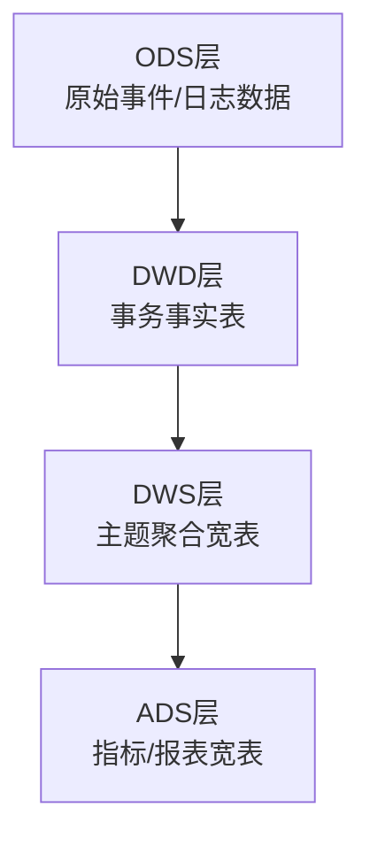
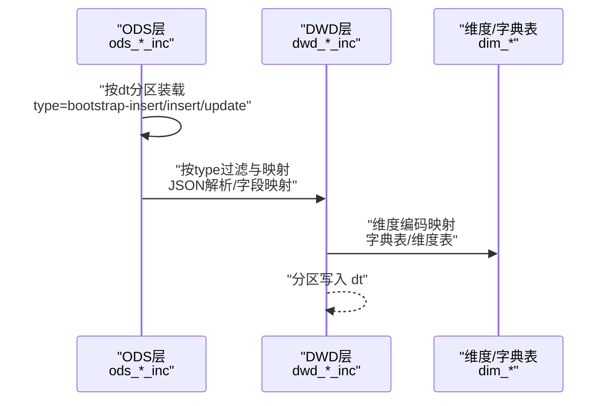
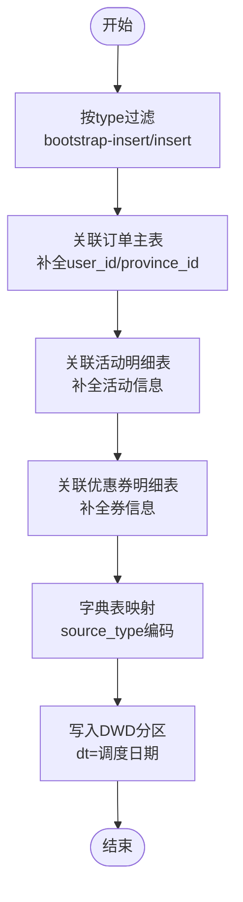
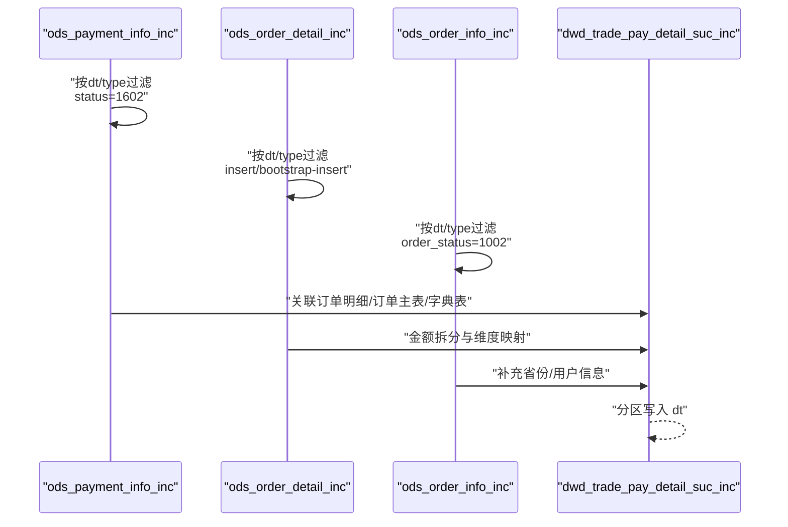
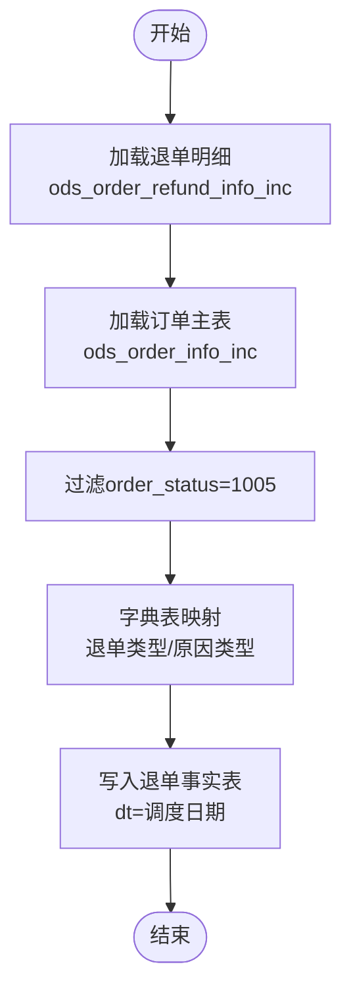
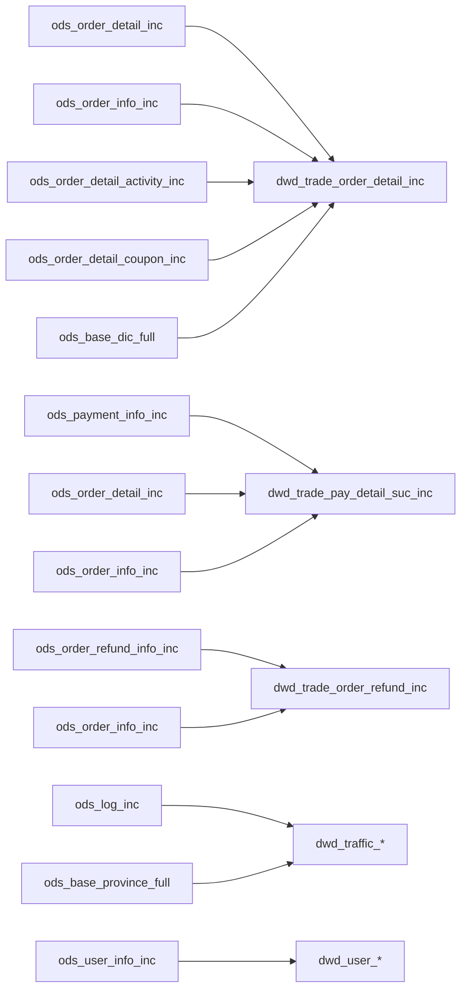

# 事务事实表

<cite>
**本文引用的文件**
- [gmall-0906.sql](file://gmall-0906.sql)
- [basic.sql](file://basic.sql)
- [console.sql](file://console.sql)
- [high.sql](file://high.sql)
- [middle.sql](file://middle.sql)
</cite>

## 目录
1. [引言](#引言)
2. [项目结构](#项目结构)
3. [核心组件](#核心组件)
4. [架构总览](#架构总览)
5. [详细组件分析](#详细组件分析)
6. [依赖分析](#依赖分析)
7. [性能考量](#性能考量)
8. [故障排查指南](#故障排查指南)
9. [结论](#结论)
10. [附录](#附录)

## 引言
本技术文档围绕HQL数据仓库中的事务事实表展开，重点阐述DWD层核心表的设计原理与建模策略，系统性说明订单明细、支付、退单等核心事务表的结构设计、字段含义与业务逻辑；并结合代码中的抽取策略（type字段标识）、JSON解析与字段映射规则、分区策略与性能优化实践，给出可落地的ETL实现路径与数据一致性保障机制。

## 项目结构
该项目以HQL脚本为主，采用“ODS/DWD/DWS/ADS”分层组织，事务事实表集中于DWD层，典型表名遵循“dwd_*_inc”命名规范，表示增量事务事实表。ODS层以JSON或分隔符文本形式承载原始事件数据，DWD层完成清洗、映射与分区装载，DWS/ADS层在此基础上进行聚合与宽表构建。

[本图为概念示意，不直接映射具体源文件，故无图示来源]

**章节来源**
- file://gmall-0906.sql#L1-L120

## 核心组件
- 事务事实表（DWD）
  - dwd_trade_order_detail_inc：交易域下单明细事务事实表
  - dwd_trade_pay_detail_suc_inc：交易域支付成功事务事实表
  - dwd_trade_order_refund_inc：交易域退单事务事实表
  - dwd_trade_refund_pay_suc_inc：交易域退款成功事务事实表
  - dwd_trade_cancel_detail_inc：交易域取消订单事务事实表
  - dwd_trade_cart_add_inc：交易域加购事务事实表
  - dwd_trade_cart_full：交易域购物车周期快照事实表
  - dwd_tool_coupon_get_inc / order / pay：工具域优惠券相关事务事实表
  - dwd_interaction_favor_add_inc：互动域收藏事务事实表
  - dwd_interaction_comment_inc：互动域评价事务事实表
  - dwd_traffic_*：流量域页面浏览/启动/动作/曝光/错误事务事实表
  - dwd_user_*：用户域注册/登录事务事实表
- 字典/维度表（用于映射与补充）
  - dim_sku_full / dim_province_full / dim_date / dim_user_zip / dim_activity_full / dim_coupon_full

上述表均采用ORC存储、带分区dt字段，便于按天增量装载与查询裁剪。

**章节来源**
- file://gmall-0906.sql#L1174-L1599
- file://gmall-0906.sql#L1600-L2399
- file://gmall-0906.sql#L2400-L3199
- file://gmall-0906.sql#L3200-L3999
- file://gmall-0906.sql#L4000-L4799
- file://gmall-0906.sql#L4800-L5599

## 架构总览
DWD层事务事实表的ETL流程通常包括：
- ODS层原始数据（JSON/分隔符）按天分区
- 依据type字段识别增量事件类型（insert/update/bootstrap-insert等）
- 通过字典表/维度表进行编码映射与维度补充
- 按天分区写入DWD事务事实表，形成稳定可查询的事实视图

**图示来源**
- [gmall-0906.sql](file://gmall-0906.sql#L1174-L1599)
- [gmall-0906.sql](file://gmall-0906.sql#L1600-L2399)
- [gmall-0906.sql](file://gmall-0906.sql#L2400-L3199)

**章节来源**
- file://gmall-0906.sql#L1174-L1599
- file://gmall-0906.sql#L1600-L2399
- file://gmall-0906.sql#L2400-L3199

## 详细组件分析

### dwd_trade_order_detail_inc（订单明细事务事实表）
- 设计要点
  - 事实粒度：订单明细行级事实
  - 关键维度：用户、商品、省份、活动、优惠券、来源类型
  - 金额拆分：原始金额、活动优惠分摊、优惠券优惠分摊、最终金额
  - 时间维度：date_id（下单日期）
- 数据抽取策略
  - 通过type字段识别bootstrap-insert（首日全量）与insert（每日增量）
  - 通过ods_order_detail_inc与ods_order_info_inc、ods_order_detail_activity_inc、ods_order_detail_coupon_inc等表关联
- JSON解析与字段映射
  - JSON SerDe解析ods_order_detail_inc.data结构
  - 通过ods_base_dic_full按parent_code='24'映射source_type编码
- 分区与存储
  - 分区字段dt，存储格式ORC
- ETL实现要点
  - 首日：type='bootstrap-insert'，直接映射字段与金额拆分
  - 每日：type='insert'，仅写入新增明细

**图示来源**
- [gmall-0906.sql](file://gmall-0906.sql#L1280-L1479)

**章节来源**
- file://gmall-0906.sql#L1280-L1479

### dwd_trade_pay_detail_suc_inc（支付成功事务事实表）
- 设计要点
  - 事实粒度：支付成功事件
  - 维度：用户、商品、省份、支付类型、来源类型、日期
  - 金额：应支付原始金额、活动优惠分摊、优惠券优惠分摊、支付金额
- 数据抽取策略
  - 通过ods_payment_info_inc筛选payment_status='1602'（支付成功）
  - 通过type='bootstrap-insert'与'delete'（示例）进行首日与每日装载
- JSON解析与字段映射
  - JSON SerDe解析ods_payment_info_inc.data
  - 通过ods_base_dic_full按parent_code='11'映射payment_type编码
  - 通过ods_base_dic_full按parent_code='24'映射source_type编码

**图示来源**
- [gmall-0906.sql](file://gmall-0906.sql#L1682-L1926)

**章节来源**
- file://gmall-0906.sql#L1682-L1926

### dwd_trade_order_refund_inc（退单事务事实表）
- 设计要点
  - 事实粒度：退单事件
  - 维度：用户、订单、商品、省份、退单类型、退单原因类型、日期
  - 指标：退单件数、退单金额
- 数据抽取策略
  - 通过ods_order_refund_info_inc按dt/type过滤
  - 通过ods_order_info_inc按order_status='1005'确认退单状态
- 字典映射
  - 通过ods_base_dic_full映射refund_type与refund_reason_type编码

**图示来源**
- [gmall-0906.sql](file://gmall-0906.sql#L1930-L2076)

**章节来源**
- file://gmall-0906.sql#L1930-L2076

### dwd_trade_refund_pay_suc_inc（退款成功事务事实表）
- 设计要点
  - 事实粒度：退款成功事件
  - 维度：用户、订单、SKU、省份、支付类型、日期
  - 指标：退款件数、退款金额
- 数据抽取策略
  - 通过ods_refund_payment_inc筛选refund_status='1602'
  - 通过ods_order_info_inc与ods_order_refund_info_inc进行关联校验

**章节来源**
- file://gmall-0906.sql#L2080-L2233

### dwd_trade_cancel_detail_inc（取消订单事务事实表）
- 设计要点
  - 事实粒度：取消订单事件
  - 维度：用户、订单、商品、省份、活动、优惠券、来源类型、日期
  - 金额：原始金额、活动优惠分摊、优惠券优惠分摊、最终金额
- 数据抽取策略
  - 通过ods_order_info_inc按order_status='1003'过滤取消状态
  - 通过ods_order_detail_inc与ods_order_detail_activity/inc与ods_order_detail_coupon/inc进行关联

**章节来源**
- file://gmall-0906.sql#L1481-L1680

### dwd_trade_cart_add_inc（加购事务事实表）
- 设计要点
  - 事实粒度：加购事件
  - 维度：用户、商品、来源类型、日期
  - 指标：加购件数
- 数据抽取策略
  - 通过ods_cart_info_inc按dt/type过滤
  - 通过ods_base_dic_full按parent_code='24'映射source_type

**章节来源**
- file://gmall-0906.sql#L1174-L1278

### dwd_trade_cart_full（购物车周期快照事实表）
- 设计要点
  - 事实粒度：周期快照（非事件）
  - 维度：用户、商品、日期
  - 指标：加购件数
- 数据抽取策略
  - 通过ods_cart_info_full按dt过滤，并筛选未下单记录

**章节来源**
- file://gmall-0906.sql#L2236-L2264

### 工具域与互动域事务事实表
- dwd_tool_coupon_get_inc / order / pay：优惠券领取/使用下单/使用支付事务事实表
- dwd_interaction_favor_add_inc：收藏事务事实表
- dwd_interaction_comment_inc：评价事务事实表
- 设计与抽取策略与前述事务表一致，均按dt分区、按type过滤、按字典表映射编码

**章节来源**
- file://gmall-0906.sql#L2268-L2537

### 流量域事务事实表
- dwd_traffic_page_view_inc / start / action / display / error：页面浏览/启动/动作/曝光/错误事务事实表
- 设计要点
  - 事实粒度：页面日志/启动/动作/曝光/错误事件
  - 维度：省份、设备、品牌、渠道、系统、版本、页面、来源类型、日期
  - 特殊：页面浏览事实通过会话窗口函数生成session_id
- 数据抽取策略
  - JSON SerDe解析ods_log_inc，lateral view explode数组字段
  - 通过ods_base_province_full进行区域映射

**章节来源**
- file://gmall-0906.sql#L2539-L3048

### 用户域事务事实表
- dwd_user_register_inc：用户注册事务事实表
- dwd_user_login_inc：用户登录事务事实表
- 设计要点
  - 事实粒度：注册/登录事件
  - 维度：用户、日期、渠道、省份、版本、设备、品牌、系统

**章节来源**
- file://gmall-0906.sql#L3052-L3196

## 依赖分析
- 表间依赖
  - dwd_trade_order_detail_inc依赖：ods_order_detail_inc、ods_order_info_inc、ods_order_detail_activity_inc、ods_order_detail_coupon_inc、ods_base_dic_full
  - dwd_trade_pay_detail_suc_inc依赖：ods_order_detail_inc、ods_payment_info_inc、ods_order_info_inc、ods_base_dic_full
  - dwd_trade_order_refund_inc依赖：ods_order_refund_info_inc、ods_order_info_inc、ods_base_dic_full
  - dwd_traffic_*依赖：ods_log_inc、ods_base_province_full
  - dwd_user_*依赖：ods_user_info_inc、ods_log_inc、ods_base_province_full
- 维度依赖
  - dim_sku_full、dim_province_full、dim_date、dim_user_zip、dim_activity_full、dim_coupon_full用于编码映射与维度补充

**图示来源**
- [gmall-0906.sql](file://gmall-0906.sql#L1174-L2399)

**章节来源**
- file://gmall-0906.sql#L1174-L2399

## 性能考量
- 存储与压缩
  - 事务事实表统一采用ORC存储，并配置snappy压缩，兼顾压缩比与IO吞吐
- 分区策略
  - 所有事务事实表均按dt分区，建议按天分区，便于增量装载与冷热数据分离
- 动态分区
  - 使用hive.exec.dynamic.partition.mode=nonstrict进行动态分区写入，提升ETL灵活性
- JSON解析
  - 使用JSON SerDe解析ods_log_inc与ods_*_inc，配合lateral view explode处理数组字段，注意控制数据规模与分区裁剪
- 窗口与聚合
  - 页面浏览事实通过窗口函数生成会话ID，建议在ods层预计算或在dwd层按需生成，避免重复计算
- 字段映射
  - 通过字典表按parent_code过滤，减少不必要的全表扫描，提高JOIN效率

[本节为通用性能建议，不直接分析具体源文件，故无章节来源]

## 故障排查指南
- JSON解析失败
  - 现象：字段为空或解析异常
  - 排查：检查SerDe配置、字段路径、时间戳转换（from_utc_timestamp）与分区dt格式
- 字典映射缺失
  - 现象：编码无法映射为名称
  - 排查：确认ods_base_dic_full的parent_code过滤条件与dt分区
- 增量类型误判
  - 现象：重复数据或遗漏数据
  - 排查：核对type字段过滤逻辑（bootstrap-insert/insert/update），并检查old字段判断（如array_contains(map_keys(old),...))
- 会话窗口异常
  - 现象：会话ID异常或重复
  - 排查：确认last_value窗口函数与session_start_point生成逻辑，确保按mid_id与ts正确排序
- 维度失效
  - 现象：省份/品牌等维度缺失
  - 排查：确认dim_*表dt分区与ods_base_province_full等表的dt一致性

**章节来源**
- file://gmall-0906.sql#L2568-L2670
- file://gmall-0906.sql#L3200-L3280

## 结论
本项目在DWD层以“dwd_*_inc”命名规范构建了覆盖交易、工具、互动、流量与用户域的事务事实表体系，通过type字段驱动的增量抽取、JSON解析与字典映射，实现了对核心业务事件的稳定刻画。结合分区策略与ORC存储，满足了大规模事务数据的高效写入与查询需求。后续可在会话窗口预计算、字典表缓存与分区裁剪等方面进一步优化。

## 附录
- 常用函数与技巧
  - JSON解析：get_json_object、SerDe配置
  - 时间转换：from_utc_timestamp、date_format、unix_timestamp
  - 窗口函数：row_number、last_value、lead/lag、窗口子句
  - 分区与动态分区：PARTITIONED BY、hive.exec.dynamic.partition.mode
- 示例参考路径
  - 订单明细事实表ETL：[gmall-0906.sql](file://gmall-0906.sql#L1280-L1479)
  - 支付成功事实表ETL：[gmall-0906.sql](file://gmall-0906.sql#L1682-L1926)
  - 退单事实表ETL：[gmall-0906.sql](file://gmall-0906.sql#L1930-L2076)
  - 页面浏览事实表ETL：[gmall-0906.sql](file://gmall-0906.sql#L2539-L2670)
  - 登录事实表ETL：[gmall-0906.sql](file://gmall-0906.sql#L3177-L3211)

**章节来源**
- file://gmall-0906.sql#L1280-L1479
- file://gmall-0906.sql#L1682-L1926
- file://gmall-0906.sql#L1930-L2076
- file://gmall-0906.sql#L2539-L2670
- file://gmall-0906.sql#L3177-L3211