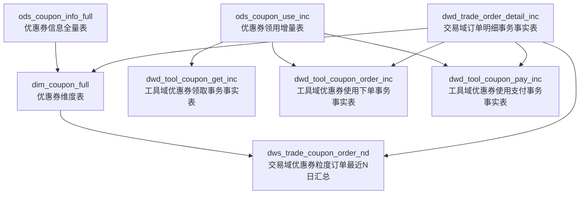
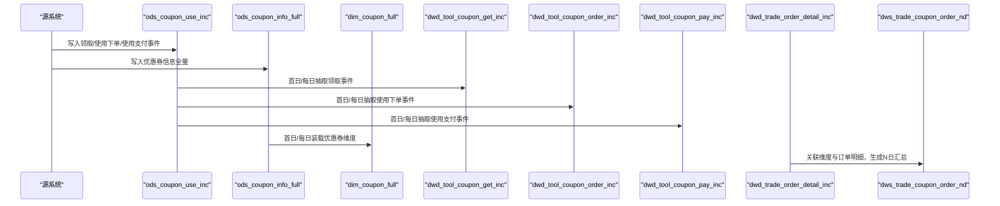
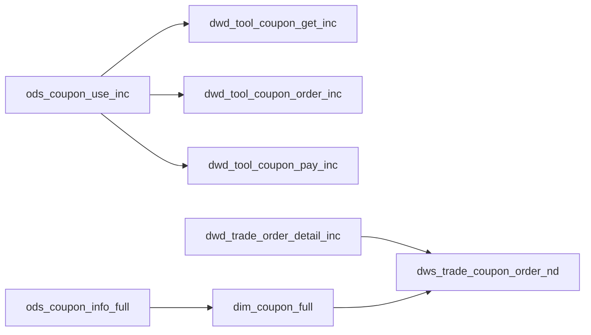

# 优惠券事务表

<cite>
**本文引用的文件**
- [gmall-0906.sql](file://gmall-0906.sql)
- [console.sql](file://console.sql)
</cite>

## 目录
1. [引言](#引言)
2. [项目结构](#项目结构)
3. [核心组件](#核心组件)
4. [架构总览](#架构总览)
5. [详细组件分析](#详细组件分析)
6. [依赖分析](#依赖分析)
7. [性能考量](#性能考量)
8. [故障排查指南](#故障排查指南)
9. [结论](#结论)
10. [附录](#附录)

## 引言
本技术文档围绕HQL数据仓库中的优惠券事务表展开，系统化阐述优惠券相关事务表的设计原理、字段语义、状态流转与生命周期管理，并结合仓库中现有的优惠券事务事实表与维度表，给出ETL实现思路、统计分析方法与效果评估指标。文档旨在帮助读者快速理解并落地优惠券在数据仓库中的抽取、清洗、装载与分析流程。

## 项目结构
本仓库包含多个SQL脚本，其中与优惠券事务表直接相关的是主数据建模脚本，涵盖：
- 优惠券事务事实表：领取、使用下单、使用支付
- 优惠券维度表：优惠券规则、范围、类型等维度信息
- 交易域订单明细表：用于关联优惠券使用与订单金额分摊
- 统计宽表：基于优惠券维度与订单明细生成的N日汇总宽表

图表来源
- [gmall-0906.sql](file://gmall-0906.sql#L195-L2399)
- [gmall-0906.sql](file://gmall-0906.sql#L4600-L4655)

章节来源
- [gmall-0906.sql](file://gmall-0906.sql#L195-L2399)
- [gmall-0906.sql](file://gmall-0906.sql#L4600-L4655)

## 核心组件
- 优惠券信息全量表（ods_coupon_info_full）
  - 记录优惠券的基础属性与生命周期参数，如类型、门槛、优惠额度、领取与过期时间等。
- 优惠券领用增量表（ods_coupon_use_inc）
  - 记录优惠券的领取、使用下单、使用支付等状态变更事件，采用JSON结构承载事件体与旧值映射。
- 工具域优惠券领取事务事实表（dwd_tool_coupon_get_inc）
  - 从ods_coupon_use_inc抽取“领取”事件，形成可分析的领取事实。
- 工具域优惠券使用下单事务事实表（dwd_tool_coupon_order_inc）
  - 从ods_coupon_use_inc抽取“使用下单”事件，形成可分析的使用下单事实。
- 工具域优惠券使用支付事务事实表（dwd_tool_coupon_pay_inc）
  - 从ods_coupon_use_inc抽取“使用支付”事件，形成可分析的使用支付事实。
- 优惠券维度表（dim_coupon_full）
  - 基于ods_coupon_info_full与字典表（类型、范围）构建，提供统一的优惠券规则与范围维度。
- 交易域订单明细事务事实表（dwd_trade_order_detail_inc）
  - 关联优惠券使用与订单金额分摊，是生成优惠券效果指标的关键事实表。
- 交易域优惠券粒度订单最近N日汇总（dws_trade_coupon_order_nd）
  - 基于订单明细与优惠券维度生成的宽表，便于进行近N日的优惠券效果分析。

章节来源
- [gmall-0906.sql](file://gmall-0906.sql#L195-L2399)
- [gmall-0906.sql](file://gmall-0906.sql#L4600-L4655)

## 架构总览
优惠券事务表在数据仓库中的流转路径如下：

图表来源
- [gmall-0906.sql](file://gmall-0906.sql#L195-L2399)
- [gmall-0906.sql](file://gmall-0906.sql#L4600-L4655)

## 详细组件分析

### 优惠券信息表（ods_coupon_info_full）
- 设计要点
  - 字段覆盖优惠券类型、门槛、优惠额度、领取与过期时间等关键生命周期参数。
  - 采用分区字段dt，便于按天装载与回溯。
- 生命周期参数
  - start_time/end_time：可领取时间段
  - expire_time：过期时间
  - limit_num/taken_count：限量与已领取次数
- 用途
  - 作为优惠券维度表的全量来源，驱动维度装载与规则解析。

章节来源
- [gmall-0906.sql](file://gmall-0906.sql#L195-L239)

### 优惠券领用表（ods_coupon_use_inc）
- 设计要点
  - JSON结构，包含type/ts/data/old字段，记录事件类型、时间戳、事件体与旧值映射。
  - 事件类型（type）与旧值（old）用于识别“insert/update”等增量变化。
- 事件与字段
  - 领取事件：get_time
  - 使用下单事件：using_time
  - 使用支付事件：used_time
  - 状态字段：coupon_status（可用于后续维度化）
- 用途
  - 作为工具域事实表的唯一来源，支撑领取、使用下单、使用支付三类事务事实表。

章节来源
- [gmall-0906.sql](file://gmall-0906.sql#L311-L323)
- [gmall-0906.sql](file://gmall-0906.sql#L2268-L2399)

### 工具域优惠券领取事务事实表（dwd_tool_coupon_get_inc）
- 设计要点
  - 字段包含优惠券ID、用户ID、领取日期等，面向分析场景的轻量事实表。
- 数据装载
  - 首日：抽取ods_coupon_use_inc中bootstrap-insert类型的领取事件
  - 每日：抽取ods_coupon_use_inc中insert类型的领取事件

章节来源
- [gmall-0906.sql](file://gmall-0906.sql#L2268-L2307)

### 工具域优惠券使用（下单）事务事实表（dwd_tool_coupon_order_inc）
- 设计要点
  - 字段包含优惠券ID、用户ID、订单ID、使用下单日期等
- 数据装载
  - 首日：抽取ods_coupon_use_inc中bootstrap-insert且using_time非空的事件
  - 每日：抽取ods_coupon_use_inc中update且using_time发生变化的事件

章节来源
- [gmall-0906.sql](file://gmall-0906.sql#L2310-L2354)

### 工具域优惠券使用（支付）事务事实表（dwd_tool_coupon_pay_inc）
- 设计要点
  - 字段包含优惠券ID、用户ID、订单ID、使用支付日期等
- 数据装载
  - 首日：抽取ods_coupon_use_inc中bootstrap-insert且used_time非空的事件
  - 每日：抽取ods_coupon_use_inc中update且used_time发生变化的事件

章节来源
- [gmall-0906.sql](file://gmall-0906.sql#L2357-L2399)

### 优惠券维度表（dim_coupon_full）
- 设计要点
  - 基于ods_coupon_info_full与字典表（类型、范围）构建
  - 新增优惠券规则文本（benefit_rule），便于下游直接使用
- 数据装载
  - 首日/每日：从ods_coupon_info_full读取，左连接字典表获得类型与范围名称

章节来源
- [gmall-0906.sql](file://gmall-0906.sql#L623-L708)

### 交易域订单明细事务事实表（dwd_trade_order_detail_inc）
- 设计要点
  - 关联订单、活动、优惠券等，包含原始金额、活动分摊、优惠券分摊等字段
- 用途
  - 与优惠券事务事实表联合，生成优惠券效果分析所需的金额口径

章节来源
- [gmall-0906.sql](file://gmall-0906.sql#L1280-L1479)

### 交易域优惠券粒度订单最近N日汇总（dws_trade_coupon_order_nd）
- 设计要点
  - 以优惠券为粒度，统计最近N日的原始金额与优惠券优惠金额
- 数据装载
  - 从dwd_trade_order_detail_inc过滤coupon_id非空，与dim_coupon_full进行关联，按优惠券维度聚合

章节来源
- [gmall-0906.sql](file://gmall-0906.sql#L4600-L4655)

### 优惠券类型编码规则与范围编码
- 类型编码（coupon_type）
  - 由字典表parent_code='32'的条目定义，dim_coupon_full中以类型编码与类型名称双字段呈现
- 范围编码（range_type）
  - 由字典表parent_code='33'的条目定义，dim_coupon_full中以范围编码与范围名称双字段呈现
- 规则文本（benefit_rule）
  - 基于类型与门槛/折扣/额度拼装，便于下游直接展示

章节来源
- [gmall-0906.sql](file://gmall-0906.sql#L623-L708)

### 优惠券状态字段含义与流转机制
- 状态字段（coupon_status）
  - 该字段存在于ods_coupon_use_inc.data结构中，但未在工具域事实表中直接体现
  - 建议在维度层或事实层增加状态维度，以便追踪“未使用/已使用/已过期/已失效”等状态
- 事件流转
  - 领取：get_time
  - 使用下单：using_time
  - 使用支付：used_time
  - 过期：expire_time（与start_time/end_time配合判断）

章节来源
- [gmall-0906.sql](file://gmall-0906.sql#L311-L323)
- [gmall-0906.sql](file://gmall-0906.sql#L2268-L2399)

### 优惠券使用与过期处理策略
- 使用判定
  - 使用下单事实表与使用支付事实表分别以using_time与used_time为准
- 过期判定
  - 以expire_time与start_time/end_time为依据，结合业务规则判断是否计入有效使用
- 建议
  - 在维度层增加“是否过期”、“是否有效使用”等派生字段，便于下游报表与分析

章节来源
- [gmall-0906.sql](file://gmall-0906.sql#L195-L239)
- [gmall-0906.sql](file://gmall-0906.sql#L2268-L2399)

### 优惠券维度表与事务表的关联关系
- 关联键
  - 优惠券ID（coupon_id）作为核心关联键
- 关联路径
  - dim_coupon_full ← ods_coupon_info_full（维度装载）
  - dwd_tool_coupon_* ← ods_coupon_use_inc（事务抽取）
  - dws_trade_coupon_order_nd ← dwd_trade_order_detail_inc ∩ dim_coupon_full（汇总）

章节来源
- [gmall-0906.sql](file://gmall-0906.sql#L195-L2399)
- [gmall-0906.sql](file://gmall-0906.sql#L4600-L4655)

### 优惠券使用情况的统计分析方法
- 基于dws_trade_coupon_order_nd的N日汇总
  - 指标：原始金额、优惠券优惠金额
  - 场景：近30日使用趋势、券效对比
- 基于工具域事实表的口径
  - 领取UV、使用下单UV、使用支付UV
  - 使用率（使用下单/领取）、支付转化率（使用支付/使用下单）

章节来源
- [gmall-0906.sql](file://gmall-0906.sql#L4600-L4655)
- [gmall-0906.sql](file://gmall-0906.sql#L2268-L2399)

### 优惠券效果评估的数据指标
- 通用指标
  - 领取量、使用下单量、使用支付量、核销量
  - 使用率、支付转化率、客单价、优惠券贡献金额
- 维度过滤
  - 类型、范围、门槛、折扣/额度等维度下的指标拆解
- 时间维度
  - 日/周/月趋势，促销活动前后对比

章节来源
- [gmall-0906.sql](file://gmall-0906.sql#L4600-L4655)
- [gmall-0906.sql](file://gmall-0906.sql#L2268-L2399)

### ETL实现示例（抽取、状态更新与生命周期管理）
- 首日装载
  - 优惠券维度：从ods_coupon_info_full读取，左连接字典表生成dim_coupon_full
  - 工具域事实：从ods_coupon_use_inc读取type='bootstrap-insert'的事件，生成dwd_tool_coupon_get/inc/pay
- 每日增量
  - 优惠券维度：按dt分区覆盖装载
  - 工具域事实：从ods_coupon_use_inc读取type='insert'或type='update'且涉及get_time/using_time/used_time变化的事件，生成当日dwd_tool_*事实
- 生命周期管理
  - 通过start_time/end_time/expire_time与using_time/used_time联动，识别“有效使用”与“过期未用”

章节来源
- [gmall-0906.sql](file://gmall-0906.sql#L623-L708)
- [gmall-0906.sql](file://gmall-0906.sql#L2268-L2399)

### 优惠券事务表在营销分析与用户行为研究中的作用
- 营销活动分析
  - 结合活动维度表与订单明细，评估活动期间的券效与客单价变化
- 用户行为研究
  - 通过领取、下单、支付的漏斗分析，洞察用户券使用路径与转化瓶颈
- 并发使用与异常处理建议
  - 并发：在抽取层通过ts与old字段识别更新序列，确保幂等装载
  - 异常：对using_time/used_time缺失或时间倒挂的事件进行标注与复核

章节来源
- [gmall-0906.sql](file://gmall-0906.sql#L1280-L1479)
- [gmall-0906.sql](file://gmall-0906.sql#L2268-L2399)

## 依赖分析
- 组件耦合
  - 工具域事实表完全依赖ods_coupon_use_inc的事件结构
  - 维度表依赖ods_coupon_info_full与字典表
  - 汇总表依赖订单明细与维度表
- 外部依赖
  - 字典表（parent_code='32'/'33'）用于类型与范围的编码解释
- 潜在风险
  - 若ods_coupon_use_inc缺少using_time/used_time，会导致使用下单/支付事实缺失
  - 若字典表缺失，维度表无法正确生成类型与范围名称

图表来源
- [gmall-0906.sql](file://gmall-0906.sql#L195-L2399)
- [gmall-0906.sql](file://gmall-0906.sql#L4600-L4655)

章节来源
- [gmall-0906.sql](file://gmall-0906.sql#L195-L2399)
- [gmall-0906.sql](file://gmall-0906.sql#L4600-L4655)

## 性能考量
- 分区与裁剪
  - 通过dt分区与日期范围过滤（如N日前）减少扫描数据量
- 增量更新
  - 优先使用type与map_keys(old)判断，仅抽取变化事件，降低I/O
- 聚合与宽表
  - N日汇总宽表可显著减少分析阶段的联表与聚合成本
- 写入策略
  - 事实表与维度表均采用覆盖写入（overwrite），需确保分区安全

[本节为通用指导，无需列出具体文件来源]

## 故障排查指南
- 常见问题
  - 优惠券未计入使用：检查using_time/used_time是否为空或时间倒挂
  - 维度名称缺失：检查字典表是否存在parent_code对应的条目
  - 汇总指标异常：检查dwd_trade_order_detail_inc中coupon_id是否为空
- 排查步骤
  - 核对ods_coupon_use_inc中事件类型与时间字段
  - 核对dim_coupon_full的类型/范围编码是否正确
  - 核对dws_trade_coupon_order_nd的日期范围与分区

章节来源
- [gmall-0906.sql](file://gmall-0906.sql#L2268-L2399)
- [gmall-0906.sql](file://gmall-0906.sql#L4600-L4655)

## 结论
本仓库已完整实现优惠券事务表的建模与ETL流程，覆盖领取、使用下单、使用支付三大关键事件，并通过维度表与N日汇总宽表支撑多维分析。建议在现有基础上补充状态维度与异常监控，进一步提升券效分析的准确性与稳定性。

[本节为总结性内容，无需列出具体文件来源]

## 附录
- 示例：基于工具域事实表的使用率计算思路
  - 使用率 = 使用下单UV / 领取UV
  - 支付转化率 = 使用支付UV / 使用下单UV
- 示例：基于dws_trade_coupon_order_nd的近N日券效对比
  - 指标：原始金额、优惠券优惠金额、客单价（后者=总金额/订单数）

章节来源
- [gmall-0906.sql](file://gmall-0906.sql#L2268-L2399)
- [gmall-0906.sql](file://gmall-0906.sql#L4600-L4655)