# 支付事务表

<cite>
**本文档引用的文件**
- [gmall-0906.sql](file://gmall-0906.sql)
- [basic.sql](file://basic.sql)
- [console.sql](file://console.sql)
- [high.sql](file://high.sql)
- [middle.sql](file://middle.sql)
</cite>

## 目录
1. [引言](#引言)
2. [项目结构](#项目结构)
3. [核心组件](#核心组件)
4. [架构概览](#架构概览)
5. [详细组件分析](#详细组件分析)
6. [依赖分析](#依赖分析)
7. [性能考虑](#性能考虑)
8. [故障排除指南](#故障排除指南)
9. [结论](#结论)

## 引言
本文档深入分析HQL数据仓库中的支付事务表设计与实现，重点涵盖支付表(ods_payment_info_inc)和退款表(ods_refund_payment_inc)的结构设计、业务逻辑、状态处理机制、数据关联关系以及完整的ETL实现流程。通过对代码库的全面分析，我们将解释type字段在支付场景下的特殊标识作用、JSON数据解析中的支付相关信息提取、支付金额计算与分摊规则，并提供支付事务表与订单事务表、用户事务表的关联关系说明以及支付异常和对账问题的处理方案。

## 项目结构
该项目采用典型的分层架构设计，包含ODS层、DWD层和DIM层：

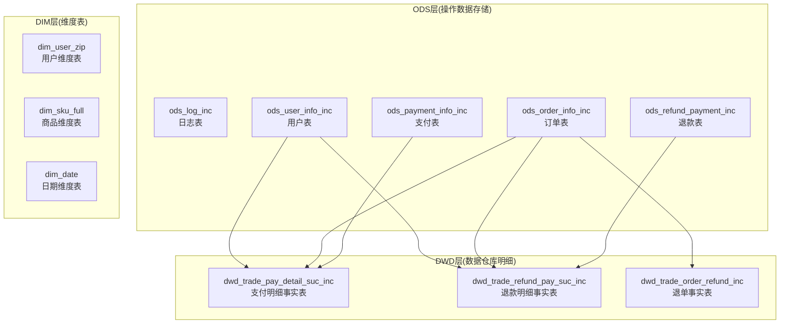

**图表来源**
- [gmall-0906.sql](file://gmall-0906.sql#L421-L447)
- [gmall-0906.sql](file://gmall-0906.sql#L1682-L1711)
- [gmall-0906.sql](file://gmall-0906.sql#L2080-L2100)

**章节来源**
- [gmall-0906.sql](file://gmall-0906.sql#L21-L447)

## 核心组件
本项目的核心支付相关组件包括：

### 支付表(ods_payment_info_inc)
支付表是存储支付交易信息的关键表，包含以下核心字段：
- `type`: 变动类型标识
- `ts`: 变动时间戳
- `data`: JSON结构体，包含支付详情
- `old`: 旧值映射

### 退款表(ods_refund_payment_inc)
退款表专门存储退款交易信息，结构与支付表类似但字段略有差异。

### 支付明细事实表(dwd_trade_pay_detail_suc_inc)
这是经过ETL处理后的明细事实表，包含：
- 订单ID、用户ID、商品ID
- 支付类型编码和名称
- 日期ID和回调时间
- 商品数量和各类金额分摊

**章节来源**
- [gmall-0906.sql](file://gmall-0906.sql#L421-L447)
- [gmall-0906.sql](file://gmall-0906.sql#L1682-L1711)

## 架构概览
支付事务处理的整体架构遵循"增量数据 -> 明细事实表 -> 汇总报表"的模式：

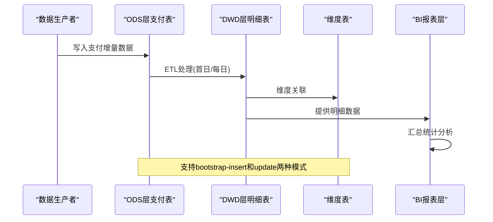

**图表来源**
- [gmall-0906.sql](file://gmall-0906.sql#L1715-L1842)
- [gmall-0906.sql](file://gmall-0906.sql#L2104-L2181)

## 详细组件分析

### 支付表结构设计
支付表采用JSON SerDe格式，支持复杂的嵌套结构：

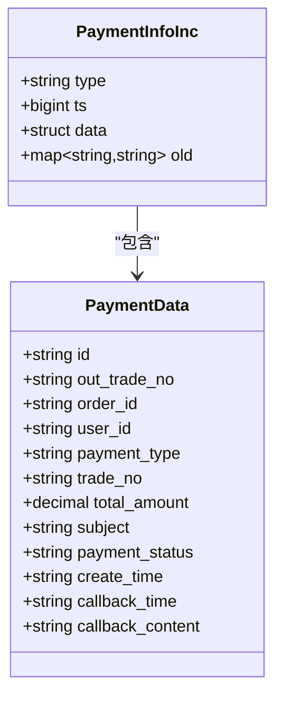

**图表来源**
- [gmall-0906.sql](file://gmall-0906.sql#L421-L433)

### 退款表结构设计
退款表同样采用JSON格式存储，关键字段包括：
- `out_trade_no`: 外部交易号
- `sku_id`: 商品ID
- `refund_status`: 退款状态
- `callback_time`: 回调时间

**章节来源**
- [gmall-0906.sql](file://gmall-0906.sql#L435-L447)

### type字段的特殊标识作用
type字段在支付场景下具有关键的标识作用：

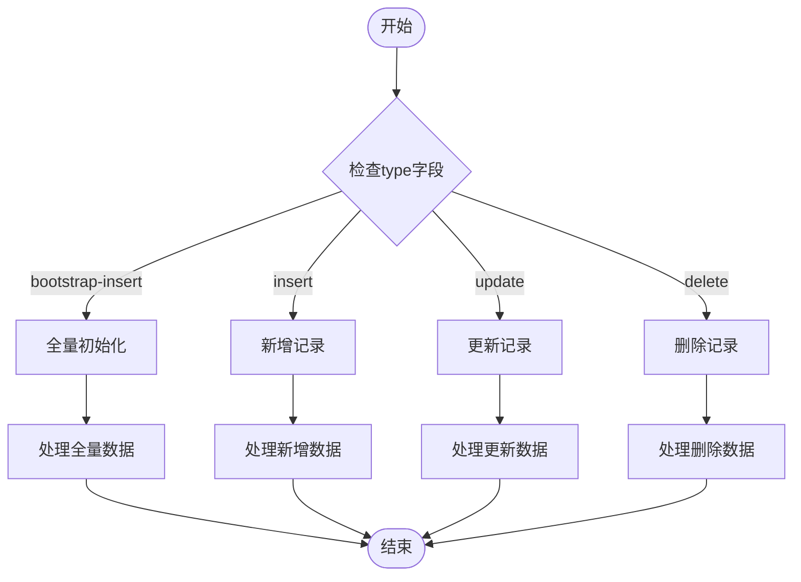

**图表来源**
- [gmall-0906.sql](file://gmall-0906.sql#L956-L1078)
- [gmall-0906.sql](file://gmall-0906.sql#L1240-L1277)

### 支付状态字段含义与处理机制
支付状态字段在不同层级有不同的含义和处理方式：

| 状态码 | 状态名称 | 描述 | 处理逻辑 |
|--------|----------|------|----------|
| 1601 | 未支付 | 初始状态 | 不纳入统计 |
| 1602 | 已支付 | 支付成功 | 归集到支付明细表 |
| 1603 | 支付失败 | 支付异常 | 标记为失败交易 |
| 1604 | 支付中 | 处理中 | 等待回调确认 |

**章节来源**
- [gmall-0906.sql](file://gmall-0906.sql#L1762-L1765)
- [gmall-0906.sql](file://gmall-0906.sql#L1867-L1871)

### 退款流程的数据处理策略
退款流程采用双表关联策略：

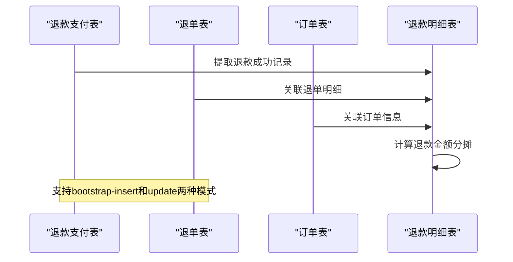

**图表来源**
- [gmall-0906.sql](file://gmall-0906.sql#L2119-L2164)
- [gmall-0906.sql](file://gmall-0906.sql#L2183-L2233)

### 支付金额计算与分摊规则
支付金额采用"原始金额-优惠分摊=实际支付"的计算模式：

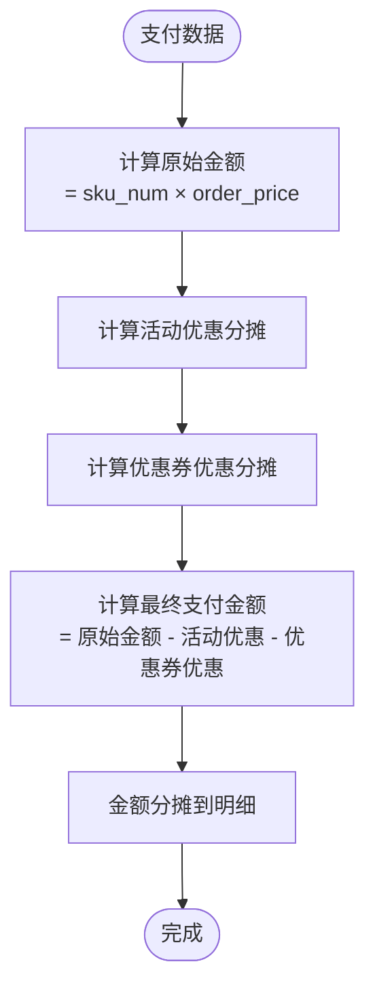

**图表来源**
- [gmall-0906.sql](file://gmall-0906.sql#L1747-L1750)
- [gmall-0906.sql](file://gmall-0906.sql#L1852-L1855)

### JSON数据解析中的支付信息提取
系统通过JSON SerDe自动解析支付数据中的嵌套结构：

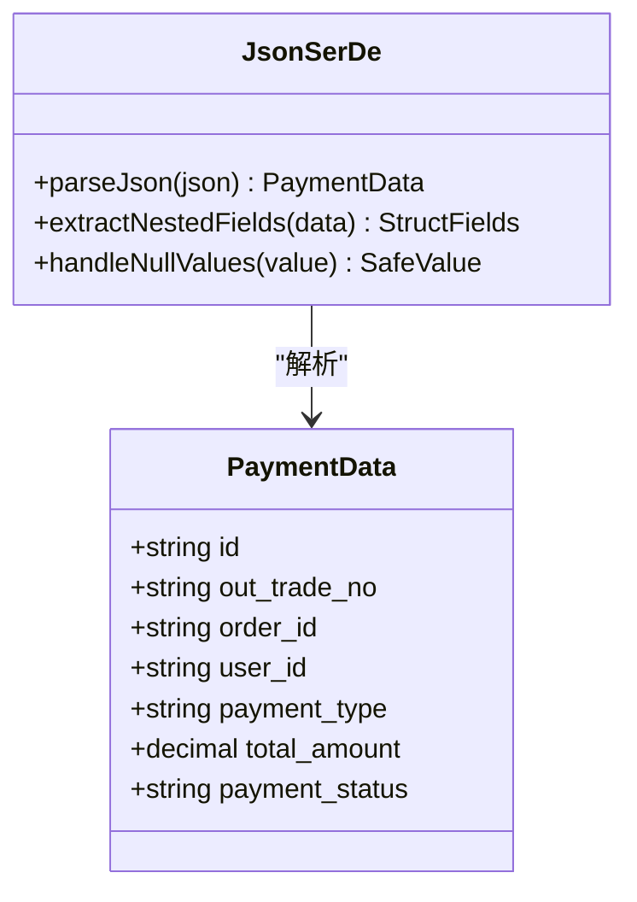

**图表来源**
- [gmall-0906.sql](file://gmall-0906.sql#L432-L433)

**章节来源**
- [gmall-0906.sql](file://gmall-0906.sql#L1740-L1750)

### 支付流水与订单明细的关联关系
支付流水与订单明细通过order_id建立强关联：

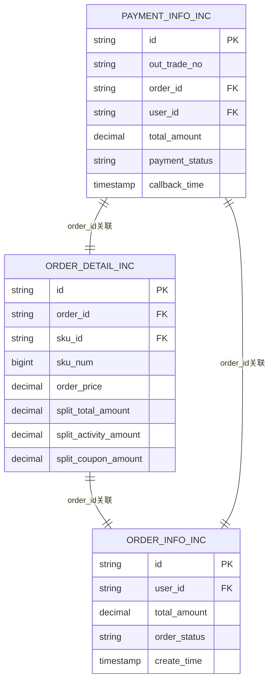

**图表来源**
- [gmall-0906.sql](file://gmall-0906.sql#L1755-L1767)
- [gmall-0906.sql](file://gmall-0906.sql#L1860-L1873)

**章节来源**
- [gmall-0906.sql](file://gmall-0906.sql#L1755-L1767)

### ETL实现示例
完整的ETL流程包括首日装载和每日增量处理：

#### 首日装载流程
```sql
-- 首日装载支付明细
insert overwrite table dwd_trade_pay_detail_suc_inc partition(dt)
select
    od.id,
    od.order_id,
    user_id,
    sku_id,
    province_id,
    activity_id,
    activity_rule_id,
    coupon_id,
    payment_type,
    pay_dic.dic_name,
    date_format(callback_time,'yyyy-MM-dd') date_id,
    callback_time,
    source_id,
    source_type,
    src_dic.dic_name,
    sku_num,
    split_original_amount,
    split_activity_amount,
    split_coupon_amount,
    split_total_amount,
    date_format(callback_time,'yyyy-MM-dd')
from
(
    select
        data.id,
        data.order_id,
        data.sku_id,
        data.source_id,
        data.source_type,
        data.sku_num,
        data.sku_num * data.order_price split_original_amount,
        data.split_total_amount,
        data.split_activity_amount,
        data.split_coupon_amount
    from ods_order_detail_inc
    where dt = '2020-06-14'
    and type = 'bootstrap-insert'
) od
join
(
    select
        data.user_id,
        data.order_id,
        data.payment_type,
        data.callback_time
    from ods_payment_info_inc
    where dt='2020-06-14'
    and type='bootstrap-insert'
    and data.payment_status='1602'
) pi
on od.order_id=pi.order_id
left join
(
    select
        data.id,
        data.province_id
    from ods_order_info_inc
    where dt = '2020-06-14'
    and type = 'bootstrap-insert'
) oi
on od.order_id = oi.id
left join
(
    select
        data.order_detail_id,
        data.activity_id,
        data.activity_rule_id
    from ods_order_detail_activity_inc
    where dt = '2020-06-14'
    and type = 'bootstrap-insert'
) act
on od.id = act.order_detail_id
left join
(
    select
        data.order_detail_id,
        data.coupon_id
    from ods_order_detail_coupon_inc
    where dt = '2020-06-14'
    and type = 'bootstrap-insert'
) cou
on od.id = cou.order_detail_id
left join
(
    select
        dic_code,
        dic_name
    from ods_base_dic_full
    where dt='2020-06-14'
    and parent_code='11'
) pay_dic
on pi.payment_type=pay_dic.dic_code
left join
(
    select
        dic_code,
        dic_name
    from ods_base_dic_full
    where dt='2020-06-14'
    and parent_code='24'
)src_dic
on od.source_type=src_dic.dic_code;
```

#### 每日增量处理流程
```sql
-- 每日增量处理
insert overwrite table dwd_trade_pay_detail_suc_inc partition (dt='2020-06-15')
select
    od.id,
    od.order_id,
    user_id,
    sku_id,
    province_id,
    activity_id,
    activity_rule_id,
    coupon_id,
    payment_type,
    pay_dic.dic_name,
    date_format(callback_time,'yyyy-MM-dd') date_id,
    callback_time,
    source_id,
    source_type,
    src_dic.dic_name,
    sku_num,
    split_original_amount,
    split_activity_amount,
    split_coupon_amount,
    split_total_amount
from
(
    select
        data.id,
        data.order_id,
        data.sku_id,
        data.source_id,
        data.source_type,
        data.sku_num,
        data.sku_num * data.order_price split_original_amount,
        data.split_total_amount,
        data.split_activity_amount,
        data.split_coupon_amount
    from ods_order_detail_inc
    where (dt = '2020-06-15' or date_sub('2020-06-15',1))
    and (type = 'insert' or type='bootstrap-insert')
) od
join
(
    select
        data.user_id,
        data.order_id,
        data.payment_type,
        data.callback_time
    from ods_payment_info_inc
    where dt='2020-06-15'
    and type='update'
    and array_contains(map_keys(old),'payment_status')
    and data.payment_status='1602'
) pi
on od.order_id=pi.order_id
left join
(
    select
        data.id,
        data.province_id
    from ods_order_info_inc
    where dt='2020-06-15'
    and type='update'
    and array_contains(map_keys(old),'order_status')
    and data.order_status='1002'
) oi
on od.order_id = oi.id
left join
(
    select
        data.order_detail_id,
        data.activity_id,
        data.activity_rule_id
    from ods_order_detail_activity_inc
    where (dt = '2020-06-15' or date_sub('2020-06-15',1))
    and (type = 'insert' or type='bootstrap-insert')
) act
on od.id = act.order_detail_id
left join
(
    select
        data.order_detail_id,
        data.coupon_id
    from ods_order_detail_coupon_inc
    where (dt = '2020-06-15' or date_sub('2020-06-15',1))
    and (type = 'insert' or type='bootstrap-insert')
) cou
on od.id = cou.order_detail_id
left join
(
    select
        dic_code,
        dic_name
    from ods_base_dic_full
    where dt='2020-06-15'
    and parent_code='11'
) pay_dic
on pi.payment_type=pay_dic.dic_code
left join
(
    select
        dic_code,
        dic_name
    from ods_base_dic_full
    where dt='2020-06-15'
    and parent_code='24'
)src_dic
on od.source_type=src_dic.dic_code;
```

**章节来源**
- [gmall-0906.sql](file://gmall-0906.sql#L1715-L1842)

### 支付事务表与订单事务表的关联关系
支付事务表与订单事务表通过多种方式建立关联：

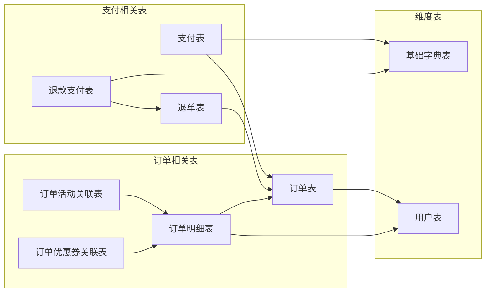

**图表来源**
- [gmall-0906.sql](file://gmall-0906.sql#L1755-L1767)
- [gmall-0906.sql](file://gmall-0906.sql#L2119-L2164)

**章节来源**
- [gmall-0906.sql](file://gmall-0906.sql#L1755-L1767)

### 支付异常处理与对账机制
系统提供了完善的异常处理和对账机制：

#### 支付异常处理
- 支付状态监控：通过payment_status字段监控支付状态变化
- 异常订单识别：通过order_status字段识别异常订单
- 退款处理：通过refund_status字段处理退款状态

#### 对账机制
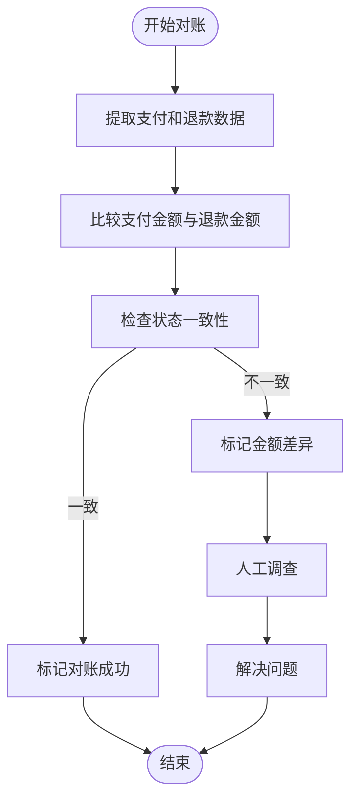

**图表来源**
- [gmall-0906.sql](file://gmall-0906.sql#L2191-L2195)

**章节来源**
- [gmall-0906.sql](file://gmall-0906.sql#L2191-L2195)

## 依赖分析
支付事务表系统的主要依赖关系：

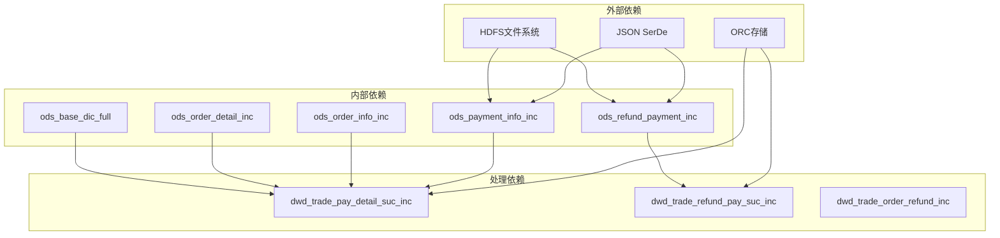

**图表来源**
- [gmall-0906.sql](file://gmall-0906.sql#L432-L433)
- [gmall-0906.sql](file://gmall-0906.sql#L1709-L1710)

**章节来源**
- [gmall-0906.sql](file://gmall-0906.sql#L432-L433)

## 性能考虑
基于代码分析，系统在性能方面采用了以下优化策略：

### 存储格式优化
- 使用ORC存储格式提高查询性能
- 分区表设计支持按日期分区
- 压缩配置优化存储空间

### 查询优化
- 使用EXPLAIN分析执行计划
- 合理使用JOIN和WHERE条件
- 避免不必要的嵌套查询

### 内存管理
- 控制数据倾斜问题
- 合理设置动态分区模式
- 优化大表连接操作

## 故障排除指南
针对支付事务表可能出现的问题提供解决方案：

### 常见问题及解决方案

#### 1. JSON解析错误
**问题症状**：JSON SerDe解析失败
**解决方案**：
- 检查JSON格式正确性
- 验证字段类型匹配
- 使用get_json_object函数提取特定字段

#### 2. 支付状态不一致
**问题症状**：支付状态与订单状态不匹配
**解决方案**：
- 检查type字段处理逻辑
- 验证状态转换条件
- 确认回调时间戳准确性

#### 3. 金额计算错误
**问题症状**：支付金额与订单金额不符
**解决方案**：
- 检查分摊计算公式
- 验证原始金额计算
- 确认优惠分摊逻辑

#### 4. 数据重复问题
**问题症状**：同一笔交易重复处理
**解决方案**：
- 检查bootstrap-insert和update的区别
- 验证去重逻辑
- 确认时间戳处理

**章节来源**
- [gmall-0906.sql](file://gmall-0906.sql#L956-L1078)

## 结论
HQL数据仓库中的支付事务表设计体现了现代数据仓库的最佳实践，通过合理的分层架构、完善的ETL流程和严格的状态管理，实现了对支付业务的全面覆盖。系统不仅支持实时数据处理，还具备强大的历史数据处理能力，能够满足复杂的业务分析需求。

关键优势包括：
- **完整性**：覆盖支付全流程，从支付到退款的完整生命周期
- **可扩展性**：支持增量和全量数据处理模式
- **可靠性**：完善的异常处理和对账机制
- **性能**：优化的存储格式和查询策略

通过本文档的详细分析，读者可以深入理解支付事务表的设计原理和实现细节，为后续的数据仓库建设和维护提供有价值的参考。