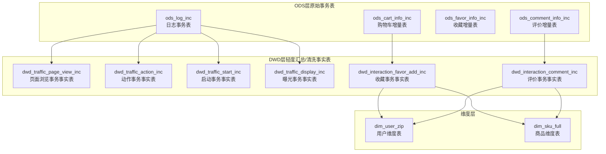
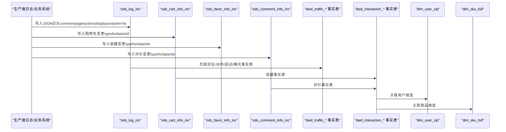
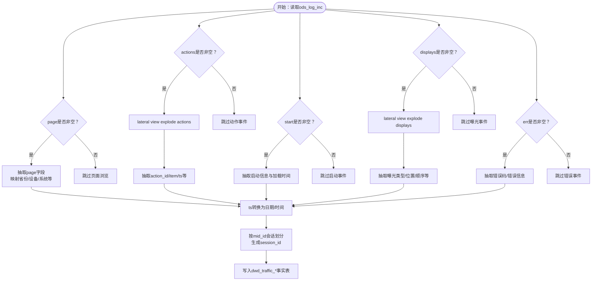
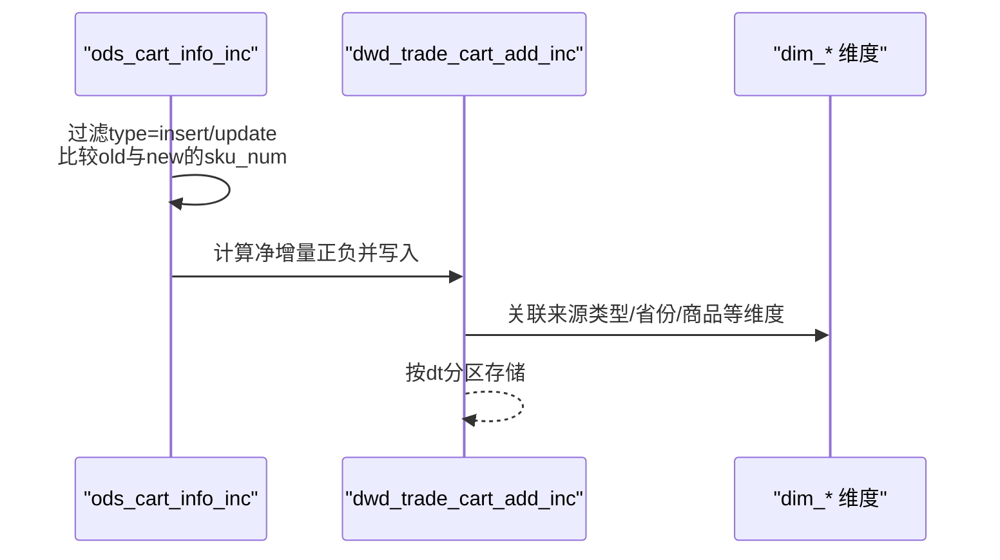
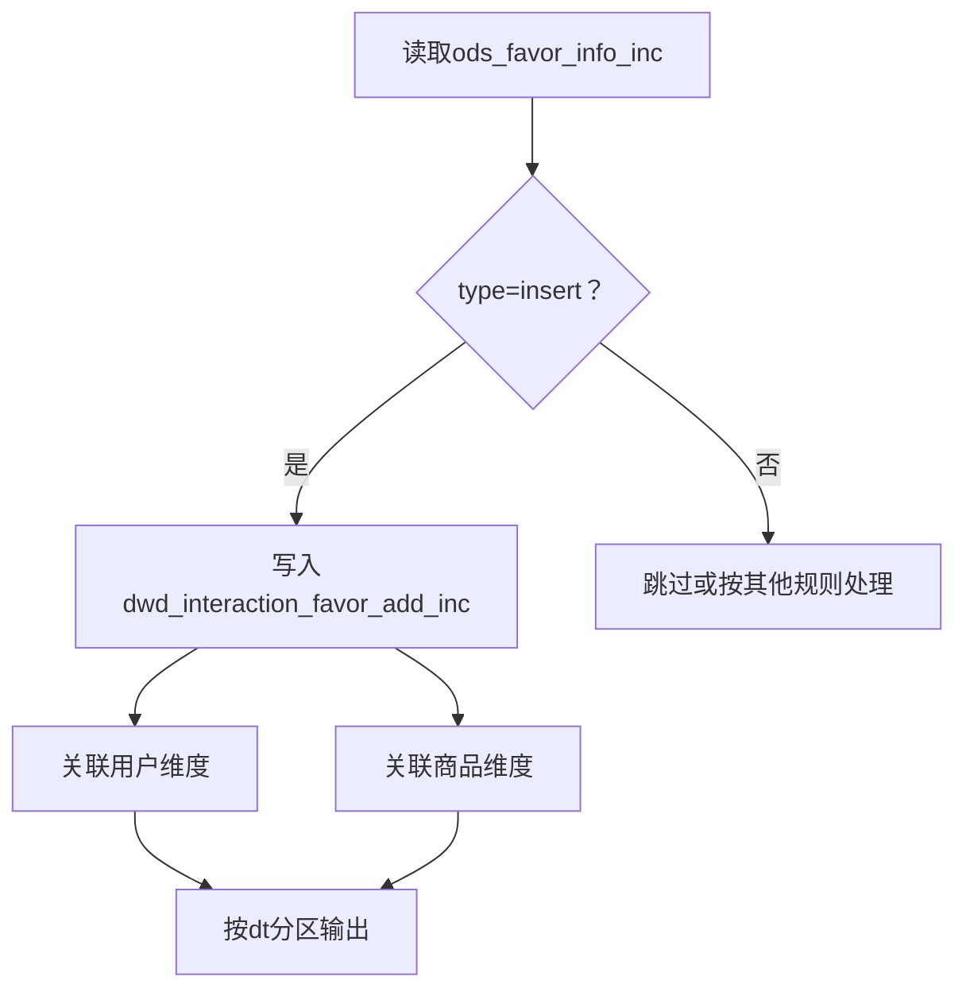
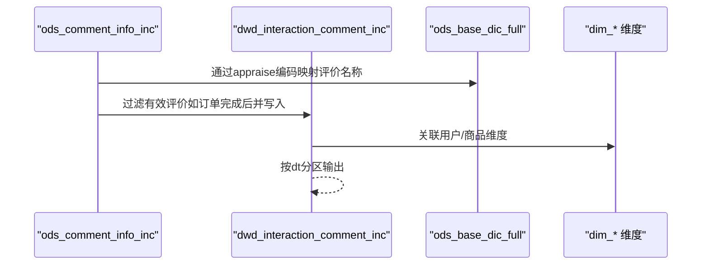
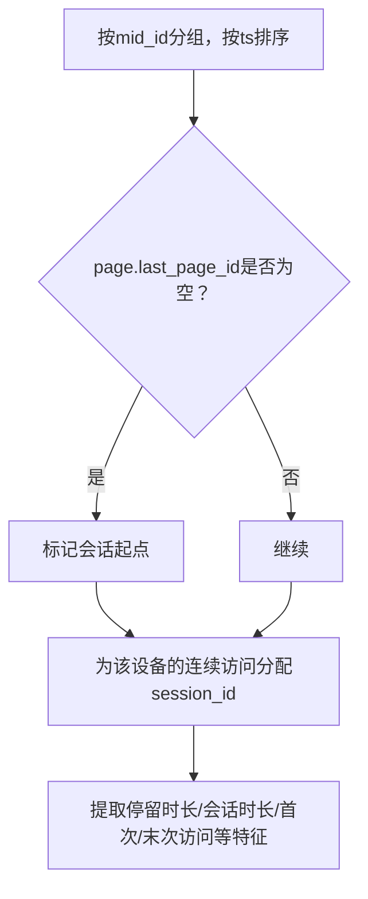
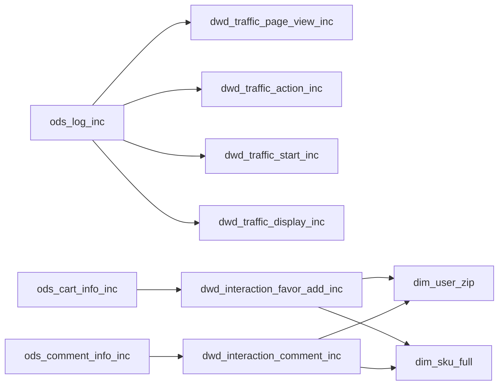

# 用户行为事务表

<cite>
**本文引用的文件**
- [gmall-0906.sql](file://gmall-0906.sql)
- [basic.sql](file://basic.sql)
- [console.sql](file://console.sql)
- [high.sql](file://high.sql)
- [middle.sql](file://middle.sql)
</cite>

## 目录
1. [引言](#引言)
2. [项目结构](#项目结构)
3. [核心组件](#核心组件)
4. [架构总览](#架构总览)
5. [详细组件分析](#详细组件分析)
6. [依赖分析](#依赖分析)
7. [性能考量](#性能考量)
8. [故障排查指南](#故障排查指南)
9. [结论](#结论)
10. [附录](#附录)

## 引言
本技术文档围绕HQL数据仓库中的用户行为事务表展开，重点覆盖日志表（ods_log_inc）、收藏表（ods_favor_info_inc）、购物车表（ods_cart_info_inc）、评价表（ods_comment_info_inc）等用户行为事务表的结构设计与业务逻辑；系统性阐述日志JSON数据结构解析、用户行为事件类型标识、时间序列处理；给出收藏、购物车、评价等行为的ETL处理流程（去重、状态变更检测、增量更新）；并说明与用户维度表、商品维度表的关联关系，以及如何基于这些事务表进行用户画像与推荐分析。

## 项目结构
本仓库包含多个SQL脚本文件，其中gmall-0906.sql集中定义了ODS层的用户行为事务表、DWD层的事实表、以及维度表的建模与ETL逻辑；basic.sql、console.sql、high.sql、middle.sql提供了大量Hive/HQL实践示例，涵盖窗口函数、时间序列、连续登录、会话划分等与用户行为分析密切相关的主题。

图示来源
- [gmall-0906.sql](file://gmall-0906.sql#L24-L336)
- [gmall-0906.sql](file://gmall-0906.sql#L2404-L2537)
- [gmall-0906.sql](file://gmall-0906.sql#L2540-L3049)

章节来源
- [gmall-0906.sql](file://gmall-0906.sql#L24-L336)
- [gmall-0906.sql](file://gmall-0906.sql#L2404-L3049)

## 核心组件
- 日志事务表（ods_log_inc）
  - JSON结构：包含公共信息(common)、页面信息(page)、动作数组(actions)、曝光数组(displays)、启动信息(start)、错误信息(err)、时间戳(ts)。
  - 解析要点：通过lateral view explode拆解actions/displays数组；使用get_json_object或JsonSerDe读取字段；将ts转换为本地时区日期与时间。
- 购物车事务表（ods_cart_info_inc）
  - 结构：type（变动类型）、ts（变动时间）、data（结构化数据）、old（旧值映射）。
  - ETL要点：根据type过滤insert/update；对sku_num等数值型字段进行增减判断，生成当日净增量。
- 收藏事务表（ods_favor_info_inc）
  - 结构：type、ts、data、old。
  - ETL要点：insert时直接落库；is_cancel用于标识取消收藏，可用于反向增量。
- 评价事务表（ods_comment_info_inc）
  - 结构：type、ts、data（含评价编码appraise）、old。
  - ETL要点：insert时落库；appraise需映射为评价名称；与订单关联可限定仅当订单完成后产生评价。

章节来源
- [gmall-0906.sql](file://gmall-0906.sql#L24-L336)
- [gmall-0906.sql](file://gmall-0906.sql#L284-L336)
- [gmall-0906.sql](file://gmall-0906.sql#L337-L336)
- [gmall-0906.sql](file://gmall-0906.sql#L2404-L2537)

## 架构总览
用户行为事务表的ETL流程自下而上分为ODS层事务表、DWD层事实表、维度表与宽表，最终支撑DWS层的用户/商品粒度汇总与分析。

图示来源
- [gmall-0906.sql](file://gmall-0906.sql#L24-L336)
- [gmall-0906.sql](file://gmall-0906.sql#L2404-L3049)

## 详细组件分析

### 日志事务表（ods_log_inc）与流量域事实表
- 结构与解析
  - JSON字段：common、page、actions（数组）、displays（数组）、start、err、ts。
  - 解析策略：使用lateral view explode拆解actions/displays；通过get_json_object或JsonSerDe读取字段；将ts转换为本地时区日期与时间。
- 行为事件类型与时间序列
  - 页面浏览：page字段非空时抽取。
  - 动作事件：对actions数组展开，逐条抽取action_id、item、ts等。
  - 启动事件：start字段非空时抽取。
  - 曝光事件：对displays数组展开，抽取display_type、item、pos_id等。
  - 错误事件：err字段非空时抽取。
  - 时间序列：基于ts进行分区与时间维度映射，结合会话划分（见后续“会话划分”）。
- 会话划分与轨迹构建
  - 通过last_value窗口函数识别会话起点（如page.last_page_id为空），为同一mid_id内的连续访问分配统一session_id。
  - 页面浏览、动作、曝光、启动、错误分别落地到对应的dwd_traffic_*事实表。

图示来源
- [gmall-0906.sql](file://gmall-0906.sql#L2540-L3049)

章节来源
- [gmall-0906.sql](file://gmall-0906.sql#L2540-L3049)

### 购物车事务表（ods_cart_info_inc）ETL
- 数据去重与增量更新
  - 依据分区dt与type字段过滤：仅处理insert或特定update场景。
  - 对sku_num等数值型字段，通过比较old['sku_num']与data.sku_num判断增减，生成当日净增量。
- 事实表落地
  - dwd_trade_cart_add_inc：包含用户、商品、来源类型、日期、加购件数等字段，便于后续用户/商品粒度汇总。

图示来源
- [gmall-0906.sql](file://gmall-0906.sql#L1174-L1278)

章节来源
- [gmall-0906.sql](file://gmall-0906.sql#L1174-L1278)

### 收藏事务表（ods_favor_info_inc）ETL
- 变更检测与增量
  - insert时直接写入dwd_interaction_favor_add_inc。
  - is_cancel用于标识取消收藏，可在下游生成“取消收藏”事件，辅助用户偏好建模。
- 维度关联
  - 关联dim_user_zip与dim_sku_full，形成用户-商品粒度的收藏事实。

图示来源
- [gmall-0906.sql](file://gmall-0906.sql#L2404-L2444)

章节来源
- [gmall-0906.sql](file://gmall-0906.sql#L2404-L2444)

### 评价事务表（ods_comment_info_inc）ETL
- 评价编码映射
  - 通过ods_base_dic_full（parent_code='12'）将appraise编码映射为评价名称。
- 订单关联与过滤
  - 仅当订单完成后产生评价时才写入dwd_interaction_comment_inc，确保评价与真实购买行为关联。
- 维度关联
  - 关联dim_user_zip与dim_sku_full，形成用户-商品-订单粒度的评价事实。

图示来源
- [gmall-0906.sql](file://gmall-0906.sql#L2447-L2537)

章节来源
- [gmall-0906.sql](file://gmall-0906.sql#L2447-L2537)

### 用户行为轨迹构建与行为特征提取
- 会话划分
  - 基于ods_log_inc的page.last_page_id是否为空作为会话起点，使用last_value窗口函数为同一设备的连续访问分配统一session_id。
- 行为轨迹
  - 将页面浏览、动作、曝光、启动、错误等事件按ts排序拼接，形成用户在设备维度上的完整行为轨迹。
- 行为特征
  - 基于窗口函数与时间序列函数（如datediff、date_format、first_value/last_value等）提取停留时长、会话时长、首次/末次访问等特征。
  - 参考示例：basic.sql中的窗口函数与时间序列函数、high.sql中的连续登录与会话划分、middle.sql中的累计消费与首次下单后连续下单比率等。

图示来源
- [gmall-0906.sql](file://gmall-0906.sql#L2540-L2623)
- [high.sql](file://high.sql#L1-L120)
- [middle.sql](file://middle.sql#L1-L120)
- [basic.sql](file://basic.sql#L680-L720)

章节来源
- [gmall-0906.sql](file://gmall-0906.sql#L2540-L2623)
- [high.sql](file://high.sql#L1-L120)
- [middle.sql](file://middle.sql#L1-L120)
- [basic.sql](file://basic.sql#L680-L720)

## 依赖分析
- ODS层到DWD层
  - 日志事务表（ods_log_inc）派生出dwd_traffic_*系列事实表；购物车、收藏、评价事务表分别派生出dwd_interaction_*事实表。
- 维度表依赖
  - dwd_interaction_*事实表依赖dim_user_zip与dim_sku_full完成用户与商品维度补充。
- 字典表依赖
  - 通过ods_base_dic_full（如parent_code='24'、'11'、'12'等）将来源类型、支付类型、评价编码等映射为名称。

图示来源
- [gmall-0906.sql](file://gmall-0906.sql#L24-L336)
- [gmall-0906.sql](file://gmall-0906.sql#L2404-L3049)

章节来源
- [gmall-0906.sql](file://gmall-0906.sql#L24-L336)
- [gmall-0906.sql](file://gmall-0906.sql#L2404-L3049)

## 性能考量
- 分区与裁剪
  - 所有事实表按dt分区，ETL时尽量限定dt与type，减少扫描范围。
- 数组展开成本
  - lateral view explode actions/displays会产生行膨胀，建议在必要时才展开，并尽早过滤。
- 窗口函数与排序
  - 会话划分与特征提取广泛使用窗口函数，需合理使用partition by与order by，避免不必要的全局排序。
- 字典映射
  - 通过ods_base_dic_full进行编码到名称的映射，建议在ETL阶段完成，避免查询时动态映射带来的性能损耗。
- 时间戳转换
  - 将ts转换为本地时区与日期维度时，尽量一次性完成，避免重复转换。

## 故障排查指南
- JSON解析失败
  - 现象：字段为空或解析异常。
  - 排查：确认输入JSON格式正确、字段命名一致；检查JsonSerDe配置；验证get_json_object路径。
- 数组为空导致无数据
  - 现象：actions/displays为空时未生成记录。
  - 排查：确保lateral view explode仅在数组非空时执行；对空数组分支进行显式过滤。
- 会话划分异常
  - 现象：同一设备的连续访问未分配相同session_id。
  - 排查：确认last_page_id判空逻辑与ts排序顺序；检查mid_id一致性。
- 维度映射缺失
  - 现象：来源类型/支付类型/评价名称为空。
  - 排查：核对ods_base_dic_full的parent_code与dic_code；确认dim_*维度表dt分区与数据完整性。
- 增量更新逻辑错误
  - 现象：购物车/收藏/评价出现重复或负增量。
  - 排查：核对type过滤条件；校验old与data字段比较逻辑；确保仅在sku_num增加时写入正增量。

章节来源
- [gmall-0906.sql](file://gmall-0906.sql#L24-L336)
- [gmall-0906.sql](file://gmall-0906.sql#L2404-L3049)

## 结论
本项目通过ODS层的用户行为事务表与DWD层的事实表，实现了对日志、收藏、购物车、评价等用户行为的结构化建模与高效ETL。结合维度表与字典表，能够支撑用户画像与推荐分析所需的多维特征与指标。实践中应重点关注JSON解析、数组展开、会话划分与增量更新逻辑，确保数据质量与性能。

## 附录
- 相关实践参考
  - 窗口函数与时间序列：参见basic.sql中的日期与窗口函数示例。
  - 连续登录与会话划分：参见high.sql与middle.sql中的典型模式。
  - 用户域注册/登录事务事实表：参见gmall-0906.sql中的用户域事实表建模与ETL。

章节来源
- [basic.sql](file://basic.sql#L680-L720)
- [high.sql](file://high.sql#L1-L120)
- [middle.sql](file://middle.sql#L1-L120)
- [gmall-0906.sql](file://gmall-0906.sql#L3052-L3196)