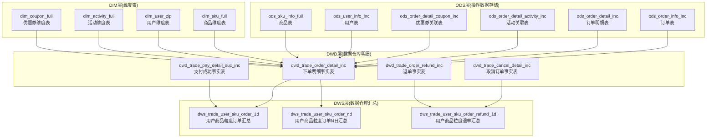
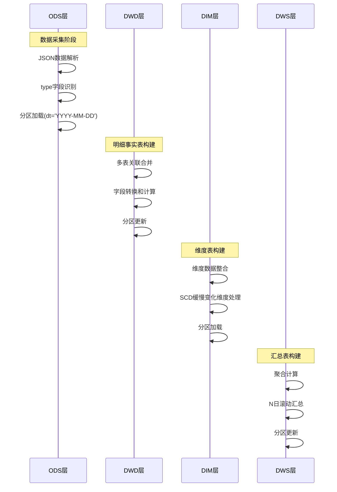
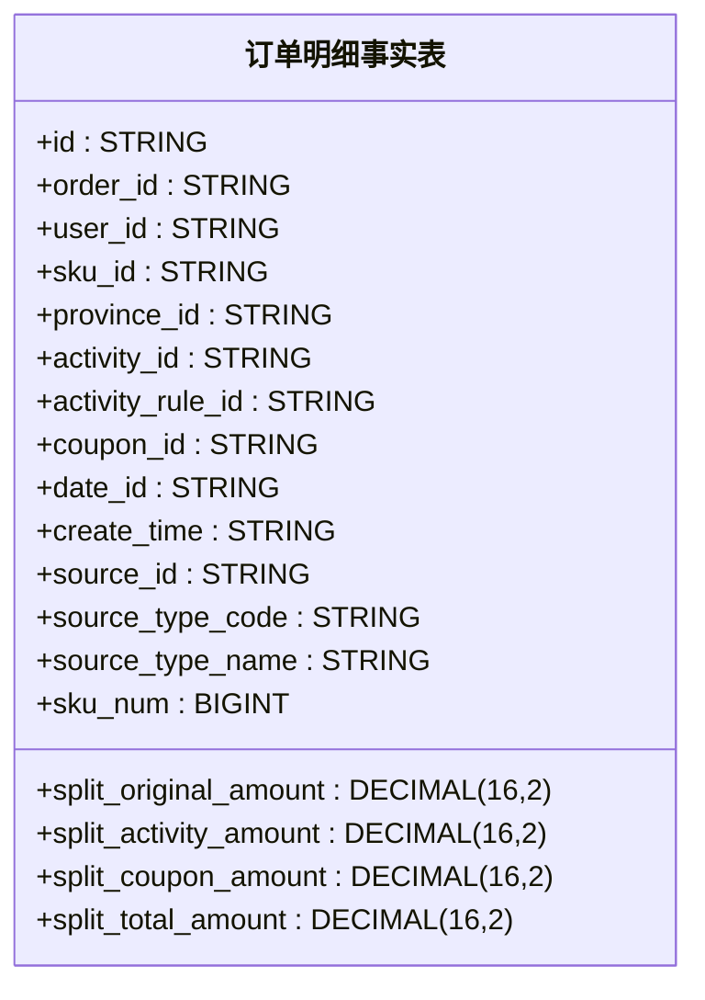
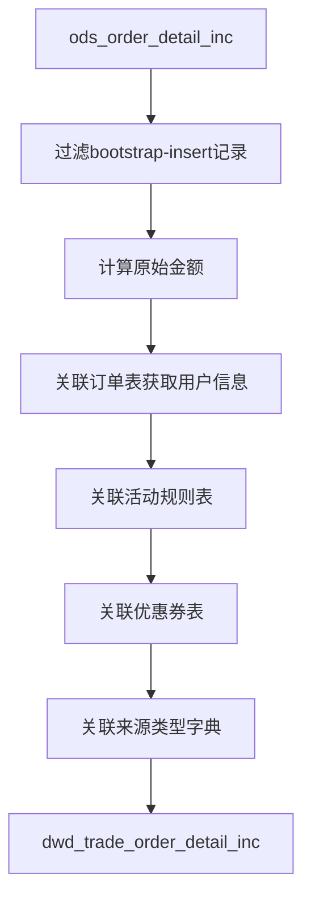
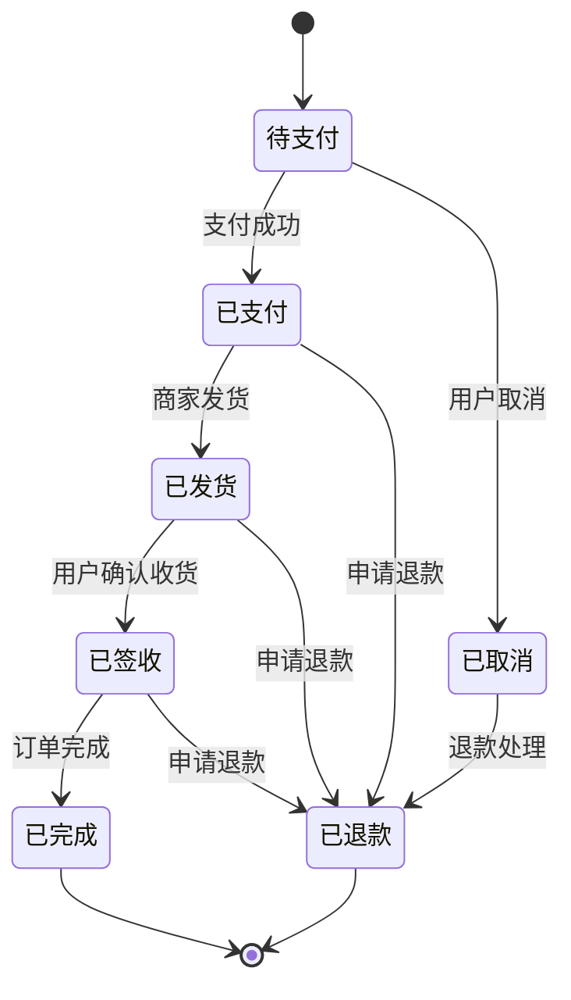
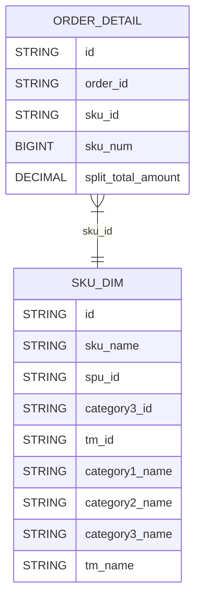
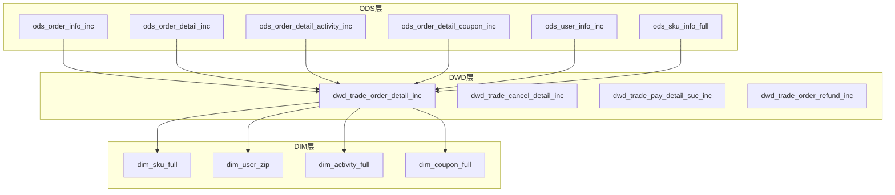

# 订单事务表

<cite>
**本文档引用的文件**
- [gmall-0906.sql](file://gmall-0906.sql)
- [basic.sql](file://basic.sql)
- [middle.sql](file://middle.sql)
- [high.sql](file://high.sql)
- [console.sql](file://console.sql)
</cite>

## 目录
1. [引言](#引言)
2. [项目结构](#项目结构)
3. [核心组件](#核心组件)
4. [架构概览](#架构概览)
5. [详细组件分析](#详细组件分析)
6. [依赖关系分析](#依赖关系分析)
7. [性能考虑](#性能考虑)
8. [故障排除指南](#故障排除指南)
9. [结论](#结论)

## 引言

本文件为HQL数据仓库订单事务表的详细技术文档。基于提供的代码库，深入解释订单相关事务表的设计原理，包括订单表(ods_order_info_inc)、订单明细表(ods_order_detail_inc)、订单明细活动关联表(ods_order_detail_activity_inc)、订单明细优惠券关联表(ods_order_detail_coupon_inc)等核心订单事务表的结构设计和业务逻辑。详细说明type字段标识不同业务类型的机制，JSON数据解析过程中的字段映射规则，以及订单状态流转的处理方式。提供完整的ETL实现示例，包括数据抽取策略、字段转换逻辑和分区加载机制。阐述订单事务表与商品维度表、用户维度表、活动维度表的关联关系，以及如何保证订单数据的一致性和完整性。

## 项目结构

该项目采用典型的Hive数据仓库分层架构，包含ODS层、DWD层、DIM层和DWS层：

**图表来源**
- [gmall-0906.sql](file://gmall-0906.sql#L378-L394)
- [gmall-0906.sql](file://gmall-0906.sql#L1282-L1308)
- [gmall-0906.sql](file://gmall-0906.sql#L1482-L1504)

**章节来源**
- [gmall-0906.sql](file://gmall-0906.sql#L21-L5663)

## 核心组件

### 订单事务表设计原理

订单事务表采用增量表设计，通过type字段标识不同的业务类型：

#### 订单表(ods_order_info_inc)
订单表采用JSON SerDe格式，包含以下核心字段：
- `type`: 变动类型标识
- `ts`: 变动时间戳
- `data`: JSON结构化数据
- `old`: 旧值映射

订单表的核心字段包括订单ID、用户ID、订单状态、支付方式、配送地址等业务关键信息。

#### 订单明细表(ods_order_detail_inc)
订单明细表记录每个订单项的详细信息：
- 商品ID、商品名称、商品图片
- 订单价格、购买数量
- 来源类型、来源ID
- 分摊金额：原始金额、活动优惠分摊、优惠券优惠分摊、最终金额分摊

#### 订单明细活动关联表(ods_order_detail_activity_inc)
建立订单明细与活动规则的关联关系：
- 订单ID、订单明细ID
- 活动ID、活动规则ID
- SKU ID、创建时间

#### 订单明细优惠券关联表(ods_order_detail_coupon_inc)
建立订单明细与优惠券的关联关系：
- 订单ID、订单明细ID
- 优惠券ID、优惠券使用ID
- SKU ID、创建时间

**章节来源**
- [gmall-0906.sql](file://gmall-0906.sql#L337-L351)
- [gmall-0906.sql](file://gmall-0906.sql#L352-L377)
- [gmall-0906.sql](file://gmall-0906.sql#L378-L394)

### type字段标识机制

type字段用于标识不同的业务变更类型：

| 类型 | 描述 | 示例场景 |
|------|------|----------|
| bootstrap-insert | 首次全量插入 | 首日数据加载 |
| insert | 新增记录 | 新订单创建 |
| update | 更新记录 | 订单状态变更、支付完成 |
| delete | 删除记录 | 订单取消 |

这种设计确保了数据变更的可追踪性和历史记录的完整性。

**章节来源**
- [gmall-0906.sql](file://gmall-0906.sql#L950-L951)
- [gmall-0906.sql](file://gmall-0906.sql#L1036-L1040)

### JSON数据解析与字段映射

系统采用JSON SerDe进行数据解析，字段映射遵循以下规则：

#### 字段提取规则
1. 使用`get_json_object()`函数提取JSON中的特定字段
2. 通过`data.`前缀访问JSON结构中的字段
3. 使用`map_keys()`函数检查old映射中的键是否存在

#### 数据类型转换
- 时间戳转换：`from_utc_timestamp(ts*1000,'GMT+8')`
- 金额字段：使用DECIMAL(16,2)精度
- 数量字段：使用BIGINT类型
- 字符串字段：统一使用STRING类型

**章节来源**
- [gmall-0906.sql](file://gmall-0906.sql#L1247-L1248)
- [gmall-0906.sql](file://gmall-0906.sql#L1429-L1432)

## 架构概览

订单事务表的ETL流程采用分层架构，确保数据质量、一致性和可维护性：

**图表来源**
- [gmall-0906.sql](file://gmall-0906.sql#L1313-L1334)
- [gmall-0906.sql](file://gmall-0906.sql#L1399-L1419)

**章节来源**
- [gmall-0906.sql](file://gmall-0906.sql#L1280-L1479)

## 详细组件分析

### 订单明细事实表(dwd_trade_order_detail_inc)

订单明细事实表是交易域的核心事实表，包含以下关键字段：

#### 结构设计

**图表来源**
- [gmall-0906.sql](file://gmall-0906.sql#L1282-L1308)

#### ETL实现流程

##### 首日加载流程

**图表来源**
- [gmall-0906.sql](file://gmall-0906.sql#L1334-L1351)

##### 每日增量加载
每日加载通过type字段识别新增记录，计算金额分摊，并关联相关维度表。

**章节来源**
- [gmall-0906.sql](file://gmall-0906.sql#L1313-L1394)
- [gmall-0906.sql](file://gmall-0906.sql#L1399-L1479)

### 订单状态流转处理

系统通过多种事实表处理订单的不同状态流转：

#### 订单生命周期管理

**图表来源**
- [gmall-0906.sql](file://gmall-0906.sql#L1482-L1504)

#### 状态变更处理机制
系统通过不同的事实表处理订单的不同状态：
- **下单明细表**: 处理待支付状态
- **取消订单表**: 处理已取消状态  
- **支付成功表**: 处理已支付状态
- **退单表**: 处理退款状态

**章节来源**
- [gmall-0906.sql](file://gmall-0906.sql#L1514-L1595)
- [gmall-0906.sql](file://gmall-0906.sql#L1618-L1679)

### 维度表关联关系

订单事务表与维度表建立了紧密的关联关系：

#### 商品维度表(dim_sku_full)

**图表来源**
- [gmall-0906.sql](file://gmall-0906.sql#L467-L493)

#### 用户维度表(dim_user_zip)
用户维度表采用SCD(缓慢变化维度)处理，支持历史数据追踪。

#### 活动维度表(dim_activity_full)
活动维度表整合活动规则信息，支持复杂的促销计算。

**章节来源**
- [gmall-0906.sql](file://gmall-0906.sql#L496-L604)
- [gmall-0906.sql](file://gmall-0906.sql#L710-L796)

## 依赖关系分析

### 表间依赖关系

**图表来源**
- [gmall-0906.sql](file://gmall-0906.sql#L1282-L1308)
- [gmall-0906.sql](file://gmall-0906.sql#L1482-L1504)

### 数据一致性保证机制

系统通过以下机制保证数据一致性：

1. **分区约束**: 所有表均按dt分区，确保数据隔离
2. **类型校验**: 通过type字段严格区分数据变更类型
3. **字段映射**: 统一的JSON字段映射规则
4. **时间戳处理**: 标准化的时间戳转换
5. **金额计算**: 精确的DECIMAL类型处理

**章节来源**
- [gmall-0906.sql](file://gmall-0906.sql#L1-L800)

## 性能考虑

### 查询优化策略

#### 分区裁剪
- 使用dt分区进行数据过滤
- 避免全表扫描
- 提高查询性能

#### 字段选择优化
- 仅选择必要的字段
- 避免SELECT *
- 减少I/O开销

#### 聚合优化
- 合理使用GROUP BY
- 避免不必要的嵌套查询
- 使用适当的聚合函数

### 存储优化

#### 文件格式选择
- ORC格式提供压缩和列式存储
- 支持索引和统计信息
- 提高查询性能

#### 分区策略
- 按日期分区
- 合理的分区大小
- 避免过多的小文件

## 故障排除指南

### 常见问题及解决方案

#### JSON解析失败
**问题**: JSON字段解析异常
**解决方案**: 
- 检查JSON格式正确性
- 验证字段路径
- 使用COALESCE处理NULL值

#### 数据类型不匹配
**问题**: DECIMAL类型转换错误
**解决方案**:
- 确保精度和标度设置正确
- 使用CAST函数进行显式转换
- 验证输入数据格式

#### 分区加载失败
**问题**: 分区目录创建失败
**解决方案**:
- 检查HDFS权限
- 验证分区值格式
- 确认目标路径存在

**章节来源**
- [basic.sql](file://basic.sql#L687-L688)
- [middle.sql](file://middle.sql#L528-L537)

## 结论

HQL数据仓库订单事务表设计体现了现代数据仓库的最佳实践：

1. **分层架构**: 清晰的ODS-DWD-DIM-DWS分层设计
2. **增量处理**: 基于type字段的增量ETL机制
3. **JSON解析**: 灵活的JSON数据处理能力
4. **维度建模**: 完整的维度表设计和关联
5. **状态管理**: 全面的订单状态流转处理
6. **性能优化**: 多层次的性能优化策略

该设计确保了订单数据的完整性、一致性和可追溯性，为后续的数据分析和报表提供了坚实的基础。通过合理的分区策略、字段映射规则和ETL流程，系统能够高效处理大规模订单数据，满足业务分析的各种需求。