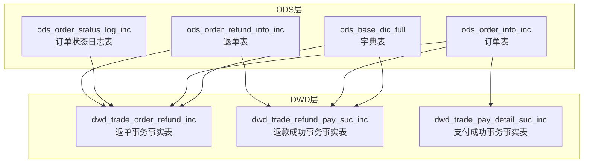
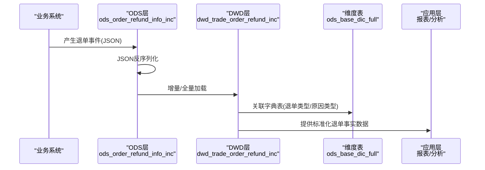
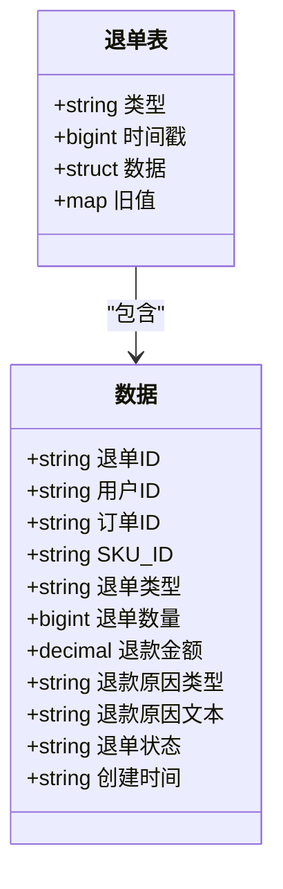
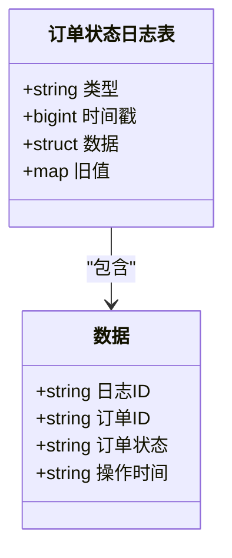
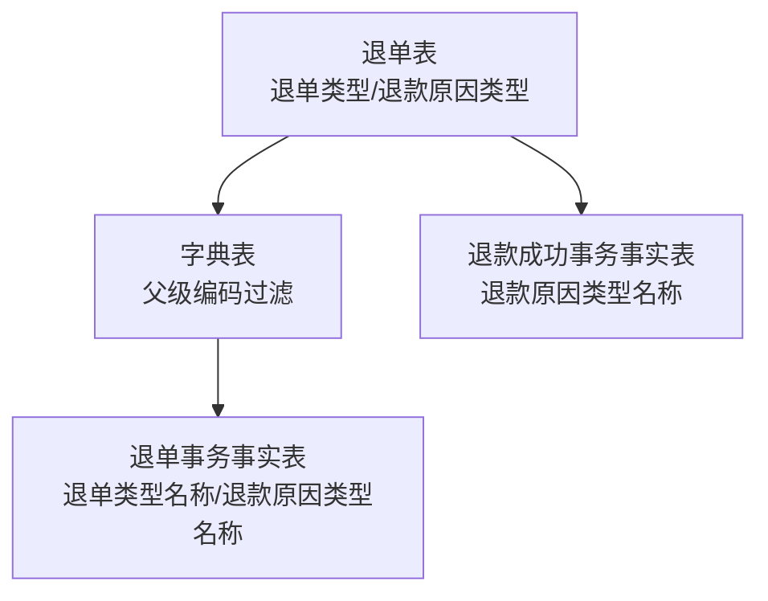
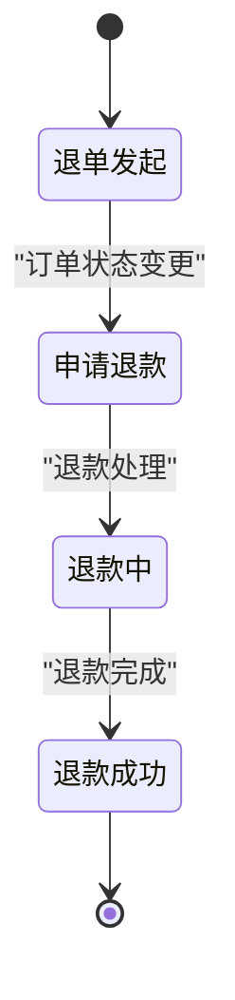
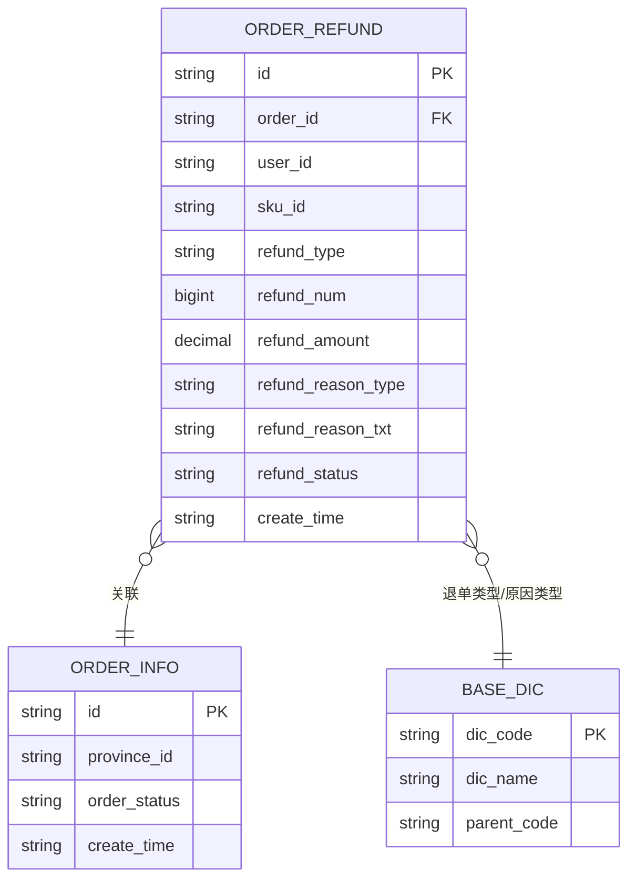
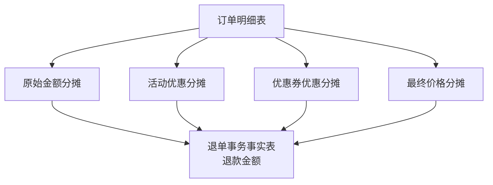
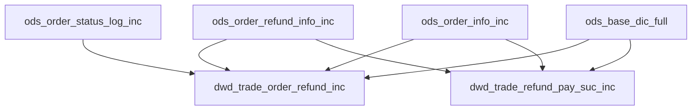

# 退单事务表

<cite>
**本文档引用的文件**
- [gmall-0906.sql](file://gmall-0906.sql)
- [console.sql](file://console.sql)
- [basic.sql](file://basic.sql)
- [high.sql](file://high.sql)
- [middle.sql](file://middle.sql)
</cite>

## 目录
1. [引言](#引言)
2. [项目结构](#项目结构)
3. [核心组件](#核心组件)
4. [架构概览](#架构概览)
5. [详细组件分析](#详细组件分析)
6. [依赖关系分析](#依赖关系分析)
7. [性能考量](#性能考量)
8. [故障排除指南](#故障排除指南)
9. [结论](#结论)

## 引言
本文件针对HQL数据仓库中的退单事务表进行全面技术文档化，重点阐释退单相关事务表的设计原理，包括退单表(ods_order_refund_info_inc)和订单状态日志表(ods_order_status_log_inc)的结构设计与业务逻辑。文档将详细说明退单类型字段的分类标准、退款原因类型的编码规则、退单状态流转的完整生命周期，并阐述退单事务表与订单事务表的关联关系、退款金额的计算与分摊机制，以及退单数据对库存和销售统计的影响。此外，文档提供完整的ETL实现示例，涵盖退单数据的抽取策略、状态更新逻辑和异常处理机制，并说明退单事务表在财务对账和运营分析中的重要作用，以及如何保证退单数据的准确性和及时性。

## 项目结构
该项目采用典型的分层数据仓库架构，包含ODS层、DWD层、DWS层和ADS层。退单事务表位于ODS层，作为最接近源系统的原始数据层，后续通过DWD层的事实表进行清洗、整合与标准化，最终服务于上层的数据应用。

图表来源
- [gmall-0906.sql](file://gmall-0906.sql#L395-L419)
- [gmall-0906.sql](file://gmall-0906.sql#L1930-L2100)

章节来源
- [gmall-0906.sql](file://gmall-0906.sql#L395-L419)

## 核心组件
本节聚焦于退单事务表的核心组件，包括退单表、订单状态日志表、字典表以及相关的DWD层事实表。

- 退单表(ods_order_refund_info_inc)
  - 字段：包含退单标识、用户标识、订单标识、SKU标识、退单类型、退单数量、退款金额、退款原因类型、退款原因文本、退单状态、创建时间等。
  - 数据来源：业务系统产生的退单事件，通过JSON序列化存储，便于灵活扩展字段。
  - 分区：按日期分区(dt)，便于增量加载与维护。

- 订单状态日志表(ods_order_status_log_inc)
  - 字段：包含日志标识、订单标识、订单状态、操作时间等。
  - 作用：记录订单状态的变更历史，支撑退单状态流转的审计与追踪。

- 字典表(ods_base_dic_full)
  - 字段：包含编码、名称、父级编码、创建时间、修改时间等。
  - 作用：为退单类型、退款原因类型等提供标准化的编码与名称映射。

- DWD层事实表
  - 退单事务事实表(dwd_trade_order_refund_inc)：将退单表与订单表、字典表进行关联，生成标准化的退单事实数据。
  - 退款成功事务事实表(dwd_trade_refund_pay_suc_inc)：记录退款成功的支付流水，用于财务对账与核销。

章节来源
- [gmall-0906.sql](file://gmall-0906.sql#L395-L419)
- [gmall-0906.sql](file://gmall-0906.sql#L1930-L2100)

## 架构概览
退单事务表的架构遵循“ODS增量/全量 + DWD清洗 + DWS/ADS应用”的分层设计。ODS层负责接收原始退单事件；DWD层进行数据清洗、标准化与维度关联；DWS/ADS层基于事实表提供报表与分析能力。

图表来源
- [gmall-0906.sql](file://gmall-0906.sql#L1956-L2076)
- [gmall-0906.sql](file://gmall-0906.sql#L2104-L2233)

## 详细组件分析

### 退单表(ods_order_refund_info_inc)结构设计
退单表采用JSON SerDe格式，字段以结构体形式组织，便于灵活扩展与维护。关键字段包括：
- 类型(type)：标识退单事件的变更类型(如新增、更新、删除)。
- 时间戳(ts)：事件发生的时间戳。
- 数据(data)：退单详情，包含用户ID、订单ID、SKU ID、退单类型、退单数量、退款金额、退款原因类型、退款原因文本、退单状态、创建时间等。
- 旧值(old)：用于增量更新时记录变更前的状态。

图表来源
- [gmall-0906.sql](file://gmall-0906.sql#L395-L407)

章节来源
- [gmall-0906.sql](file://gmall-0906.sql#L395-L407)

### 订单状态日志表(ods_order_status_log_inc)结构设计
订单状态日志表记录订单状态的历史变更，字段包括：
- 类型(type)：事件类型。
- 时间戳(ts)：事件发生的时间戳。
- 数据(data)：包含日志ID、订单ID、订单状态、操作时间。
- 旧值(old)：变更前状态。

图表来源
- [gmall-0906.sql](file://gmall-0906.sql#L409-L419)

章节来源
- [gmall-0906.sql](file://gmall-0906.sql#L409-L419)

### 退单类型与退款原因类型编码规则
退单类型与退款原因类型通过字典表进行标准化管理。字典表包含编码、名称、父级编码等字段，退单类型与退款原因类型分别对应不同的父级编码(parent_code)。

- 退单类型编码：来源于字典表中特定父级编码的子项，通过退单表中的退单类型字段与字典表进行关联，生成退单类型名称。
- 退款原因类型编码：同样来源于字典表，通过退款原因类型字段与字典表关联，生成退款原因类型名称。

图表来源
- [gmall-0906.sql](file://gmall-0906.sql#L1988-L2056)
- [gmall-0906.sql](file://gmall-0906.sql#L2144-L2233)

章节来源
- [gmall-0906.sql](file://gmall-0906.sql#L1988-L2056)
- [gmall-0906.sql](file://gmall-0906.sql#L2144-L2233)

### 退单状态流转生命周期
退单状态流转通过订单状态日志表与退单表共同记录。典型流程包括：
- 退单发起：退单表记录退单事件，状态为初始状态。
- 订单状态变更：订单状态日志表记录订单状态的变更，如从“已支付”到“申请退款”再到“退款成功”。
- 退款确认：退款成功事务事实表记录退款成功的支付流水，完成对账闭环。

图表来源
- [gmall-0906.sql](file://gmall-0906.sql#L2043-L2047)
- [gmall-0906.sql](file://gmall-0906.sql#L2193-L2195)

章节来源
- [gmall-0906.sql](file://gmall-0906.sql#L2043-L2047)
- [gmall-0906.sql](file://gmall-0906.sql#L2193-L2195)

### 退单事务表与订单事务表的关联关系
退单事务表与订单事务表通过订单ID进行关联，DWD层的事实表进一步整合字典表与订单表，形成标准化的退单事实数据。

图表来源
- [gmall-0906.sql](file://gmall-0906.sql#L1975-L2016)
- [gmall-0906.sql](file://gmall-0906.sql#L2149-L2152)

章节来源
- [gmall-0906.sql](file://gmall-0906.sql#L1975-L2016)
- [gmall-0906.sql](file://gmall-0906.sql#L2149-L2152)

### 退款金额的计算与分摊机制
退款金额的计算与分摊机制在DWD层的事实表中体现：
- 原始金额分摊：订单明细表中的原始金额按SKU进行分摊。
- 活动优惠分摊：活动优惠按SKU进行分摊。
- 优惠券优惠分摊：优惠券优惠按SKU进行分摊。
- 最终价格分摊：最终价格按SKU进行分摊。

图表来源
- [gmall-0906.sql](file://gmall-0906.sql#L1747-L1750)
- [gmall-0906.sql](file://gmall-0906.sql#L2064-L2072)

章节来源
- [gmall-0906.sql](file://gmall-0906.sql#L1747-L1750)
- [gmall-0906.sql](file://gmall-0906.sql#L2064-L2072)

### 退单数据对库存与销售统计的影响
退单数据对库存与销售统计的影响主要体现在：
- 库存影响：退单成功后，对应SKU的库存应相应增加，以便后续销售统计的准确性。
- 销售统计：退单数据需从销售统计中剔除相应的销售额与销售量，确保销售报表的真实与准确。

章节来源
- [console.sql](file://console.sql#L5048-L5084)

## 依赖关系分析
退单事务表的依赖关系主要体现在ODS层与DWD层之间的数据流，以及与字典表的关联。

图表来源
- [gmall-0906.sql](file://gmall-0906.sql#L1956-L2076)
- [gmall-0906.sql](file://gmall-0906.sql#L2104-L2233)

章节来源
- [gmall-0906.sql](file://gmall-0906.sql#L1956-L2076)
- [gmall-0906.sql](file://gmall-0906.sql#L2104-L2233)

## 性能考量
- 分区策略：退单表按日期分区，便于增量加载与维护，减少扫描范围。
- JSON SerDe：采用JSON SerDe格式，便于灵活扩展字段，但需注意解析成本。
- 维度关联：通过字典表进行维度关联，建议在DWD层进行预关联，减少重复计算。
- 增量更新：利用old字段记录变更前状态，支持高效的增量更新与去重。

## 故障排除指南
- 字段缺失或解析失败：检查JSON字段是否完整，确认SerDe配置正确。
- 编码不一致：核对字典表中的编码与退单表中的编码是否一致，确保关联正确。
- 状态不一致：检查订单状态日志表与退单表的状态一致性，排查状态变更逻辑。
- 性能问题：优化分区策略与索引，减少不必要的全表扫描。

## 结论
退单事务表在数据仓库中扮演着关键角色，通过对退单事件的标准化记录与处理，为财务对账、运营分析与库存管理提供了可靠的数据基础。通过合理的分层设计、严格的编码规范与完善的ETL流程，能够确保退单数据的准确性与时效性，从而支撑业务决策与运营优化。