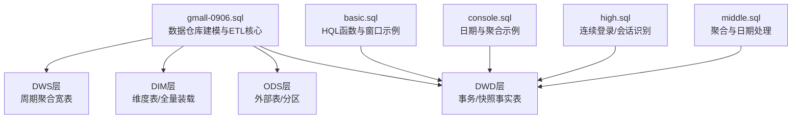
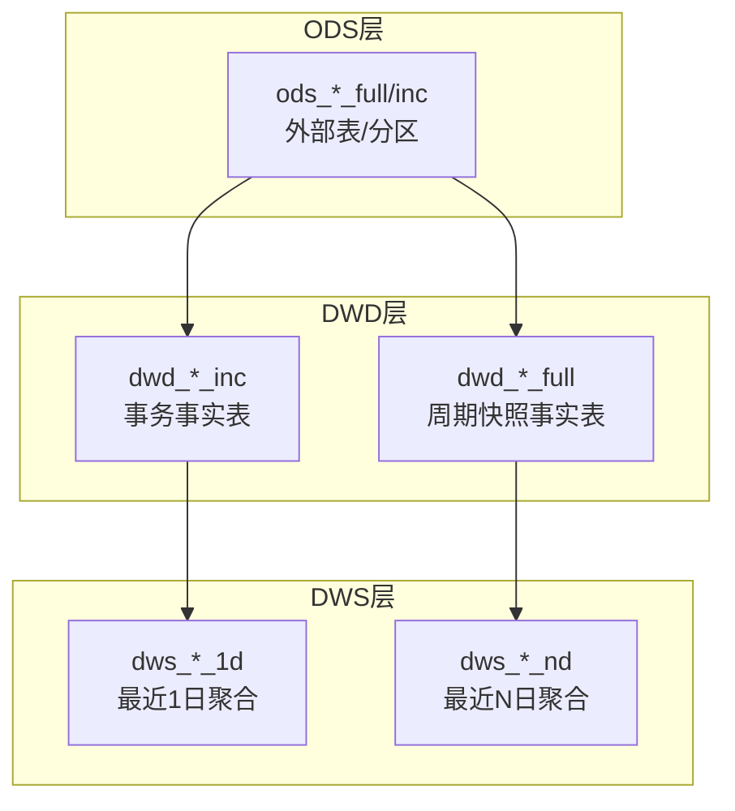
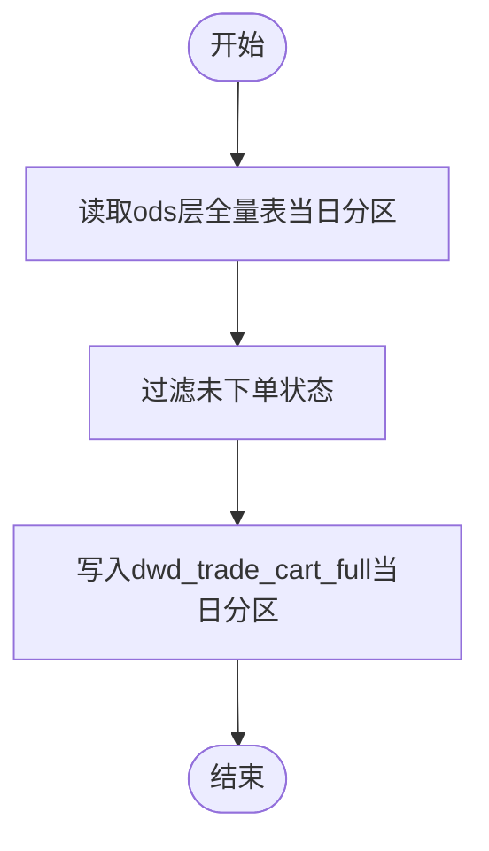
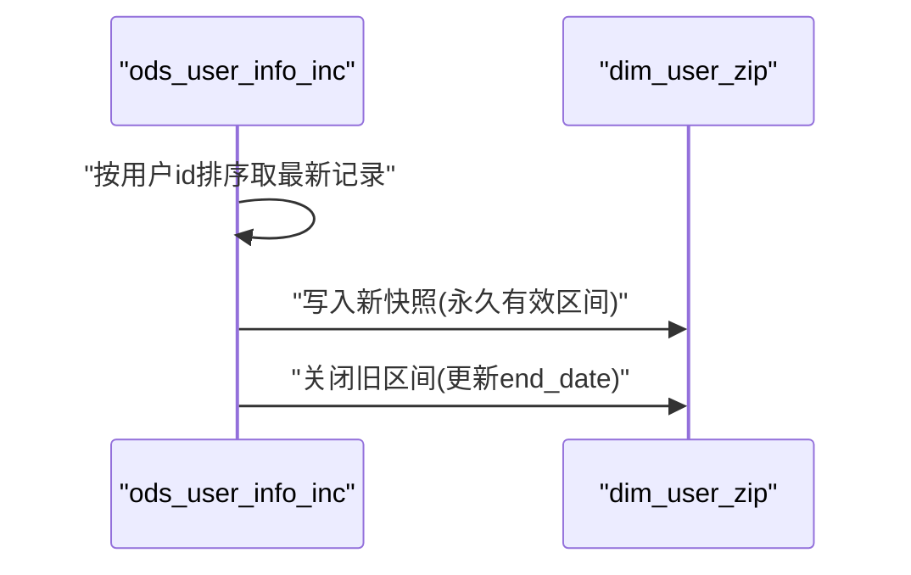
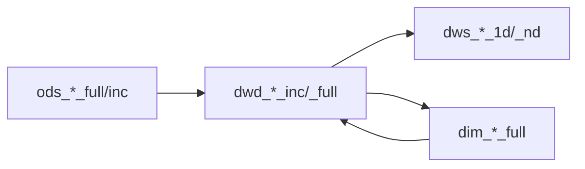

# 周期快照表

<cite>
**本文引用的文件**
- [gmall-0906.sql](file://gmall-0906.sql)
- [basic.sql](file://basic.sql)
- [console.sql](file://console.sql)
- [high.sql](file://high.sql)
- [middle.sql](file://middle.sql)
</cite>

## 目录
1. [引言](#引言)
2. [项目结构](#项目结构)
3. [核心组件](#核心组件)
4. [架构总览](#架构总览)
5. [详细组件分析](#详细组件分析)
6. [依赖分析](#依赖分析)
7. [性能考量](#性能考量)
8. [故障排查指南](#故障排查指南)
9. [结论](#结论)
10. [附录](#附录)

## 引言
本技术文档围绕HQL数据仓库中的周期快照表展开，系统阐述DWD层周期快照表的设计理念、命名规范、建模策略、采集逻辑、去重机制、历史保留策略、分区管理与更新策略，并对比事务表与快照表的差异，给出一致性保障与性能优化建议。本文以仓库中的实际SQL脚本为依据，结合HQL常见模式，帮助读者快速理解并落地周期快照表的建设。

## 项目结构
仓库包含多个SQL脚本，其中gmall-0906.sql是数据仓库建模与ETL的核心文件，涵盖ODS/DIM/DWD/DWS等各层表定义与装载逻辑；basic.sql、console.sql、high.sql、middle.sql提供了HQL常用函数、窗口函数、日期处理、连续登录/会话识别等实践案例，可作为周期快照表ETL实现的参考素材。

图示来源
- [gmall-0906.sql](file://gmall-0906.sql#L1-L200)
- [basic.sql](file://basic.sql#L1-L120)
- [console.sql](file://console.sql#L1-L120)
- [high.sql](file://high.sql#L1-L60)
- [middle.sql](file://middle.sql#L1-L60)

章节来源
- [gmall-0906.sql](file://gmall-0906.sql#L1-L200)

## 核心组件
- DWD层周期快照事实表：以“dwd_*_full”命名，记录某一时间点的状态集合，典型如交易域购物车周期快照表。
- DWD层事务事实表：以“dwd_*_inc”命名，记录业务事件的增量变更，典型如订单明细、支付成功、退单等。
- DWS层周期聚合宽表：以“dws_*_nd”命名，基于DWD层事务表按自然日滚动聚合，形成近N日聚合视图。

章节来源
- [gmall-0906.sql](file://gmall-0906.sql#L2236-L2265)
- [gmall-0906.sql](file://gmall-0906.sql#L1174-L1278)
- [gmall-0906.sql](file://gmall-0906.sql#L3792-L3855)

## 架构总览
DWD层的周期快照表与事务表共同构成“状态+事件”的双轨数据体系。事务表负责高频、细粒度的事件采集，快照表负责低频、稳定的状态归档。二者通过分区dt实现时间维度的统一管理，并在DWS层以“近N日”口径进行聚合。

图示来源
- [gmall-0906.sql](file://gmall-0906.sql#L1174-L1278)
- [gmall-0906.sql](file://gmall-0906.sql#L2236-L2265)
- [gmall-0906.sql](file://gmall-0906.sql#L3792-L3855)

## 详细组件分析

### 周期快照表设计与命名规范
- 表命名规范
  - 事务事实表：dwd_*_inc，如“dwd_trade_cart_add_inc”、“dwd_trade_order_detail_inc”等，记录事件级数据。
  - 周期快照表：dwd_*_full，如“dwd_trade_cart_full”，记录某一天的完整状态。
  - 周期聚合宽表：dws_*_nd，如“dws_trade_user_sku_order_nd”，记录近N日聚合指标。
- 设计理念
  - 快照表面向“某一时点”的静态状态，适合离线报表与趋势分析；事务表面向“事件流”的动态变化，适合实时/准实时监控。
  - 快照表通常按dt分区，分区粒度为自然日，便于按日期回溯与对比。

章节来源
- [gmall-0906.sql](file://gmall-0906.sql#L2236-L2265)
- [gmall-0906.sql](file://gmall-0906.sql#L1174-L1278)
- [gmall-0906.sql](file://gmall-0906.sql#L3792-L3855)

### 交易域购物车周期快照表（dwd_trade_cart_full）
- 表结构要点
  - 字段包含主键标识、用户与商品维度、状态字段（如加购件数），并按dt分区。
- 数据生成频率
  - 日频全量装载，每日基于ods层全量表生成当日快照。
- 存储方式
  - 使用ORC格式并启用压缩，提升读写性能与存储效率。
- 采集逻辑
  - 首日全量装载：从ods层全量表读取当日数据，过滤未下单状态，写入dwd层快照表。
  - 每日装载：基于ods层全量表当日分区，按上述逻辑生成新快照。

图示来源
- [gmall-0906.sql](file://gmall-0906.sql#L2254-L2265)

章节来源
- [gmall-0906.sql](file://gmall-0906.sql#L2236-L2265)

### 用户维度表（dim_user_zip）的周期快照建模
- 表结构要点
  - 包含用户关键属性与有效期区间(start_date/end_date)，用于刻画用户状态的历史有效性。
- 数据生成频率
  - 首日全量装载：从ods层增量表中提取bootstrap-insert事件，写入永久有效区间。
  - 每日装载：基于ods层增量表按用户维度去重最新记录，生成新快照并关闭旧区间。
- 历史保留策略
  - 通过start_date/end_date维护历史版本，实现缓慢变更维度的历史追溯。

图示来源
- [gmall-0906.sql](file://gmall-0906.sql#L909-L1169)

章节来源
- [gmall-0906.sql](file://gmall-0906.sql#L909-L1169)

### 商品维度表（dim_sku_full）的周期快照建模
- 表结构要点
  - 聚合商品相关信息（品牌、品类、属性等），按dt分区。
- 数据生成频率
  - 日频全量装载：基于ods层多源表join生成当日维度快照。
- 存储方式
  - ORC格式+压缩，提升查询性能。

章节来源
- [gmall-0906.sql](file://gmall-0906.sql#L466-L605)

### 事务表与快照表的差异与协作
- 事务表（dwd_*_inc）
  - 记录事件的插入/更新/删除，支持增量处理与回放。
  - 典型表：dwd_trade_order_detail_inc、dwd_trade_pay_detail_suc_inc、dwd_trade_order_refund_inc等。
- 快照表（dwd_*_full）
  - 记录某一日的完整状态，适合离线分析与对比。
  - 典型表：dwd_trade_cart_full、dim_user_zip等。
- 协作关系
  - 事务表驱动DWS层近N日聚合；快照表支撑跨日对比与历史回溯。

章节来源
- [gmall-0906.sql](file://gmall-0906.sql#L1174-L1278)
- [gmall-0906.sql](file://gmall-0906.sql#L2236-L2265)

### 采集逻辑与去重机制
- 去重策略
  - 使用窗口函数rank()按时间戳对同一用户/商品的最新记录去重，确保快照表的唯一性。
  - 对于用户登录/注册等事件，采用“首日注册/登录”场景，按rn=1抽取首条记录，避免重复。
- 采集流程
  - 读取ods层当日分区数据 → 去重/清洗 → 关联维度 → 写入dwd层分区。

章节来源
- [gmall-0906.sql](file://gmall-0906.sql#L1081-L1169)
- [gmall-0906.sql](file://gmall-0906.sql#L3200-L3280)

### 历史数据保留策略
- 维度慢变：通过start_date/end_date维护历史版本，支持任意日期的快照回溯。
- 事务表：按dt分区滚动清理，保留近N日数据以平衡成本与可追溯性。
- 快照表：按dt分区存储，历史数据长期保留，便于对比分析。

章节来源
- [gmall-0906.sql](file://gmall-0906.sql#L909-L1169)
- [gmall-0906.sql](file://gmall-0906.sql#L3792-L3855)

### 分区管理与数据更新策略
- 分区管理
  - 所有DWD/DWS层事实表均按dt分区，分区键为自然日字符串。
  - 动态分区开启（如hive.exec.dynamic.partition.mode=nonstrict）以支持按dt写入。
- 更新策略
  - 首日全量：从ods层bootstrap-insert事件生成初始快照。
  - 每日增量：基于ods层当日增量事件，生成当日快照并合并历史区间。
  - 聚合策略：DWS层按近7日/30日滚动聚合，使用if(dt>=date_add(dt,-6),...,0)进行滑动求和。

章节来源
- [gmall-0906.sql](file://gmall-0906.sql#L956-L1078)
- [gmall-0906.sql](file://gmall-0906.sql#L4109-L4127)

### ETL实现示例（基于仓库脚本）
- 交易域购物车周期快照
  - 首日全量装载：读取ods层全量表当日分区，过滤未下单状态，写入dwd层。
  - 每日装载：基于ods层全量表当日分区，按上述逻辑生成新快照。
- 用户维度表周期快照
  - 首日：提取bootstrap-insert事件，写入永久有效区间。
  - 每日：按用户维度去重最新记录，生成新快照并关闭旧区间。
- DWS层近N日聚合
  - 基于dws_*_1d表，使用if(dt>=date_add(dt,-6),...,0)进行7日滑动聚合，再按用户/商品/省份等维度group by生成dws_*_nd。

章节来源
- [gmall-0906.sql](file://gmall-0906.sql#L2254-L2265)
- [gmall-0906.sql](file://gmall-0906.sql#L956-L1078)
- [gmall-0906.sql](file://gmall-0906.sql#L4109-L4127)

## 依赖分析
- 维度依赖
  - 快照表构建常依赖dim_*全量表（如dim_sku_full、dim_province_full），需确保dim层按dt分区全量装载。
- 事务表依赖
  - DWS层近N日聚合依赖dwd_*_inc事务表，需保证事务表按dt分区的完整性与正确性。
- 分区依赖
  - 所有表按dt分区，上游ods层需按dt分区组织数据，下游dwd/dws层按dt分区写入。

图示来源
- [gmall-0906.sql](file://gmall-0906.sql#L466-L605)
- [gmall-0906.sql](file://gmall-0906.sql#L1174-L1278)
- [gmall-0906.sql](file://gmall-0906.sql#L3792-L3855)

章节来源
- [gmall-0906.sql](file://gmall-0906.sql#L466-L605)
- [gmall-0906.sql](file://gmall-0906.sql#L1174-L1278)
- [gmall-0906.sql](file://gmall-0906.sql#L3792-L3855)

## 性能考量
- 存储格式与压缩
  - ORC格式+snappy压缩，显著降低I/O与存储成本，提升扫描与聚合性能。
- 分区裁剪
  - 按dt分区读写，充分利用分区裁剪，避免全表扫描。
- 去重与窗口函数
  - 使用rank()等窗口函数进行去重，减少重复数据写入，提高后续聚合效率。
- 动态分区
  - 开启动态分区模式，减少手工分区管理成本，提升写入吞吐。

章节来源
- [gmall-0906.sql](file://gmall-0906.sql#L850-L906)
- [gmall-0906.sql](file://gmall-0906.sql#L956-L1078)

## 故障排查指南
- 常见问题
  - 分区缺失：检查ods层是否按dt分区写入，确认dwd/dws层分区是否正确。
  - 去重异常：核对rank()排序字段与时间戳字段，确保最新记录被保留。
  - 维度缺失：确认dim_*_full是否按dt全量装载，且与dwd层关联键一致。
- 调试建议
  - 先验证ods到dwd的单步装载，再进行dws聚合。
  - 使用小分区或限定日期范围进行回归测试，定位问题范围。

章节来源
- [gmall-0906.sql](file://gmall-0906.sql#L956-L1078)
- [gmall-0906.sql](file://gmall-0906.sql#L4109-L4127)

## 结论
周期快照表通过“某一日状态”的视角，为离线分析与历史对比提供稳定数据基座；配合事务表的事件追踪能力，形成“状态+事件”的完整数据画像。遵循统一的命名规范、分区策略与去重机制，可在保证数据一致性的同时，获得良好的性能与可维护性。

## 附录
- 命名规范速查
  - 事务事实表：dwd_*_inc
  - 周期快照表：dwd_*_full
  - 周期聚合宽表：dws_*_nd
- 关键实现参考
  - 快照表装载：dwd_trade_cart_full、dim_user_zip
  - 事务表装载：dwd_trade_order_detail_inc、dwd_trade_pay_detail_suc_inc、dwd_trade_order_refund_inc
  - 聚合宽表：dws_trade_user_sku_order_nd、dws_trade_user_order_nd

章节来源
- [gmall-0906.sql](file://gmall-0906.sql#L2236-L2265)
- [gmall-0906.sql](file://gmall-0906.sql#L909-L1169)
- [gmall-0906.sql](file://gmall-0906.sql#L1174-L1278)
- [gmall-0906.sql](file://gmall-0906.sql#L3792-L3855)