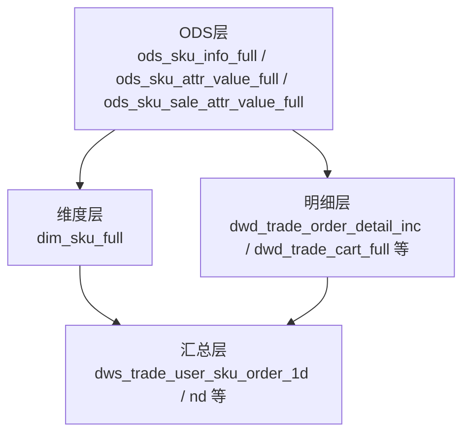
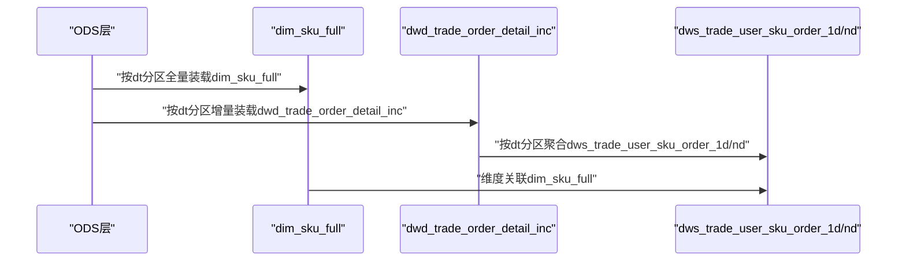
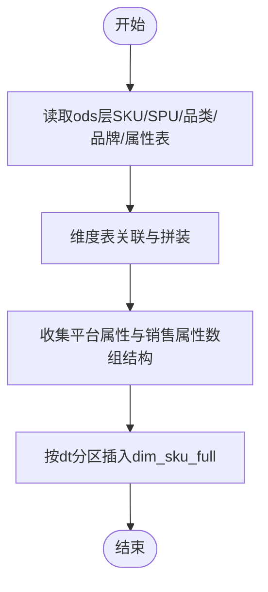
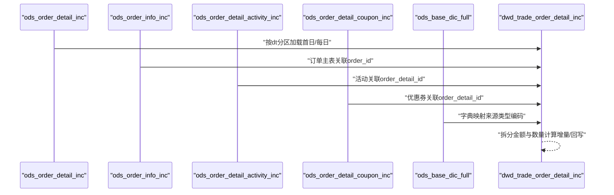
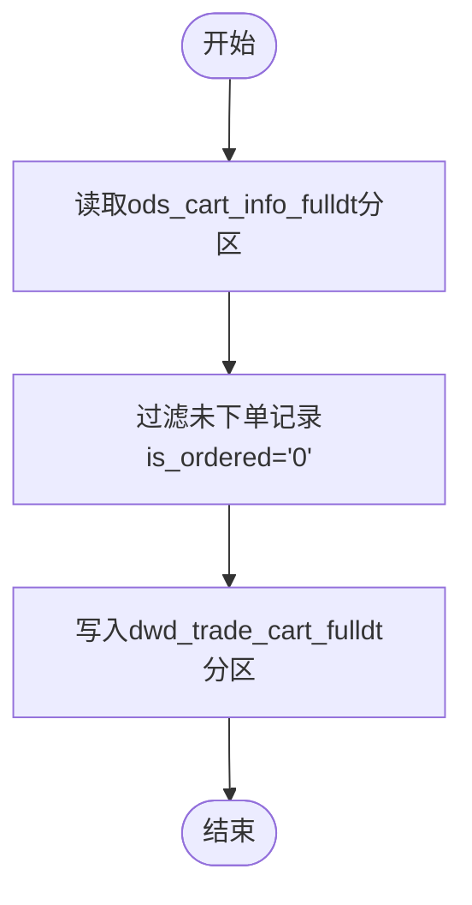
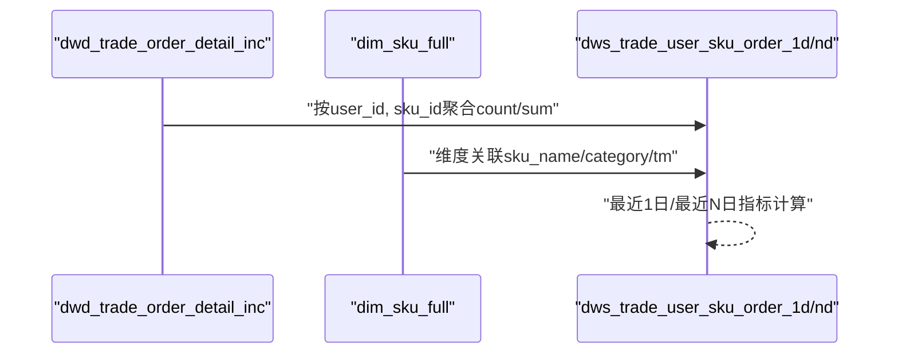
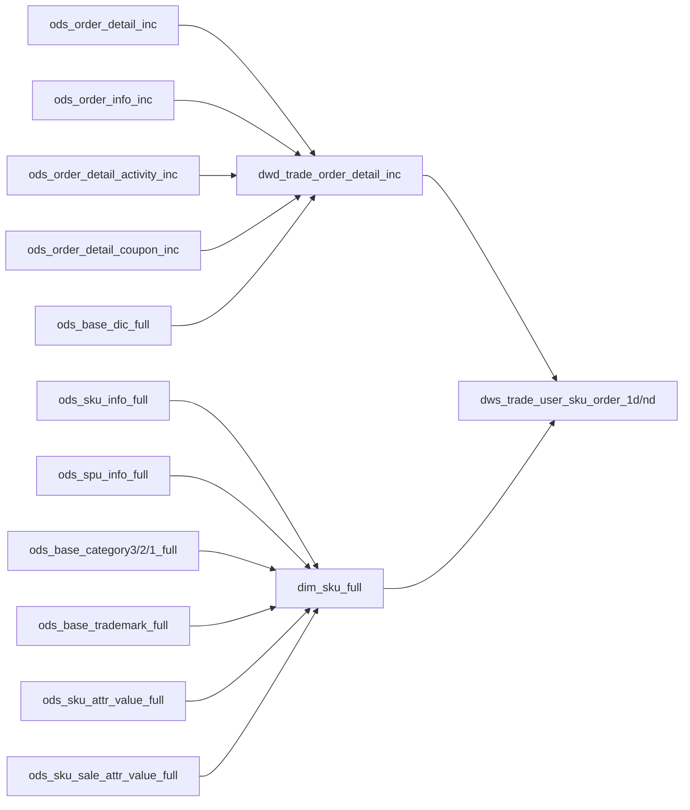

# 商品快照表

<cite>
**本文引用的文件**
- [gmall-0906.sql](file://gmall-0906.sql)
- [console.sql](file://console.sql)
</cite>

## 目录
1. [引言](#引言)
2. [项目结构](#项目结构)
3. [核心组件](#核心组件)
4. [架构总览](#架构总览)
5. [详细组件分析](#详细组件分析)
6. [依赖分析](#依赖分析)
7. [性能考量](#性能考量)
8. [故障排查指南](#故障排查指南)
9. [结论](#结论)
10. [附录](#附录)

## 引言
本文件围绕HQL数据仓库中的商品快照表展开，系统化阐述商品快照表的设计原理、业务价值与技术实现，重点覆盖以下方面：
- 商品快照表与商品增量表的差异、数据结构设计、更新策略与存储优化
- 商品状态数据的采集逻辑、更新频率与历史版本管理
- 商品维度表的维护策略、数据一致性保障与性能调优
- ETL实现流程（抽取、清洗、转换、加载）
- 商品快照表在商品分析、价格监控与库存管理中的关键作用

## 项目结构
本仓库包含多份SQL脚本，其中与商品快照表密切相关的主要是商品维度表与交易域事实表的建模与装载逻辑。整体结构以ODS层（外部数据源）、DWD层（事务事实表）、DWS层（主题宽表）为主线，商品维度表作为维度支撑贯穿于多类宽表与分析指标。

图示来源
- [gmall-0906.sql](file://gmall-0906.sql#L218-L489)
- [gmall-0906.sql](file://gmall-0906.sql#L1280-L1393)
- [gmall-0906.sql](file://gmall-0906.sql#L2236-L2264)
- [gmall-0906.sql](file://gmall-0906.sql#L3652-L3791)

章节来源
- [gmall-0906.sql](file://gmall-0906.sql#L218-L489)
- [gmall-0906.sql](file://gmall-0906.sql#L1280-L1393)
- [gmall-0906.sql](file://gmall-0906.sql#L2236-L2264)
- [gmall-0906.sql](file://gmall-0906.sql#L3652-L3791)

## 核心组件
- 商品维度表 dim_sku_full：汇聚SKU、SPU、品类、品牌等静态维度信息，并按自然日分区，用于后续事实表与宽表的维度关联。
- 交易域事务事实表 dwd_trade_order_detail_inc：记录订单明细的事务事实，包含价格、优惠分摊、来源类型等，按自然日分区。
- 交易域购物车周期快照 dwd_trade_cart_full：记录每日有效的购物车快照，按自然日分区。
- 交易域用户商品粒度汇总 dws_trade_user_sku_order_1d / nd：基于事务事实表与维度表生成的用户-商品粒度指标宽表。

章节来源
- [gmall-0906.sql](file://gmall-0906.sql#L466-L493)
- [gmall-0906.sql](file://gmall-0906.sql#L1280-L1393)
- [gmall-0906.sql](file://gmall-0906.sql#L2236-L2264)
- [gmall-0906.sql](file://gmall-0906.sql#L3652-L3791)

## 架构总览
商品快照表在本项目中体现为两类：
- 商品维度快照：dim_sku_full，按日全量装载，提供稳定的商品维度视图。
- 商品交易快照：dwd_trade_order_detail_inc 与 dwd_trade_cart_full，分别记录订单与购物车的事务快照，按日分区，便于回溯与重算。

图示来源
- [gmall-0906.sql](file://gmall-0906.sql#L466-L493)
- [gmall-0906.sql](file://gmall-0906.sql#L1280-L1393)
- [gmall-0906.sql](file://gmall-0906.sql#L3652-L3791)

## 详细组件分析

### 商品维度表 dim_sku_full（商品快照）
- 设计要点
  - 聚合SKU、SPU、品类、品牌等静态维度，形成稳定的商品维度快照。
  - 采用ORC存储并启用snappy压缩，提升IO与查询性能。
  - 按dt分区，每日全量装载，确保维度一致性与可追溯性。
- 数据生成机制
  - 以ods_sku_info_full为基础，关联ods_spu_info_full、ods_base_categoryX_full、ods_base_trademark_full、ods_sku_attr_value_full、ods_sku_sale_attr_value_full等表，完成维度拼装与数组结构的收集。
  - 使用collect_set与named_struct等聚合与结构化函数，保证维度字段的完整性与一致性。
- 更新策略
  - 首日与每日均执行全量装载，确保维度表的完整性与时效性。
  - 通过分区dt控制装载范围，便于按日重跑与回溯。

图示来源
- [gmall-0906.sql](file://gmall-0906.sql#L466-L493)
- [gmall-0906.sql](file://gmall-0906.sql#L496-L604)

章节来源
- [gmall-0906.sql](file://gmall-0906.sql#L466-L493)
- [gmall-0906.sql](file://gmall-0906.sql#L496-L604)

### 交易域下单事务事实表 dwd_trade_order_detail_inc（商品交易快照）
- 设计要点
  - 记录订单明细的事务事实，包含价格、优惠分摊、来源类型等字段，按dt分区。
  - 通过ods_order_detail_inc、ods_order_info_inc、ods_order_detail_activity_inc、ods_order_detail_coupon_inc与ods_base_dic_full等表进行多表关联与清洗。
- 数据生成机制
  - 首日：使用bootstrap-insert类型进行全量装载。
  - 每日：根据type与old字段判断insert/update，计算拆分金额与数量差异，仅加载有变更的记录。
- 更新策略
  - 动态分区模式开启，按dt分区写入，支持增量与回溯重算。

图示来源
- [gmall-0906.sql](file://gmall-0906.sql#L1280-L1393)
- [gmall-0906.sql](file://gmall-0906.sql#L1396-L1479)

章节来源
- [gmall-0906.sql](file://gmall-0906.sql#L1280-L1393)
- [gmall-0906.sql](file://gmall-0906.sql#L1396-L1479)

### 交易域购物车周期快照 dwd_trade_cart_full（商品交易快照）
- 设计要点
  - 记录每日有效的购物车快照，过滤已下单的记录（is_ordered='0'），按dt分区。
- 数据生成机制
  - 从ods_cart_info_full读取当日数据，仅保留未下单的购物车记录，形成每日快照。

图示来源
- [gmall-0906.sql](file://gmall-0906.sql#L2236-L2264)

章节来源
- [gmall-0906.sql](file://gmall-0906.sql#L2236-L2264)

### 商品维度表与交易域宽表的关系（dws_trade_user_sku_order_1d/nd）
- 设计要点
  - 基于dwd_trade_order_detail_inc与dim_sku_full进行维度关联，生成用户-商品粒度的指标宽表。
  - 支持最近1日与最近N日的指标聚合，便于趋势分析与同比环比。
- 数据生成机制
  - 首日：按dt分区聚合并关联dim_sku_full。
  - 每日：仅聚合当日订单明细，再与dim_sku_full进行关联。

图示来源
- [gmall-0906.sql](file://gmall-0906.sql#L3652-L3791)
- [gmall-0906.sql](file://gmall-0906.sql#L3792-L3854)

章节来源
- [gmall-0906.sql](file://gmall-0906.sql#L3652-L3791)
- [gmall-0906.sql](file://gmall-0906.sql#L3792-L3854)

## 依赖分析
- 维度依赖
  - dim_sku_full依赖ods_sku_info_full、ods_spu_info_full、ods_base_categoryX_full、ods_base_trademark_full、ods_sku_attr_value_full、ods_sku_sale_attr_value_full。
- 事实表依赖
  - dwd_trade_order_detail_inc依赖ods_order_detail_inc、ods_order_info_inc、ods_order_detail_activity_inc、ods_order_detail_coupon_inc、ods_base_dic_full。
- 宽表依赖
  - dws_trade_user_sku_order_1d/nd依赖dwd_trade_order_detail_inc与dim_sku_full。

图示来源
- [gmall-0906.sql](file://gmall-0906.sql#L218-L489)
- [gmall-0906.sql](file://gmall-0906.sql#L1280-L1393)
- [gmall-0906.sql](file://gmall-0906.sql#L3652-L3791)

章节来源
- [gmall-0906.sql](file://gmall-0906.sql#L218-L489)
- [gmall-0906.sql](file://gmall-0906.sql#L1280-L1393)
- [gmall-0906.sql](file://gmall-0906.sql#L3652-L3791)

## 性能考量
- 存储与压缩
  - 维度表与事实表普遍采用ORC存储并启用snappy压缩，降低存储成本并提升扫描与聚合性能。
- 分区策略
  - 所有关键表按dt分区，便于按日重跑、冷热数据分离与增量处理。
- 聚合与去重
  - 使用collect_set与数组聚合函数，减少维度表冗余；在宽表聚合阶段使用group by与窗口函数，避免不必要的笛卡尔积与重复计算。
- 动态分区
  - 在每日装载时开启动态分区模式，减少写放大与分区管理成本。

章节来源
- [gmall-0906.sql](file://gmall-0906.sql#L466-L493)
- [gmall-0906.sql](file://gmall-0906.sql#L1280-L1393)
- [gmall-0906.sql](file://gmall-0906.sql#L3652-L3791)

## 故障排查指南
- 维度不一致
  - 现象：宽表指标与维度不匹配。
  - 排查：确认dim_sku_full的装载是否按dt分区全量执行，检查ods层字段映射与字典表（ods_base_dic_full）的编码对应关系。
- 事务事实缺失
  - 现象：dwd层订单明细缺失或重复。
  - 排查：核对ods_order_detail_inc的type与old字段过滤逻辑，确认增量装载条件与拆分金额计算是否正确。
- 聚合异常
  - 现象：dws层指标异常或波动。
  - 排查：检查dwd层是否按dt分区正确加载，确认dim_sku_full的dt分区是否为最新；核对聚合逻辑与日期区间（最近N日）计算。

章节来源
- [gmall-0906.sql](file://gmall-0906.sql#L1280-L1393)
- [gmall-0906.sql](file://gmall-0906.sql#L3652-L3791)
- [gmall-0906.sql](file://gmall-0906.sql#L466-L493)

## 结论
- 商品快照表通过dim_sku_full与dwd层事务事实表，提供了稳定、可回溯的商品维度与交易快照能力。
- 采用分区化、ORC存储与聚合优化，兼顾了数据一致性与查询性能。
- 建议在生产环境中严格执行分区重跑与校验流程，确保维度与事实表的时效性与准确性。

## 附录
- 商品维度表字段与含义参考（节选）
  - id：商品ID
  - price：商品价格
  - sku_name/sku_desc：商品名称与描述
  - weight：重量
  - is_sale：是否在售
  - spu_id/spu_name：SPU编号与名称
  - category3_id/category3_name/category2_id/category2_name/category1_id/category1_name：三级/二级/一级品类名称
  - tm_id/tm_name：品牌ID与名称
  - sku_attr_values/sku_sale_attr_values：平台属性与销售属性（数组结构）
  - create_time：创建时间

章节来源
- [gmall-0906.sql](file://gmall-0906.sql#L466-L493)