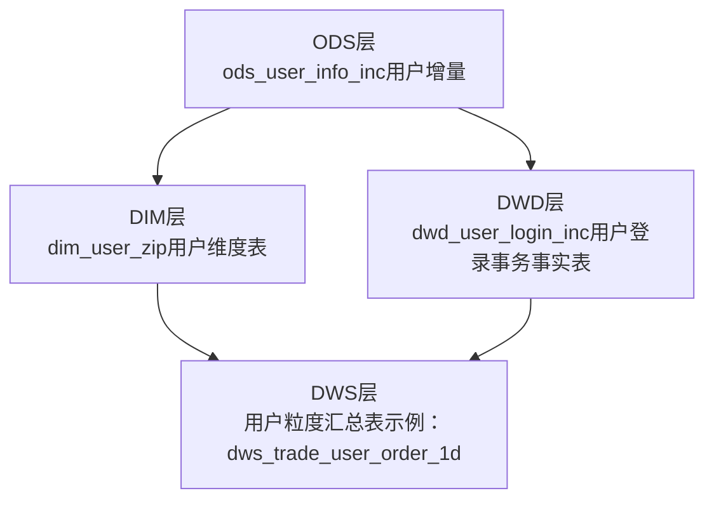
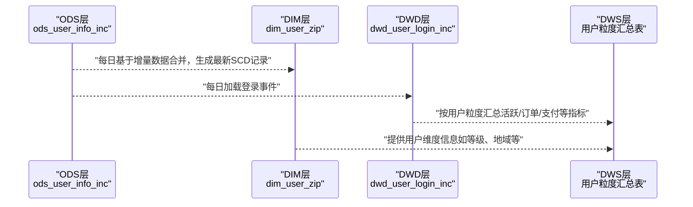
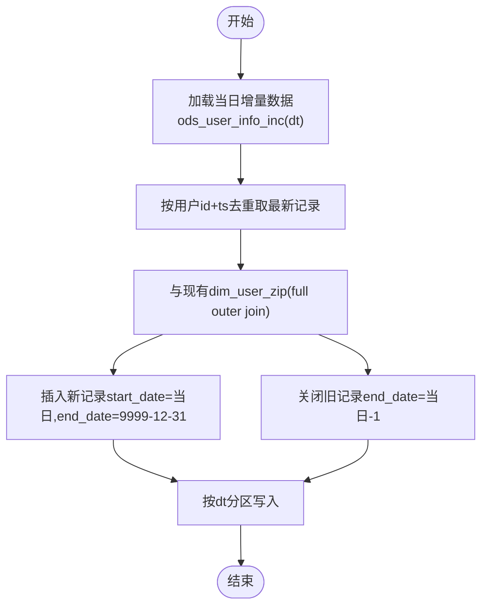
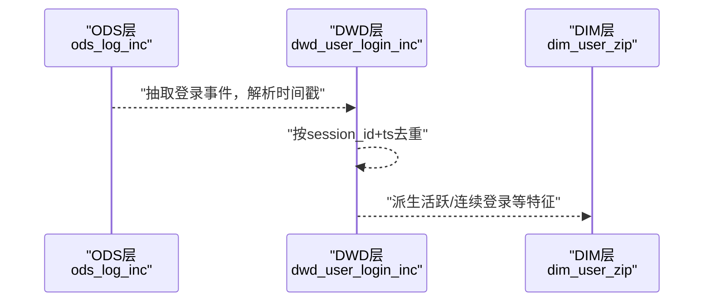
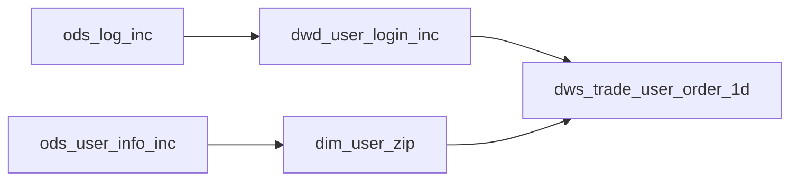

# 用户快照表

<cite>
**本文引用的文件**
- [gmall-0906.sql](file://gmall-0906.sql)
- [console.sql](file://console.sql)
- [middle.sql](file://middle.sql)
- [high.sql](file://high.sql)
- [basic.sql](file://basic.sql)
</cite>

## 目录
1. [简介](#简介)
2. [项目结构](#项目结构)
3. [核心组件](#核心组件)
4. [架构概览](#架构概览)
5. [详细组件分析](#详细组件分析)
6. [依赖分析](#依赖分析)
7. [性能考量](#性能考量)
8. [故障排查指南](#故障排查指南)
9. [结论](#结论)
10. [附录](#附录)

## 简介
本技术文档围绕HQL数据仓库中的用户快照表展开，重点阐释用户维度表的设计理念、数据建模策略与ETL实现路径，并结合仓库中现有的用户维度表与相关事实表，系统梳理用户状态数据的采集频率、去重机制与历史数据保留策略。同时，文档将对比用户快照表与用户增量表的差异，给出可落地的ETL步骤与维护策略，帮助读者在实际业务场景中高效构建与使用用户快照表，支撑用户行为分析与用户画像构建。

## 项目结构
仓库采用模块化SQL脚本组织，涵盖ODS层、DWD层、DWS层与维度表等典型分层，其中与用户快照表密切相关的对象主要集中在维度表与DWD层的事实表中：
- ODS层：用户增量表（ods_user_info_inc），承载用户状态的增量变更。
- DIM层：用户维度表（dim_user_zip），采用缓慢变化维度（SCD）策略，记录用户状态的历史区间。
- DWD层：用户域事务事实表（dwd_user_login_inc），记录用户登录事件，用于派生用户活跃状态与快照。

图表来源
- [gmall-0906.sql](file://gmall-0906.sql#L449-L461)
- [gmall-0906.sql](file://gmall-0906.sql#L909-L930)
- [gmall-0906.sql](file://gmall-0906.sql#L3192-L3196)

章节来源
- [gmall-0906.sql](file://gmall-0906.sql#L449-L461)
- [gmall-0906.sql](file://gmall-0906.sql#L909-L930)
- [gmall-0906.sql](file://gmall-0906.sql#L3192-L3196)

## 核心组件
- 用户维度表（dim_user_zip）
  - 设计目标：以SCD Type 2的方式记录用户状态的历史区间，支持按任意日期回溯用户在该日期的有效状态。
  - 关键字段：用户标识、登录名、昵称、姓名、电话、邮箱、用户等级、生日、性别、创建/操作时间、生效开始/结束日期。
  - 存储格式：ORC，分区字段dt。
- 用户增量表（ods_user_info_inc）
  - 设计目标：承载用户维度的增量变更，包含type（变更类型）、ts（时间戳）、data（新值）、old（旧值）等。
- 用户登录事务事实表（dwd_user_login_inc）
  - 设计目标：记录用户登录事件，用于派生用户活跃状态与快照。

章节来源
- [gmall-0906.sql](file://gmall-0906.sql#L909-L930)
- [gmall-0906.sql](file://gmall-0906.sql#L449-L461)
- [gmall-0906.sql](file://gmall-0906.sql#L3192-L3196)

## 架构概览
用户快照表的生成路径遵循“增量采集 -> 维度建模 -> 事实表派生 -> 汇总分析”的流程。dim_user_zip作为用户维度快照的核心载体，dwd_user_login_inc提供用户活跃状态的事件级输入，二者共同构成用户快照表的数据基础。

图表来源
- [gmall-0906.sql](file://gmall-0906.sql#L956-L1078)
- [gmall-0906.sql](file://gmall-0906.sql#L3199-L3235)
- [gmall-0906.sql](file://gmall-0906.sql#L4056-L4081)

## 详细组件分析

### 用户维度表（dim_user_zip）设计与建模策略
- SCD Type 2实现要点
  - 通过start_date/end_date维护用户状态的历史区间，9999-12-31作为当前有效区间的结束标志。
  - 新增记录时，对ods_user_info_inc按用户id与ts排序取最新一条，确保同一用户在同一天仅保留一条有效记录。
  - 合并策略：full outer join旧表与新表，对新增用户插入新记录；对变更用户关闭旧记录并插入新记录。
- 字段敏感性处理
  - 姓名、电话、邮箱等敏感字段采用MD5处理，兼顾隐私保护与维度一致性。
- 分区与存储
  - 分区字段dt，存储格式ORC，压缩snappy，提升查询与写入性能。

图表来源
- [gmall-0906.sql](file://gmall-0906.sql#L956-L1078)
- [gmall-0906.sql](file://gmall-0906.sql#L1081-L1168)

章节来源
- [gmall-0906.sql](file://gmall-0906.sql#L909-L930)
- [gmall-0906.sql](file://gmall-0906.sql#L934-L951)
- [gmall-0906.sql](file://gmall-0906.sql#L956-L1078)
- [gmall-0906.sql](file://gmall-0906.sql#L1081-L1168)

### 用户登录事务事实表（dwd_user_login_inc）与活跃状态派生
- 事件采集
  - 从ods_log_inc中抽取用户登录事件，解析时间戳，生成登录时间与日期标识。
- 去重与会话识别
  - 使用row_number按session_id与ts排序，剔除重复登录事件。
- 派生活跃状态
  - 可基于dwd_user_login_inc派生用户活跃度、连续登录等特征，作为用户快照表的补充输入。

图表来源
- [gmall-0906.sql](file://gmall-0906.sql#L3199-L3235)
- [gmall-0906.sql](file://gmall-0906.sql#L3236-L3275)

章节来源
- [gmall-0906.sql](file://gmall-0906.sql#L3192-L3196)
- [gmall-0906.sql](file://gmall-0906.sql#L3199-L3235)
- [gmall-0906.sql](file://gmall-0906.sql#L3236-L3275)

### 用户快照表与用户增量表的差异
- 数据结构差异
  - 用户快照表（dim_user_zip）：面向历史区间，包含start_date/end_date，记录用户状态的历史快照。
  - 用户增量表（ods_user_info_inc）：面向事件，包含type/ts/data/old，记录用户状态的变更事件。
- 更新策略差异
  - 快照表：按日合并，SCD Type 2，维护历史区间。
  - 增量表：按事件写入，无需去重（由下游处理）。
- 存储优化差异
  - 快照表：ORC分区存储，适合回溯查询。
  - 增量表：JSON SerDe或Delimited，便于流式接入。

章节来源
- [gmall-0906.sql](file://gmall-0906.sql#L909-L930)
- [gmall-0906.sql](file://gmall-0906.sql#L449-L461)

### 用户维度表维护策略与数据一致性保证
- 维护策略
  - 首日全量装载：dt='9999-12-31'，标记当前有效记录。
  - 每日增量合并：full outer join旧表与新表，关闭旧记录并插入新记录。
  - 去重策略：按用户id+ts排序取最新记录，确保同一天仅一条有效记录。
- 一致性保证
  - 通过rank() over (partition by id order by ts desc)确保同一用户最新状态优先。
  - 分区dt统一管理，避免跨分区数据错乱。

章节来源
- [gmall-0906.sql](file://gmall-0906.sql#L934-L951)
- [gmall-0906.sql](file://gmall-0906.sql#L956-L1078)
- [gmall-0906.sql](file://gmall-0906.sql#L1081-L1168)

### 用户快照表在用户行为分析与画像构建中的作用
- 用户行为分析
  - 结合dwd_user_login_inc与dws层用户粒度汇总表，可分析用户活跃度、连续登录、支付转化等行为指标。
- 用户画像构建
  - 以dim_user_zip为维度基表，结合订单、支付、加购等事实表，构建用户分层（新用户、活跃用户、沉睡用户、流失用户）与标签体系。

章节来源
- [gmall-0906.sql](file://gmall-0906.sql#L4056-L4081)
- [console.sql](file://console.sql#L6749-L6783)

## 依赖分析
- 维度表依赖
  - dim_user_zip依赖ods_user_info_inc的增量数据，确保用户状态的及时更新。
- 事实表依赖
  - dwd_user_login_inc依赖ods_log_inc的登录事件数据。
  - DWS层用户粒度汇总表依赖dwd_user_login_inc与订单/支付等事实表。
- 依赖关系图

图表来源
- [gmall-0906.sql](file://gmall-0906.sql#L449-L461)
- [gmall-0906.sql](file://gmall-0906.sql#L3192-L3196)
- [gmall-0906.sql](file://gmall-0906.sql#L4056-L4081)

章节来源
- [gmall-0906.sql](file://gmall-0906.sql#L449-L461)
- [gmall-0906.sql](file://gmall-0906.sql#L3192-L3196)
- [gmall-0906.sql](file://gmall-0906.sql#L4056-L4081)

## 性能考量
- 存储格式与压缩
  - dim_user_zip采用ORC存储，snappy压缩，适合列式扫描与高并发查询。
- 分区策略
  - 按dt分区，有利于按天增量加载与裁剪历史数据。
- 去重与排序
  - 使用rank()与row_number()在分区中排序，避免全表扫描，提高合并效率。
- I/O与计算分离
  - 事实表与维度表分离，减少重复计算，提升查询性能。

章节来源
- [gmall-0906.sql](file://gmall-0906.sql#L928-L929)
- [gmall-0906.sql](file://gmall-0906.sql#L956-L1078)

## 故障排查指南
- 常见问题
  - 数据重复：检查ods_user_info_inc的去重逻辑，确保按用户id+ts取最新记录。
  - 分区错乱：核对dt分区写入逻辑，确保新旧记录分区一致。
  - 字段缺失：确认dim_user_zip字段映射与ods_user_info_inc结构一致。
- 排查步骤
  - 校验ods_user_info_inc当日增量数据条数与去重后条数。
  - 校验dim_user_zip当日分区数据是否包含新旧两条记录。
  - 校验dwd_user_login_inc当日登录事件是否正确解析与去重。

章节来源
- [gmall-0906.sql](file://gmall-0906.sql#L956-L1078)
- [gmall-0906.sql](file://gmall-0906.sql#L3199-L3235)

## 结论
本文基于仓库现有代码，系统阐述了用户维度表（dim_user_zip）的SCD Type 2建模策略与ETL实现路径，并结合用户登录事务事实表（dwd_user_login_inc）与DWS层汇总表，给出了用户快照表在用户行为分析与画像构建中的应用价值。通过合理的分区、存储与去重策略，可实现高效、稳定、可追溯的用户状态快照能力，为后续分析与报表提供坚实基础。

## 附录
- 相关文件与位置
  - 用户维度表定义与装载：[gmall-0906.sql](file://gmall-0906.sql#L909-L930)
  - 用户维度表每日合并逻辑：[gmall-0906.sql](file://gmall-0906.sql#L956-L1078)
  - 用户登录事务事实表定义与装载：[gmall-0906.sql](file://gmall-0906.sql#L3192-L3196)
  - 用户登录事件去重与派生：[gmall-0906.sql](file://gmall-0906.sql#L3199-L3235)
  - 用户活跃分层示例（参考）：[console.sql](file://console.sql#L6749-L6783)