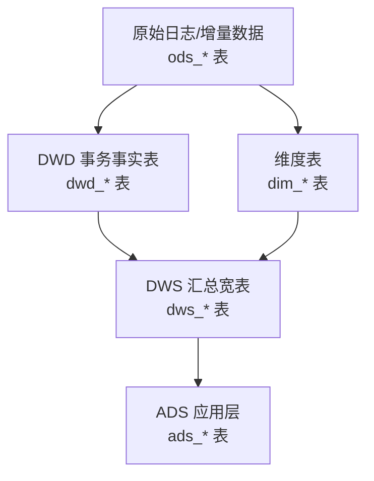
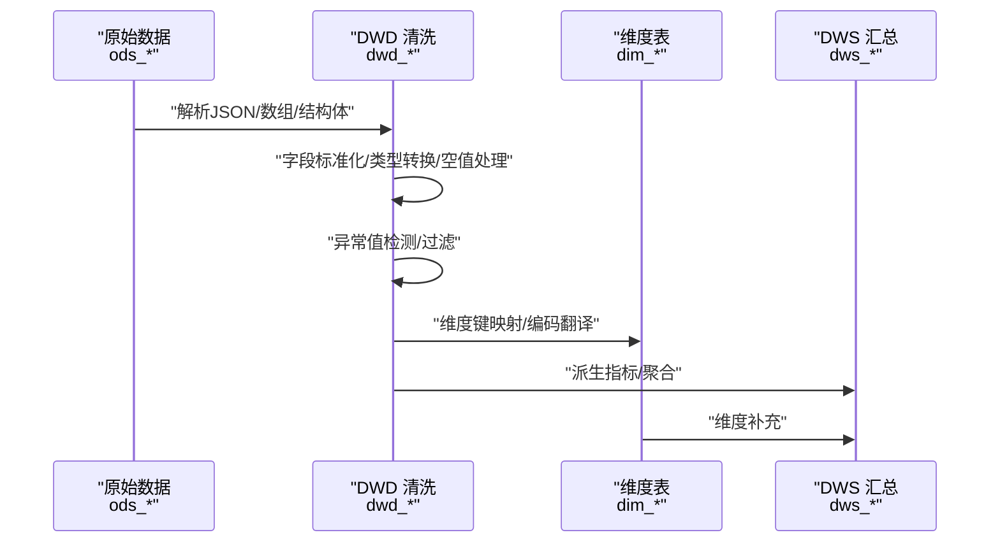
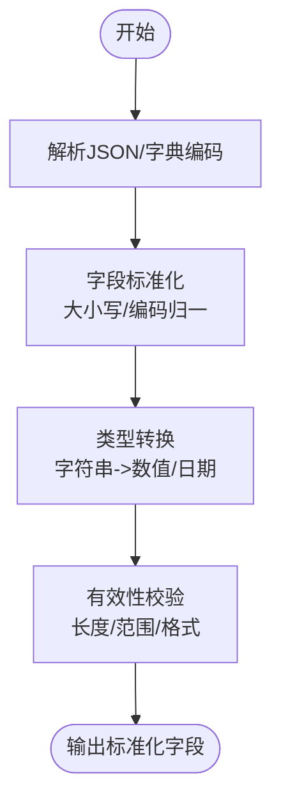
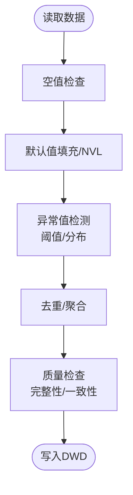
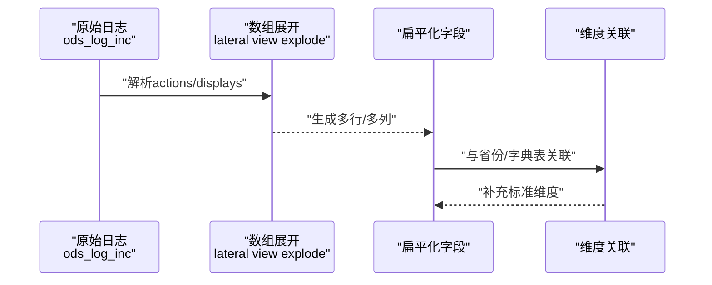
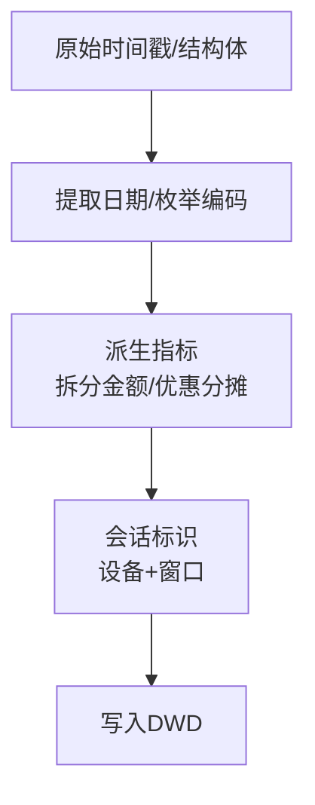
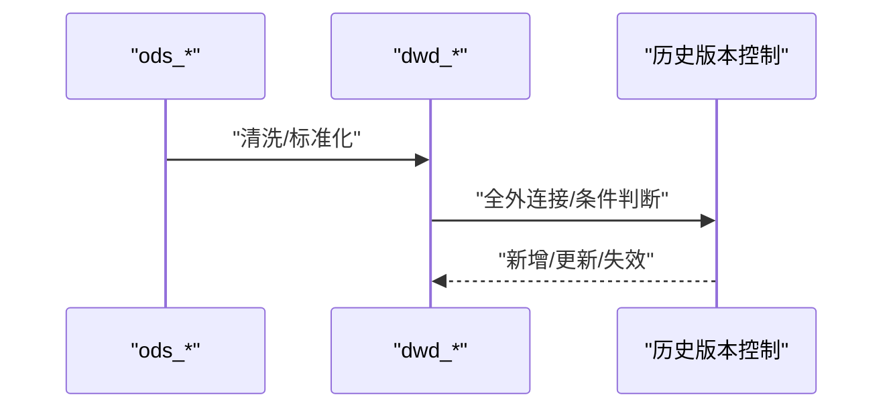
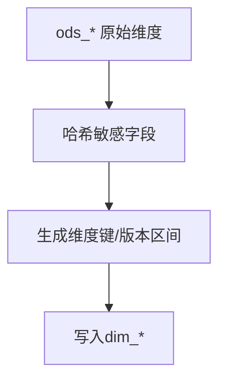
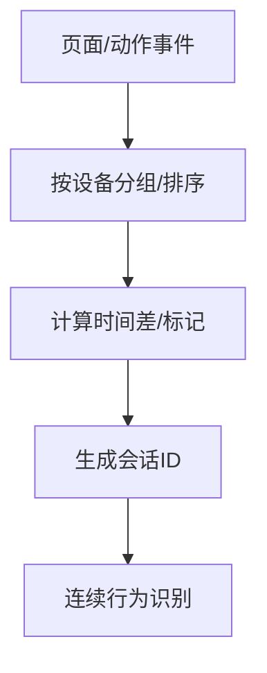
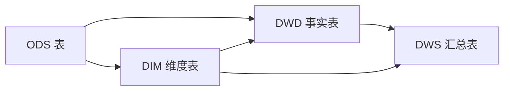

# 数据清洗与标准化

<cite>
**本文引用的文件**
- [basic.sql](file://basic.sql)
- [console.sql](file://console.sql)
- [gmall-0906.sql](file://gmall-0906.sql)
- [high.sql](file://high.sql)
- [middle.sql](file://middle.sql)
</cite>

## 目录
1. [引言](#引言)
2. [项目结构](#项目结构)
3. [核心组件](#核心组件)
4. [架构总览](#架构总览)
5. [详细组件分析](#详细组件分析)
6. [依赖分析](#依赖分析)
7. [性能考量](#性能考量)
8. [故障排查指南](#故障排查指南)
9. [结论](#结论)
10. [附录](#附录)

## 引言
本技术文档聚焦于 DWD 层数据清洗与标准化过程，系统阐述在 ETL 流程中数据清洗的关键作用与实施策略，覆盖字段标准化、数据类型转换、空值处理、异常值检测、JSON 解析、嵌套结构扁平化、复杂字段提取、数据质量检查规则、清洗逻辑示例与性能优化技巧，并给出数据一致性验证、重复数据处理与数据完整性保障机制。

## 项目结构
仓库包含多个 SQL 文件，分别演示了数据清洗、窗口函数、日期处理、JSON 解析与嵌套展开、集合聚合等能力。其中 gmall-0906.sql 是构建 DWD 层事实表与维度表的主脚本，集中体现了清洗与标准化的完整流程；basic.sql、console.sql、high.sql、middle.sql 提供了大量清洗与标准化的实践范式与最佳实践参考。

图示来源
- [gmall-0906.sql](file://gmall-0906.sql#L1176-L1393)
- [gmall-0906.sql](file://gmall-0906.sql#L1397-L1679)
- [gmall-0906.sql](file://gmall-0906.sql#L1682-L2100)
- [gmall-0906.sql](file://gmall-0906.sql#L2236-L2354)
- [gmall-0906.sql](file://gmall-0906.sql#L2357-L2401)
- [gmall-0906.sql](file://gmall-0906.sql#L2404-L2537)
- [gmall-0906.sql](file://gmall-0906.sql#L2539-L3048)
- [gmall-0906.sql](file://gmall-0906.sql#L3052-L3175)
- [gmall-0906.sql](file://gmall-0906.sql#L3177-L3279)

章节来源
- [gmall-0906.sql](file://gmall-0906.sql#L1176-L1393)
- [gmall-0906.sql](file://gmall-0906.sql#L1397-L1679)
- [gmall-0906.sql](file://gmall-0906.sql#L1682-L2100)
- [gmall-0906.sql](file://gmall-0906.sql#L2236-L2401)
- [gmall-0906.sql](file://gmall-0906.sql#L2404-L2537)
- [gmall-0906.sql](file://gmall-0906.sql#L2539-L3048)
- [gmall-0906.sql](file://gmall-0906.sql#L3052-L3279)

## 核心组件
- ODS 层：外部表，承载原始 JSON 日志与增量数据，字段多为字符串或嵌套结构。
- DWD 层：事务事实表，完成字段标准化、类型转换、空值处理、异常值过滤、JSON 解析与嵌套扁平化、复杂字段提取。
- DIM 层：维度表，完成维度键生成、维度历史变更（缓慢变化维）与一致性校验。
- DWS 层：轻度汇总宽表，基于 DWD/DIM 进行聚合与派生，作为 ADS 的输入。

章节来源
- [gmall-0906.sql](file://gmall-0906.sql#L1176-L1393)
- [gmall-0906.sql](file://gmall-0906.sql#L1397-L1679)
- [gmall-0906.sql](file://gmall-0906.sql#L1682-L2100)
- [gmall-0906.sql](file://gmall-0906.sql#L2236-L2401)
- [gmall-0906.sql](file://gmall-0906.sql#L2404-L2537)
- [gmall-0906.sql](file://gmall-0906.sql#L2539-L3048)
- [gmall-0906.sql](file://gmall-0906.sql#L3052-L3279)

## 架构总览
DWD 层清洗与标准化遵循“先解析、后规范、再派生”的流程：对 JSON 字段进行抽取与展开，对嵌套数组/结构体进行扁平化，统一时间字段格式与类型，规范化枚举编码，处理空值与异常值，最后生成稳定的历史可追溯的事实表。

图示来源
- [gmall-0906.sql](file://gmall-0906.sql#L2539-L2623)
- [gmall-0906.sql](file://gmall-0906.sql#L2672-L2751)
- [gmall-0906.sql](file://gmall-0906.sql#L2753-L2842)
- [gmall-0906.sql](file://gmall-0906.sql#L2844-L2939)
- [gmall-0906.sql](file://gmall-0906.sql#L2941-L3048)
- [gmall-0906.sql](file://gmall-0906.sql#L3052-L3279)

## 详细组件分析

### 1) 字段标准化与数据类型转换
- 时间字段标准化：统一使用日期字符串或时间戳，转换为日期标识与时间戳格式，便于后续分区与排序。
- 编码映射：通过字典表将业务编码映射为标准名称，确保跨表一致性。
- 类型转换：将字符串数值转换为整型/十进制，确保聚合与比较正确性。
- 枚举归一：统一来源类型、支付类型、退单类型等枚举值，避免多义性。

图示来源
- [gmall-0906.sql](file://gmall-0906.sql#L1197-L1278)
- [gmall-0906.sql](file://gmall-0906.sql#L1399-L1479)
- [gmall-0906.sql](file://gmall-0906.sql#L1619-L1679)
- [gmall-0906.sql](file://gmall-0906.sql#L1821-L1926)
- [gmall-0906.sql](file://gmall-0906.sql#L2020-L2076)
- [gmall-0906.sql](file://gmall-0906.sql#L2169-L2233)

章节来源
- [gmall-0906.sql](file://gmall-0906.sql#L1197-L1278)
- [gmall-0906.sql](file://gmall-0906.sql#L1399-L1479)
- [gmall-0906.sql](file://gmall-0906.sql#L1619-L1679)
- [gmall-0906.sql](file://gmall-0906.sql#L1821-L1926)
- [gmall-0906.sql](file://gmall-0906.sql#L2020-L2076)
- [gmall-0906.sql](file://gmall-0906.sql#L2169-L2233)

### 2) 空值处理与异常值检测
- 空值处理：使用条件判断与默认值填充，避免聚合与连接异常；对可空字段采用 NVL/COALESCE。
- 异常值检测：基于业务阈值与统计规则识别异常，如负数数量、超长文本、非法时间戳等。
- 重复数据处理：通过去重、分组聚合与窗口函数标记，确保事实表粒度清晰。

图示来源
- [gmall-0906.sql](file://gmall-0906.sql#L1240-L1278)
- [gmall-0906.sql](file://gmall-0906.sql#L1481-L1599)
- [gmall-0906.sql](file://gmall-0906.sql#L1821-L1926)
- [gmall-0906.sql](file://gmall-0906.sql#L2169-L2233)
- [gmall-0906.sql](file://gmall-0906.sql#L2404-L2537)
- [gmall-0906.sql](file://gmall-0906.sql#L2539-L3048)

章节来源
- [gmall-0906.sql](file://gmall-0906.sql#L1240-L1278)
- [gmall-0906.sql](file://gmall-0906.sql#L1481-L1599)
- [gmall-0906.sql](file://gmall-0906.sql#L1821-L1926)
- [gmall-0906.sql](file://gmall-0906.sql#L2169-L2233)
- [gmall-0906.sql](file://gmall-0906.sql#L2404-L2537)
- [gmall-0906.sql](file://gmall-0906.sql#L2539-L3048)

### 3) JSON 数据解析与嵌套结构扁平化
- JSON 解析：使用 JSON 字段抽取函数获取嵌套对象与数组元素。
- 数组展开：利用横向扩展函数将数组拆分为多行，再与维度表关联。
- 结构体扁平化：将结构体字段拆分为多列，统一命名与类型。

图示来源
- [gmall-0906.sql](file://gmall-0906.sql#L2828-L2842)
- [gmall-0906.sql](file://gmall-0906.sql#L2925-L2939)
- [gmall-0906.sql](file://gmall-0906.sql#L2570-L2623)
- [gmall-0906.sql](file://gmall-0906.sql#L2672-L2751)
- [gmall-0906.sql](file://gmall-0906.sql#L2753-L2842)
- [gmall-0906.sql](file://gmall-0906.sql#L2844-L2939)
- [gmall-0906.sql](file://gmall-0906.sql#L2941-L3048)

章节来源
- [gmall-0906.sql](file://gmall-0906.sql#L2828-L2842)
- [gmall-0906.sql](file://gmall-0906.sql#L2925-L2939)
- [gmall-0906.sql](file://gmall-0906.sql#L2570-L2623)
- [gmall-0906.sql](file://gmall-0906.sql#L2672-L2751)
- [gmall-0906.sql](file://gmall-0906.sql#L2753-L2842)
- [gmall-0906.sql](file://gmall-0906.sql#L2844-L2939)
- [gmall-0906.sql](file://gmall-0906.sql#L2941-L3048)

### 4) 复杂字段提取与派生
- 会话标识：基于设备 ID 与时间窗口生成会话 ID，用于页面浏览与动作事件的会话级分析。
- 日期维度：从时间戳中提取年、季、月、日、周等维度字段，支撑多粒度分析。
- 指标派生：基于原始字段计算拆分金额、优惠分摊、原始金额等派生指标。

图示来源
- [gmall-0906.sql](file://gmall-0906.sql#L2570-L2623)
- [gmall-0906.sql](file://gmall-0906.sql#L2672-L2751)
- [gmall-0906.sql](file://gmall-0906.sql#L2753-L2842)
- [gmall-0906.sql](file://gmall-0906.sql#L2844-L2939)
- [gmall-0906.sql](file://gmall-0906.sql#L1399-L1479)
- [gmall-0906.sql](file://gmall-0906.sql#L1619-L1679)

章节来源
- [gmall-0906.sql](file://gmall-0906.sql#L2570-L2623)
- [gmall-0906.sql](file://gmall-0906.sql#L2672-L2751)
- [gmall-0906.sql](file://gmall-0906.sql#L2753-L2842)
- [gmall-0906.sql](file://gmall-0906.sql#L2844-L2939)
- [gmall-0906.sql](file://gmall-0906.sql#L1399-L1479)
- [gmall-0906.sql](file://gmall-0906.sql#L1619-L1679)

### 5) 数据质量检查规则与清洗逻辑示例
- 完整性：检查主键/分区键是否存在，字段长度与格式是否符合预期。
- 一致性：枚举编码与字典表一致，时间格式统一，来源类型编码正确。
- 一致性验证：通过全外连接与条件判断，识别新增、更新、删除与历史版本控制。
- 重复数据处理：使用去重与聚合，确保事实表粒度唯一。

图示来源
- [gmall-0906.sql](file://gmall-0906.sql#L954-L1078)
- [gmall-0906.sql](file://gmall-0906.sql#L1081-L1168)
- [gmall-0906.sql](file://gmall-0906.sql#L1176-L1393)
- [gmall-0906.sql](file://gmall-0906.sql#L1397-L1679)

章节来源
- [gmall-0906.sql](file://gmall-0906.sql#L954-L1078)
- [gmall-0906.sql](file://gmall-0906.sql#L1081-L1168)
- [gmall-0906.sql](file://gmall-0906.sql#L1176-L1393)
- [gmall-0906.sql](file://gmall-0906.sql#L1397-L1679)

### 6) 维度表与维度键生成
- 维度键生成：对敏感字段进行哈希处理，保护隐私的同时保持键的稳定性。
- 维度历史：通过时间区间与版本控制，维护维度的历史变更轨迹。
- 维度映射：将业务编码映射为标准名称，提升跨表一致性。

图示来源
- [gmall-0906.sql](file://gmall-0906.sql#L932-L951)
- [gmall-0906.sql](file://gmall-0906.sql#L954-L1078)
- [gmall-0906.sql](file://gmall-0906.sql#L1081-L1168)

章节来源
- [gmall-0906.sql](file://gmall-0906.sql#L932-L951)
- [gmall-0906.sql](file://gmall-0906.sql#L954-L1078)
- [gmall-0906.sql](file://gmall-0906.sql#L1081-L1168)

### 7) 会话与连续行为分析（清洗辅助）
- 会话划分：基于时间窗口与设备 ID 生成会话标识，用于页面浏览与动作事件的会话级分析。
- 连续行为：通过窗口函数与日期差计算，识别连续登录、连续下单等行为模式。

图示来源
- [gmall-0906.sql](file://gmall-0906.sql#L2570-L2623)
- [gmall-0906.sql](file://gmall-0906.sql#L3200-L3279)
- [high.sql](file://high.sql#L1-L84)
- [middle.sql](file://middle.sql#L1-L120)

章节来源
- [gmall-0906.sql](file://gmall-0906.sql#L2570-L2623)
- [gmall-0906.sql](file://gmall-0906.sql#L3200-L3279)
- [high.sql](file://high.sql#L1-L84)
- [middle.sql](file://middle.sql#L1-L120)

## 依赖分析
- 组件耦合：DWD 事实表依赖 DIM 维度表与字典表；DWS 汇总依赖 DWD 与 DIM。
- 外部依赖：JSON SerDe 用于解析 JSON 日志；字典表提供编码映射。
- 数据流向：ODS -> DWD -> DIM -> DWS -> ADS。

图示来源
- [gmall-0906.sql](file://gmall-0906.sql#L1176-L1393)
- [gmall-0906.sql](file://gmall-0906.sql#L1397-L1679)
- [gmall-0906.sql](file://gmall-0906.sql#L1682-L2100)
- [gmall-0906.sql](file://gmall-0906.sql#L2236-L2401)
- [gmall-0906.sql](file://gmall-0906.sql#L2404-L2537)
- [gmall-0906.sql](file://gmall-0906.sql#L2539-L3048)
- [gmall-0906.sql](file://gmall-0906.sql#L3052-L3279)

章节来源
- [gmall-0906.sql](file://gmall-0906.sql#L1176-L1393)
- [gmall-0906.sql](file://gmall-0906.sql#L1397-L1679)
- [gmall-0906.sql](file://gmall-0906.sql#L1682-L2100)
- [gmall-0906.sql](file://gmall-0906.sql#L2236-L2401)
- [gmall-0906.sql](file://gmall-0906.sql#L2404-L2537)
- [gmall-0906.sql](file://gmall-0906.sql#L2539-L3048)
- [gmall-0906.sql](file://gmall-0906.sql#L3052-L3279)

## 性能考量
- 动态分区：启用非严格模式，减少分区扫描与写入成本。
- 存储格式：采用列式存储与压缩，提升读写性能与存储效率。
- 数据倾斜：通过去重、预聚合与合理分区键设计，避免热点分区。
- 计算引擎：根据场景选择合适引擎，必要时关闭某些优化以规避已知问题。
- 窗口函数：尽量在分区与排序上保持简洁，避免不必要的嵌套与重复计算。

章节来源
- [gmall-0906.sql](file://gmall-0906.sql#L956-L956)
- [gmall-0906.sql](file://gmall-0906.sql#L1176-L1193)
- [gmall-0906.sql](file://gmall-0906.sql#L2979-L3048)

## 故障排查指南
- JSON 解析失败：检查 JSON 格式与字段路径，确认 SerDe 配置与分区键。
- 窗口函数异常：核对分区与排序字段，避免在 WHERE 中直接使用窗口表达式。
- 空值导致的聚合偏差：使用默认值填充或条件过滤，确保聚合准确性。
- 维度映射不一致：核对字典表编码与父类代码，确保映射链完整。
- 会话划分异常：检查时间戳与设备 ID，确认窗口起点标记逻辑。

章节来源
- [gmall-0906.sql](file://gmall-0906.sql#L2570-L2623)
- [gmall-0906.sql](file://gmall-0906.sql#L2672-L2751)
- [gmall-0906.sql](file://gmall-0906.sql#L2753-L2842)
- [gmall-0906.sql](file://gmall-0906.sql#L2844-L2939)
- [gmall-0906.sql](file://gmall-0906.sql#L2941-L3048)
- [gmall-0906.sql](file://gmall-0906.sql#L3200-L3279)

## 结论
DWD 层的清洗与标准化是 ETL 流程的基石，通过对 JSON 解析、嵌套扁平化、字段标准化、类型转换、空值与异常值处理、维度映射与历史版本控制的系统化实施，能够显著提升数据质量与分析稳定性。结合性能优化与质量检查规则，可确保数据在全生命周期内保持一致性、完整性与可追溯性。

## 附录
- JSON 解析与数组展开示例路径
  - [数组展开（动作）](file://gmall-0906.sql#L2828-L2842)
  - [数组展开（曝光）](file://gmall-0906.sql#L2925-L2939)
- 会话与连续行为示例路径
  - [页面浏览会话划分](file://gmall-0906.sql#L2570-L2623)
  - [登录连续行为](file://gmall-0906.sql#L3200-L3279)
  - [连续登录/下单示例](file://high.sql#L1-L84)
  - [连续下单示例](file://middle.sql#L1-L120)
- 字段标准化与类型转换示例路径
  - [下单事实表字段标准化](file://gmall-0906.sql#L1399-L1479)
  - [支付成功事实表字段标准化](file://gmall-0906.sql#L1821-L1926)
  - [退单事实表字段标准化](file://gmall-0906.sql#L2020-L2076)
- 维度表与历史版本控制示例路径
  - [用户维度全量装载与历史版本](file://gmall-0906.sql#L954-L1078)
  - [用户维度增量装载与历史版本](file://gmall-0906.sql#L1081-L1168)