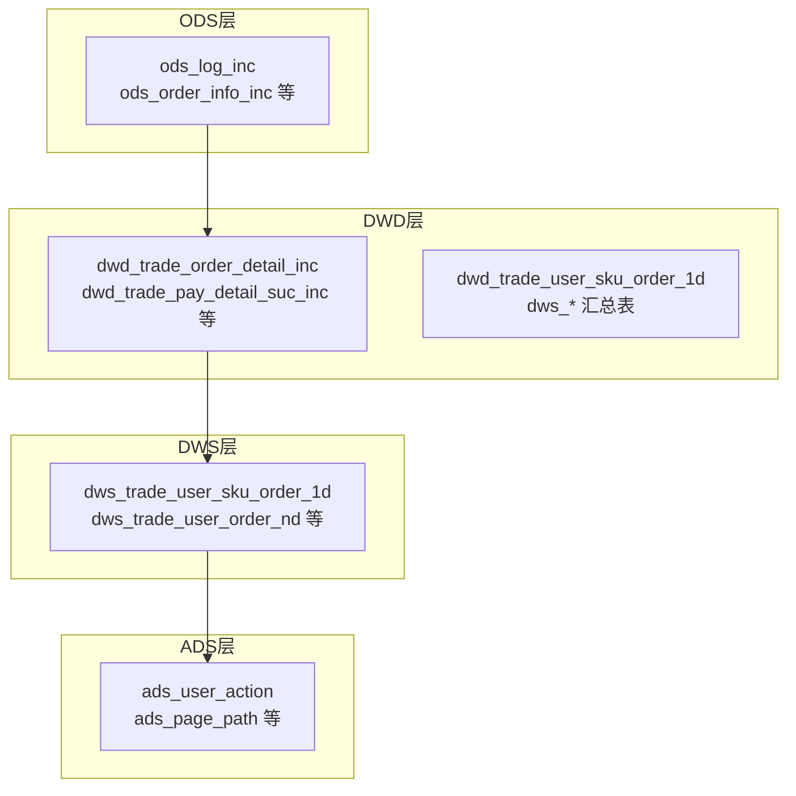
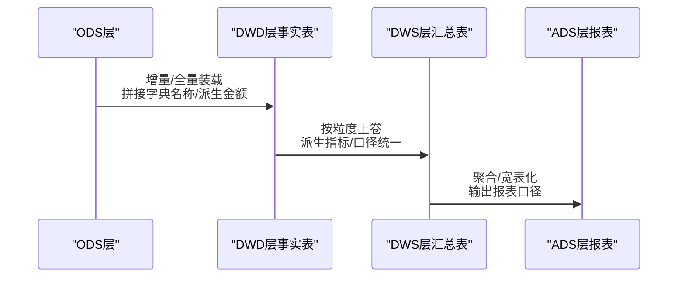
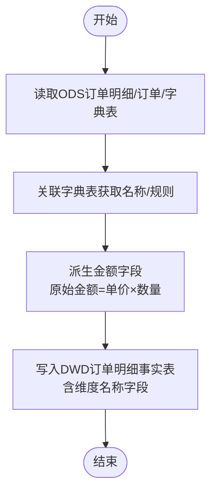
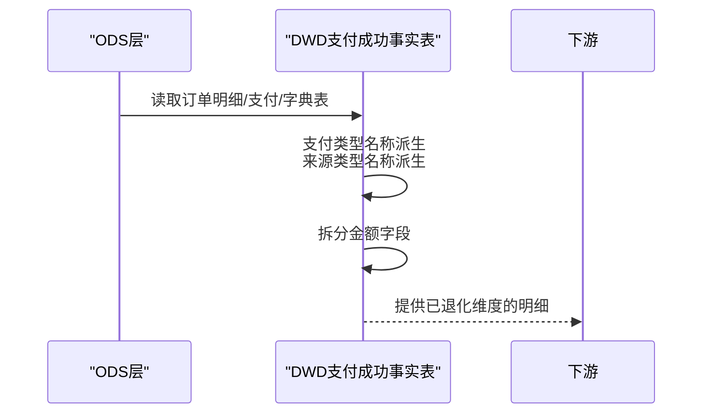
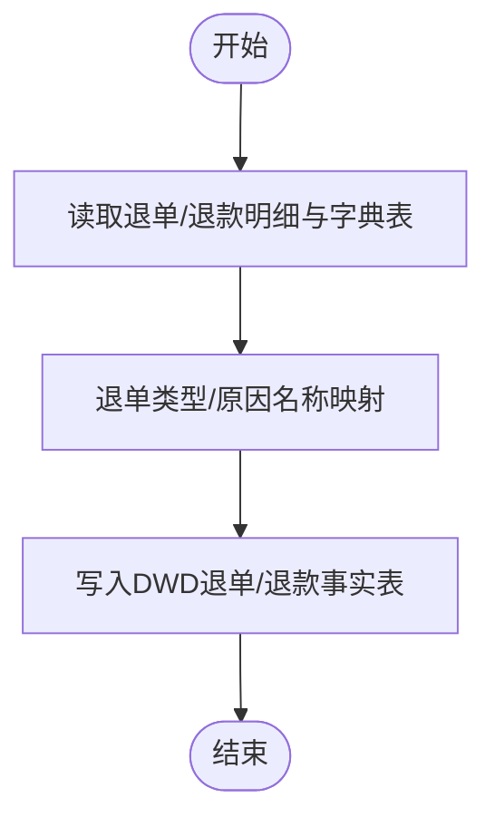
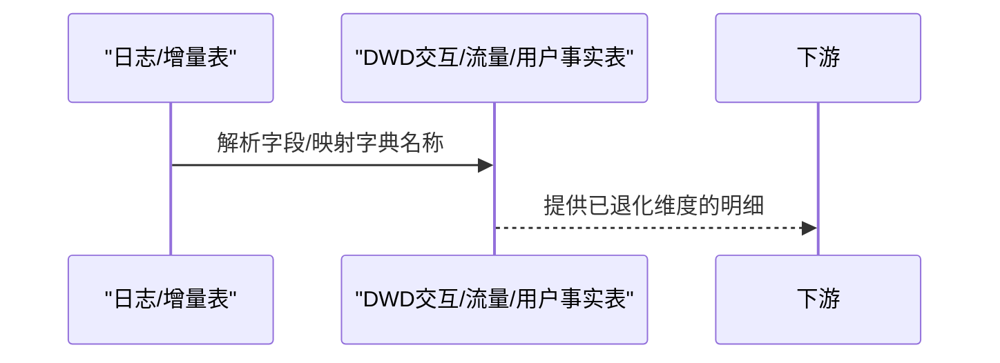
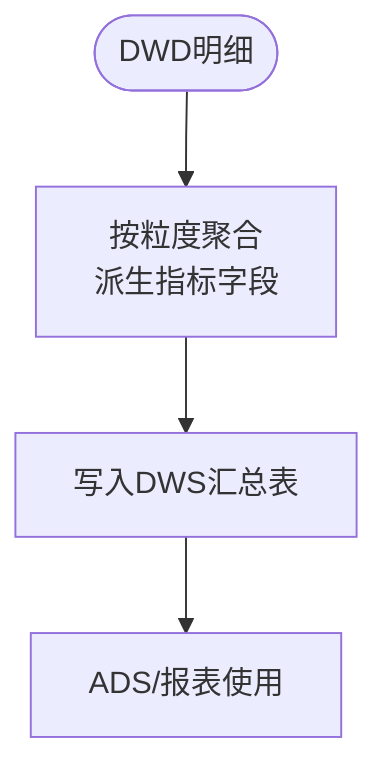
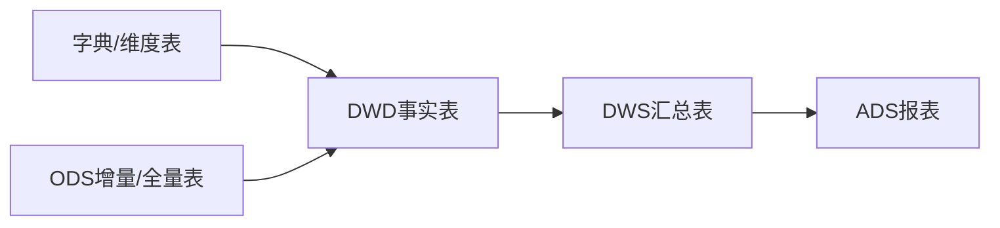

# 维度退化与字段派生

<cite>
**本文引用的文件**
- [gmall-0906.sql](file://gmall-0906.sql)
- [middle.sql](file://middle.sql)
- [high.sql](file://high.sql)
- [console.sql](file://console.sql)
- [basic.sql](file://basic.sql)
</cite>

## 目录
1. [引言](#引言)
2. [项目结构](#项目结构)
3. [核心组件](#核心组件)
4. [架构总览](#架构总览)
5. [详细组件分析](#详细组件分析)
6. [依赖分析](#依赖分析)
7. [性能考量](#性能考量)
8. [故障排查指南](#故障排查指南)
9. [结论](#结论)
10. [附录](#附录)

## 引言
本技术文档围绕DWD层“维度退化与字段派生”主题，系统阐述：
- 维度退化的概念、目的与实施策略：将维度表的描述性字段直接下沉到事实表，以减少查询时的关联开销，提升OLAP查询性能。
- 关键业务字段的派生逻辑：如订单状态码到状态名称的映射、金额类字段的拆分与汇总、来源类型/支付类型的字典名称派生等。
- 维度退化对查询性能、存储空间与维护成本的影响与权衡。
- 字段派生规则、维度退化决策标准与最佳实践。

本仓库以GMALL电商仓为核心示例，覆盖ODS、DWD、DWS、ADS等分层的事实表与维度表构建脚本，便于结合真实场景理解维度退化与派生的落地方式。

## 项目结构
仓库包含多个SQL脚本，分别覆盖：
- ODS层：原始日志与增量/全量表定义与装载
- DWD层：事务/周期快照/事件事实表，体现维度退化与字段派生
- DWS层：粒度上卷汇总表，展示派生字段的聚合与跨层使用
- ADS层：面向报表/看板的宽表与指标表
- 辅助脚本：练习与示例SQL，涵盖日期、窗口、开窗、派生与汇总等常用模式

图示来源
- [gmall-0906.sql](file://gmall-0906.sql#L1280-L1480)
- [gmall-0906.sql](file://gmall-0906.sql#L3650-L3790)
- [gmall-0906.sql](file://gmall-0906.sql#L3790-L3990)

章节来源
- [gmall-0906.sql](file://gmall-0906.sql#L1-L200)

## 核心组件
- DWD交易域事实表：包含订单明细、支付成功、退单、退款、加购、收藏、评价等事务事实表，大量采用“维度退化”策略，直接在事实表中沉淀维度名称字段，减少下游查询JOIN。
- DWS粒度上卷汇总表：基于DWD事实表进行派生与聚合，形成面向主题的宽表，支撑多维分析。
- ADS报表宽表：进一步整合派生字段与指标，满足看板与报表需求。

章节来源
- [gmall-0906.sql](file://gmall-0906.sql#L1280-L1480)
- [gmall-0906.sql](file://gmall-0906.sql#L3650-L3990)

## 架构总览
DWD层通过“维度退化 + 字段派生”的方式，将字典表/维度表的关键描述字段直接写入事实表，从而：
- 减少查询阶段的JOIN数量，提升查询性能
- 降低运行时的动态解析成本
- 但会增加存储与ETL维护成本，需在设计时平衡

图示来源
- [gmall-0906.sql](file://gmall-0906.sql#L1280-L1480)
- [gmall-0906.sql](file://gmall-0906.sql#L3650-L3990)

## 详细组件分析

### 1) 订单明细事实表（维度退化与派生）
- 维度退化要点
  - 将来源类型编码映射为来源类型名称，直接写入事实表字段，避免查询时关联字典表
  - 将省份ID映射为省份名称、地区编码、ISO编码等，写入事实表
  - 将SKU维度信息（品牌、品类、SKU名称）直接写入事实表，减少下游JOIN
- 字段派生要点
  - 原始金额、活动优惠分摊、券优惠分摊、最终金额等拆分字段，用于后续口径统一与汇总
  - 计算原始金额=单价×数量，确保汇总一致性
- 示例路径
  - [订单明细事实表建表与装载](file://gmall-0906.sql#L1280-L1480)
  - [维度退化：来源类型名称、省份信息、SKU维度信息写入](file://gmall-0906.sql#L1310-L1419)

图示来源
- [gmall-0906.sql](file://gmall-0906.sql#L1310-L1419)

章节来源
- [gmall-0906.sql](file://gmall-0906.sql#L1280-L1480)

### 2) 支付成功事实表（维度退化与派生）
- 维度退化要点
  - 支付类型编码映射为支付类型名称，写入事实表
  - 来源类型编码映射为来源类型名称，写入事实表
- 字段派生要点
  - 按支付口径拆分原始金额、活动优惠分摊、券优惠分摊、支付金额等字段
- 示例路径
  - [支付成功事实表建表与装载](file://gmall-0906.sql#L1682-L1843)

图示来源
- [gmall-0906.sql](file://gmall-0906.sql#L1682-L1843)

章节来源
- [gmall-0906.sql](file://gmall-0906.sql#L1682-L1843)

### 3) 退单/退款事实表（维度退化与派生）
- 维度退化要点
  - 退单类型编码映射为退单类型名称
  - 退单原因类型编码映射为退单原因名称
- 字段派生要点
  - 退单件数与退单金额的派生与汇总
- 示例路径
  - [退单事实表建表与装载](file://gmall-0906.sql#L1930-L2073)
  - [退款成功事实表建表与装载](file://gmall-0906.sql#L2080-L2233)

图示来源
- [gmall-0906.sql](file://gmall-0906.sql#L1930-L2073)
- [gmall-0906.sql](file://gmall-0906.sql#L2080-L2233)

章节来源
- [gmall-0906.sql](file://gmall-0906.sql#L1930-L2073)
- [gmall-0906.sql](file://gmall-0906.sql#L2080-L2233)

### 4) 交互/流量/用户域事实表（维度退化与派生）
- 交互域：收藏、评价等事务事实表，将评价编码映射为评价名称，写入事实表
- 流量域：页面浏览、启动、动作、曝光等事实表，将来源类型、页面ID等映射为名称
- 用户域：注册、登录等事务事实表，将渠道、品牌、型号、操作系统等维度名称写入
- 示例路径
  - [收藏/评价事实表建表与装载](file://gmall-0906.sql#L2404-L2536)
  - [页面浏览/启动/动作/曝光事实表建表与装载](file://gmall-0906.sql#L2540-L3048)
  - [用户注册/登录事实表建表与装载](file://gmall-0906.sql#L3052-L3199)

图示来源
- [gmall-0906.sql](file://gmall-0906.sql#L2404-L2536)
- [gmall-0906.sql](file://gmall-0906.sql#L2540-L3048)
- [gmall-0906.sql](file://gmall-0906.sql#L3052-L3199)

章节来源
- [gmall-0906.sql](file://gmall-0906.sql#L2404-L2536)
- [gmall-0906.sql](file://gmall-0906.sql#L2540-L3048)
- [gmall-0906.sql](file://gmall-0906.sql#L3052-L3199)

### 5) DWS层派生与汇总（字段派生规则）
- 用户-商品粒度订单最近1日/近N日汇总：派生下单次数、下单件数、原始金额、活动优惠金额、券优惠金额、最终金额等
- 用户-省份粒度订单最近1日/近N日汇总：派生下单次数、原始金额、活动优惠金额、券优惠金额、最终金额等
- 用户-品牌/品类粒度订单最近1日/近N日汇总：派生下单次数、下单件数、原始金额、活动优惠金额、券优惠金额、最终金额等
- 示例路径
  - [用户-商品粒度汇总建表与装载](file://gmall-0906.sql#L3650-L3990)
  - [用户-省份粒度汇总建表与装载](file://gmall-0906.sql#L4266-L4416)
  - [用户-品牌/品类粒度汇总建表与装载](file://gmall-0906.sql#L3792-L3855)

图示来源
- [gmall-0906.sql](file://gmall-0906.sql#L3650-L3990)
- [gmall-0906.sql](file://gmall-0906.sql#L4266-L4416)

章节来源
- [gmall-0906.sql](file://gmall-0906.sql#L3650-L3990)
- [gmall-0906.sql](file://gmall-0906.sql#L4266-L4416)

### 6) 字段派生规则与示例（来自辅助脚本）
- 日期与时间派生：日期ID、周ID、季度、年份、是否工作日、节假日等
- 金额与统计：IF/COALESCE/NVL、SUM/COUNT/DISTINCT、开窗函数、窗口内聚合
- 会话与连续登录：基于LAG/ROW_NUMBER/日期差打标，识别连续登录天数
- 示例路径
  - [日期维度派生与装载](file://gmall-0906.sql#L850-L906)
  - [连续登录与会话打标示例](file://high.sql#L1-L120)
  - [金额与统计示例](file://middle.sql#L240-L320)
  - [日期函数与派生示例](file://basic.sql#L1-L200)

章节来源
- [gmall-0906.sql](file://gmall-0906.sql#L850-L906)
- [high.sql](file://high.sql#L1-L120)
- [middle.sql](file://middle.sql#L240-L320)
- [basic.sql](file://basic.sql#L1-L200)

## 依赖分析
- 维度退化依赖字典表/维度表：来源类型、支付类型、地区、品牌、品类、评价等字典表
- DWD事实表依赖ODS增量/全量表与字典表，完成维度名称与派生字段的写入
- DWS汇总表依赖DWD事实表，完成按粒度的派生与聚合
- ADS报表依赖DWS汇总表，完成最终指标输出

图示来源
- [gmall-0906.sql](file://gmall-0906.sql#L1280-L1480)
- [gmall-0906.sql](file://gmall-0906.sql#L3650-L3990)

章节来源
- [gmall-0906.sql](file://gmall-0906.sql#L1280-L1480)
- [gmall-0906.sql](file://gmall-0906.sql#L3650-L3990)

## 性能考量
- 查询性能
  - 维度退化可显著减少JOIN，尤其在高频维度（如来源类型、支付类型、品牌、省份）上效果明显
  - 通过在事实表中直接存储维度名称，避免运行时动态解析与关联
- 存储与维护成本
  - 维度退化会增加事实表宽度与存储体积，需评估压缩策略（如ORC+Snappy）
  - 维度名称变更需在ETL层同步更新，维护成本上升；可通过维度表版本化或缓慢变化维度策略控制
- 聚合与扫描
  - DWS层的派生字段可减少下游重复计算，但需注意分区与裁剪策略，避免全表扫描

[本节为通用指导，无需列出具体文件来源]

## 故障排查指南
- 维度名称缺失或为空
  - 检查字典表是否存在对应编码，确认关联条件是否正确
  - 示例参考：[字典名称映射与装载](file://gmall-0906.sql#L1310-L1419)
- 金额字段异常
  - 检查单价×数量与拆分金额的逻辑一致性，确保NVL/COALESCE处理空值
  - 示例参考：[金额派生与汇总](file://gmall-0906.sql#L3650-L3990)
- 连续登录/会话打标异常
  - 检查LAG/ROW_NUMBER/日期差计算是否正确，确保去重与分区顺序一致
  - 示例参考：[连续登录与会话打标](file://high.sql#L1-L120)
- 分区与日期维度
  - 确认日期维度表是否正确装载，日期ID格式是否一致
  - 示例参考：[日期维度装载](file://gmall-0906.sql#L850-L906)

章节来源
- [gmall-0906.sql](file://gmall-0906.sql#L1310-L1419)
- [gmall-0906.sql](file://gmall-0906.sql#L3650-L3990)
- [high.sql](file://high.sql#L1-L120)
- [gmall-0906.sql](file://gmall-0906.sql#L850-L906)

## 结论
- 维度退化在DWD层的核心价值在于“以空间换时间”，通过在事实表中沉淀维度名称与派生字段，显著降低查询阶段的JOIN与解析成本
- 字段派生需遵循“口径统一、可追溯、可审计”的原则，确保金额与统计口径一致
- 在实施过程中需平衡存储、维护与查询收益，并结合分区、压缩与物化视图等手段优化整体性能

[本节为总结性内容，无需列出具体文件来源]

## 附录
- 维度退化决策标准
  - 高频使用且稳定不变的维度编码（如来源类型、支付类型、品牌、省份）
  - 维度名称在事实表中占比不大，但能显著减少JOIN
  - 维度名称变更频率低，或具备版本化/缓慢变化维度策略
- 字段派生最佳实践
  - 明确派生口径与边界，统一命名规范
  - 在ETL层集中实现派生逻辑，避免下游重复计算
  - 对空值进行显式处理（NVL/COALESCE），确保聚合一致性
  - 对日期与时间派生进行严格校验，确保分区与日期ID一致

[本节为通用指导，无需列出具体文件来源]