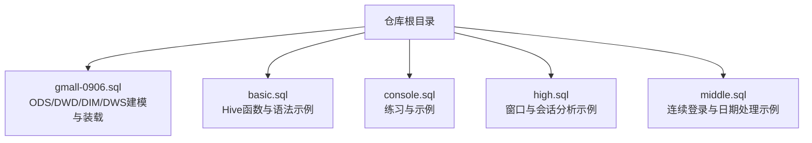
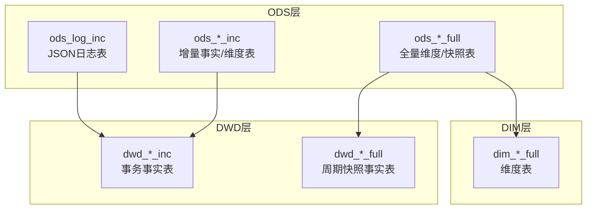
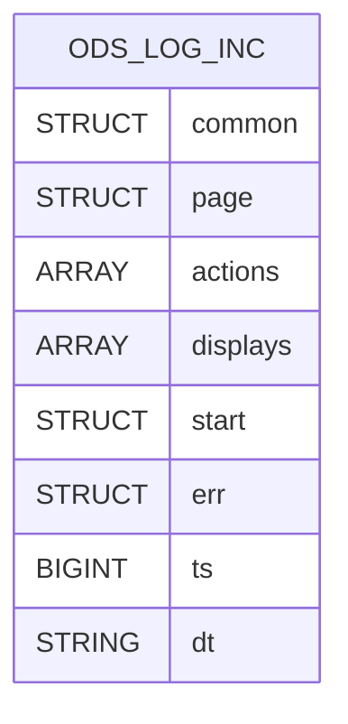
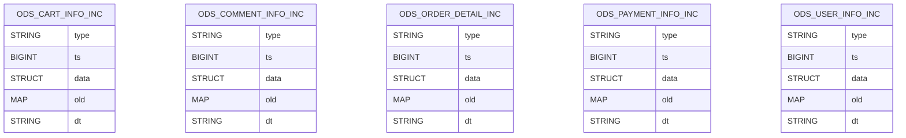
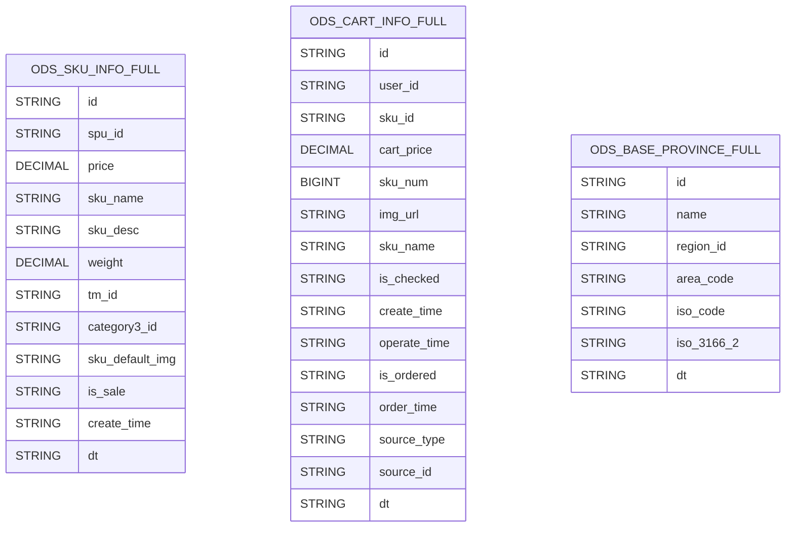
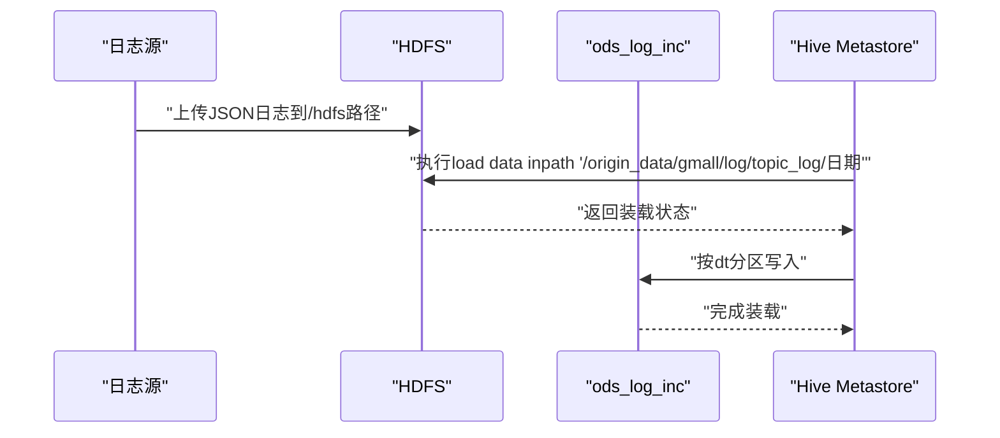
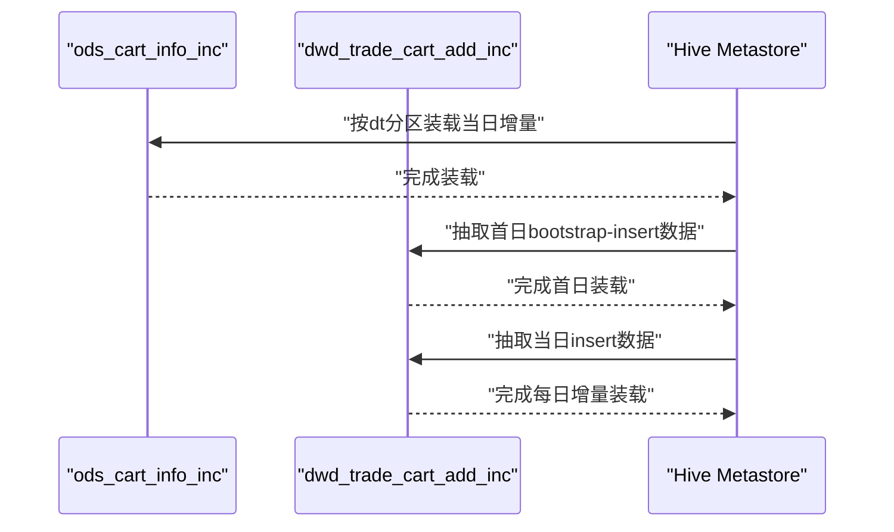
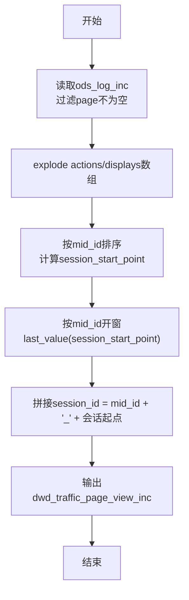
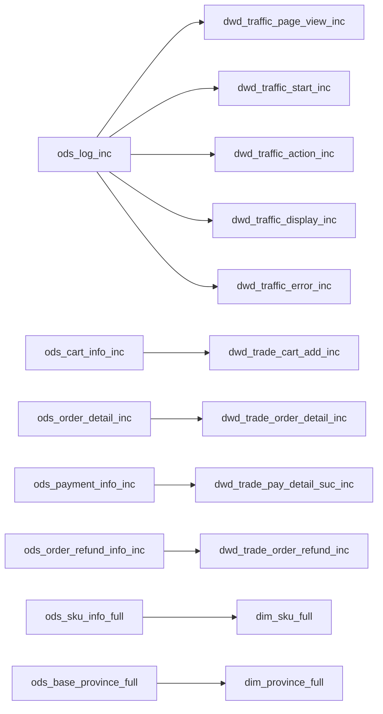

# ODS层（原始数据层）

<cite>
**本文引用的文件**
- [gmall-0906.sql](file://gmall-0906.sql)
- [basic.sql](file://basic.sql)
- [console.sql](file://console.sql)
- [high.sql](file://high.sql)
- [middle.sql](file://middle.sql)
</cite>

## 目录
1. [引言](#引言)
2. [项目结构](#项目结构)
3. [核心组件](#核心组件)
4. [架构总览](#架构总览)
5. [详细组件分析](#详细组件分析)
6. [依赖分析](#依赖分析)
7. [性能考量](#性能考量)
8. [故障排查指南](#故障排查指南)
9. [结论](#结论)
10. [附录](#附录)

## 引言
本文件面向HQL数据仓库ODS层（原始数据层），系统化梳理ODS层作为“近源、轻处理、可回放”的数据接入与归档层的设计理念与实现要点。围绕日志表（ods_log_inc）、增量表（ods_*_inc）与全量表（ods_*_full）三类典型表型，本文给出表结构设计模式、分区策略、存储格式选择（ORC、JsonSerDe）、数据接入方式、分区管理与保留策略、数据质量控制措施，并提供建表与装载参考路径与最佳实践建议。

## 项目结构
- 本仓库以SQL脚本为主，集中展示了从ODS到DWD/DIM/DWS的建模与装载流程。其中，ODS层的建表与装载集中在 gmall-0906.sql 文件中，涵盖日志表、增量事实表、全量维度表等。
- 其他脚本（如 basic.sql、console.sql、high.sql、middle.sql）提供了Hive常用函数、窗口函数、日期处理、连续登录/会话识别等通用能力，有助于理解ODS层数据接入与预处理的上下文。

[本图为概念性结构示意，不直接映射具体代码文件，故不附“图示来源”]

**章节来源**
- [gmall-0906.sql](file://gmall-0906.sql#L1-L120)

## 核心组件
- 日志表（ods_log_inc）
  - 设计要点：采用JsonSerDe解析JSON日志，字段以结构体/数组形式承载页面行为、动作、曝光、启动、错误等多维信息；按日分区（dt）组织。
  - 数据接入：通过load data inpath命令将指定日期的日志目录装载至对应dt分区。
  - 参考路径：
    - [建表与分区定义](file://gmall-0906.sql#L24-L42)
    - [数据装载命令示例](file://gmall-0906.sql#L44-L48)

- 增量表（ods_*_inc）
  - 设计要点：统一携带type（变更类型）、ts（变更时间戳）、data（本次变更的完整数据）、old（旧值映射）字段；便于后续DWD层按事件类型与时间戳进行增量清洗与装载。
  - 数据接入：按日分区dt装载，常见于交易、互动、用户等主题的事实/维度增量表。
  - 参考路径：
    - [购物车增量表建表](file://gmall-0906.sql#L284-L297)
    - [评价增量表建表](file://gmall-0906.sql#L298-L323)
    - [订单明细增量表建表](file://gmall-0906.sql#L337-L351)
    - [支付增量表建表](file://gmall-0906.sql#L421-L434)
    - [用户增量表建表](file://gmall-0906.sql#L449-L462)

- 全量表（ods_*_full）
  - 设计要点：按主题维护全量维度或周期快照；字段与业务含义明确，按dt分区归档。
  - 数据接入：周期性全量装载，覆盖历史周期。
  - 参考路径：
    - [SKU全量表建表](file://gmall-0906.sql#L234-L252)
    - [购物车全量表建表](file://gmall-0906.sql#L171-L193)
    - [地区全量表建表](file://gmall-0906.sql#L800-L815)
    - [日期维度表建表与装载](file://gmall-0906.sql#L850-L907)

**章节来源**
- [gmall-0906.sql](file://gmall-0906.sql#L24-L48)
- [gmall-0906.sql](file://gmall-0906.sql#L171-L193)
- [gmall-0906.sql](file://gmall-0906.sql#L234-L252)
- [gmall-0906.sql](file://gmall-0906.sql#L284-L323)
- [gmall-0906.sql](file://gmall-0906.sql#L337-L351)
- [gmall-0906.sql](file://gmall-0906.sql#L421-L434)
- [gmall-0906.sql](file://gmall-0906.sql#L449-L462)
- [gmall-0906.sql](file://gmall-0906.sql#L800-L815)
- [gmall-0906.sql](file://gmall-0906.sql#L850-L907)

## 架构总览
ODS层作为数据接入的第一站，承担以下职责：
- 原始日志/增量数据的结构化落仓；
- 按dt分区归档，便于后续按天回放与修复；
- 为DWD层提供统一的增量/全量数据源，支撑后续维度建模与宽表汇总。

**图示来源**
- [gmall-0906.sql](file://gmall-0906.sql#L24-L42)
- [gmall-0906.sql](file://gmall-0906.sql#L284-L323)
- [gmall-0906.sql](file://gmall-0906.sql#L171-L193)
- [gmall-0906.sql](file://gmall-0906.sql#L800-L815)

## 详细组件分析

### 日志表（ods_log_inc）
- 表结构设计模式
  - 采用JsonSerDe解析JSON日志，字段以结构体/数组形式组织，便于承载页面、动作、曝光、启动、错误等多维信息。
  - 常见字段族：common（公共信息）、page（页面信息）、actions（动作数组）、displays（曝光数组）、start（启动信息）、err（错误信息）、ts（时间戳）。
- 分区策略
  - 按dt字符串分区，便于按天装载与查询。
- 存储格式
  - JsonSerDe + 外部表，便于直接对接日志源。
- 数据接入
  - 使用load data inpath将指定日期的日志目录装载至对应dt分区。
- 参考路径
  - [建表与分区定义](file://gmall-0906.sql#L24-L42)
  - [数据装载命令示例](file://gmall-0906.sql#L44-L48)

**图示来源**
- [gmall-0906.sql](file://gmall-0906.sql#L24-L42)

**章节来源**
- [gmall-0906.sql](file://gmall-0906.sql#L24-L42)
- [gmall-0906.sql](file://gmall-0906.sql#L44-L48)

### 增量表（ods_*_inc）
- 设计模式
  - 统一字段：type（变更类型）、ts（变更时间戳）、data（本次变更的完整数据）、old（旧值映射）。
  - 适用于交易、互动、用户等主题的事实/维度增量。
- 分区策略
  - 按dt字符串分区，便于按天增量装载与回放。
- 存储格式
  - 多数采用JsonSerDe（增量事实/维度），部分事实表采用ORC（提升查询性能）。
- 数据接入
  - 按日分区装载，常见于首日bootstrap-insert与后续每日insert/update场景。
- 参考路径
  - [购物车增量表建表](file://gmall-0906.sql#L284-L297)
  - [评价增量表建表](file://gmall-0906.sql#L298-L323)
  - [订单明细增量表建表](file://gmall-0906.sql#L337-L351)
  - [支付增量表建表](file://gmall-0906.sql#L421-L434)
  - [用户增量表建表](file://gmall-0906.sql#L449-L462)

**图示来源**
- [gmall-0906.sql](file://gmall-0906.sql#L284-L323)
- [gmall-0906.sql](file://gmall-0906.sql#L337-L351)
- [gmall-0906.sql](file://gmall-0906.sql#L421-L434)
- [gmall-0906.sql](file://gmall-0906.sql#L449-L462)

**章节来源**
- [gmall-0906.sql](file://gmall-0906.sql#L284-L323)
- [gmall-0906.sql](file://gmall-0906.sql#L337-L351)
- [gmall-0906.sql](file://gmall-0906.sql#L421-L434)
- [gmall-0906.sql](file://gmall-0906.sql#L449-L462)

### 全量表（ods_*_full）
- 设计模式
  - 维度/快照全量表，字段覆盖业务主键与关键属性，按dt分区归档。
- 分区策略
  - 按dt字符串分区，便于按周期装载与历史回溯。
- 存储格式
  - 多数采用ORC（压缩存储，提升查询性能），部分文本维度表采用DELIMITED FIELDS TERMINATED BY。
- 数据接入
  - 周期性全量装载，覆盖历史周期，便于下游维度建模。
- 参考路径
  - [SKU全量表建表](file://gmall-0906.sql#L234-L252)
  - [购物车全量表建表](file://gmall-0906.sql#L171-L193)
  - [地区全量表建表](file://gmall-0906.sql#L800-L815)
  - [日期维度表建表与装载](file://gmall-0906.sql#L850-L907)

**图示来源**
- [gmall-0906.sql](file://gmall-0906.sql#L171-L193)
- [gmall-0906.sql](file://gmall-0906.sql#L234-L252)
- [gmall-0906.sql](file://gmall-0906.sql#L800-L815)
- [gmall-0906.sql](file://gmall-0906.sql#L850-L907)

**章节来源**
- [gmall-0906.sql](file://gmall-0906.sql#L171-L193)
- [gmall-0906.sql](file://gmall-0906.sql#L234-L252)
- [gmall-0906.sql](file://gmall-0906.sql#L800-L815)
- [gmall-0906.sql](file://gmall-0906.sql#L850-L907)

### 数据接入流程（序列图）
以“日志表装载”为例，展示从原始日志到ODS分区表的关键步骤。

**图示来源**
- [gmall-0906.sql](file://gmall-0906.sql#L44-L48)

**章节来源**
- [gmall-0906.sql](file://gmall-0906.sql#L44-L48)

### 增量装载流程（序列图）
以“购物车增量表”为例，展示首日bootstrap-insert与每日insert场景。

**图示来源**
- [gmall-0906.sql](file://gmall-0906.sql#L1196-L1278)

**章节来源**
- [gmall-0906.sql](file://gmall-0906.sql#L1196-L1278)

### 复杂逻辑示例（流程图）
以“页面浏览日志到会话标识”的复杂逻辑为例，展示基于窗口函数与explode的处理流程。

**图示来源**
- [gmall-0906.sql](file://gmall-0906.sql#L2570-L2623)

**章节来源**
- [gmall-0906.sql](file://gmall-0906.sql#L2570-L2623)

## 依赖分析
- ODS层内部依赖
  - 日志表ods_log_inc为流量域多张事实表（页面浏览、启动、动作、曝光、错误）的共同数据源。
  - 增量表ods_*_inc为DWD层事务事实表的主要数据源。
  - 全量表ods_*_full为维度表与周期快照事实表的数据源。
- 外部依赖
  - JsonSerDe用于JSON日志解析；DELIMITED FIELDS TERMINATED BY用于文本维度表。
  - ORC存储格式用于提升查询与压缩效率。

**图示来源**
- [gmall-0906.sql](file://gmall-0906.sql#L2540-L2751)
- [gmall-0906.sql](file://gmall-0906.sql#L1175-L1278)
- [gmall-0906.sql](file://gmall-0906.sql#L1682-L1927)
- [gmall-0906.sql](file://gmall-0906.sql#L1929-L2077)
- [gmall-0906.sql](file://gmall-0906.sql#L2236-L2265)
- [gmall-0906.sql](file://gmall-0906.sql#L800-L815)

**章节来源**
- [gmall-0906.sql](file://gmall-0906.sql#L2540-L2751)
- [gmall-0906.sql](file://gmall-0906.sql#L1175-L1278)
- [gmall-0906.sql](file://gmall-0906.sql#L1682-L1927)
- [gmall-0906.sql](file://gmall-0906.sql#L1929-L2077)
- [gmall-0906.sql](file://gmall-0906.sql#L2236-L2265)
- [gmall-0906.sql](file://gmall-0906.sql#L800-L815)

## 性能考量
- 存储格式
  - ORC：具备列式存储、内置压缩、索引与向量化执行优势，适合大表与复杂查询场景。
  - JsonSerDe：灵活解析JSON，但需注意字段类型与空值处理，适合日志类原始数据。
- 分区策略
  - dt分区为日级，便于按天回放与修复；建议结合动态分区与严格模式，避免过多小文件。
- 字段与类型
  - 明确数值精度（DECIMAL）与布尔类型（BOOLEAN），减少下游转换成本。
- I/O与扫描
  - 优先按分区裁剪，避免全表扫描；对高频字段建立合适索引或物化视图（视引擎支持情况）。

[本节为通用指导，不直接分析具体文件，故不附“章节来源”]

## 故障排查指南
- JSON解析失败
  - 现象：字段为空或解析异常。
  - 排查：确认JSON格式、字段命名一致性；检查JsonSerDe配置与分区路径。
  - 参考路径：
    - [日志表建表与SerDe配置](file://gmall-0906.sql#L24-L42)

- 分区缺失或数据未落盘
  - 现象：按dt查询为空。
  - 排查：确认load data命令的目标分区dt与实际日期一致；检查HDFS路径是否存在。
  - 参考路径：
    - [日志表装载命令示例](file://gmall-0906.sql#L44-L48)

- 增量数据重复或遗漏
  - 现象：DWD层重复或漏记。
  - 排查：核对ods_*_inc的type字段与时间戳ts；确保首日bootstrap-insert与每日insert/update逻辑正确。
  - 参考路径：
    - [购物车增量表装载（首日/每日）](file://gmall-0906.sql#L1196-L1278)
    - [订单明细增量表装载（首日/每日）](file://gmall-0906.sql#L1310-L1479)

- 会话/连续登录逻辑异常
  - 现象：会话切分错误或连续登录天数不正确。
  - 排查：核对窗口函数排序字段（ts）、去重逻辑（distinct）与lag/first_value使用。
  - 参考路径：
    - [页面浏览日志到会话标识](file://gmall-0906.sql#L2570-L2623)
    - [连续登录与日期处理示例](file://middle.sql#L1-L120)

**章节来源**
- [gmall-0906.sql](file://gmall-0906.sql#L24-L42)
- [gmall-0906.sql](file://gmall-0906.sql#L44-L48)
- [gmall-0906.sql](file://gmall-0906.sql#L1196-L1278)
- [gmall-0906.sql](file://gmall-0906.sql#L1310-L1479)
- [gmall-0906.sql](file://gmall-0906.sql#L2570-L2623)
- [middle.sql](file://middle.sql#L1-L120)

## 结论
ODS层通过“日志表+增量表+全量表”的组合，实现了对原始数据的近源接入与稳定归档。日志表采用JsonSerDe适配JSON日志，增量表统一携带type/ts/data/old便于增量清洗，全量表按dt分区归档支撑维度建模。配合合理的分区策略、存储格式与装载流程，ODS层为后续DWD/DIM/DWS提供了高质量、可回放的数据基础。

[本节为总结性内容，不直接分析具体文件，故不附“章节来源”]

## 附录

### 建表与装载参考路径清单
- 日志表
  - [ods_log_inc建表与分区定义](file://gmall-0906.sql#L24-L42)
  - [日志表装载命令示例](file://gmall-0906.sql#L44-L48)
- 增量表
  - [购物车增量表建表](file://gmall-0906.sql#L284-L297)
  - [评价增量表建表](file://gmall-0906.sql#L298-L323)
  - [订单明细增量表建表](file://gmall-0906.sql#L337-L351)
  - [支付增量表建表](file://gmall-0906.sql#L421-L434)
  - [用户增量表建表](file://gmall-0906.sql#L449-L462)
  - [购物车增量装载（首日/每日）](file://gmall-0906.sql#L1196-L1278)
  - [订单明细增量装载（首日/每日）](file://gmall-0906.sql#L1310-L1479)
- 全量表
  - [SKU全量表建表](file://gmall-0906.sql#L234-L252)
  - [购物车全量表建表](file://gmall-0906.sql#L171-L193)
  - [地区全量表建表](file://gmall-0906.sql#L800-L815)
  - [日期维度表建表与装载](file://gmall-0906.sql#L850-L907)

### 数据字典与字段说明（示例）
- ods_log_inc
  - common：公共信息结构体
  - page：页面信息结构体
  - actions：动作数组
  - displays：曝光数组
  - start：启动信息结构体
  - err：错误信息结构体
  - ts：时间戳
  - dt：分区字段
  - 参考路径：[日志表建表](file://gmall-0906.sql#L24-L42)

- ods_cart_info_inc
  - type：变更类型
  - ts：变更时间戳
  - data：本次变更的完整数据结构体
  - old：旧值映射
  - dt：分区字段
  - 参考路径：[购物车增量表建表](file://gmall-0906.sql#L284-L297)

- ods_sku_info_full
  - id：SKU主键
  - spu_id：SPU主键
  - price：价格
  - sku_name：SKU名称
  - category3_id：三级品类ID
  - tm_id：品牌ID
  - is_sale：是否在售
  - create_time：创建时间
  - dt：分区字段
  - 参考路径：[SKU全量表建表](file://gmall-0906.sql#L234-L252)

**章节来源**
- [gmall-0906.sql](file://gmall-0906.sql#L24-L42)
- [gmall-0906.sql](file://gmall-0906.sql#L284-L297)
- [gmall-0906.sql](file://gmall-0906.sql#L234-L252)