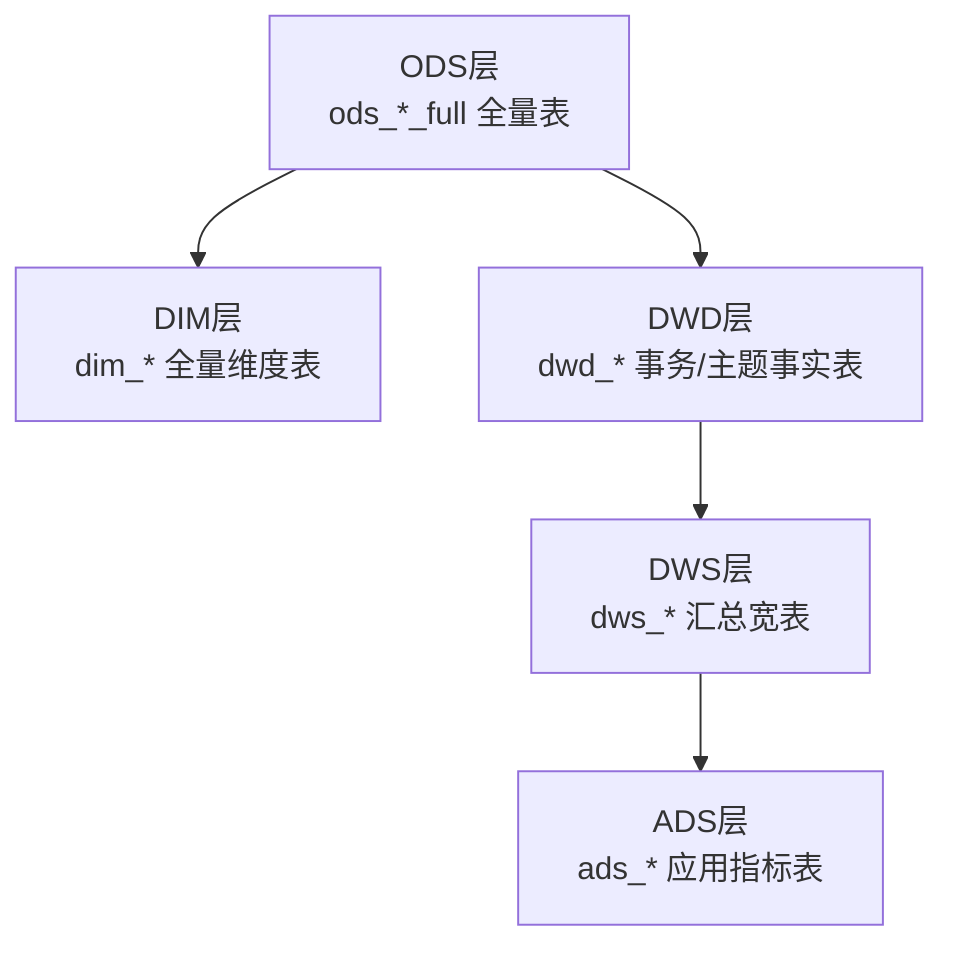
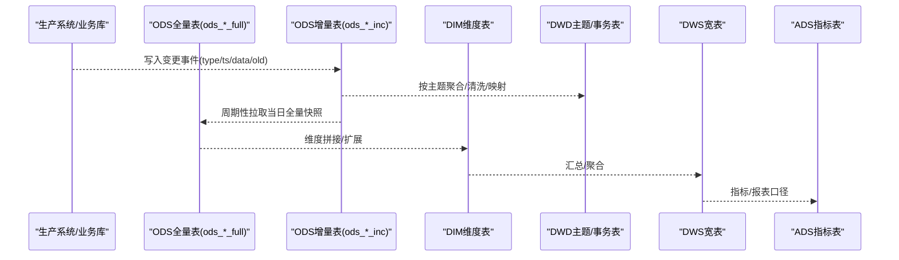
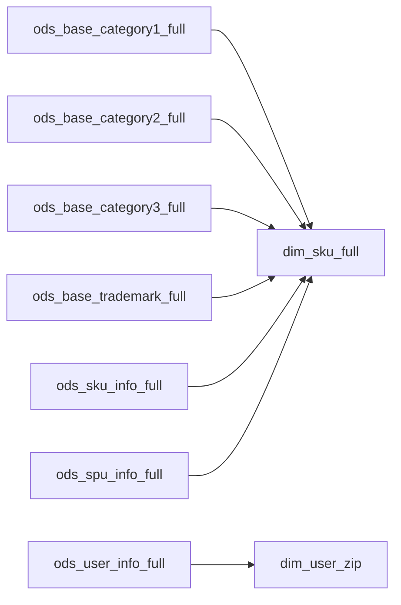

# 全量表设计

<cite>
**本文引用的文件**
- [gmall-0906.sql](file://gmall-0906.sql)
- [basic.sql](file://basic.sql)
- [console.sql](file://console.sql)
</cite>

## 目录
1. [引言](#引言)
2. [项目结构](#项目结构)
3. [核心组件](#核心组件)
4. [架构总览](#架构总览)
5. [详细组件分析](#详细组件分析)
6. [依赖分析](#依赖分析)
7. [性能考量](#性能考量)
8. [故障排查指南](#故障排查指南)
9. [结论](#结论)
10. [附录](#附录)

## 引言
本技术文档聚焦于HQL数据仓库中的全量表（ods_*_full）设计与实现，系统梳理全量表的建表语法、字段设计、分区策略、数据装载流程与质量控制要点，并结合仓库中实际存在的ods_sku_info_full、ods_user_info_full、ods_base_category*_full等代表性表，给出可复用的设计规范与最佳实践。同时，本文将对比全量表与增量表（ods_*_inc）的差异，明确更新机制、数据保留策略与典型业务场景。

## 项目结构
本仓库围绕“ODS-DMZ/DIM/DWD/DWS/ADS”分层组织SQL脚本，其中全量表集中位于ODS层，采用ods_*_full命名规范；维度表与宽表位于DIM层；主题宽表与汇总表位于DWD/DWS/ADS层。全量表通常以分区内存储当日全量快照，便于后续宽表构建与跨表关联。

[本图为概念性结构示意，不直接映射具体源文件，故无图表来源]

**章节来源**
- [gmall-0906.sql](file://gmall-0906.sql#L1-L120)

## 核心组件
- 全量表（ods_*_full）
  - 特征：按自然日分区（dt），存储当日全量数据快照；字段覆盖主键与业务关键字段；文本型字段使用制表符分隔，NULL统一定义为空字符串。
  - 示例：ods_sku_info_full、ods_user_info_full、ods_base_category*_full等。
- 增量表（ods_*_inc）
  - 特征：按事件或业务变更类型（type）与时间戳（ts）记录增量；通常采用JSON SerDe解析；分区dt用于按天归档。
  - 示例：ods_log_inc、ods_order_detail_inc、ods_user_info_inc等。
- 维度表（dim_*）
  - 特征：全量维度表，常采用ORC存储与snappy压缩；部分维度表（如dim_user_zip）采用缓慢变化维度（SCD）策略维护有效期。
- 事务/主题事实表（dwd_*）
  - 特征：基于增量表聚合生成，按主题域拆分，面向分析口径的宽表。

**章节来源**
- [gmall-0906.sql](file://gmall-0906.sql#L50-L220)
- [gmall-0906.sql](file://gmall-0906.sql#L800-L900)
- [gmall-0906.sql](file://gmall-0906.sql#L909-L950)

## 架构总览
全量表作为ODS层“事实快照”，为上层维度表与宽表提供稳定、可回放的数据基线；与增量表形成互补：增量表负责实时/准实时的事件记录，全量表负责周期性全量覆盖与回溯。

[本图为概念性流程示意，不直接映射具体源文件，故无图表来源]

## 详细组件分析

### 全量表通用建表语法与分区策略
- 行格式与分隔符
  - 文本全量表普遍使用“DELIMITED FIELDS TERMINATED BY '\t'”定义字段分隔符。
  - NULL值处理：通过“NULL DEFINED AS ''”将输入中的空字符串映射为NULL，便于后续统一处理。
- 分区
  - 全量表统一按dt分区，便于按天回放与替换。
- 存储
  - 维度表（如dim_sku_full）采用ORC存储并启用snappy压缩，提升查询与写入性能。

**章节来源**
- [gmall-0906.sql](file://gmall-0906.sql#L50-L120)
- [gmall-0906.sql](file://gmall-0906.sql#L800-L860)
- [console.sql](file://console.sql#L160-L200)

### 代表性全量表：ods_sku_info_full
- 字段设计要点
  - 主键：id（SKU ID）
  - 关联维度：spu_id、category3_id、tm_id
  - 业务关键字段：price、sku_name、sku_desc、weight、is_sale、create_time
- 数据装载
  - 通过ods层全量表按dt分区抽取当日全量数据，作为dwd/dim层宽表构建的数据源。

**章节来源**
- [gmall-0906.sql](file://gmall-0906.sql#L234-L282)

### 代表性全量表：ods_user_info_full
- 字段设计要点
  - 主键：id（用户ID）
  - 基本信息：login_name、nick_name、name、phone_num、email、user_level、birthday、gender、create_time、operate_time
- 数据装载
  - 与ods_user_info_inc配合，按bootstrap-insert首日全量拉取，后续由增量表驱动更新。

**章节来源**
- [gmall-0906.sql](file://gmall-0906.sql#L909-L950)

### 代表性全量表：ods_base_category*_full
- 字段设计要点
  - 一级分类：id、name
  - 二级/三级分类：id、name、上级分类id（category2_id/category3_id）
- 数据装载
  - 通过ods_base_category*_full按dt分区存储当日全量，供dim层拼接品类层级。

**章节来源**
- [gmall-0906.sql](file://gmall-0906.sql#L84-L170)

### 全量表与增量表的差异与协作
- 设计差异
  - 全量表：按dt分区、字段标准化、统一NULL处理、面向宽表构建
  - 增量表：按type/ts记录事件、JSON SerDe解析、面向实时/准实时
- 更新机制
  - 全量表：每日覆盖写入，新旧数据通过分区dt隔离；与增量表相比，全量表更适合离线宽表构建与历史回放。
  - 增量表：通过type字段标识insert/update/bootstrap-insert等事件类型，驱动下游DWD层聚合与维度表SCD维护。
- 数据保留策略
  - 全量表：按dt分区保留当日快照；建议保留最近N天，便于回溯与修复。
  - 增量表：按业务与合规要求保留若干天至数月，典型按天清理。

**章节来源**
- [gmall-0906.sql](file://gmall-0906.sql#L1200-L1300)
- [gmall-0906.sql](file://gmall-0906.sql#L1600-L1700)

### 数据装载命令与业务场景
- 典型装载命令
  - 文本全量表装载：使用“LOAD DATA INPATH ... INTO TABLE ... PARTITION (dt='YYYY-MM-DD')”，适用于ods_*_full类表。
  - JSON增量表装载：使用“LOAD DATA INPATH ... INTO TABLE ... PARTITION (dt='YYYY-MM-DD')”，适用于ods_*_inc类表。
  - 宽表构建：通过WITH/CTE将ods_*_full与ods_*_inc按dt关联，完成维度扩展与指标计算。
- 业务场景
  - 商品维度表构建：以ods_sku_info_full为核心，关联ods_spu_info_full、ods_base_category*_full、ods_base_trademark_full等，生成dim_sku_full。
  - 用户维度表构建：以ods_user_info_full为基础，结合ods_user_info_inc的bootstrap-insert首日全量，生成dim_user_zip并维护SCD有效期。
  - 交易主题事实表：以ods_order_detail_inc等增量表为源，按dt聚合生成dwd_trade_*主题表。

**章节来源**
- [gmall-0906.sql](file://gmall-0906.sql#L496-L608)
- [gmall-0906.sql](file://gmall-0906.sql#L909-L1170)

### 表结构设计规范与字段命名约定
- 规范
  - 字段注释：每个字段均提供中文注释，明确业务含义。
  - 主键：明确主键字段（如id），确保唯一性与稳定性。
  - 关联键：明确外键与上游主键对应关系（如category3_id对应ods_base_category3_full.id）。
  - 时间字段：统一使用create_time、operate_time等，便于后续派生维度。
- 命名约定
  - 全量表：ods_{业务域}_{实体}_full
  - 增量表：ods_{业务域}_{实体}_inc
  - 维度表：dim_{实体}_full
  - 事务/主题事实表：dwd_{域}_{主题}_inc 或 dwd_{域}_{主题}_full
  - 汇总宽表：dws_{域}_{粒度}_{时间窗口}
  - 应用指标表：ads_{指标}_by_{维度}

**章节来源**
- [gmall-0906.sql](file://gmall-0906.sql#L1-L120)
- [gmall-0906.sql](file://gmall-0906.sql#L800-L900)

### 数据质量控制措施
- 字段分隔与NULL处理
  - 明确DELIMITED FIELDS TERMINATED BY与NULL DEFINED AS，避免空值误判。
- 分区一致性
  - dt分区必须与数据日期一致，防止跨日污染。
- 类型与精度
  - 数值型字段使用DECIMAL(precision, scale)，避免精度丢失。
- 去重与完整性
  - 全量表按主键去重，确保唯一性；对关键字段进行非空校验。
- 回放与修复
  - 通过dt分区快速回放与修复；对异常分区进行重跑。

**章节来源**
- [gmall-0906.sql](file://gmall-0906.sql#L50-L120)
- [basic.sql](file://basic.sql#L680-L700)

## 依赖分析
- 全量表依赖
  - 业务系统/ETL产出的ods_*_full文件（文本格式，制表符分隔，NULL定义为空字符串）
  - 增量表ods_*_inc（JSON SerDe，按type/ts记录事件）
- 上游依赖
  - 全量表作为dim_*与dwd_*的稳定数据源；增量表作为dwd_*的事件源。
- 依赖关系图

**图表来源**
- [gmall-0906.sql](file://gmall-0906.sql#L496-L608)
- [gmall-0906.sql](file://gmall-0906.sql#L800-L900)

**章节来源**
- [gmall-0906.sql](file://gmall-0906.sql#L496-L608)
- [gmall-0906.sql](file://gmall-0906.sql#L800-L900)

## 性能考量
- 存储与压缩
  - 维度表采用ORC存储与snappy压缩，显著提升扫描与写入性能。
- 分区裁剪
  - 全量表按dt分区，查询时尽量带上dt过滤，避免全表扫描。
- 字段分隔与NULL处理
  - 统一分隔符与NULL定义，减少解析错误与数据清洗成本。
- 写入策略
  - 全量表采用每日覆盖写入，避免频繁小文件；增量表按天分区，便于增量追加。

[本节为通用性能建议，不直接分析具体源文件，故无章节来源]

## 故障排查指南
- 常见问题
  - 字段分隔符不匹配：检查DELIMITED FIELDS TERMINATED BY是否与数据一致。
  - NULL值误判：确认NULL DEFINED AS配置，避免空字符串被识别为NULL。
  - 分区缺失：核对dt分区是否正确，防止跨日数据污染。
  - 类型不匹配：核对DECIMAL精度与长度，避免截断。
- 排查步骤
  - 验证建表DDL与分区定义
  - 使用SHOW PARTITIONS与DESCRIBE验证分区与字段
  - 使用LIMIT与WHERE进行小批量抽样验证
  - 对比ods_*_full与ods_*_inc的数据一致性

**章节来源**
- [gmall-0906.sql](file://gmall-0906.sql#L50-L120)
- [console.sql](file://console.sql#L160-L200)

## 结论
全量表（ods_*_full）在HQL数据仓库中承担“稳定数据基线”的角色，通过统一的建表语法、分区策略与质量控制，为维度表与宽表构建提供可靠支撑。与增量表（ods_*_inc）协同，既能满足离线回放与修复需求，又能兼顾实时/准实时事件处理。遵循本文提出的表结构设计规范、字段命名约定与质量控制措施，可显著提升数据仓库的可维护性与稳定性。

## 附录
- 建表语句示例路径
  - 全量表（文本分隔+NULL定义）：参见 [gmall-0906.sql](file://gmall-0906.sql#L50-L120)
  - 维度表（ORC+snappy）：参见 [gmall-0906.sql](file://gmall-0906.sql#L800-L860)
- 数据装载命令示例路径
  - 文本全量装载：参见 [gmall-0906.sql](file://gmall-0906.sql#L40-L60)
  - JSON增量装载：参见 [gmall-0906.sql](file://gmall-0906.sql#L284-L320)
- 宽表构建示例路径
  - 商品维度表构建：参见 [gmall-0906.sql](file://gmall-0906.sql#L496-L608)
  - 用户维度表构建：参见 [gmall-0906.sql](file://gmall-0906.sql#L909-L1170)