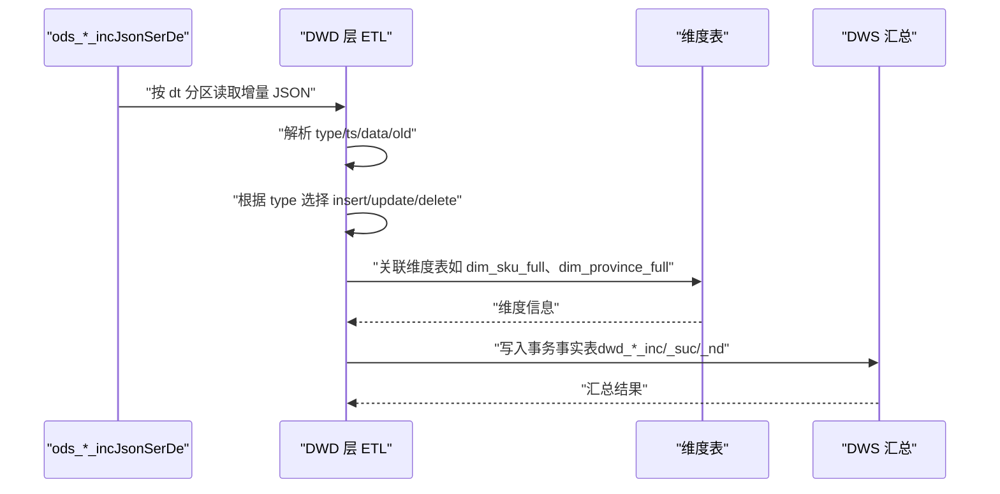
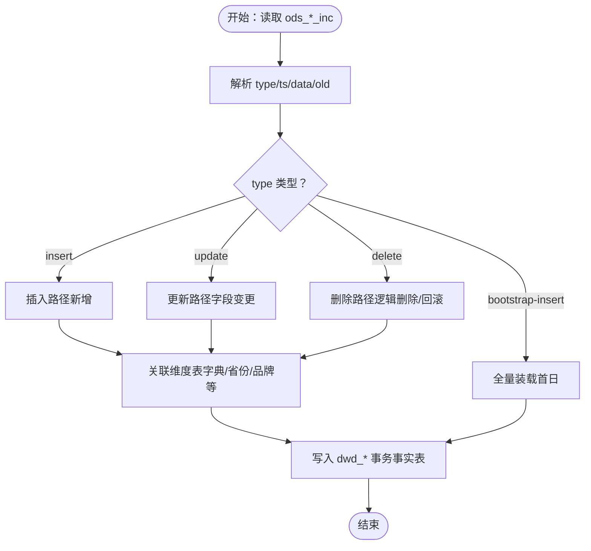
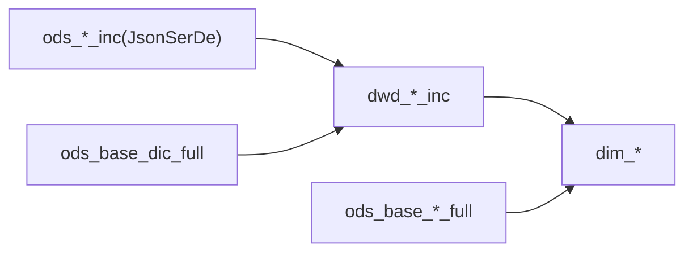

# 增量表设计

<cite>
**本文引用的文件**
- [gmall-0906.sql](file://gmall-0906.sql)
- [basic.sql](file://basic.sql)
- [high.sql](file://high.sql)
- [middle.sql](file://middle.sql)
- [console.sql](file://console.sql)
</cite>

## 目录
1. [引言](#引言)
2. [项目结构](#项目结构)
3. [核心组件](#核心组件)
4. [架构总览](#架构总览)
5. [详细组件分析](#详细组件分析)
6. [依赖分析](#依赖分析)
7. [性能考量](#性能考量)
8. [故障排查指南](#故障排查指南)
9. [结论](#结论)
10. [附录](#附录)

## 引言
本文件围绕 HQL 数据仓库中的增量表（ods_*_inc）进行系统化技术文档整理，重点阐述以下方面：
- 增量表的设计原理与实现细节，包括事务性数据变更的捕获机制（type、ts、data、old 字段）。
- JsonSerDe 序列化格式在增量表中的应用与解析要点。
- 数据变更类型标识与历史数据追踪策略。
- 增量表与全量表的配合使用、数据合并策略与 ETL 处理流程。
- 建表语句示例、数据装载命令与查询示例。
- 增量数据处理的最佳实践、性能优化技巧与故障排查方法。

## 项目结构
本仓库包含多个 SQL 文件，其中与增量表设计密切相关的为 gmall-0906.sql，其他文件用于演示 Hive 基础语法、窗口函数与分析场景。增量表主要分布在 gmall-0906.sql 的 ODS 层，采用 JsonSerDe 行格式，分区字段 dt 作为日期分区键；同时配套维度表与主题宽表（DWD/DWS）用于后续 ETL 与汇总。

```mermaid
graph TB
subgraph "ODS 层增量表"
ODS_LOG["ods_log_inc<br/>JsonSerDe"]
ODS_CART["ods_cart_info_inc<br/>JsonSerDe"]
ODS_ORDER["ods_order_info_inc<br/>JsonSerDe"]
ODS_COMMENT["ods_comment_info_inc<br/>JsonSerDe"]
ODS_USER["ods_user_info_inc<br/>JsonSerDe"]
ODS_REFUND["ods_order_refund_info_inc<br/>JsonSerDe"]
ODS_PAY["ods_payment_info_inc<br/>JsonSerDe"]
ODS_FAVOR["ods_favor_info_inc<br/>JsonSerDe"]
ODS_ACTIVITY["ods_order_detail_activity_inc<br/>JsonSerDe"]
ODS_COUPON["ods_order_detail_coupon_inc<br/>JsonSerDe"]
ODS_FULL["ods_*_full<br/>Delimited示例：ods_cart_info_full"]
end
subgraph "DWD 层事务事实表"
DWD_CART["dwd_trade_cart_add_inc"]
DWD_ORDER["dwd_trade_order_detail_inc"]
DWD_CANCEL["dwd_trade_cancel_detail_inc"]
DWD_PAY["dwd_trade_pay_detail_suc_inc"]
DWD_REFUND["dwd_trade_order_refund_inc"]
DWD_REFUND_PAY["dwd_trade_refund_pay_suc_inc"]
DWD_TRAFFIC["dwd_traffic_*_inc"]
DWD_USER["dwd_user_*_inc"]
end
subgraph "维度表"
DIM_SKU["dim_sku_full"]
DIM_PROVINCE["dim_province_full"]
DIM_DATE["dim_date"]
DIM_USER_ZIP["dim_user_zip"]
DIM_COUPON["dim_coupon_full"]
DIM_ACTIVITY["dim_activity_full"]
end
ODS_FULL --> DWD_CART
ODS_FULL --> DWD_ORDER
ODS_FULL --> DWD_REFUND
ODS_FULL --> DWD_PAY
ODS_FULL --> DWD_REFUND_PAY
ODS_FULL --> DWD_TRAFFIC
ODS_FULL --> DWD_USER
ODS_LOG --> DWD_TRAFFIC
ODS_CART --> DWD_CART
ODS_ORDER --> DWD_ORDER
ODS_COMMENT --> DWD_USER
ODS_USER --> DWD_USER
ODS_REFUND --> DWD_REFUND
ODS_PAY --> DWD_PAY
ODS_FAVOR --> DWD_USER
ODS_ACTIVITY --> DWD_ORDER
ODS_COUPON --> DWD_ORDER
DWD_CART --> DIM_SKU
DWD_ORDER --> DIM_SKU
DWD_REFUND --> DIM_SKU
DWD_PAY --> DIM_SKU
DWD_REFUND_PAY --> DIM_SKU
DWD_TRAFFIC --> DIM_PROVINCE
DWD_USER --> DIM_USER_ZIP
DWD_ORDER --> DIM_PROVINCE
DWD_REFUND --> DIM_PROVINCE
DWD_PAY --> DIM_PROVINCE
DWD_REFUND_PAY --> DIM_PROVINCE
DWD_ORDER --> DIM_DATE
```

图示来源
- [gmall-0906.sql](file://gmall-0906.sql#L284-L461)
- [gmall-0906.sql](file://gmall-0906.sql#L1174-L1278)
- [gmall-0906.sql](file://gmall-0906.sql#L1280-L1479)
- [gmall-0906.sql](file://gmall-0906.sql#L1480-L1680)
- [gmall-0906.sql](file://gmall-0906.sql#L1682-L1927)
- [gmall-0906.sql](file://gmall-0906.sql#L1928-L2077)
- [gmall-0906.sql](file://gmall-0906.sql#L2078-L2234)
- [gmall-0906.sql](file://gmall-0906.sql#L2236-L2399)
- [gmall-0906.sql](file://gmall-0906.sql#L2404-L2537)
- [gmall-0906.sql](file://gmall-0906.sql#L2538-L3049)
- [gmall-0906.sql](file://gmall-0906.sql#L3052-L3175)
- [gmall-0906.sql](file://gmall-0906.sql#L3176-L3280)
- [gmall-0906.sql](file://gmall-0906.sql#L800-L848)
- [gmall-0906.sql](file://gmall-0906.sql#L850-L887)
- [gmall-0906.sql](file://gmall-0906.sql#L908-L949)
- [gmall-0906.sql](file://gmall-0906.sql#L909-L1080)
- [gmall-0906.sql](file://gmall-0906.sql#L1081-L1169)

章节来源
- [gmall-0906.sql](file://gmall-0906.sql#L284-L461)
- [gmall-0906.sql](file://gmall-0906.sql#L1174-L1278)
- [gmall-0906.sql](file://gmall-0906.sql#L1280-L1479)
- [gmall-0906.sql](file://gmall-0906.sql#L1480-L1680)
- [gmall-0906.sql](file://gmall-0906.sql#L1682-L1927)
- [gmall-0906.sql](file://gmall-0906.sql#L1928-L2077)
- [gmall-0906.sql](file://gmall-0906.sql#L2078-L2234)
- [gmall-0906.sql](file://gmall-0906.sql#L2236-L2399)
- [gmall-0906.sql](file://gmall-0906.sql#L2404-L2537)
- [gmall-0906.sql](file://gmall-0906.sql#L2538-L3049)
- [gmall-0906.sql](file://gmall-0906.sql#L3052-L3175)
- [gmall-0906.sql](file://gmall-0906.sql#L3176-L3280)
- [gmall-0906.sql](file://gmall-0906.sql#L800-L848)
- [gmall-0906.sql](file://gmall-0906.sql#L850-L887)
- [gmall-0906.sql](file://gmall-0906.sql#L908-L949)
- [gmall-0906.sql](file://gmall-0906.sql#L909-L1080)
- [gmall-0906.sql](file://gmall-0906.sql#L1081-L1169)

## 核心组件
- 增量表（ods_*_inc）
  - 通用字段：type（变更类型）、ts（变更时间）、data（本次变更数据）、old（旧值映射）。
  - 行格式：JsonSerDe，便于直接落盘 JSON 日志并按 dt 分区。
  - 示例：购物车增量表、订单明细增量表、支付增量表、退单增量表、日志增量表等。
- 全量表（ods_*_full）
  - Delimited 行格式，按 dt 分区，用于维度表构建与周期快照。
- 事务事实表（dwd_*_inc/_suc/_nd）
  - 增量表经 ETL 聚合为事务事实表，支持 insert/update/cancel/refund 等状态流转。
- 维度表（dim_*）
  - 商品、省份、日期、用户、活动、优惠券等维度表，支撑宽表与汇总表。

章节来源
- [gmall-0906.sql](file://gmall-0906.sql#L284-L461)
- [gmall-0906.sql](file://gmall-0906.sql#L1174-L1278)
- [gmall-0906.sql](file://gmall-0906.sql#L1280-L1479)
- [gmall-0906.sql](file://gmall-0906.sql#L1480-L1680)
- [gmall-0906.sql](file://gmall-0906.sql#L1682-L1927)
- [gmall-0906.sql](file://gmall-0906.sql#L1928-L2077)
- [gmall-0906.sql](file://gmall-0906.sql#L2078-L2234)
- [gmall-0906.sql](file://gmall-0906.sql#L2236-L2399)
- [gmall-0906.sql](file://gmall-0906.sql#L2404-L2537)
- [gmall-0906.sql](file://gmall-0906.sql#L2538-L3049)
- [gmall-0906.sql](file://gmall-0906.sql#L3052-L3175)
- [gmall-0906.sql](file://gmall-0906.sql#L3176-L3280)
- [gmall-0906.sql](file://gmall-0906.sql#L800-L848)
- [gmall-0906.sql](file://gmall-0906.sql#L850-L887)
- [gmall-0906.sql](file://gmall-0906.sql#L908-L949)
- [gmall-0906.sql](file://gmall-0906.sql#L909-L1080)
- [gmall-0906.sql](file://gmall-0906.sql#L1081-L1169)

## 架构总览
增量表作为数据源，通过 JsonSerDe 解析 JSON，结合 type/ts/data/old 字段识别事务变更；随后进入 DWD 层，依据业务规则拆解为事务事实表，并与维度表关联生成汇总表（DWS），最终服务于报表与分析。

图示来源
- [gmall-0906.sql](file://gmall-0906.sql#L1174-L1278)
- [gmall-0906.sql](file://gmall-0906.sql#L1280-L1479)
- [gmall-0906.sql](file://gmall-0906.sql#L1480-L1680)
- [gmall-0906.sql](file://gmall-0906.sql#L1682-L1927)
- [gmall-0906.sql](file://gmall-0906.sql#L1928-L2077)
- [gmall-0906.sql](file://gmall-0906.sql#L2078-L2234)
- [gmall-0906.sql](file://gmall-0906.sql#L2236-L2399)
- [gmall-0906.sql](file://gmall-0906.sql#L2404-L2537)
- [gmall-0906.sql](file://gmall-0906.sql#L2538-L3049)
- [gmall-0906.sql](file://gmall-0906.sql#L3052-L3175)
- [gmall-0906.sql](file://gmall-0906.sql#L3176-L3280)
- [gmall-0906.sql](file://gmall-0906.sql#L800-L848)
- [gmall-0906.sql](file://gmall-0906.sql#L850-L887)
- [gmall-0906.sql](file://gmall-0906.sql#L908-L949)
- [gmall-0906.sql](file://gmall-0906.sql#L909-L1080)
- [gmall-0906.sql](file://gmall-0906.sql#L1081-L1169)

## 详细组件分析

### 增量表字段与 JsonSerDe 应用
- 字段定义
  - type：事务变更类型（如 bootstrap-insert、insert、update、delete）。
  - ts：变更时间戳（BIGINT），用于排序与会话/事件窗口计算。
  - data：本次变更的完整数据结构（STRUCT/ARRAY/基本类型）。
  - old：旧值映射（MAP<STRING,STRING>），用于识别字段级变更。
- 行格式
  - JsonSerDe：适用于日志类 JSON 数据，字段与 JSON 结构一一对应。
  - Delimited：适用于结构化文本数据（如全量表）。
- 分区
  - dt：日期分区键，便于按天增量处理与回放。

章节来源
- [gmall-0906.sql](file://gmall-0906.sql#L284-L461)
- [gmall-0906.sql](file://gmall-0906.sql#L1174-L1278)
- [gmall-0906.sql](file://gmall-0906.sql#L1280-L1479)
- [gmall-0906.sql](file://gmall-0906.sql#L1480-L1680)
- [gmall-0906.sql](file://gmall-0906.sql#L1682-L1927)
- [gmall-0906.sql](file://gmall-0906.sql#L1928-L2077)
- [gmall-0906.sql](file://gmall-0906.sql#L2078-L2234)
- [gmall-0906.sql](file://gmall-0906.sql#L2236-L2399)
- [gmall-0906.sql](file://gmall-0906.sql#L2404-L2537)
- [gmall-0906.sql](file://gmall-0906.sql#L2538-L3049)
- [gmall-0906.sql](file://gmall-0906.sql#L3052-L3175)
- [gmall-0906.sql](file://gmall-0906.sql#L3176-L3280)
- [gmall-0906.sql](file://gmall-0906.sql#L800-L848)
- [gmall-0906.sql](file://gmall-0906.sql#L850-L887)
- [gmall-0906.sql](file://gmall-0906.sql#L908-L949)
- [gmall-0906.sql](file://gmall-0906.sql#L909-L1080)
- [gmall-0906.sql](file://gmall-0906.sql#L1081-L1169)

### 增量表与全量表的配合
- 全量表（ods_*_full）：按 dt 分区，提供维度构建与周期快照。
- 增量表（ods_*_inc）：按 dt 分区，承载事务变更。
- 合并策略
  - 首日：bootstrap-insert 类型写入全量表或维度表。
  - 每日：基于增量表的 insert/update/delete，结合 old 字段进行字段级更新与回滚。
  - 维度表（如 dim_user_zip）：通过 rank() over (partition by id order by ts desc) 取最新记录，维护缓慢变化维度（SCD）。

章节来源
- [gmall-0906.sql](file://gmall-0906.sql#L909-L1080)
- [gmall-0906.sql](file://gmall-0906.sql#L1081-L1169)
- [gmall-0906.sql](file://gmall-0906.sql#L2236-L2399)
- [gmall-0906.sql](file://gmall-0906.sql#L2404-L2537)
- [gmall-0906.sql](file://gmall-0906.sql#L2538-L3049)
- [gmall-0906.sql](file://gmall-0906.sql#L3052-L3175)
- [gmall-0906.sql](file://gmall-0906.sql#L3176-L3280)

### 事务事实表的 ETL 处理流程
- 购物车增量（ods_cart_info_inc）到 DWD
  - 首日：type=bootstrap-insert，直接写入 dwd_trade_cart_add_inc。
  - 每日：type=insert 或 update，结合 old['sku_num'] 判断增量数量，生成当日事务事实。
- 订单明细增量（ods_order_detail_inc）到 DWD
  - 首日：type=bootstrap-insert，关联订单、活动、优惠券、来源字典，写入 dwd_trade_order_detail_inc。
  - 每日：type=insert，仅写入新增明细。
- 支付成功（ods_payment_info_inc）到 DWD
  - 基于支付状态（payment_status）过滤，写入 dwd_trade_pay_detail_suc_inc。
- 退单与退款（ods_order_refund_info_inc、ods_refund_payment_inc）到 DWD
  - 基于状态变化（order_status、refund_status）写入相应事实表。

图示来源
- [gmall-0906.sql](file://gmall-0906.sql#L1174-L1278)
- [gmall-0906.sql](file://gmall-0906.sql#L1280-L1479)
- [gmall-0906.sql](file://gmall-0906.sql#L1480-L1680)
- [gmall-0906.sql](file://gmall-0906.sql#L1682-L1927)
- [gmall-0906.sql](file://gmall-0906.sql#L1928-L2077)
- [gmall-0906.sql](file://gmall-0906.sql#L2078-L2234)
- [gmall-0906.sql](file://gmall-0906.sql#L2236-L2399)
- [gmall-0906.sql](file://gmall-0906.sql#L2404-L2537)
- [gmall-0906.sql](file://gmall-0906.sql#L2538-L3049)
- [gmall-0906.sql](file://gmall-0906.sql#L3052-L3175)
- [gmall-0906.sql](file://gmall-0906.sql#L3176-L3280)

### 增量数据变更类型标识与历史追踪
- 变更类型
  - bootstrap-insert：全量初始化。
  - insert：新增记录。
  - update：字段更新（结合 old 映射）。
  - delete：删除记录（可选，视业务需求）。
- 历史追踪
  - 通过 ts 字段与窗口函数（如 rank() over (partition by id order by ts desc)）选取最新记录，维护维度表的历史版本。
  - 通过 dt 分区与日期范围过滤，实现按日回放与重算。

章节来源
- [gmall-0906.sql](file://gmall-0906.sql#L909-L1080)
- [gmall-0906.sql](file://gmall-0906.sql#L1081-L1169)
- [gmall-0906.sql](file://gmall-0906.sql#L1174-L1278)
- [gmall-0906.sql](file://gmall-0906.sql#L1280-L1479)

### 建表语句示例与数据装载命令
- 增量表（JsonSerDe）
  - 示例：购物车增量表、订单明细增量表、支付增量表、退单增量表、日志增量表等。
- 全量表（Delimited）
  - 示例：购物车全量表、用户全量表、优惠券全量表等。
- 数据装载
  - 增量装载：load data inpath ... into table ... partition(dt='YYYY-MM-DD');
  - 首日全量装载：insert overwrite table ... partition(dt='YYYY-MM-DD') select ... from ods_*_inc where dt='YYYY-MM-DD' and type='bootstrap-insert';
  - 每日增量装载：insert overwrite table ... partition(dt='YYYY-MM-DD') select ... from ods_*_inc where dt='YYYY-MM-DD' and type='insert';

章节来源
- [gmall-0906.sql](file://gmall-0906.sql#L284-L461)
- [gmall-0906.sql](file://gmall-0906.sql#L800-L848)
- [gmall-0906.sql](file://gmall-0906.sql#L850-L887)
- [gmall-0906.sql](file://gmall-0906.sql#L908-L949)
- [gmall-0906.sql](file://gmall-0906.sql#L909-L1080)
- [gmall-0906.sql](file://gmall-0906.sql#L1081-L1169)
- [gmall-0906.sql](file://gmall-0906.sql#L1174-L1278)
- [gmall-0906.sql](file://gmall-0906.sql#L1280-L1479)
- [gmall-0906.sql](file://gmall-0906.sql#L1480-L1680)
- [gmall-0906.sql](file://gmall-0906.sql#L1682-L1927)
- [gmall-0906.sql](file://gmall-0906.sql#L1928-L2077)
- [gmall-0906.sql](file://gmall-0906.sql#L2078-L2234)
- [gmall-0906.sql](file://gmall-0906.sql#L2236-L2399)
- [gmall-0906.sql](file://gmall-0906.sql#L2404-L2537)
- [gmall-0906.sql](file://gmall-0906.sql#L2538-L3049)
- [gmall-0906.sql](file://gmall-0906.sql#L3052-L3175)
- [gmall-0906.sql](file://gmall-0906.sql#L3176-L3280)

### 查询示例
- 增量表查询
  - 按 dt 分区过滤：where dt='YYYY-MM-DD'
  - 按 type 过滤：and type='insert'
  - 按字段变更过滤：and array_contains(map_keys(old),'sku_num')
- 维度表查询
  - 取最新记录：rank() over (partition by id order by ts desc) rk where rk=1
- 事务事实表查询
  - 按日期范围汇总：where dt>=date_add('YYYY-MM-DD',-6) and dt<='YYYY-MM-DD'

章节来源
- [gmall-0906.sql](file://gmall-0906.sql#L1174-L1278)
- [gmall-0906.sql](file://gmall-0906.sql#L1280-L1479)
- [gmall-0906.sql](file://gmall-0906.sql#L1480-L1680)
- [gmall-0906.sql](file://gmall-0906.sql#L1682-L1927)
- [gmall-0906.sql](file://gmall-0906.sql#L1928-L2077)
- [gmall-0906.sql](file://gmall-0906.sql#L2078-L2234)
- [gmall-0906.sql](file://gmall-0906.sql#L2236-L2399)
- [gmall-0906.sql](file://gmall-0906.sql#L2404-L2537)
- [gmall-0906.sql](file://gmall-0906.sql#L2538-L3049)
- [gmall-0906.sql](file://gmall-0906.sql#L3052-L3175)
- [gmall-0906.sql](file://gmall-0906.sql#L3176-L3280)

## 依赖分析
- 组件耦合
  - 增量表（ods_*_inc）与 DWD 事务事实表强耦合，DWD 依赖 ods_*_inc 的 type/ts/data/old 字段。
  - DWD 事务事实表与维度表（dim_*）弱耦合，通过字典码表与基础表关联。
- 外部依赖
  - JsonSerDe：用于 ods_*_inc 的 JSON 解析。
  - 字典表（ods_base_dic_full）：提供来源类型、支付类型、评价类型等编码映射。
- 潜在循环依赖
  - 未发现直接循环依赖；维度表与事务事实表为单向依赖。

图示来源
- [gmall-0906.sql](file://gmall-0906.sql#L1174-L1278)
- [gmall-0906.sql](file://gmall-0906.sql#L1280-L1479)
- [gmall-0906.sql](file://gmall-0906.sql#L1480-L1680)
- [gmall-0906.sql](file://gmall-0906.sql#L1682-L1927)
- [gmall-0906.sql](file://gmall-0906.sql#L1928-L2077)
- [gmall-0906.sql](file://gmall-0906.sql#L2078-L2234)
- [gmall-0906.sql](file://gmall-0906.sql#L2236-L2399)
- [gmall-0906.sql](file://gmall-0906.sql#L2404-L2537)
- [gmall-0906.sql](file://gmall-0906.sql#L2538-L3049)
- [gmall-0906.sql](file://gmall-0906.sql#L3052-L3175)
- [gmall-0906.sql](file://gmall-0906.sql#L3176-L3280)
- [gmall-0906.sql](file://gmall-0906.sql#L800-L848)
- [gmall-0906.sql](file://gmall-0906.sql#L850-L887)
- [gmall-0906.sql](file://gmall-0906.sql#L908-L949)
- [gmall-0906.sql](file://gmall-0906.sql#L909-L1080)
- [gmall-0906.sql](file://gmall-0906.sql#L1081-L1169)

章节来源
- [gmall-0906.sql](file://gmall-0906.sql#L1174-L1278)
- [gmall-0906.sql](file://gmall-0906.sql#L1280-L1479)
- [gmall-0906.sql](file://gmall-0906.sql#L1480-L1680)
- [gmall-0906.sql](file://gmall-0906.sql#L1682-L1927)
- [gmall-0906.sql](file://gmall-0906.sql#L1928-L2077)
- [gmall-0906.sql](file://gmall-0906.sql#L2078-L2234)
- [gmall-0906.sql](file://gmall-0906.sql#L2236-L2399)
- [gmall-0906.sql](file://gmall-0906.sql#L2404-L2537)
- [gmall-0906.sql](file://gmall-0906.sql#L2538-L3049)
- [gmall-0906.sql](file://gmall-0906.sql#L3052-L3175)
- [gmall-0906.sql](file://gmall-0906.sql#L3176-L3280)
- [gmall-0906.sql](file://gmall-0906.sql#L800-L848)
- [gmall-0906.sql](file://gmall-0906.sql#L850-L887)
- [gmall-0906.sql](file://gmall-0906.sql#L908-L949)
- [gmall-0906.sql](file://gmall-0906.sql#L909-L1080)
- [gmall-0906.sql](file://gmall-0906.sql#L1081-L1169)

## 性能考量
- JsonSerDe 读取
  - 适合日志类 JSON，但解析成本较高；建议在入库前尽量规范化数据结构，减少深层嵌套。
- 分区裁剪
  - 严格使用 dt 分区过滤，避免全表扫描。
- 窗口函数与去重
  - 在维度表构建中使用 rank()/row_number() 与去重（distinct/group by）减少重复数据，提升后续 join 性能。
- 动态分区
  - 合理配置 hive.exec.dynamic.partition.mode=nonstrict，避免小文件过多。
- 字段选择
  - 仅选择必要字段，避免 select * 导致 IO 增加。

章节来源
- [gmall-0906.sql](file://gmall-0906.sql#L909-L1080)
- [gmall-0906.sql](file://gmall-0906.sql#L1081-L1169)
- [gmall-0906.sql](file://gmall-0906.sql#L1174-L1278)
- [gmall-0906.sql](file://gmall-0906.sql#L1280-L1479)
- [gmall-0906.sql](file://gmall-0906.sql#L1480-L1680)
- [gmall-0906.sql](file://gmall-0906.sql#L1682-L1927)
- [gmall-0906.sql](file://gmall-0906.sql#L1928-L2077)
- [gmall-0906.sql](file://gmall-0906.sql#L2078-L2234)
- [gmall-0906.sql](file://gmall-0906.sql#L2236-L2399)
- [gmall-0906.sql](file://gmall-0906.sql#L2404-L2537)
- [gmall-0906.sql](file://gmall-0906.sql#L2538-L3049)
- [gmall-0906.sql](file://gmall-0906.sql#L3052-L3175)
- [gmall-0906.sql](file://gmall-0906.sql#L3176-L3280)

## 故障排查指南
- JsonSerDe 解析失败
  - 检查 JSON 结构与字段类型一致性；确认 ROW FORMAT SERDE 'org.apache.hadoop.hive.serde2.JsonSerDe' 正确配置。
- 分区缺失或分区键错误
  - 确认 dt 分区键正确写入；检查 load data inpath 命令的分区参数。
- 维度表未取到最新记录
  - 检查 ts 字段是否正确；确认 rank() over (partition by id order by ts desc) rk=1 条件。
- 字段变更判断异常
  - 检查 old 映射是否存在；使用 array_contains(map_keys(old), '字段名') 判断是否涉及该字段。
- 性能问题
  - 使用 explain/analyze 检查执行计划；优化 where 条件、减少不必要的 join 与 select *。

章节来源
- [gmall-0906.sql](file://gmall-0906.sql#L909-L1080)
- [gmall-0906.sql](file://gmall-0906.sql#L1081-L1169)
- [gmall-0906.sql](file://gmall-0906.sql#L1174-L1278)
- [gmall-0906.sql](file://gmall-0906.sql#L1280-L1479)
- [gmall-0906.sql](file://gmall-0906.sql#L1480-L1680)
- [gmall-0906.sql](file://gmall-0906.sql#L1682-L1927)
- [gmall-0906.sql](file://gmall-0906.sql#L1928-L2077)
- [gmall-0906.sql](file://gmall-0906.sql#L2078-L2234)
- [gmall-0906.sql](file://gmall-0906.sql#L2236-L2399)
- [gmall-0906.sql](file://gmall-0906.sql#L2404-L2537)
- [gmall-0906.sql](file://gmall-0906.sql#L2538-L3049)
- [gmall-0906.sql](file://gmall-0906.sql#L3052-L3175)
- [gmall-0906.sql](file://gmall-0906.sql#L3176-L3280)

## 结论
增量表（ods_*_inc）通过 JsonSerDe 与统一的 type/ts/data/old 字段，实现了对事务性数据变更的标准化捕获；配合全量表与维度表，形成从 ODS 到 DWD/DIM 的完整数据链路。遵循分区裁剪、窗口函数去重与动态分区配置等最佳实践，可在保证数据准确性的同时显著提升性能。遇到解析与性能问题时，可通过执行计划分析与字段校验快速定位并解决。

## 附录
- 常用 SQL 片段路径
  - 增量表建表（JsonSerDe）：[gmall-0906.sql](file://gmall-0906.sql#L284-L461)
  - 全量表建表（Delimited）：[gmall-0906.sql](file://gmall-0906.sql#L800-L848)
  - 首日全量装载（示例：购物车）：[gmall-0906.sql](file://gmall-0906.sql#L2255-L2264)
  - 每日增量装载（示例：购物车）：[gmall-0906.sql](file://gmall-0906.sql#L1199-L1278)
  - 维度表最新记录取值（示例：用户维度）：[gmall-0906.sql](file://gmall-0906.sql#L956-L1080)
  - 事务事实表 ETL（示例：订单明细）：[gmall-0906.sql](file://gmall-0906.sql#L1280-L1479)