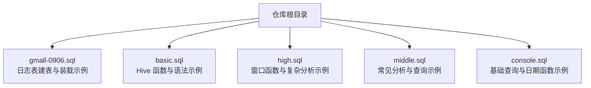
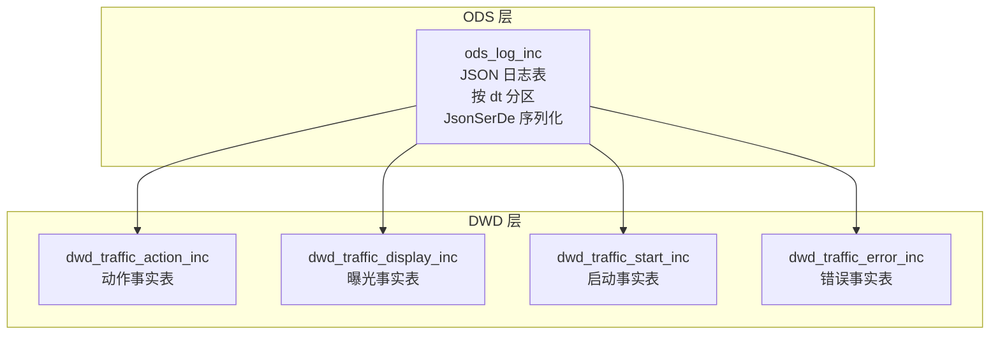
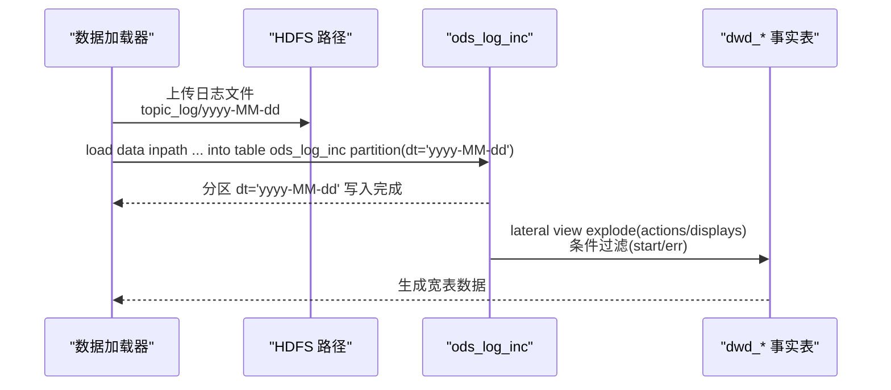
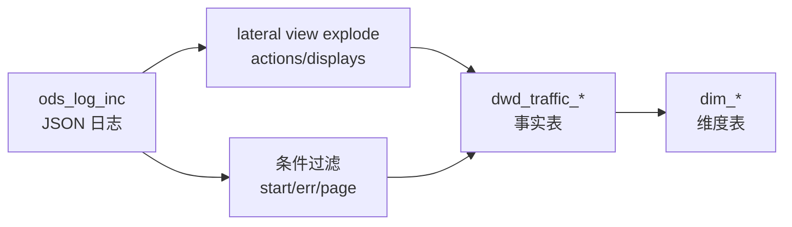

# 日志表设计

<cite>
**本文引用的文件**
- [gmall-0906.sql](file://gmall-0906.sql)
- [basic.sql](file://basic.sql)
</cite>

## 目录
1. [引言](#引言)
2. [项目结构](#项目结构)
3. [核心组件](#核心组件)
4. [架构总览](#架构总览)
5. [详细组件分析](#详细组件分析)
6. [依赖分析](#依赖分析)
7. [性能考量](#性能考量)
8. [故障排查指南](#故障排查指南)
9. [结论](#结论)
10. [附录](#附录)

## 引言
本技术文档围绕 HQL 数据仓库中的日志表（ods_log_inc）展开，系统性阐述其建表设计、嵌套结构（common、page、actions、displays、start、err 等字段）的定义与用途、JsonSerDe 序列化格式的使用、按日期分区策略、数据装载方式，以及日志数据的特点、数据结构设计思路与业务应用场景。文档同时提供建表语句示例、数据装载命令与查询示例的路径指引，并给出字段含义说明、数据类型选择理由与性能优化建议，帮助读者快速理解并高效使用该日志表。

## 项目结构
本仓库包含多个 SQL 文件，其中与日志表设计密切相关的为 gmall-0906.sql。该文件中定义了 ods_log_inc 日志表的建表语句、分区策略、序列化格式，以及后续从 ods 层到 dwd 层的事实表装载逻辑。basic.sql 提供了 Hive 常用函数与语法示例，有助于理解日志表字段解析与查询场景。

图表来源
- [gmall-0906.sql](file://gmall-0906.sql#L24-L41)
- [basic.sql](file://basic.sql#L1-L120)

章节来源
- [gmall-0906.sql](file://gmall-0906.sql#L24-L41)
- [basic.sql](file://basic.sql#L1-L120)

## 核心组件
- ods_log_inc 日志表：ODS 层外部表，采用 JsonSerDe 序列化，按 dt 日期分区，承载原始日志数据。
- 嵌套结构字段：
  - common：公共信息，包含区域、品牌、渠道、新老用户标识、机型、系统、用户 ID、版本等。
  - page：页面信息，包含页面停留时长、目标项、目标类型、上一页、页面 ID、来源类型等。
  - actions：动作数组，包含动作 ID、目标项、目标类型、时间戳。
  - displays：曝光数组，包含曝光类型、目标项、目标类型、曝光顺序、曝光位置。
  - start：启动信息，包含入口、加载时长、广告 ID、广告时长、跳过时点等。
  - err：错误信息，包含错误码与错误消息。
  - ts：事件时间戳。
- 数据装载：通过 load data inpath 命令将指定日期的日志数据装载到对应 dt 分区。

章节来源
- [gmall-0906.sql](file://gmall-0906.sql#L24-L41)
- [gmall-0906.sql](file://gmall-0906.sql#L44-L46)

## 架构总览
ods_log_inc 作为 ODS 层原始日志表，承担数据接入与归档职责；随后通过 dwd 层事实表（如 dwd_traffic_action_inc、dwd_traffic_display_inc、dwd_traffic_start_inc、dwd_traffic_error_inc）对日志进行拆解与清洗，形成面向分析的宽表，支撑后续 DWS、ADS 等层级的报表与指标计算。

图表来源
- [gmall-0906.sql](file://gmall-0906.sql#L24-L41)
- [gmall-0906.sql](file://gmall-0906.sql#L2755-L2841)
- [gmall-0906.sql](file://gmall-0906.sql#L2844-L2939)
- [gmall-0906.sql](file://gmall-0906.sql#L2673-L2751)
- [gmall-0906.sql](file://gmall-0906.sql#L2941-L3047)

## 详细组件分析

### ods_log_inc 建表与序列化
- 表结构要点
  - 字段类型：common/page/start/err 为 STRUCT；actions/displays 为 ARRAY<STRUCT>；ts 为 BIGINT；dt 为分区键 STRING。
  - 序列化：ROW FORMAT SERDE 'org.apache.hadoop.hive.serde2.JsonSerDe'。
  - 分区：PARTITIONED BY (`dt` STRING)。
  - 存储位置：LOCATION '/warehouse/gmall/ods/ods_log_inc/'。
- 设计意图
  - JsonSerDe 适配 JSON 文本日志，便于直接落盘与后续解析。
  - 分区 dt 用于按天归档与查询裁剪，提升扫描效率。
  - 嵌套结构映射前端上报的复杂 JSON 结构，便于后续拆解与分析。

章节来源
- [gmall-0906.sql](file://gmall-0906.sql#L24-L41)

### 嵌套字段详解与业务含义
- common（公共信息）
  - 字段示例：ar（区域）、ba（品牌）、ch（渠道）、is_new（是否新用户）、md（机型）、mid（设备 ID）、os（操作系统）、uid（用户 ID）、vc（版本号）。
  - 用途：统一设备与用户上下文信息，便于跨表关联与维度分析。
- page（页面信息）
  - 字段示例：during_time（页面停留时长）、item/item_type（目标项与类型）、last_page_id（上一页）、page_id（页面 ID）、source_type（来源类型）。
  - 用途：刻画用户页面行为轨迹与停留特征。
- actions（动作数组）
  - 字段示例：action_id（动作 ID）、item/item_type（目标项与类型）、ts（时间戳）。
  - 用途：记录用户在页面内的具体交互动作序列。
- displays（曝光数组）
  - 字段示例：display_type（曝光类型）、item/item_type（曝光对象与类型）、order（曝光顺序）、pos_id（曝光位置）。
  - 用途：记录广告或商品曝光情况，支持曝光到点击链路分析。
- start（启动信息）
  - 字段示例：entry（入口）、loading_time（加载时长）、open_ad_id/open_ad_ms/open_ad_skip_ms（广告相关）。
  - 用途：分析启动性能与广告投放效果。
- err（错误信息）
  - 字段示例：error_code（错误码）、msg（错误消息）。
  - 用途：采集异常与错误信息，支撑质量监控与问题定位。
- ts（时间戳）
  - 用途：事件发生时间，用于排序与会话识别。

章节来源
- [gmall-0906.sql](file://gmall-0906.sql#L24-L41)

### 数据装载流程
- 单日装载
  - 使用 load data inpath 命令将指定路径的日志文件装载到 ods_log_inc 的 dt 分区。
  - 示例路径与分区：topic_log/2020-06-14 -> dt='2020-06-14'。
- 后续处理
  - 通过 lateral view explode 将 actions/displays 数组展开，生成 dwd 层事实表。
  - 对 start/err 字段进行条件过滤与字段映射，形成启动与错误事实表。

图表来源
- [gmall-0906.sql](file://gmall-0906.sql#L44-L46)
- [gmall-0906.sql](file://gmall-0906.sql#L2828-L2832)
- [gmall-0906.sql](file://gmall-0906.sql#L2925-L2929)
- [gmall-0906.sql](file://gmall-0906.sql#L2737-L2741)
- [gmall-0906.sql](file://gmall-0906.sql#L3035-L3038)

章节来源
- [gmall-0906.sql](file://gmall-0906.sql#L44-L46)
- [gmall-0906.sql](file://gmall-0906.sql#L2737-L2741)
- [gmall-0906.sql](file://gmall-0906.sql#L2828-L2832)
- [gmall-0906.sql](file://gmall-0906.sql#L2925-L2929)
- [gmall-0906.sql](file://gmall-0906.sql#L3035-L3038)

### 查询与拆解示例（路径指引）
- 动作事实表装载
  - 路径：[gmall-0906.sql](file://gmall-0906.sql#L2785-L2807)
  - 关键点：lateral view explode(actions)、字段映射、日期转换、省份维度关联。
- 曝光事实表装载
  - 路径：[gmall-0906.sql](file://gmall-0906.sql#L2878-L2902)
  - 关键点：lateral view explode(displays)、曝光顺序与位置字段映射。
- 启动事实表装载
  - 路径：[gmall-0906.sql](file://gmall-0906.sql#L2701-L2720)
  - 关键点：start 字段过滤、广告相关字段提取。
- 错误事实表装载
  - 路径：[gmall-0906.sql](file://gmall-0906.sql#L2979-L3007)
  - 关键点：err 字段过滤、错误码与消息提取。
- 页面浏览与会话起点识别
  - 路径：[gmall-0906.sql](file://gmall-0906.sql#L2600-L2613)
  - 关键点：page.last_page_id 为空时标记会话起点，结合窗口函数进行会话标识。

章节来源
- [gmall-0906.sql](file://gmall-0906.sql#L2785-L2807)
- [gmall-0906.sql](file://gmall-0906.sql#L2878-L2902)
- [gmall-0906.sql](file://gmall-0906.sql#L2701-L2720)
- [gmall-0906.sql](file://gmall-0906.sql#L2979-L3007)
- [gmall-0906.sql](file://gmall-0906.sql#L2600-L2613)

### 数据类型选择理由
- STRUCT/ARRAY<STRUCT>：用于表达嵌套 JSON 的层次结构，便于后续 explode 与字段级访问。
- STRING/BIGINT：common/page/start/err 中多数字段为 STRING，便于兼容不同上报格式；ts 使用 BIGINT 以支持时间戳运算。
- 分区 dt 使用 STRING：便于与日期字符串一致，简化分区管理与查询。

章节来源
- [gmall-0906.sql](file://gmall-0906.sql#L24-L41)

### 字段含义与业务场景
- common：设备与用户上下文，用于设备画像、用户画像与地域分析。
- page：页面行为，用于页面热度、跳出率、停留时长等分析。
- actions：交互动作，用于事件流分析、漏斗转化与用户路径分析。
- displays：曝光行为，用于曝光到点击链路与广告效果评估。
- start：启动性能与广告投放，用于启动时延与广告观看时长分析。
- err：错误监控，用于异常趋势与问题定位。

章节来源
- [gmall-0906.sql](file://gmall-0906.sql#L24-L41)

## 依赖分析
- ODS 层依赖
  - JsonSerDe：解析 JSON 日志文本。
  - 分区 dt：按天分区，便于查询裁剪与增量处理。
- DWD 层依赖
  - lateral view explode：将数组字段展开为行，形成宽表。
  - 字段映射：将嵌套字段扁平化为宽表列。
  - 维度表关联：与省份等维度表进行关联，补充地理信息。

图表来源
- [gmall-0906.sql](file://gmall-0906.sql#L2828-L2832)
- [gmall-0906.sql](file://gmall-0906.sql#L2925-L2929)
- [gmall-0906.sql](file://gmall-0906.sql#L2737-L2741)
- [gmall-0906.sql](file://gmall-0906.sql#L3035-L3038)

章节来源
- [gmall-0906.sql](file://gmall-0906.sql#L2828-L2832)
- [gmall-0906.sql](file://gmall-0906.sql#L2925-L2929)
- [gmall-0906.sql](file://gmall-0906.sql#L2737-L2741)
- [gmall-0906.sql](file://gmall-0906.sql#L3035-L3038)

## 性能考量
- 分区裁剪：按 dt 分区可显著减少扫描数据量，建议在查询中始终带上 dt 条件。
- 数组展开成本：lateral view explode 会产生行膨胀，应尽量在必要时才展开，并配合 where 过滤减少无效行。
- 字段扁平化：将嵌套字段映射为宽表列，有利于后续聚合与连接，但需权衡列数与存储成本。
- 时间戳处理：使用 BIGINT 存储 ts，便于排序与区间计算，避免字符串时间处理带来的隐式转换成本。
- 序列化与存储：JsonSerDe 解析 JSON 有一定 CPU 成本，建议在 ODS 层保持原始结构，在 DWD 层进行必要的扁平化与清洗。

章节来源
- [gmall-0906.sql](file://gmall-0906.sql#L24-L41)
- [gmall-0906.sql](file://gmall-0906.sql#L2785-L2807)
- [gmall-0906.sql](file://gmall-0906.sql#L2878-L2902)

## 故障排查指南
- JSON 解析失败
  - 现象：加载或查询时报错，字段为空或解析异常。
  - 排查：确认输入 JSON 格式正确，字段命名与建表定义一致；检查 JsonSerDe 是否正确配置。
  - 参考路径：[gmall-0906.sql](file://gmall-0906.sql#L24-L41)
- 分区缺失
  - 现象：查询不到数据或分区不存在。
  - 排查：确认 dt 分区值与装载时一致；使用 show partitions 检查分区是否存在。
  - 参考路径：[gmall-0906.sql](file://gmall-0906.sql#L44-L46)
- 数组字段为空
  - 现象：explode 后无数据或行数异常。
  - 排查：在装载前增加 where actions is not null 与 where displays is not null 条件；确保上游日志确实包含数组字段。
  - 参考路径：[gmall-0906.sql](file://gmall-0906.sql#L2828-L2832)
  - 参考路径：[gmall-0906.sql](file://gmall-0906.sql#L2925-L2929)
- 启动/错误字段为空
  - 现象：start/err 字段为空导致事实表无数据。
  - 排查：在装载时增加 where start is not null 或 where err is not null 条件。
  - 参考路径：[gmall-0906.sql](file://gmall-0906.sql#L2737-L2741)
  - 参考路径：[gmall-0906.sql](file://gmall-0906.sql#L3035-L3038)

章节来源
- [gmall-0906.sql](file://gmall-0906.sql#L24-L41)
- [gmall-0906.sql](file://gmall-0906.sql#L44-L46)
- [gmall-0906.sql](file://gmall-0906.sql#L2828-L2832)
- [gmall-0906.sql](file://gmall-0906.sql#L2925-L2929)
- [gmall-0906.sql](file://gmall-0906.sql#L2737-L2741)
- [gmall-0906.sql](file://gmall-0906.sql#L3035-L3038)

## 结论
ods_log_inc 通过 JsonSerDe 与按天分区策略，实现了对复杂 JSON 日志的高效接入与管理。其嵌套结构清晰映射前端上报数据，为后续动作、曝光、启动与错误等维度的事实表提供了坚实基础。遵循分区裁剪、数组展开优化与字段扁平化原则，可在保证查询性能的同时满足多样化的业务分析需求。

## 附录
- 建表语句示例（路径）
  - [gmall-0906.sql](file://gmall-0906.sql#L24-L41)
- 数据装载命令示例（路径）
  - [gmall-0906.sql](file://gmall-0906.sql#L44-L46)
- 查询与拆解示例（路径）
  - 动作事实表装载：[gmall-0906.sql](file://gmall-0906.sql#L2785-L2807)
  - 曝光事实表装载：[gmall-0906.sql](file://gmall-0906.sql#L2878-L2902)
  - 启动事实表装载：[gmall-0906.sql](file://gmall-0906.sql#L2701-L2720)
  - 错误事实表装载：[gmall-0906.sql](file://gmall-0906.sql#L2979-L3007)
  - 页面浏览与会话起点识别：[gmall-0906.sql](file://gmall-0906.sql#L2600-L2613)