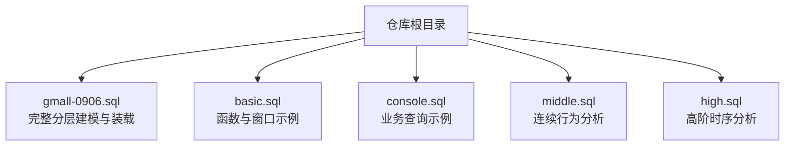
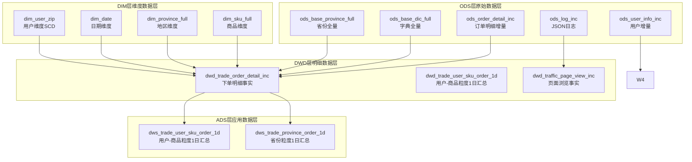
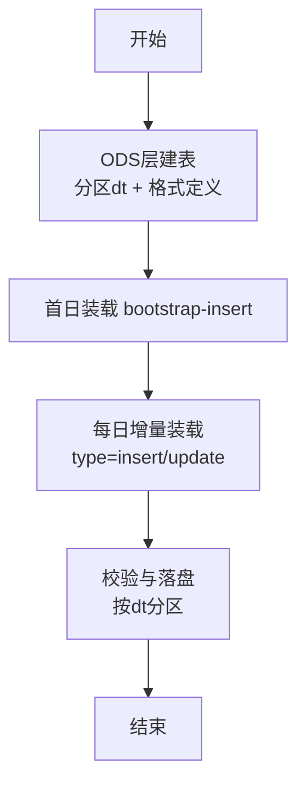
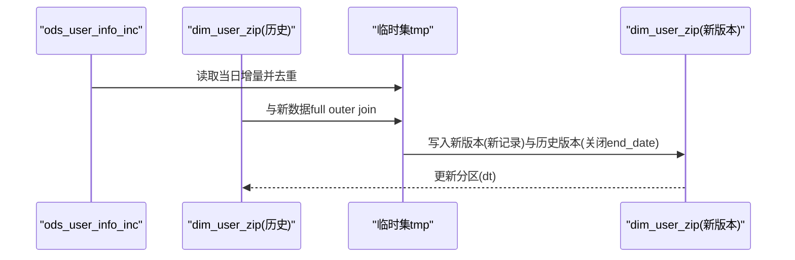
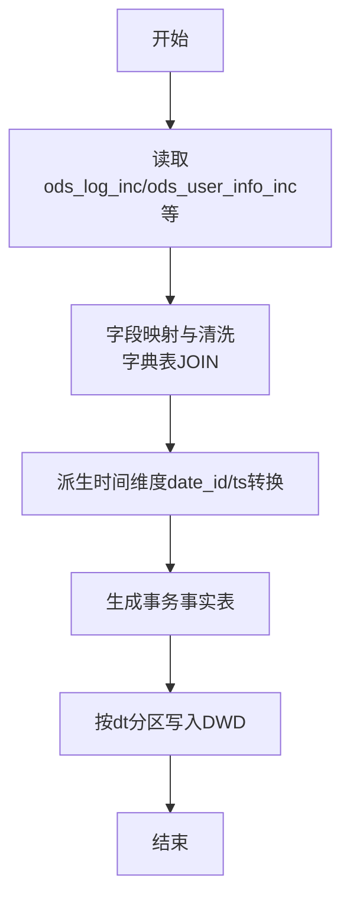
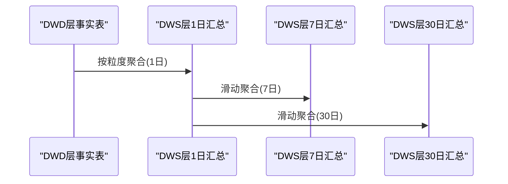

# 数据仓库架构

<cite>
**本文引用的文件**
- [basic.sql](file://basic.sql)
- [console.sql](file://console.sql)
- [gmall-0906.sql](file://gmall-0906.sql)
- [high.sql](file://high.sql)
- [middle.sql](file://middle.sql)
</cite>

## 目录
1. [引言](#引言)
2. [项目结构](#项目结构)
3. [核心组件](#核心组件)
4. [架构总览](#架构总览)
5. [详细组件分析](#详细组件分析)
6. [依赖分析](#依赖分析)
7. [性能考量](#性能考量)
8. [故障排查指南](#故障排查指南)
9. [结论](#结论)
10. [附录](#附录)

## 引言
本文件面向HQL数据仓库工程，系统化梳理四层数据仓库架构设计与实现要点：ODS层（原始数据层）、DWD层（明细数据层）、DIM层（维度数据层）、ADS层（应用数据层）。通过对仓库脚本的结构化解读，阐明每层的数据流向、处理逻辑、存储策略与分区设计，并给出架构图表与数据流图，帮助读者快速理解整体设计思路与最佳实践。

## 项目结构
仓库采用按主题/模块拆分的SQL脚本组织方式，便于分层与职责分离：
- gmall-0906.sql：完整数据仓库建模与分层实现，覆盖ODS/DIM/DWD/ADS各层事实表与汇总表的建表、分区与装载流程。
- basic.sql：通用函数与窗口函数示例，体现仓库中广泛使用的分析能力。
- console.sql：业务场景查询与练习，展示典型联结、聚合与窗口分析。
- middle.sql：连续登录、累计消费等典型分析场景，强调窗口与时间维度的使用。
- high.sql：在线人数、会话划分等高阶分析，体现窗口与时间序列处理。

章节来源
- file://gmall-0906.sql#L1-L120
- file://basic.sql#L1-L120
- file://console.sql#L1-L120
- file://middle.sql#L1-L120
- file://high.sql#L1-L120

## 核心组件
围绕四层架构，核心组件包括：
- ODS层（原始数据层）
  - 作用：接入原始日志与业务增量/全量数据，按天分区，保留原始字段与时间戳。
  - 特征：外部表、分区字段dt、按数据源类型区分（JSON/TSV）。
- DIM层（维度数据层）
  - 作用：沉淀维度主数据，如商品、地区、日期、用户等，支持缓慢变更维度（SCD）。
  - 特征：按天分区dt；部分维度表采用ORC存储并启用压缩。
- DWD层（明细数据层）
  - 作用：对ODS进行清洗、映射、派生与轻度聚合，形成可查询的事实明细。
  - 特征：按天分区dt；事实表字段标准化；多表JOIN与字典表映射。
- ADS层（应用数据层）
  - 作用：面向主题与指标的宽表或汇总表，支撑报表与前端展示。
  - 特征：按天分区dt；按主题聚合（用户/商品/省份/活动/优惠券等）。

章节来源
- file://gmall-0906.sql#L21-L120
- file://gmall-0906.sql#L465-L520
- file://gmall-0906.sql#L1174-L1210
- file://gmall-0906.sql#L3652-L3700
- file://gmall-0906.sql#L4038-L4060

## 架构总览
下图展示了从ODS到DWD再到ADS的整体数据流与分层关系：

图表来源
- file://gmall-0906.sql#L21-L120
- file://gmall-0906.sql#L465-L520
- file://gmall-0906.sql#L1174-L1210
- file://gmall-0906.sql#L3652-L3700
- file://gmall-0906.sql#L4266-L4340

## 详细组件分析

### ODS层（原始数据层）
- 设计要点
  - 外部表：便于对接离线/实时数据源，降低迁移成本。
  - 分区策略：统一按dt分区，便于增量装载与失效恢复。
  - 数据格式：日志类采用JSON SerDe，业务表采用TSV分隔。
- 典型表
  - 日志事实：ods_log_inc（JSON），包含common/page/actions/displays/start/err/ts等字段。
  - 用户事实：ods_user_info_inc（JSON），含type/ts/data/old等CDC字段。
  - 订单明细：ods_order_detail_inc（JSON），含data与old用于增量更新识别。
  - 字典与基础维度：ods_base_dic_full、ods_base_province_full等全量表。
- 装载流程
  - 首日bootstrap-insert：一次性导入全量数据。
  - 每日增量：基于type字段识别insert/update/bootstrap-insert，结合ts/old字段完成差异装载。

图表来源
- file://gmall-0906.sql#L21-L120
- file://gmall-0906.sql#L1174-L1210

章节来源
- file://gmall-0906.sql#L21-L120
- file://gmall-0906.sql#L1174-L1210

### DIM层（维度数据层）
- 设计要点
  - 维度主数据：商品、地区、日期、用户等，按天分区dt。
  - 维度建模：通过ODS全量表与字典表JOIN构建，派生维度属性（如品类链路、品牌名称）。
  - SCD处理：用户维度采用zipper模式，维护start_date/end_date与历史版本。
- 典型表
  - 商品维度：dim_sku_full，聚合spu/category/tm等信息，生成层级维度。
  - 地区维度：dim_province_full，关联region生成完整地理维度。
  - 日期维度：dim_date，预置周/季度/工作日等派生字段。
  - 用户维度：dim_user_zip，MD5脱敏与SCD处理。
- 装载策略
  - 首日：bootstrap-insert一次性写入历史有效区间（end_date='9999-12-31'）。
  - 每日：基于ods_user_info_inc的最新记录，与历史表full outer join，生成新旧版本并回写end_date。

图表来源
- file://gmall-0906.sql#L909-L1080
- file://gmall-0906.sql#L1081-L1170

章节来源
- file://gmall-0906.sql#L465-L520
- file://gmall-0906.sql#L800-L870
- file://gmall-0906.sql#L909-L1080
- file://gmall-0906.sql#L1081-L1170

### DWD层（明细数据层）
- 设计要点
  - 清洗与映射：将ODS的原始字段映射为标准维度编码（如字典表dic_code/dic_name）。
  - 事务事实：按业务事件建事实表，如下单明细、支付明细、退单明细、页面浏览、启动、动作、曝光等。
  - 时间维度：将create_time/ts等统一转换为date_id，便于后续按日聚合。
- 典型表
  - 交易域下单明细：dwd_trade_order_detail_inc，含活动/优惠券关联字段。
  - 交易域支付明细：dwd_trade_pay_detail_suc_inc，按支付状态过滤。
  - 交易域退单明细：dwd_trade_order_refund_inc。
  - 流量域页面浏览：dwd_traffic_page_view_inc，基于ods_log_inc解析并生成session_id。
  - 用户域注册/登录：dwd_user_register_inc、dwd_user_login_inc。
- 装载策略
  - 首日：bootstrap-insert一次性装载。
  - 每日：根据type与old字段识别新增/更新，计算差量（如sku_num差值）并落盘。

图表来源
- file://gmall-0906.sql#L2540-L2620
- file://gmall-0906.sql#L3052-L3175
- file://gmall-0906.sql#L1280-L1395

章节来源
- file://gmall-0906.sql#L1280-L1395
- file://gmall-0906.sql#L1682-L1712
- file://gmall-0906.sql#L1930-L2077
- file://gmall-0906.sql#L2236-L2307
- file://gmall-0906.sql#L2310-L2399
- file://gmall-0906.sql#L2404-L2537
- file://gmall-0906.sql#L2540-L2620
- file://gmall-0906.sql#L2628-L2751
- file://gmall-0906.sql#L2754-L2842
- file://gmall-0906.sql#L2844-L2939
- file://gmall-0906.sql#L2941-L3051
- file://gmall-0906.sql#L3052-L3175

### ADS层（应用数据层）
- 设计要点
  - 主题聚合：按用户/商品/省份/活动/优惠券等粒度进行1日/7日/30日/至今汇总。
  - 指标口径：明确原始金额、活动优惠、券优惠、最终金额等口径，确保一致性。
  - 存储格式：采用ORC并启用压缩，提升查询性能与存储效率。
- 典型表
  - 用户-商品粒度1日汇总：dws_trade_user_sku_order_1d。
  - 用户-商品粒度n日汇总：dws_trade_user_sku_order_nd。
  - 省份粒度1日/nd汇总：dws_trade_province_order_1d/nd。
  - 用户粒度1日/nd/至今汇总：dws_trade_user_order_1d/nd/td。
  - 优惠券/活动粒度nd汇总：dws_trade_coupon_order_nd、dws_trade_activity_order_nd。
- 装载策略
  - 1日汇总：基于DWD层按粒度聚合，派生优惠金额字段。
  - n日汇总：基于1日表进行滑动窗口聚合。
  - 至今汇总：基于TD表进行全量累加或基于1日表进行full outer join滚动更新。

图表来源
- file://gmall-0906.sql#L3652-L3700
- file://gmall-0906.sql#L3792-L3824
- file://gmall-0906.sql#L4038-L4054
- file://gmall-0906.sql#L4086-L4107
- file://gmall-0906.sql#L4266-L4327
- file://gmall-0906.sql#L4368-L4416
- file://gmall-0906.sql#L4600-L4655
- file://gmall-0906.sql#L4658-L4712
- file://gmall-0906.sql#L4714-L4793

章节来源
- file://gmall-0906.sql#L3652-L3700
- file://gmall-0906.sql#L3792-L3824
- file://gmall-0906.sql#L4038-L4054
- file://gmall-0906.sql#L4086-L4107
- file://gmall-0906.sql#L4266-L4327
- file://gmall-0906.sql#L4368-L4416
- file://gmall-0906.sql#L4600-L4655
- file://gmall-0906.sql#L4658-L4712
- file://gmall-0906.sql#L4714-L4793

## 依赖分析
- 组件耦合
  - ODS依赖外部数据源（日志/业务系统），通过分区dt与格式定义隔离。
  - DIM依赖ODS全量表与字典表，形成稳定的维度主数据。
  - DWD依赖DIM与ODS，承担清洗、映射与派生职责。
  - ADS依赖DWD，进行主题聚合与口径统一。
- 依赖关系可视化

图表来源
- file://gmall-0906.sql#L21-L120
- file://gmall-0906.sql#L465-L520
- file://gmall-0906.sql#L1174-L1210
- file://gmall-0906.sql#L3652-L3700

章节来源
- file://gmall-0906.sql#L21-L120
- file://gmall-0906.sql#L465-L520
- file://gmall-0906.sql#L1174-L1210
- file://gmall-0906.sql#L3652-L3700

## 性能考量
- 存储格式与压缩
  - 事实表与汇总表普遍采用ORC存储并启用snappy压缩，显著降低存储与I/O开销。
- 分区策略
  - 统一按dt分区，便于按天裁剪与失效恢复；对高基数维度（如mid_id）建议配合桶或分区裁剪。
- 查询优化
  - 优先使用分区裁剪与谓词下推；避免select *，仅取必要列。
  - 合理使用窗口函数与物化视图（如DWS层）减少重复计算。
- 写入优化
  - 首日全量与每日增量分离，减少重复扫描；增量阶段利用type/old字段精准识别差异。

章节来源
- file://gmall-0906.sql#L465-L520
- file://gmall-0906.sql#L1174-L1210
- file://gmall-0906.sql#L3652-L3700

## 故障排查指南
- 常见问题定位
  - 字段缺失/类型不一致：检查ODS建表字段与数据源是否匹配，确认JSON/TSV分隔符与NULL定义。
  - 分区丢失/分区值异常：核对dt分区值与日期格式，确保load/insert时正确传入dt。
  - 维度映射失败：核对字典表parent_code与dic_code是否一致，确认JOIN键是否存在。
  - SCD更新冲突：核对ods_user_info_inc的ts与type字段，确保去重与版本切换逻辑正确。
- 排查步骤
  - 首先验证ODS数据是否成功导入（分区是否存在、记录数是否符合预期）。
  - 检查DIM装载是否成功（字典JOIN是否命中、派生字段是否正确）。
  - 校验DWD事实表字段映射与时间维度转换（date_id/ts转换）。
  - 最后核对ADS层聚合口径与分区写入。

章节来源
- file://gmall-0906.sql#L21-L120
- file://gmall-0906.sql#L909-L1080
- file://gmall-0906.sql#L1174-L1210
- file://gmall-0906.sql#L3652-L3700

## 结论
本仓库以ODS/DIM/DWD/ADS四层架构为核心，实现了从原始日志与业务数据到主题汇总与指标报表的完整数据通路。通过分区dt、ORC存储、字典映射与SCD处理等手段，兼顾了数据一致性、查询性能与维护便利性。建议在实际落地中持续完善分区裁剪、物化汇总与监控告警体系，以支撑更大规模与更高频次的数据更新。

## 附录
- 表结构设计规范
  - 明确主键/外键与业务键，统一命名风格（如dwd_前缀）。
  - 事实表字段标准化，避免冗余与重复计算。
- 分区策略
  - 按dt分区，建议按天滚动清理过期分区。
- 存储格式
  - 事实表与汇总表优先采用ORC并启用snappy压缩。
- 指标口径
  - 明确原始金额/优惠金额/最终金额等口径，确保跨表一致性。