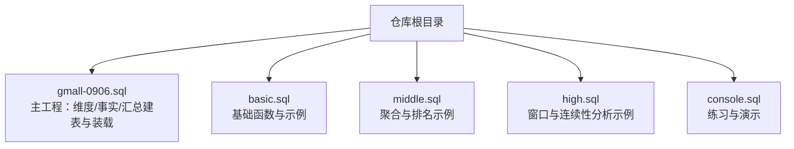
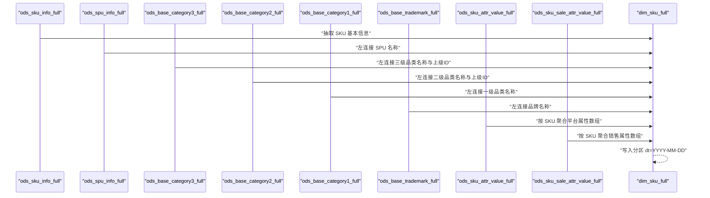
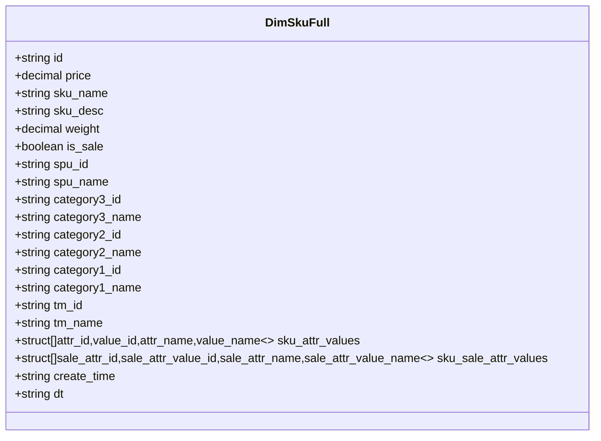
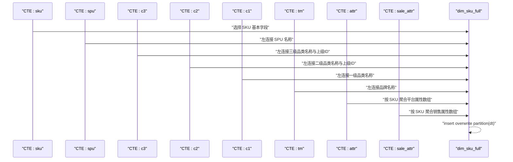
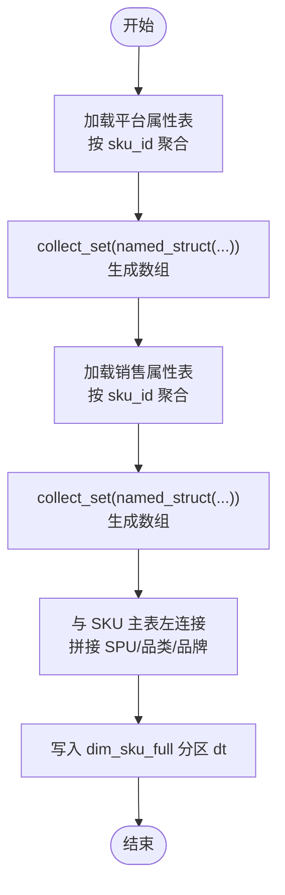
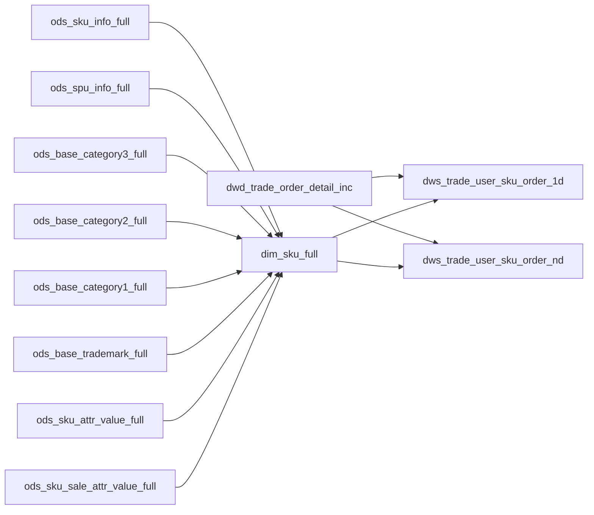

# 商品维度建模

<cite>
**本文引用的文件**
- [gmall-0906.sql](file://gmall-0906.sql)
- [basic.sql](file://basic.sql)
- [middle.sql](file://middle.sql)
- [high.sql](file://high.sql)
- [console.sql](file://console.sql)
</cite>

## 目录
1. [引言](#引言)
2. [项目结构](#项目结构)
3. [核心组件](#核心组件)
4. [架构总览](#架构总览)
5. [详细组件分析](#详细组件分析)
6. [依赖分析](#依赖分析)
7. [性能考量](#性能考量)
8. [故障排查指南](#故障排查指南)
9. [结论](#结论)
10. [附录](#附录)

## 引言
本文件围绕商品维度建模展开，聚焦于商品维度表 dim_sku_full 的设计与实现，系统阐述 SKU、SPU、品牌、品类等多层级维度的整合策略；深入解析平台属性与销售属性的处理方式；总结冗余设计原则与查询优化技巧，并给出从 ODS 层抽取整合到维度表装载的完整流程与常见业务场景实践。

## 项目结构
仓库包含多个 SQL 文件，其中 gmall-0906.sql 是主工程脚本，涵盖维度表、事实表、汇总表的建表与装载逻辑；basic.sql、middle.sql、high.sql、console.sql 提供通用函数、示例与练习，可作为辅助参考。

章节来源
- file://gmall-0906.sql#L1-L120

## 核心组件
- 商品维度表 dim_sku_full：整合 SKU、SPU、品牌、品类、平台属性、销售属性等多维信息，面向宽表查询与分析。
- ODS 层多张表：ods_sku_info_full、ods_spu_info_full、ods_base_category1/2/3_full、ods_base_trademark_full、ods_sku_attr_value_full、ods_sku_sale_attr_value_full 等，提供维度与属性的原子数据。
- 事实表与汇总表：dwd_trade_order_detail_inc、dws_trade_user_sku_order_1d/nd 等，用于验证维度表在实际业务中的使用。

章节来源
- file://gmall-0906.sql#L466-L604
- file://gmall-0906.sql#L2300-L3099
- file://gmall-0906.sql#L3652-L3824

## 架构总览
dim_sku_full 的构建采用“宽表化”思想，通过 CTE 将 ODS 层多源数据汇聚，利用 LEFT JOIN 完成层级维度与属性的拼接，最终写入分区表。整体流程如下：

图表来源
- [gmall-0906.sql](file://gmall-0906.sql#L498-L604)

章节来源
- file://gmall-0906.sql#L498-L604

## 详细组件分析

### 维度表设计与冗余策略
- 字段覆盖全面：包含 SKU 基本信息、SPU 名称、三级/二级/一级品类名称与 ID、品牌名称与 ID、平台属性数组（attr_id、value_id、attr_name、value_name）、销售属性数组（sale_attr_id、sale_attr_value_id、sale_attr_name、sale_attr_value_name），以及创建时间。
- 冗余设计原则：
  - 将层级维度（品类三级到一级）与品牌名称冗余到同一行，避免查询时频繁 JOIN。
  - 将平台属性与销售属性以数组结构冗余，便于后续直接取值与过滤，减少运行时聚合成本。
  - 通过分区 dt 实现时间维度隔离，便于增量装载与回溯。

章节来源
- file://gmall-0906.sql#L466-L494
- file://gmall-0906.sql#L498-L604

### 多层级维度整合策略
- SPU 与 SKU：通过 spu.id = sku.spu_id 左连接，补充 spu_name。
- 品类层级：c3.category2_id -> c2.id -> c2.category1_id -> c1.id，逐级补充名称。
- 品牌：tm.id = sku.tm_id 左连接，补充 tm_name。
- 时间：保留 create_time 以便后续分析。

章节来源
- file://gmall-0906.sql#L515-L604

### 平台属性与销售属性处理
- 平台属性（ods_sku_attr_value_full）：按 sku_id 聚合并收集 named_struct 形成数组，字段包含 attr_id、value_id、attr_name、value_name。
- 销售属性（ods_sku_sale_attr_value_full）：按 sku_id 聚合并收集 named_struct 形成数组，字段包含 sale_attr_id、sale_attr_value_id、sale_attr_name、sale_attr_value_name。
- 两种属性均以数组形式写入 dim_sku_full，便于后续直接访问与过滤。

章节来源
- file://gmall-0906.sql#L557-L574

### 数据装载流程与分区管理
- 装载入口：以 dt=YYYY-MM-DD 为分区键，按日期拉取 ODS 层当日全量或增量数据。
- 装载方式：WITH CTE + LEFT JOIN，确保即使某些维度缺失也能保留主键数据。
- 分区写入：insert overwrite table dim_sku_full partition(dt='YYYY-MM-DD')。

章节来源
- file://gmall-0906.sql#L498-L604

### 查询优化与常见业务场景
- 优化要点：
  - 使用分区 dt 进行过滤，避免全表扫描。
  - 使用数组字段时，优先基于数组内元素进行过滤，减少不必要的展开与 JOIN。
  - 对于高频过滤维度（如品牌、品类、SPU），建议在查询层缓存或物化常用维度键值映射。
- 常见场景：
  - 按品牌/品类/SPU 维度聚合销量与金额：dim_sku_full 作为左连接维度表，dwd_trade_order_detail_inc 作为事实表，按 tm_id/categoryX_id/spu_id 聚合。
  - 近 N 日汇总：dws_trade_user_sku_order_nd 通过 dws_trade_user_sku_order_1d 与日期范围聚合生成。

章节来源
- file://gmall-0906.sql#L3652-L3824
- file://gmall-0906.sql#L3827-L3855

### 类图：dim_sku_full 结构与字段

图表来源
- [gmall-0906.sql](file://gmall-0906.sql#L466-L494)

章节来源
- file://gmall-0906.sql#L466-L494

### 序列图：dim_sku_full 装载流程

图表来源
- [gmall-0906.sql](file://gmall-0906.sql#L498-L604)

章节来源
- file://gmall-0906.sql#L498-L604

### 流程图：属性聚合与数组构造

图表来源
- [gmall-0906.sql](file://gmall-0906.sql#L557-L604)

章节来源
- file://gmall-0906.sql#L557-L604

## 依赖分析
- 维度表依赖 ODS 层多表：
  - 事实表与汇总表依赖 dim_sku_full 进行维度关联，如 dws_trade_user_sku_order_1d/nd。
- 维度表与事实表之间的依赖关系：
  - 事实表 dwd_trade_order_detail_inc 产出订单明细，汇总表 dws_trade_user_sku_order_1d/nd 以 dim_sku_full 为维度基表进行聚合。

图表来源
- [gmall-0906.sql](file://gmall-0906.sql#L3652-L3824)
- [gmall-0906.sql](file://gmall-0906.sql#L3827-L3855)

章节来源
- file://gmall-0906.sql#L3652-L3824
- file://gmall-0906.sql#L3827-L3855

## 性能考量
- 存储与压缩：dim_sku_full 使用 ORC 存储并启用 snappy 压缩，提升 IO 与查询性能。
- 分区策略：按 dt 分区，查询时务必带上分区过滤，避免全表扫描。
- 数组字段访问：直接访问数组字段时，尽量在 WHERE 子句中使用数组内元素过滤，避免展开后再过滤。
- 聚合与去重：属性聚合阶段使用 collect_set/group by，减少重复与大表连接成本。

章节来源
- file://gmall-0906.sql#L490-L494
- file://gmall-0906.sql#L557-L574

## 故障排查指南
- 常见问题与定位：
  - 缺失维度：若某条 SKU 缺少品牌或品类信息，LEFT JOIN 仍会保留该 SKU，需检查对应 ODS 表是否存在 dt=目标日期的数据。
  - 属性为空：平台属性与销售属性为空时，数组字段为空，属于正常现象，需在查询层做好判空处理。
  - 分区缺失：装载时未指定 dt 或 dt 不一致会导致写入失败，需核对分区键与日期。
- 调试建议：
  - 先单独跑 CTE 片段，确认每一步 JOIN 的结果集大小与字段正确性。
  - 使用 LIMIT 观察数组字段结构，确保 named_struct 字段名与顺序一致。
  - 在事实表与维度表联结时，先用小分区验证逻辑，再扩大到全量。

章节来源
- file://gmall-0906.sql#L498-L604

## 结论
dim_sku_full 通过冗余设计与数组化属性，显著降低了查询时的 JOIN 成本与运行时聚合压力，适合多维分析与近 N 日汇总场景。结合分区 dt 与合理的过滤策略，可在保证查询性能的同时满足业务灵活性。

## 附录
- 相关练习与示例可参考 basic.sql、middle.sql、high.sql、console.sql 中的窗口函数、聚合与日期处理示例，有助于理解复杂查询与优化思路。

章节来源
- file://basic.sql#L1-L120
- file://middle.sql#L1-L120
- file://high.sql#L1-L120
- file://console.sql#L1-L120