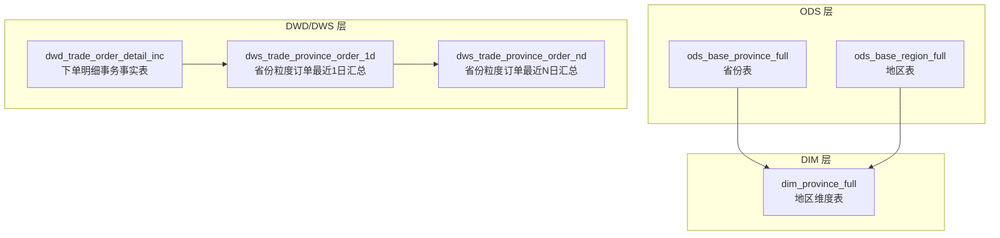
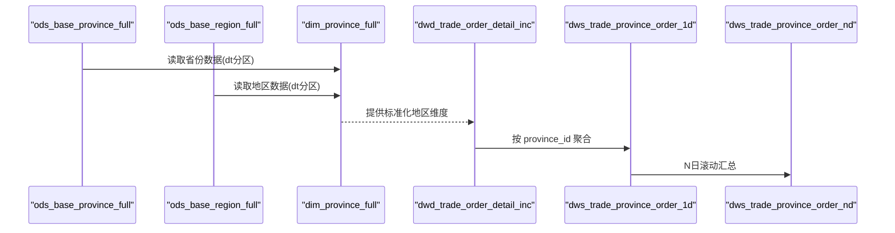
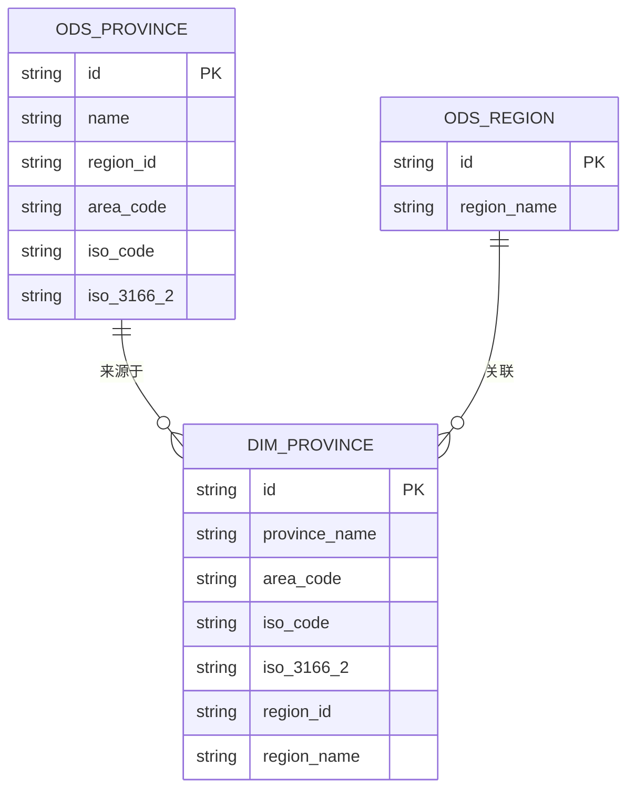
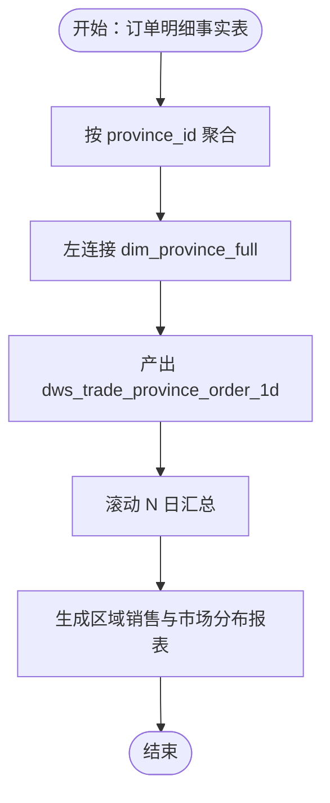
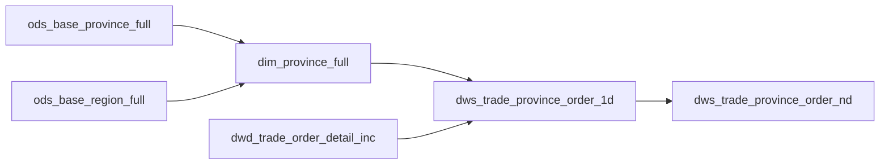

# 地区维度建模

<cite>
**本文引用的文件**
- [gmall-0906.sql](file://gmall-0906.sql)
- [basic.sql](file://basic.sql)
- [high.sql](file://high.sql)
- [middle.sql](file://middle.sql)
- [console.sql](file://console.sql)
</cite>

## 目录
1. [引言](#引言)
2. [项目结构](#项目结构)
3. [核心组件](#核心组件)
4. [架构总览](#架构总览)
5. [详细组件分析](#详细组件分析)
6. [依赖分析](#依赖分析)
7. [性能考量](#性能考量)
8. [故障排查指南](#故障排查指南)
9. [结论](#结论)
10. [附录](#附录)

## 引言
本文件围绕“地区维度建模”展开，系统化阐述 dim_province_full 地区维度表的设计与实现，覆盖以下主题：
- 省、市、区县等行政区域的层级关系建模思路
- 地区维度表与行政区划代码的对应关系与标准化
- 地理分析中的典型业务应用（区域销售分析、市场分布分析）
- 数据维护策略（应对行政区划调整等业务变更）
- 查询优化技巧与跨层级统计分析方法

## 项目结构
仓库包含多个 SQL 文件，其中 gmall-0906.sql 是核心建模脚本，涵盖 ODS、DIM、DWD、DWS 层的建表与装载逻辑；basic.sql、high.sql、middle.sql、console.sql 提供函数、开窗与实战练习示例，可作为查询优化与分析范式的参考。

图示来源
- [gmall-0906.sql](file://gmall-0906.sql#L133-L160)
- [gmall-0906.sql](file://gmall-0906.sql#L800-L848)
- [gmall-0906.sql](file://gmall-0906.sql#L4310-L4416)

章节来源
- [gmall-0906.sql](file://gmall-0906.sql#L133-L160)
- [gmall-0906.sql](file://gmall-0906.sql#L800-L848)
- [gmall-0906.sql](file://gmall-0906.sql#L4310-L4416)

## 核心组件
- ODS 层：ods_base_province_full（省份表）、ods_base_region_full（地区表），提供原始行政区划与地区编码。
- DIM 层：dim_province_full（地区维度表），整合省份与大区信息，并输出标准化的地区编码与名称。
- DWD/DWS 层：dwd_trade_order_detail_inc 与 dws_trade_province_order_1d/nd，基于地区维度表进行区域销售与市场分布分析。

章节来源
- [gmall-0906.sql](file://gmall-0906.sql#L133-L160)
- [gmall-0906.sql](file://gmall-0906.sql#L800-L848)
- [gmall-0906.sql](file://gmall-0906.sql#L4310-L4416)

## 架构总览
地区维度表的构建采用“ODS → DIM → DWS”的经典建模路径：
- ODS 层负责抽取原始省份与地区数据
- DIM 层完成清洗、合并与标准化（含地区编码与名称）
- DWS 层基于 DIM 进行区域粒度的汇总分析

图示来源
- [gmall-0906.sql](file://gmall-0906.sql#L818-L848)
- [gmall-0906.sql](file://gmall-0906.sql#L4310-L4416)

## 详细组件分析

### 地区维度表设计与实现（dim_province_full）
- 字段设计要点
  - id：省份唯一标识
  - province_name：省份名称
  - area_code：地区编码（标准化行政区划代码）
  - iso_code / iso_3166_2：ISO-3166-2 编码（用于可视化与国际对接）
  - region_id / region_name：所属大区标识与名称
- 数据来源与合并
  - 来源表：ods_base_province_full（含 id/name/region_id/area_code/iso_code/iso_3166_2）
  - 合并表：ods_base_region_full（id、region_name）
  - 关联条件：province.region_id = region.id
- 分区与存储
  - 分区字段：dt（日期分区）
  - 存储格式：ORC，启用 snappy 压缩

图示来源
- [gmall-0906.sql](file://gmall-0906.sql#L133-L160)
- [gmall-0906.sql](file://gmall-0906.sql#L800-L848)

章节来源
- [gmall-0906.sql](file://gmall-0906.sql#L133-L160)
- [gmall-0906.sql](file://gmall-0906.sql#L800-L848)

### 行政区划代码的标准化与统一
- area_code：来自省份表的标准化地区编码，作为跨系统统一的主键
- iso_code / iso_3166_2：提供旧版与新版 ISO 编码，便于地图可视化与国际对接
- region_id / region_name：用于后续跨层级统计与区域聚合

章节来源
- [gmall-0906.sql](file://gmall-0906.sql#L133-L160)
- [gmall-0906.sql](file://gmall-0906.sql#L800-L848)

### 地区维度表在地理分析中的应用
- 区域销售分析
  - 事实表 dwd_trade_order_detail_inc 按 province_id 聚合，产出 dws_trade_province_order_1d
  - 通过 dim_province_full 的 province_name、area_code、iso_code/iso_3166_2，形成可读的区域报表
- 市场分布分析
  - 基于 province_id 进行同比、环比与滚动周期（如7日/30日）汇总，识别增长与波动趋势
  - 结合 dws_trade_province_order_nd，生成多维区域洞察

图示来源
- [gmall-0906.sql](file://gmall-0906.sql#L4310-L4416)

章节来源
- [gmall-0906.sql](file://gmall-0906.sql#L4310-L4416)

### 数据维护策略（应对行政区划调整）
- 维护原则
  - 以 ODS 层为准：ods_base_province_full/ods_base_region_full 作为权威来源
  - DIM 层仅做清洗与合并，不改变业务含义
- 变更处理建议
  - 新增/变更：在 ODS 层更新后，重新执行 dim_province_full 的全量装载（按 dt 分区）
  - 删除/合并：通过 ODS 层的变更类型（如 bootstrap-insert/update/delete）在 DWD 层映射，避免 DIM 层直接删除
- 历史一致性
  - 事实表按 dt 分区，区域口径变更不影响历史数据，仅影响新分区

章节来源
- [gmall-0906.sql](file://gmall-0906.sql#L818-L848)
- [gmall-0906.sql](file://gmall-0906.sql#L133-L160)

### 查询优化技巧与跨层级统计
- 优化技巧
  - 使用 dt 分区过滤，避免全表扫描
  - 在 JOIN 时优先使用标准化编码（area_code）与主键（id），减少字符串匹配成本
  - 使用 ORC 存储与 snappy 压缩，提升 IO 性能
- 跨层级统计
  - 通过 dim_province_full 的 region_id/region_name，实现“省-大区”两级聚合
  - 在 DWS 层进行 N 日滚动汇总，结合日期维度表（dim_date）进行同比/环比分析

章节来源
- [gmall-0906.sql](file://gmall-0906.sql#L800-L848)
- [gmall-0906.sql](file://gmall-0906.sql#L850-L906)

## 依赖分析
- 组件耦合
  - dim_province_full 依赖 ods_base_province_full 与 ods_base_region_full
  - dws_trade_province_order_1d/nd 依赖 dim_province_full 与 dwd_trade_order_detail_inc
- 外部依赖
  - Hive/ORC 存储与分区机制
  - 日期维度表（dim_date）用于时间维度分析

图示来源
- [gmall-0906.sql](file://gmall-0906.sql#L133-L160)
- [gmall-0906.sql](file://gmall-0906.sql#L800-L848)
- [gmall-0906.sql](file://gmall-0906.sql#L4310-L4416)

章节来源
- [gmall-0906.sql](file://gmall-0906.sql#L133-L160)
- [gmall-0906.sql](file://gmall-0906.sql#L800-L848)
- [gmall-0906.sql](file://gmall-0906.sql#L4310-L4416)

## 性能考量
- 存储与压缩
  - ORC 文件格式与 snappy 压缩显著降低存储与 IO 成本
- 分区策略
  - 按 dt 分区，查询时务必带上分区过滤条件
- JOIN 优化
  - 优先使用 id/area_code 等数值或短字符串字段
  - 减少不必要的字符串拼接与函数计算
- 聚合与滚动
  - DWS 层预聚合与滚动汇总，避免下游重复计算

## 故障排查指南
- 常见问题
  - 分区缺失：确认 dt 分区是否正确传入
  - 编码不一致：检查 ods_base_province_full 的 area_code 是否标准化
  - JOIN 结果为空：核对 dim_province_full 与事实表的 province_id 映射关系
- 参考示例
  - 开窗与聚合示例可参考 basic.sql、high.sql、middle.sql、console.sql 中的日期与聚合函数实践

章节来源
- [basic.sql](file://basic.sql#L1-L120)
- [high.sql](file://high.sql#L1-L120)
- [middle.sql](file://middle.sql#L1-L120)
- [console.sql](file://console.sql#L1-L120)

## 结论
dim_province_full 通过标准化的地区编码与清晰的层级关系，为区域销售与市场分布分析提供了稳定、可扩展的数据基础。配合分区、ORC 存储与预聚合汇总，可在保证性能的同时满足多维区域分析需求。面对行政区划调整等业务变更，应坚持“ODS 为尊、DIM 清洗、DWS 汇总”的建模路径，确保历史数据的稳定性与可追溯性。

## 附录
- 示例参考路径（不含代码内容，仅提供定位）
  - 地区维度建表与装载：[gmall-0906.sql](file://gmall-0906.sql#L800-L848)
  - ODS 省份与地区表定义：[gmall-0906.sql](file://gmall-0906.sql#L133-L160)
  - 区域销售汇总（1日/ND）：[gmall-0906.sql](file://gmall-0906.sql#L4310-L4416)
  - 开窗与聚合示例：[basic.sql](file://basic.sql#L120-L220)、[high.sql](file://high.sql#L1-L120)、[middle.sql](file://middle.sql#L1-L120)、[console.sql](file://console.sql#L1-L120)