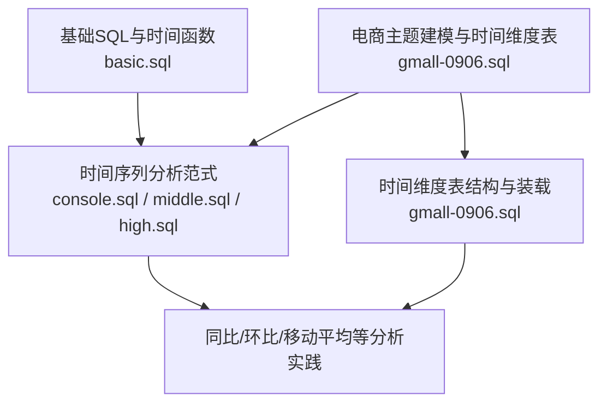
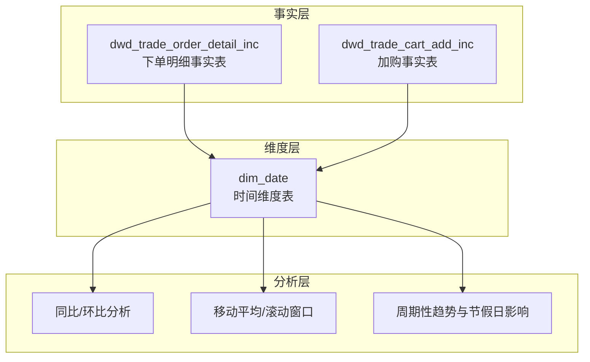
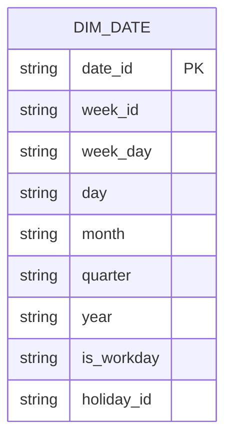
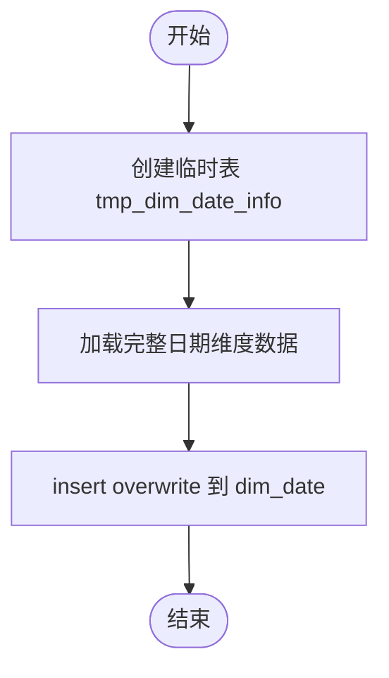
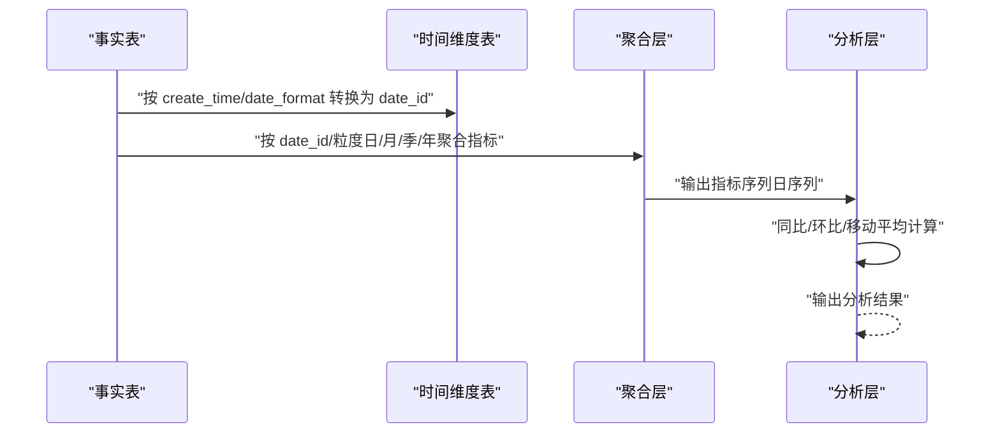
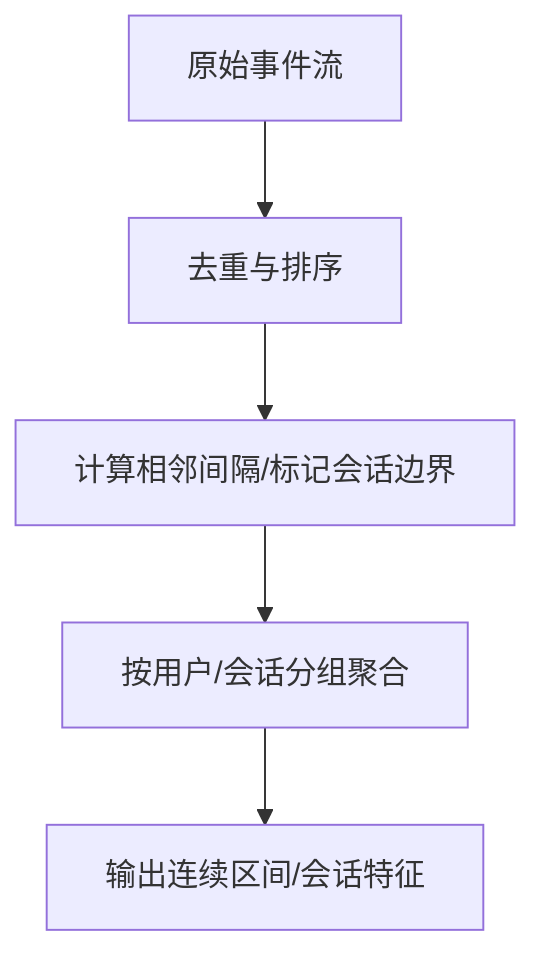
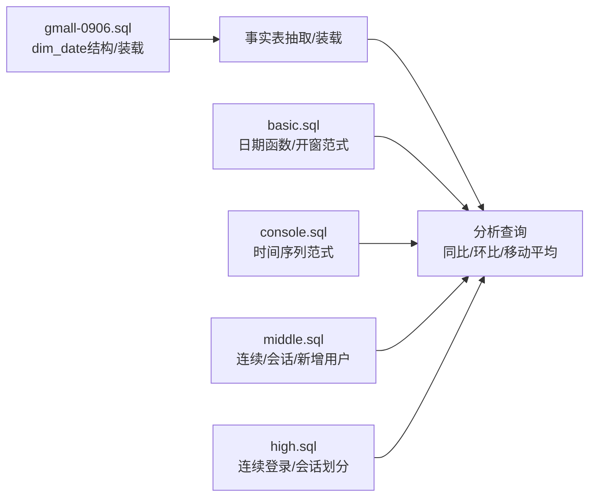

# 时间维度建模

<cite>
**本文引用的文件**
- [basic.sql](file://basic.sql)
- [console.sql](file://console.sql)
- [gmall-0906.sql](file://gmall-0906.sql)
- [high.sql](file://high.sql)
- [middle.sql](file://middle.sql)
</cite>

## 目录
1. [引言](#引言)
2. [项目结构](#项目结构)
3. [核心组件](#核心组件)
4. [架构总览](#架构总览)
5. [详细组件分析](#详细组件分析)
6. [依赖分析](#依赖分析)
7. [性能考量](#性能考量)
8. [故障排查指南](#故障排查指南)
9. [结论](#结论)
10. [附录](#附录)

## 引言
本文件系统性阐述仓库中时间维度建模的设计与实现，覆盖日历维度、业务日期维度等不同时间粒度的建模策略；解释时间维度表的结构设计与关系；给出时间序列分析（同比、环比、移动平均）的应用方法；说明时间维度表的数据生成策略（自动生成指定时间段的完整时间维度数据）；并总结查询优化与复杂时间分析场景的处理要点。文档面向不同技术背景读者，既提供高层概览，也给出可落地的实现参考与图示。

## 项目结构
仓库包含多个SQL脚本，分别演示基础SQL能力、时间序列分析实践、电商主题建模（含时间维度表）等。与时间维度建模直接相关的核心文件为 gmall-0906.sql，其中定义了时间维度表结构与装载流程；basic.sql、console.sql、middle.sql、high.sql 提供大量基于时间函数与开窗分析的时间序列分析范式。

图表来源
- [gmall-0906.sql](file://gmall-0906.sql#L851-L906)
- [basic.sql](file://basic.sql#L60-L120)
- [console.sql](file://console.sql#L80-L160)
- [middle.sql](file://middle.sql#L1-L120)
- [high.sql](file://high.sql#L1-L60)

章节来源
- [gmall-0906.sql](file://gmall-0906.sql#L851-L906)
- [basic.sql](file://basic.sql#L60-L120)
- [console.sql](file://console.sql#L80-L160)
- [middle.sql](file://middle.sql#L1-L120)
- [high.sql](file://high.sql#L1-L60)

## 核心组件
- 时间维度表（dim_date）
  - 字段：date_id、week_id、week_day、day、month、quarter、year、is_workday、holiday_id
  - 存储：ORC格式，分区/位置管理
  - 装载：通过临时表 tmp_dim_date_info 导入，再写入 dim_date
- 事实表与维度表关联
  - 事实表（如 dwd_trade_order_detail_inc）在抽取时将 create_time/date_format 转换为 date_id，与 dim_date 关联进行分析
- 时间序列分析范式
  - 开窗函数（sum/avg/lead/lag/ntile/rank/dense_rank）与日期函数（year/month/day/last_day/date_add/date_sub）组合，支撑同比、环比、移动平均等分析

章节来源
- [gmall-0906.sql](file://gmall-0906.sql#L851-L906)
- [gmall-0906.sql](file://gmall-0906.sql#L1280-L1394)
- [basic.sql](file://basic.sql#L419-L564)
- [console.sql](file://console.sql#L3009-L3050)

## 架构总览
时间维度建模在仓库中的整体架构由“时间维度表 + 事实表 + 分析查询”构成。dim_date 作为中心维度，被事实表引用，用于时间粒度的聚合与对比分析。

图表来源
- [gmall-0906.sql](file://gmall-0906.sql#L851-L906)
- [gmall-0906.sql](file://gmall-0906.sql#L1280-L1394)

## 详细组件分析

### 时间维度表结构设计
- 字段设计原则
  - date_id：标准化日期标识，便于与事实表关联
  - week_id/week_day：周粒度与周内日标识，支持周对齐分析
  - day/month/quarter/year：多粒度层级，满足日/月/季/年的聚合与对比
  - is_workday/holiday_id：业务日期维度，支持工作日/节假日差异分析
- 存储与分区
  - ORC格式提升压缩与查询性能
  - 通过外部表与临时表配合，实现批量装载与切换

图表来源
- [gmall-0906.sql](file://gmall-0906.sql#L851-L888)

章节来源
- [gmall-0906.sql](file://gmall-0906.sql#L851-L888)

### 时间维度表的数据生成策略
- 生成流程
  - 创建临时表 tmp_dim_date_info，导入预生成的完整日期维度数据
  - 将临时表数据 insert overwrite 到 dim_date，完成装载
- 适用场景
  - 指定时间段（如历史到未来）的完整日期覆盖
  - 一次性批量装载，避免运行时动态生成带来的成本

图表来源
- [gmall-0906.sql](file://gmall-0906.sql#L888-L906)

章节来源
- [gmall-0906.sql](file://gmall-0906.sql#L888-L906)

### 日历维度与业务日期维度的设计策略
- 日历维度
  - 基于标准日期函数（year/month/day/week_of_year/last_day 等）派生 week_id、week_day、day、month、quarter、year
  - 通过 is_workday 标识工作日/节假日，支持工作日与周末的对比分析
- 业务日期维度
  - 以 is_workday 与 holiday_id 为核心，结合业务规则（如调休、长假）标注节假日
  - 与事实表的 create_time/date_id 关联，形成业务口径的时间对齐

章节来源
- [gmall-0906.sql](file://gmall-0906.sql#L851-L888)

### 时间粒度的定义与关系
- 年/季度/月/周/日的派生
  - year/quarter/month/week_id/week_day/day 由 date_id 派生
- 层级关系
  - 日 -> 周 -> 月 -> 季 -> 年，逐层聚合
  - 通过开窗与分组实现跨粒度对比（如按月汇总、按季度汇总）

章节来源
- [gmall-0906.sql](file://gmall-0906.sql#L851-L888)
- [basic.sql](file://basic.sql#L60-L120)

### 时间序列分析应用：同比、环比、移动平均
- 同比（YoY）
  - 以 year 为基准，对比去年同期指标
  - 示例：按年聚合后，使用 lag/lead 或日期差分实现同比
- 环比（MoM）
  - 以 month 为基准，对比上月指标
  - 示例：按月聚合后，使用 lag/lead 或 datediff 实现环比
- 移动平均（Rolling Window）
  - 使用开窗函数 rows between ... preceding and ... following 定义滑动窗口
  - 示例：按日聚合后，对最近 N 天求均值/求和

图表来源
- [gmall-0906.sql](file://gmall-0906.sql#L1280-L1394)
- [basic.sql](file://basic.sql#L419-L564)
- [console.sql](file://console.sql#L3009-L3050)
- [middle.sql](file://middle.sql#L1-L120)
- [high.sql](file://high.sql#L1-L60)

章节来源
- [gmall-0906.sql](file://gmall-0906.sql#L1280-L1394)
- [basic.sql](file://basic.sql#L419-L564)
- [console.sql](file://console.sql#L3009-L3050)
- [middle.sql](file://middle.sql#L1-L120)
- [high.sql](file://high.sql#L1-L60)

### 复杂时间分析场景处理
- 连续登录/连续下单
  - 使用 row_number/lag/datediff 等组合，识别连续区间
  - 通过 flag = date_sub(date, row_number()) 的技巧，将连续日期归并
- 会话划分与停留时长
  - 使用 lag(view_timestamp) 计算相邻访问间隔，设定阈值（如 > 60 秒）作为会话边界
- 新增用户/活跃用户统计
  - 使用 rank(min(login_ts)) 获取首次登录日期，按日统计新增用户
- 周期性趋势与节假日影响
  - 通过 is_workday/holiday_id 与指标序列联动，观察节假日对销量/活跃的影响

图表来源
- [high.sql](file://high.sql#L1-L120)
- [middle.sql](file://middle.sql#L1-L120)

章节来源
- [high.sql](file://high.sql#L1-L120)
- [middle.sql](file://middle.sql#L1-L120)

## 依赖分析
- 维度与事实的依赖
  - 事实表在抽取阶段将 create_time 转换为 date_id，依赖 dim_date 的完整性与正确性
- 时间函数与开窗函数的依赖
  - 年/月/日等派生依赖标准日期函数
  - 同比/环比/移动平均依赖开窗函数与日期差分
- 文件间依赖
  - gmall-0906.sql 定义 dim_date 结构与装载流程
  - basic/console/middle/high 提供时间序列分析范式，支撑同比/环比/移动平均等分析

图表来源
- [gmall-0906.sql](file://gmall-0906.sql#L851-L906)
- [basic.sql](file://basic.sql#L419-L564)
- [console.sql](file://console.sql#L3009-L3050)
- [middle.sql](file://middle.sql#L1-L120)
- [high.sql](file://high.sql#L1-L120)

章节来源
- [gmall-0906.sql](file://gmall-0906.sql#L851-L906)
- [basic.sql](file://basic.sql#L419-L564)
- [console.sql](file://console.sql#L3009-L3050)
- [middle.sql](file://middle.sql#L1-L120)
- [high.sql](file://high.sql#L1-L120)

## 性能考量
- 存储格式与压缩
  - dim_date 使用 ORC 格式，具备更好的压缩比与列式扫描性能
- 分区与位置管理
  - 通过外部表与临时表配合，减少运行时计算，提高装载效率
- 查询优化建议
  - 在事实表侧尽量提前派生 date_id，避免在大表上重复计算日期函数
  - 使用开窗函数时限定分区与排序列，减少不必要的全局排序
  - 对高频分析字段建立合适的索引或物化视图（视引擎支持情况）
- 时间序列分析的代价控制
  - 移动平均等窗口计算应限定窗口大小，避免过大的 rows between
  - 对大表进行分桶/分区，按时间粒度拆分，提升查询局部性

章节来源
- [gmall-0906.sql](file://gmall-0906.sql#L851-L888)

## 故障排查指南
- 日期格式错误
  - 日期函数对输入格式敏感，常见问题为格式不匹配导致返回 null
  - 建议：统一使用标准格式，或在派生 date_id 前进行格式清洗
- 开窗函数与聚合混用
  - 开窗函数与 group by 的组合需谨慎，避免重复计算与歧义
  - 建议：明确分组与排序键，必要时分层计算
- 连续性分析误判
  - 使用 row_number/lag/datediff 时，务必先去重（如按用户+日期去重），避免重复导致连续区间错误
- 同比/环比口径不一致
  - 年度/月份派生需与业务口径一致（如自然年 vs 财务年），确保对比口径清晰

章节来源
- [basic.sql](file://basic.sql#L60-L120)
- [middle.sql](file://middle.sql#L1-L120)
- [high.sql](file://high.sql#L1-L120)

## 结论
本仓库展示了从时间维度表结构设计、装载策略到时间序列分析的完整实践路径。通过标准化的 date_id 与多粒度派生字段，结合开窗与日期函数，能够高效支撑同比、环比、移动平均等分析需求。建议在实际项目中：
- 以 dim_date 为中心，统一事实表的时间口径
- 在抽取阶段完成 date_id 派生，减少下游重复计算
- 针对复杂时间分析场景，采用去重+标记+分组的范式，确保连续性与准确性
- 结合 ORC 存储与分区策略，持续优化查询性能

## 附录
- 相关实现参考路径
  - 时间维度表结构与装载：[gmall-0906.sql](file://gmall-0906.sql#L851-L906)
  - 事实表抽取与时间字段派生：[gmall-0906.sql](file://gmall-0906.sql#L1280-L1394)
  - 时间序列分析范式（同比/环比/移动平均）：[basic.sql](file://basic.sql#L419-L564)、[console.sql](file://console.sql#L3009-L3050)、[middle.sql](file://middle.sql#L1-L120)、[high.sql](file://high.sql#L1-L120)