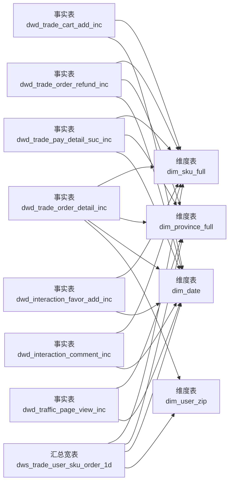
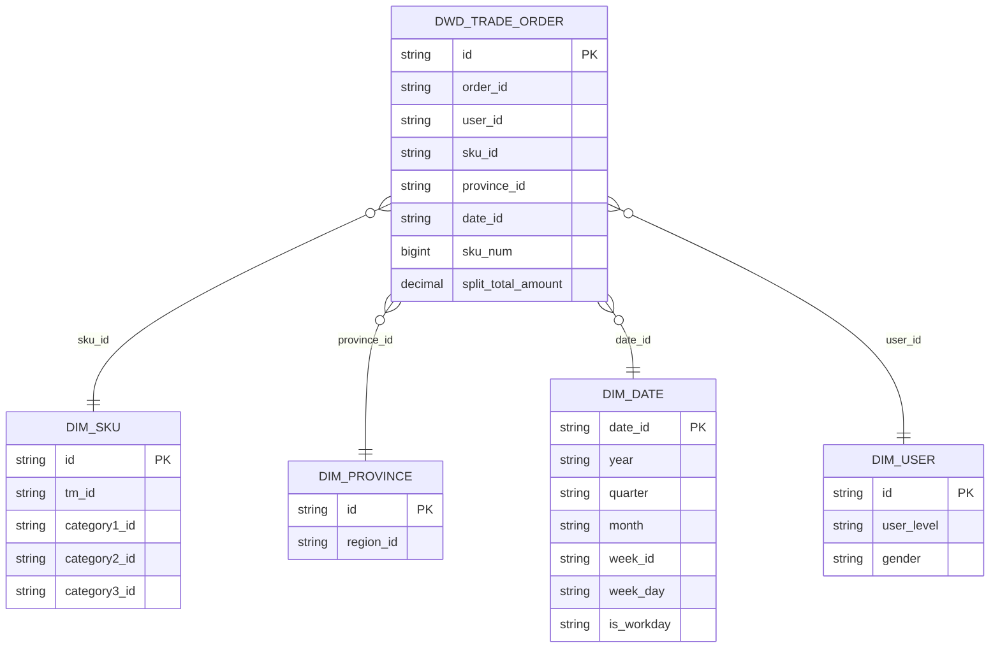
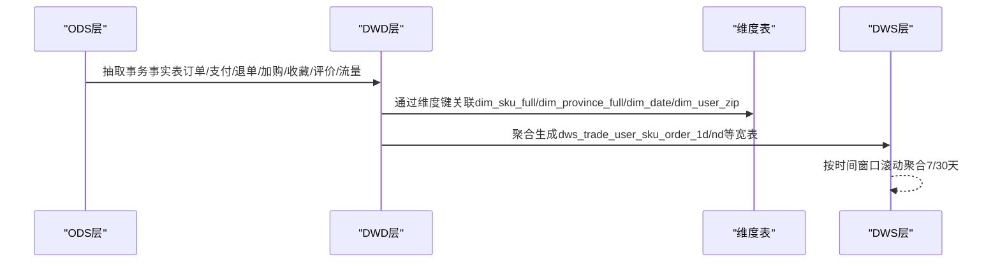
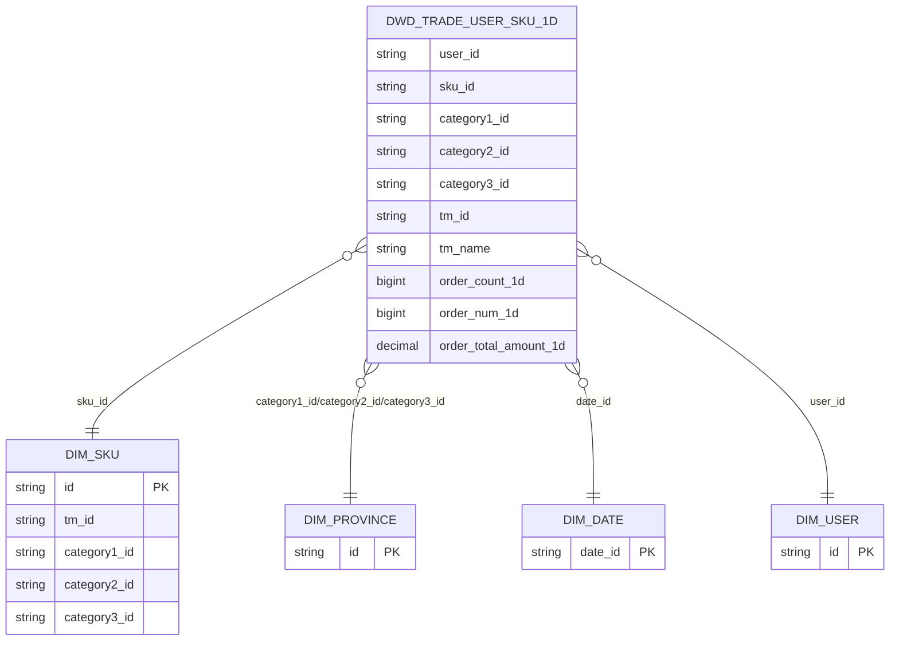
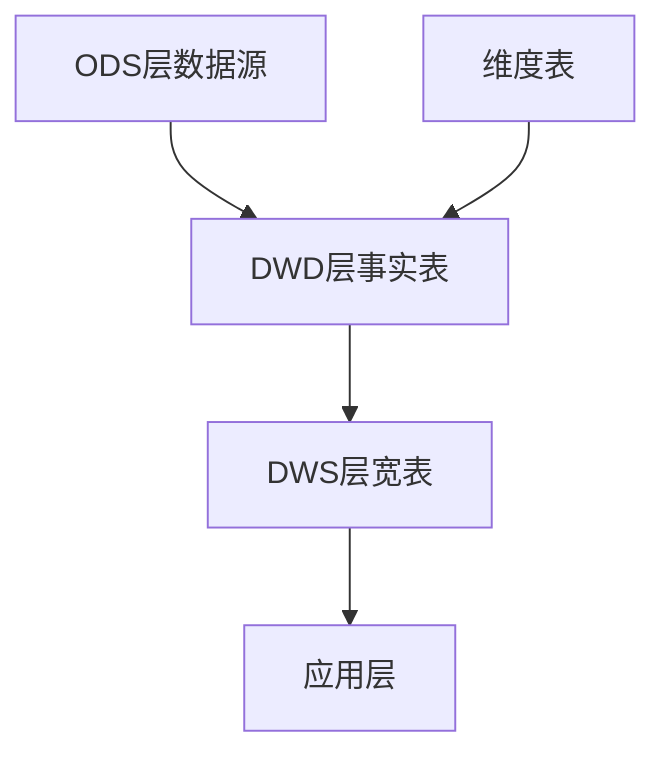

# 星型模型设计

<cite>
**本文引用的文件**
- [gmall-0906.sql](file://gmall-0906.sql)
- [console.sql](file://console.sql)
- [basic.sql](file://basic.sql)
- [middle.sql](file://middle.sql)
- [high.sql](file://high.sql)
</cite>

## 目录
1. [引言](#引言)
2. [项目结构](#项目结构)
3. [核心组件](#核心组件)
4. [架构总览](#架构总览)
5. [详细组件分析](#详细组件分析)
6. [依赖分析](#依赖分析)
7. [性能考量](#性能考量)
8. [故障排查指南](#故障排查指南)
9. [结论](#结论)
10. [附录](#附录)

## 引言
本文件围绕星型模型设计展开，系统阐述事实表与维度表的关系、主键外键约束、连接关系与查询性能优化策略，并结合仓库级电商数据模型（gmall）给出可落地的应用场景与实践建议。星型模型以事实表为中心，周围环绕多个维度表，便于快速聚合与分析，适合OLAP场景。

## 项目结构
该仓库包含多类SQL脚本，涵盖电商数据仓库的ODS/DWD/DWS/ADS分层建模、维度表构建、事实表抽取与汇总，以及大量分析查询示例。其中，gmall-0906.sql是电商数据仓库建模的主体，展示了典型的星型模型实现：以交易、互动、流量等事务事实表为核心，围绕用户、商品、地区、时间等维度表进行宽表化与轻度反范式化，支撑多维分析。

```mermaid
graph TB
subgraph "ODS层"
ODS_LOG["ods_log_inc"]
ODS_USER_INFO["ods_user_info_inc"]
ODS_ORDER_DETAIL["ods_order_detail_inc"]
ODS_BASE_DICT["ods_base_dic_full"]
ODS_BASE_PROVINCE["ods_base_province_full"]
end
subgraph "DWD层"
DWD_TRADE_ORDER["dwd_trade_order_detail_inc"]
DWD_TRADE_CART["dwd_trade_cart_add_inc"]
DWD_TRADE_REFUND["dwd_trade_order_refund_inc"]
DWD_TRADE_PAY["dwd_trade_pay_detail_suc_inc"]
DWD_TOOL_COUPON_GET["dwd_tool_coupon_get_inc"]
DWD_INTERACTION_FAVOR["dwd_interaction_favor_add_inc"]
DWD_INTERACTION_COMMENT["dwd_interaction_comment_inc"]
DWD_TRAFFIC_PAGE["dwd_traffic_page_view_inc"]
DWD_TRAFFIC_START["dwd_traffic_start_inc"]
DWD_TRAFFIC_ACTION["dwd_traffic_action_inc"]
DWD_TRAFFIC_DISPLAY["dwd_traffic_display_inc"]
DWD_TRAFFIC_ERROR["dwd_traffic_error_inc"]
DWD_USER_LOGIN["dwd_user_login_inc"]
DWD_USER_REGISTER["dwd_user_register_inc"]
end
subgraph "维度表"
DIM_DATE["dim_date"]
DIM_SKU["dim_sku_full"]
DIM_PROVINCE["dim_province_full"]
DIM_USER["dim_user_zip"]
DIM_ACTIVITY["dim_activity_full"]
DIM_COUPON["dim_coupon_full"]
end
subgraph "DWS层"
DWS_USER_SKU["dws_trade_user_sku_order_1d"]
DWS_USER_SKU_ND["dws_trade_user_sku_order_nd"]
DWS_USER_SKU_REFUND["dws_trade_user_sku_order_refund_1d"]
DWS_USER_SKU_REFUND_ND["dws_trade_user_sku_order_refund_nd"]
end
ODS_LOG --> DWD_TRAFFIC_PAGE
ODS_LOG --> DWD_TRAFFIC_START
ODS_LOG --> DWD_TRAFFIC_ACTION
ODS_LOG --> DWD_TRAFFIC_DISPLAY
ODS_LOG --> DWD_TRAFFIC_ERROR
ODS_USER_INFO --> DWD_USER_LOGIN
ODS_USER_INFO --> DWD_USER_REGISTER
ODS_USER_INFO --> DIM_USER
ODS_ORDER_DETAIL --> DWD_TRADE_ORDER
ODS_ORDER_DETAIL --> DWD_TRADE_REFUND
ODS_ORDER_DETAIL --> DWD_TRADE_PAY
ODS_BASE_DICT --> DWD_TRADE_ORDER
ODS_BASE_DICT --> DWD_TRADE_CART
ODS_BASE_DICT --> DWD_TRADE_REFUND
ODS_BASE_DICT --> DWD_TRADE_PAY
ODS_BASE_PROVINCE --> DWD_TRADE_ORDER
ODS_BASE_PROVINCE --> DWD_TRADE_REFUND
ODS_BASE_PROVINCE --> DWD_TRADE_PAY
ODS_BASE_PROVINCE --> DIM_PROVINCE
DIM_DATE --> DWD_TRADE_ORDER
DIM_DATE --> DWD_TRADE_CART
DIM_DATE --> DWD_TRADE_REFUND
DIM_DATE --> DWD_TRADE_PAY
DIM_DATE --> DWS_USER_SKU
DIM_DATE --> DWS_USER_SKU_ND
DIM_SKU --> DWD_TRADE_ORDER
DIM_SKU --> DWD_TRADE_CART
DIM_SKU --> DWD_TRADE_REFUND
DIM_SKU --> DWD_TRADE_PAY
DIM_SKU --> DWS_USER_SKU
DIM_SKU --> DWS_USER_SKU_ND
DIM_PROVINCE --> DWD_TRADE_ORDER
DIM_PROVINCE --> DWD_TRADE_REFUND
DIM_PROVINCE --> DWD_TRADE_PAY
DIM_PROVINCE --> DWS_USER_SKU
DIM_PROVINCE --> DWS_USER_SKU_ND
DIM_USER --> DWD_TRADE_ORDER
DIM_USER --> DWD_TRADE_CART
DIM_USER --> DWD_TRADE_REFUND
DIM_USER --> DWD_TRADE_PAY
DIM_USER --> DWS_USER_SKU
DIM_USER --> DWS_USER_SKU_ND
DWD_TRADE_ORDER --> DWS_USER_SKU
DWD_TRADE_REFUND --> DWS_USER_SKU_REFUND
```

图表来源
- [gmall-0906.sql](file://gmall-0906.sql#L851-L1197)
- [gmall-0906.sql](file://gmall-0906.sql#L1174-L1927)
- [gmall-0906.sql](file://gmall-0906.sql#L1930-L2399)
- [gmall-0906.sql](file://gmall-0906.sql#L2404-L3199)
- [gmall-0906.sql](file://gmall-0906.sql#L3200-L3999)

章节来源
- [gmall-0906.sql](file://gmall-0906.sql#L851-L1197)
- [gmall-0906.sql](file://gmall-0906.sql#L1174-L1927)
- [gmall-0906.sql](file://gmall-0906.sql#L1930-L2399)
- [gmall-0906.sql](file://gmall-0906.sql#L2404-L3199)
- [gmall-0906.sql](file://gmall-0906.sql#L3200-L3999)

## 核心组件
- 事实表（Fact Tables）
  - 交易域事务事实表：dwd_trade_order_detail_inc、dwd_trade_cart_add_inc、dwd_trade_refund_inc、dwd_trade_pay_detail_suc_inc
  - 工具域事实表：dwd_tool_coupon_get_inc、dwd_tool_coupon_order_inc、dwd_tool_coupon_pay_inc
  - 互动域事实表：dwd_interaction_favor_add_inc、dwd_interaction_comment_inc
  - 流量域事实表：dwd_traffic_page_view_inc、dwd_traffic_start_inc、dwd_traffic_action_inc、dwd_traffic_display_inc、dwd_traffic_error_inc
  - 用户域事实表：dwd_user_login_inc、dwd_user_register_inc
- 维度表（Dimension Tables）
  - 时间维度：dim_date
  - 商品维度：dim_sku_full
  - 地区维度：dim_province_full
  - 用户维度：dim_user_zip
  - 活动/优惠券维度：dim_activity_full、dim_coupon_full
- 汇总宽表（DWS）
  - dws_trade_user_sku_order_1d、dws_trade_user_sku_order_nd、dws_trade_user_sku_order_refund_1d、dws_trade_user_sku_order_refund_nd

章节来源
- [gmall-0906.sql](file://gmall-0906.sql#L1174-L1927)
- [gmall-0906.sql](file://gmall-0906.sql#L1930-L2399)
- [gmall-0906.sql](file://gmall-0906.sql#L2404-L3199)
- [gmall-0906.sql](file://gmall-0906.sql#L3200-L3999)

## 架构总览
星型模型以“事实表+维度表”为核心，事实表存储可度量的业务事件（如订单、支付、加购、退单、收藏、评价、流量行为），维度表存储描述性属性（如用户、商品、地区、时间）。查询时通过维度键连接事实表，形成宽表用于多维分析。

图表来源
- [gmall-0906.sql](file://gmall-0906.sql#L1174-L1927)
- [gmall-0906.sql](file://gmall-0906.sql#L1930-L2399)
- [gmall-0906.sql](file://gmall-0906.sql#L3652-L3999)

章节来源
- [gmall-0906.sql](file://gmall-0906.sql#L1174-L1927)
- [gmall-0906.sql](file://gmall-0906.sql#L1930-L2399)
- [gmall-0906.sql](file://gmall-0906.sql#L3652-L3999)

## 详细组件分析

### 事实表与维度表的关系设计
- 主键外键约束
  - 事实表通常以代理键（如id）作为主键；维度键（如user_id、sku_id、province_id、date_id）作为外键指向相应维度表。
  - 示例：dwd_trade_order_detail_inc包含user_id、sku_id、province_id、date_id等维度键，分别关联dim_user_zip、dim_sku_full、dim_province_full、dim_date。
- 连接关系
  - 事实表与维度表通过维度键进行LEFT JOIN或INNER JOIN，形成宽表，便于多维聚合与分析。
  - 示例：dwd_trade_order_detail_inc与dim_sku_full、dim_province_full、dim_date、dim_user_zip的连接逻辑在建表与装载脚本中有明确体现。

图表来源
- [gmall-0906.sql](file://gmall-0906.sql#L1174-L1927)
- [gmall-0906.sql](file://gmall-0906.sql#L3652-L3999)

章节来源
- [gmall-0906.sql](file://gmall-0906.sql#L1174-L1927)
- [gmall-0906.sql](file://gmall-0906.sql#L3652-L3999)

### 电商数据仓库中的星型模型应用
- 交易域分析
  - 事实表：dwd_trade_order_detail_inc（订单明细）、dwd_trade_pay_detail_suc_inc（支付成功）、dwd_trade_refund_inc（退单）、dwd_trade_cart_add_inc（加购）
  - 维度表：dim_sku_full（商品）、dim_province_full（地区）、dim_date（时间）、dim_user_zip（用户）
  - 汇总宽表：dws_trade_user_sku_order_1d、dws_trade_user_sku_order_nd、dws_trade_user_sku_order_refund_1d、dws_trade_user_sku_order_refund_nd
- 互动与流量域分析
  - 事实表：dwd_interaction_favor_add_inc（收藏）、dwd_interaction_comment_inc（评价）、dwd_traffic_page_view_inc（页面浏览）、dwd_traffic_start_inc（启动）、dwd_traffic_action_inc（动作）、dwd_traffic_display_inc（曝光）、dwd_traffic_error_inc（错误）
  - 维度表：dim_province_full、dim_date
- 工具域分析
  - 事实表：dwd_tool_coupon_get_inc（领券）、dwd_tool_coupon_order_inc（下单使用）、dwd_tool_coupon_pay_inc（支付使用）

图表来源
- [gmall-0906.sql](file://gmall-0906.sql#L1174-L1927)
- [gmall-0906.sql](file://gmall-0906.sql#L3652-L3999)

章节来源
- [gmall-0906.sql](file://gmall-0906.sql#L1174-L1927)
- [gmall-0906.sql](file://gmall-0906.sql#L3652-L3999)

### 查询性能优化要点
- 存储与分区
  - 事实表与维度表普遍采用ORC格式并开启压缩，提升I/O与扫描效率。
  - 事实表按dt分区，便于按天增量装载与裁剪。
- 连接与聚合
  - 优先使用维度键进行JOIN，避免跨层大表全表扫描。
  - 在DWS层预先聚合，减少分析阶段的连接与聚合成本。
- 窄表与宽表
  - 将常用维度属性冗余到事实表或DWS宽表，降低运行时JOIN次数。
- 索引与统计
  - 建议维护分区统计信息，优化CBO（基于代价的优化器）决策。

章节来源
- [gmall-0906.sql](file://gmall-0906.sql#L1174-L1927)
- [gmall-0906.sql](file://gmall-0906.sql#L3652-L3999)

### 星型模型 vs 雪花模型
- 星型模型
  - 优点：查询简单、JOIN少、分析性能高；适合OLAP与即席查询。
  - 缺点：存在少量数据冗余，更新异常风险需通过ETL流程控制。
- 雪花模型
  - 优点：规范化程度高，数据一致性强。
  - 缺点：查询涉及多表JOIN，分析性能较低。
- 实践建议
  - 数据仓库分析层采用星型模型；ODS/DWD层可适度反范式化以提升查询效率。

章节来源
- [gmall-0906.sql](file://gmall-0906.sql#L1174-L1927)
- [gmall-0906.sql](file://gmall-0906.sql#L3652-L3999)

### 表结构示例与ER图说明
- 事实表示例
  - dwd_trade_order_detail_inc：包含订单明细、用户、商品、地区、时间、来源类型、数量与金额分摊等字段。
  - dwd_trade_user_sku_order_1d：按用户-商品粒度聚合的最近1日下单次数、件数与金额。
- 维度表示例
  - dim_sku_full：商品维度，包含品牌、品类、属性等信息。
  - dim_province_full：地区维度，包含省/地区信息。
  - dim_date：时间维度，包含年/季/月/周/工作日等。
  - dim_user_zip：用户维度，包含用户画像信息。
- ER图
  - 事实表与维度表通过维度键建立一对多关系，形成星型结构。

图表来源
- [gmall-0906.sql](file://gmall-0906.sql#L3652-L3999)

章节来源
- [gmall-0906.sql](file://gmall-0906.sql#L3652-L3999)

## 依赖分析
- 组件耦合
  - DWD层事实表依赖ODS层增量/全量数据与维度表；DWS层宽表依赖DWD层事实表与维度表。
- 外部依赖
  - 事实表与维度表依赖ods_base_dic_full（字典表）进行枚举值映射（如来源类型、支付类型、评价类型等）。
- 数据流向
  - ODS -> DWD -> DWS -> 应用层（报表/BI）

图表来源
- [gmall-0906.sql](file://gmall-0906.sql#L1174-L1927)
- [gmall-0906.sql](file://gmall-0906.sql#L3652-L3999)

章节来源
- [gmall-0906.sql](file://gmall-0906.sql#L1174-L1927)
- [gmall-0906.sql](file://gmall-0906.sql#L3652-L3999)

## 性能考量
- 存储格式与压缩
  - 事实表与维度表普遍采用ORC格式并启用snappy压缩，降低存储与I/O开销。
- 分区策略
  - 事实表按dt分区，便于按天增量装载与裁剪，减少扫描范围。
- 聚合预计算
  - 在DWS层按用户-商品-品类-品牌等粒度进行1日/7日/30日聚合，显著降低分析查询的JOIN与聚合成本。
- 维度过滤
  - 在事实表侧冗余常用维度属性（如date_id、category_id、tm_id），减少运行时JOIN。

章节来源
- [gmall-0906.sql](file://gmall-0906.sql#L1174-L1927)
- [gmall-0906.sql](file://gmall-0906.sql#L3652-L3999)

## 故障排查指南
- 常见问题
  - 维度键缺失或为空：检查ODS层数据清洗与映射逻辑，确保维度键正确生成。
  - 分区未更新：确认DWD层按dt分区的装载逻辑是否覆盖目标日期。
  - 维度表未更新：确认dim_user_zip等缓慢变化维度表的拉链逻辑是否生效。
- 排查步骤
  - 核对事实表与维度表的维度键是否一致（如sku_id、user_id、province_id、date_id）。
  - 检查字典表ods_base_dic_full的parent_code过滤条件是否正确。
  - 对比DWD与DWS层的聚合口径与日期范围，定位差异。

章节来源
- [gmall-0906.sql](file://gmall-0906.sql#L1174-L1927)
- [gmall-0906.sql](file://gmall-0906.sql#L3652-L3999)

## 结论
本仓库以gmall为例完整实现了星型模型的数据仓库架构：以事务事实表为核心，围绕用户、商品、地区、时间等维度表构建宽表，配合DWS层的预聚合，满足电商领域的多维分析与即席查询需求。通过分区、ORC存储、冗余维度属性与预聚合等手段，显著提升了查询性能与可维护性。

## 附录
- 相关查询示例与分析思路可参考仓库中的分析脚本，涵盖连续登录、会话识别、累计消费、首年销售等典型场景。

章节来源
- [console.sql](file://console.sql#L5407-L6390)
- [console.sql](file://console.sql#L6329-L6390)
- [basic.sql](file://basic.sql#L1-L800)
- [middle.sql](file://middle.sql#L1-L800)
- [high.sql](file://high.sql#L1-L319)