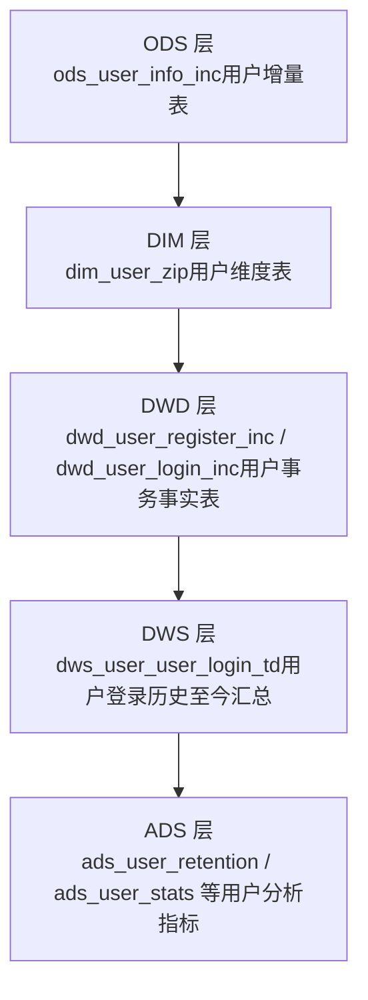
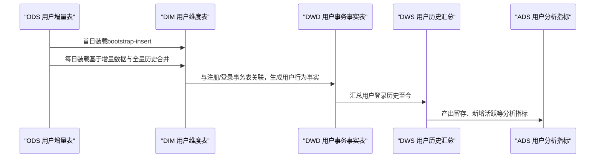
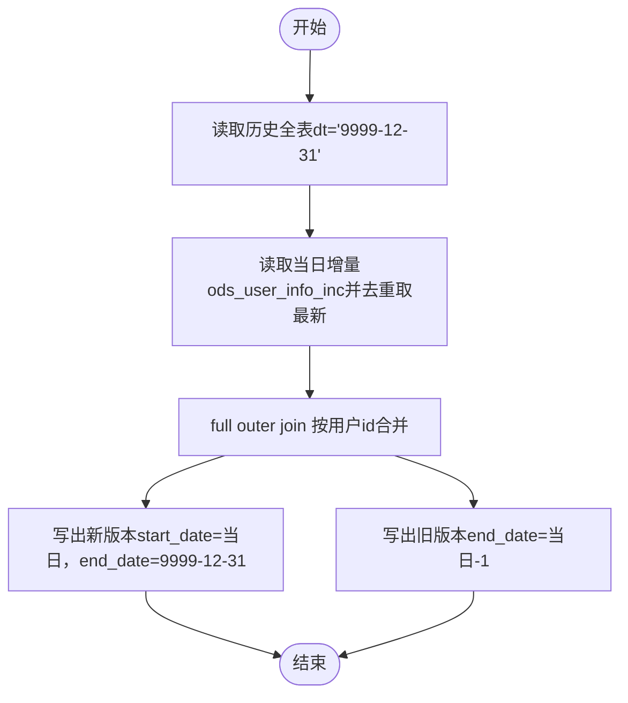
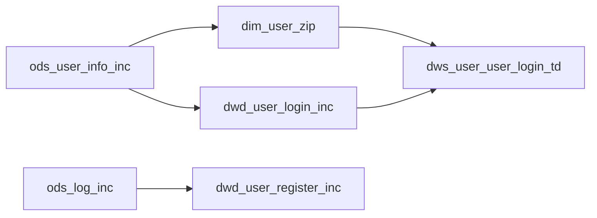

# 用户维度建模

<cite>
**本文引用的文件**
- [gmall-0906.sql](file://gmall-0906.sql)
- [middle.sql](file://middle.sql)
- [high.sql](file://high.sql)
- [console.sql](file://console.sql)
- [basic.sql](file://basic.sql)
</cite>

## 目录
1. [引言](#引言)
2. [项目结构](#项目结构)
3. [核心组件](#核心组件)
4. [架构总览](#架构总览)
5. [详细组件分析](#详细组件分析)
6. [依赖分析](#依赖分析)
7. [性能考量](#性能考量)
8. [故障排查指南](#故障排查指南)
9. [结论](#结论)
10. [附录](#附录)

## 引言
本文件围绕用户维度建模展开，系统阐述用户维度表的设计原则与实现细节，覆盖用户基本信息、用户等级、用户状态等维度属性的处理策略；详解缓慢变化维度（SCD）处理方案，包括如何追踪用户信息的历史变更；给出用户维度表的数据装载流程，展示如何从用户增量表中提取用户最新状态信息；并说明用户维度表在用户行为分析中的应用场景，包括用户画像构建、用户分群等分析需求的支撑方法。

## 项目结构
本仓库包含多个SQL脚本，其中与用户维度建模直接相关的核心文件为gmall-0906.sql，该文件定义了ODS层用户增量表、DIM层用户维度表，并提供了首日与每日装载的完整流程。其他脚本（如middle.sql、high.sql、console.sql、basic.sql）提供了日期维度、用户活跃、连续登录、用户注册/登录等辅助能力，可作为用户维度建模的配套参考。

图示来源
- [gmall-0906.sql](file://gmall-0906.sql#L450-L1098)
- [gmall-0906.sql](file://gmall-0906.sql#L3052-L3199)
- [gmall-0906.sql](file://gmall-0906.sql#L4892-L4957)

章节来源
- [gmall-0906.sql](file://gmall-0906.sql#L450-L1098)
- [gmall-0906.sql](file://gmall-0906.sql#L3052-L3199)
- [gmall-0906.sql](file://gmall-0906.sql#L4892-L4957)

## 核心组件
- 用户维度表（dim_user_zip）
  - 字段涵盖用户标识、登录名、昵称、姓名、手机号、邮箱、用户等级、生日、性别、创建时间、操作时间，以及SCD必需的开始日期与结束日期。
  - 采用SCD Type 2设计，通过start_date/end_date实现历史版本管理。
- 用户增量表（ods_user_info_inc）
  - 记录用户在各业务事件中的数据变更，包含type（如bootstrap-insert、insert、update等）与ts（时间戳），用于识别最新状态与历史变更。
- 用户事务事实表（dwd_user_register_inc、dwd_user_login_inc）
  - 提供用户注册、登录等关键行为的事务级事实，为用户维度表的装载提供上下文与校验依据。
- 用户登录历史至今汇总（dws_user_user_login_td）
  - 基于dwd_user_login_inc生成用户登录历史至今的汇总，支撑用户画像与分群分析。

章节来源
- [gmall-0906.sql](file://gmall-0906.sql#L908-L1098)
- [gmall-0906.sql](file://gmall-0906.sql#L3052-L3199)
- [gmall-0906.sql](file://gmall-0906.sql#L4892-L4957)

## 架构总览
用户维度建模遵循“ODS -> DIM -> DWD/DWS -> ADS”的分层架构，用户维度表作为分析层的核心实体，向上承接业务事务事实，向下服务各类分析指标与报表。

图示来源
- [gmall-0906.sql](file://gmall-0906.sql#L932-L1098)
- [gmall-0906.sql](file://gmall-0906.sql#L3075-L3175)
- [gmall-0906.sql](file://gmall-0906.sql#L4892-L4957)

## 详细组件分析

### 用户维度表（dim_user_zip）设计与实现
- 设计要点
  - SCD Type 2：通过start_date/end_date标识有效时间段，新版本生效时，旧版本end_date回填至前一天，形成历史版本链。
  - MD5脱敏：对敏感字段（姓名、手机号、邮箱）进行MD5处理，满足数据安全要求。
  - 全量与增量结合：首日全量装载，后续每日基于增量数据与历史全表进行full outer join，实现版本切换与历史归档。
- 数据装载流程
  - 首日装载：从ods_user_info_inc中筛选type=bootstrap-insert的记录，直接写入dim_user_zip，end_date统一指向未来（9999-12-31）。
  - 每日装载：以dim_user_zip（dt='9999-12-31'）为旧表，ods_user_info_inc为新表，按用户id进行full outer join，生成新旧版本并分别写出。
- 关键实现位置
  - 首日装载与每日装载逻辑见以下路径：
    - [gmall-0906.sql](file://gmall-0906.sql#L932-L1098)

图示来源
- [gmall-0906.sql](file://gmall-0906.sql#L954-L1098)

章节来源
- [gmall-0906.sql](file://gmall-0906.sql#L908-L1098)

### SCD（缓慢变化维度）处理策略
- 目标
  - 追踪用户信息的历史变更，确保分析时可按时间点还原用户在任意历史时刻的维度状态。
- 策略
  - 版本化：新增版本时，旧版本end_date回填至变更日的前一天；新版本start_date为变更日，end_date为未来。
  - 去重与取最新：每日从增量表按用户id排序取最新一条记录，避免重复与脏数据。
  - MD5脱敏：对姓名、手机号、邮箱等字段进行MD5处理，兼顾隐私与一致性。
- 关键实现位置
  - [gmall-0906.sql](file://gmall-0906.sql#L954-L1098)

章节来源
- [gmall-0906.sql](file://gmall-0906.sql#L954-L1098)

### 从用户增量表提取最新状态信息
- 增量表结构
  - 包含type（bootstrap-insert/insert/update）、ts（时间戳）、data（用户字段）、old（旧值映射）等。
- 提取策略
  - 按用户id排序取最新记录（rank() over (partition by id order by ts desc) rk=1），确保同一用户在当日仅保留一条最新状态。
  - 对新增用户（type='bootstrap-insert'）与更新用户（type='insert'/'update'）分别处理，保证全量与增量的一致性。
- 关键实现位置
  - [gmall-0906.sql](file://gmall-0906.sql#L954-L1098)

章节来源
- [gmall-0906.sql](file://gmall-0906.sql#L954-L1098)

### 用户维度表在用户行为分析中的应用
- 用户画像构建
  - 结合dwd_user_register_inc（注册信息）、dwd_user_login_inc（登录信息）、dws_user_user_login_td（登录历史至今）等，构建用户基础画像与行为画像。
- 用户分群
  - 基于登录频次、最近登录时间、累计订单数等指标，结合SCD版本，按历史时点进行用户分群与标签化运营。
- 关键实现位置
  - 注册/登录事实装载与登录历史汇总：
    - [gmall-0906.sql](file://gmall-0906.sql#L3075-L3175)
    - [gmall-0906.sql](file://gmall-0906.sql#L4892-L4957)

章节来源
- [gmall-0906.sql](file://gmall-0906.sql#L3075-L3175)
- [gmall-0906.sql](file://gmall-0906.sql#L4892-L4957)

### 辅助能力与配套实现
- 日期维度与连续登录
  - 提供日期维度表与连续登录分析能力，支撑用户活跃度与留存分析。
  - 参考：
    - [gmall-0906.sql](file://gmall-0906.sql#L850-L906)
    - [high.sql](file://high.sql#L1-L319)
- 用户活跃与连续登录
  - 提供连续登录、会话划分等分析能力，辅助用户分群与画像。
  - 参考：
    - [high.sql](file://high.sql#L1-L319)
    - [console.sql](file://console.sql#L210-L270)
- 基础函数与日期处理
  - 提供日期函数、开窗函数、集合函数等，支撑维度表与分析表的构建。
  - 参考：
    - [basic.sql](file://basic.sql#L1-L800)

章节来源
- [gmall-0906.sql](file://gmall-0906.sql#L850-L906)
- [high.sql](file://high.sql#L1-L319)
- [console.sql](file://console.sql#L210-L270)
- [basic.sql](file://basic.sql#L1-L800)

## 依赖分析
- 组件耦合
  - dim_user_zip依赖ods_user_info_inc（增量数据源）与dim_province_full（地区维度，用于其他维度表，此处为整体架构参考）。
  - dwd_user_register_inc、dwd_user_login_inc依赖ods_user_info_inc与ods_log_inc（日志表，用于注册/登录事件识别）。
  - dws_user_user_login_td依赖dwd_user_login_inc与dim_user_zip（注册日期）。
- 外部依赖
  - Hive SerDe/分区/ORC存储配置，确保增量与全量装载的稳定性与性能。
- 关键实现位置
  - [gmall-0906.sql](file://gmall-0906.sql#L450-L1098)
  - [gmall-0906.sql](file://gmall-0906.sql#L3052-L3199)
  - [gmall-0906.sql](file://gmall-0906.sql#L4892-L4957)

图示来源
- [gmall-0906.sql](file://gmall-0906.sql#L450-L1098)
- [gmall-0906.sql](file://gmall-0906.sql#L3052-L3199)
- [gmall-0906.sql](file://gmall-0906.sql#L4892-L4957)

章节来源
- [gmall-0906.sql](file://gmall-0906.sql#L450-L1098)
- [gmall-0906.sql](file://gmall-0906.sql#L3052-L3199)
- [gmall-0906.sql](file://gmall-0906.sql#L4892-L4957)

## 性能考量
- 分区与存储
  - DIM层采用分区（dt）与ORC存储，提升查询与写入性能。
- 增量装载优化
  - 每日装载采用full outer join与union all组合，避免全表扫描；通过rank()取最新记录，减少重复数据。
- 日期与会话计算
  - 使用开窗函数与日期函数进行连续登录与会话划分，减少多轮扫描与临时表。
- 参考实现位置
  - [gmall-0906.sql](file://gmall-0906.sql#L954-L1098)
  - [high.sql](file://high.sql#L1-L319)

章节来源
- [gmall-0906.sql](file://gmall-0906.sql#L954-L1098)
- [high.sql](file://high.sql#L1-L319)

## 故障排查指南
- 常见问题
  - 增量数据缺失或重复：检查ods_user_info_inc的type与ts字段，确认是否正确标注bootstrap-insert/insert/update，以及是否按用户id排序取最新。
  - SCD版本未正确回填：核对dim_user_zip的end_date是否正确回填至变更日的前一天，start_date是否为变更日。
  - 登录历史汇总异常：检查dwd_user_login_inc与dws_user_user_login_td的装载逻辑，确认每日全量与历史表的合并是否正确。
- 参考实现位置
  - [gmall-0906.sql](file://gmall-0906.sql#L954-L1098)
  - [gmall-0906.sql](file://gmall-0906.sql#L4892-L4957)

章节来源
- [gmall-0906.sql](file://gmall-0906.sql#L954-L1098)
- [gmall-0906.sql](file://gmall-0906.sql#L4892-L4957)

## 结论
本项目通过ODS -> DIM -> DWD/DWS -> ADS的分层架构，实现了用户维度表的稳健建模与高效装载。SCD Type 2设计确保了用户历史状态的可追溯性；基于增量表的每日装载流程保障了数据新鲜度与一致性；配合注册/登录等事务事实与历史汇总，为用户画像构建与用户分群提供了坚实的数据基础。

## 附录
- 相关实现位置汇总
  - 用户维度表与装载流程：[gmall-0906.sql](file://gmall-0906.sql#L908-L1098)
  - 用户注册/登录事务事实装载：[gmall-0906.sql](file://gmall-0906.sql#L3075-L3175)
  - 用户登录历史至今汇总：[gmall-0906.sql](file://gmall-0906.sql#L4892-L4957)
  - 连续登录与会话分析：[high.sql](file://high.sql#L1-L319)
  - 日期维度与基础函数：[gmall-0906.sql](file://gmall-0906.sql#L850-L906)、[basic.sql](file://basic.sql#L1-L800)