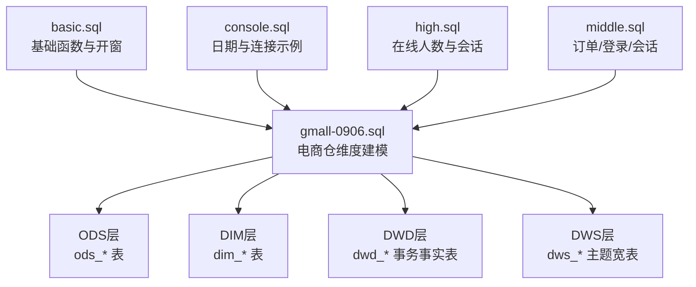
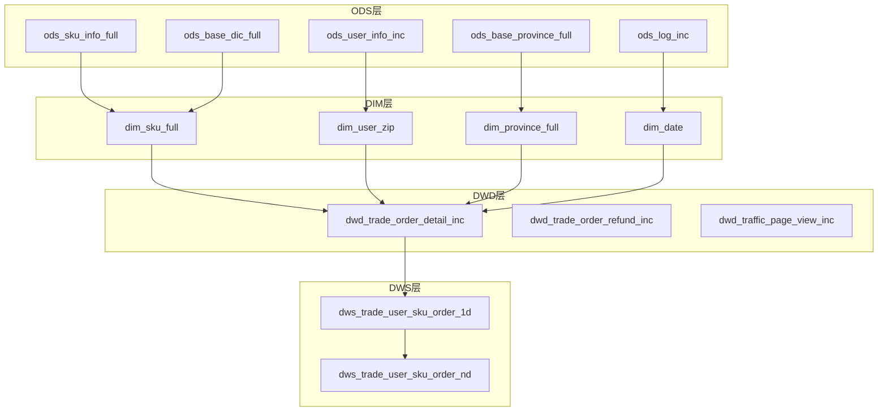
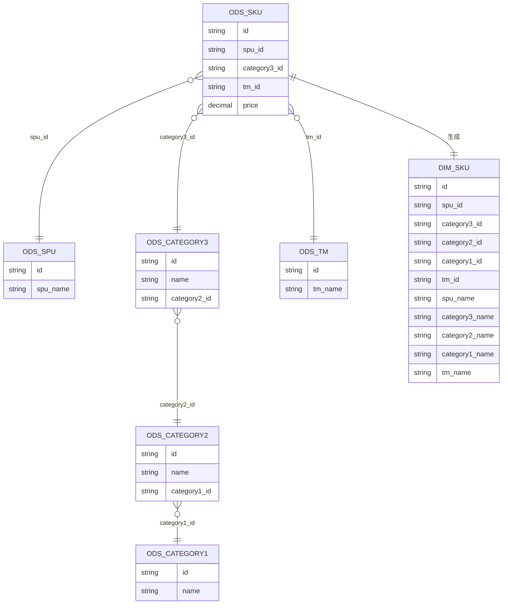
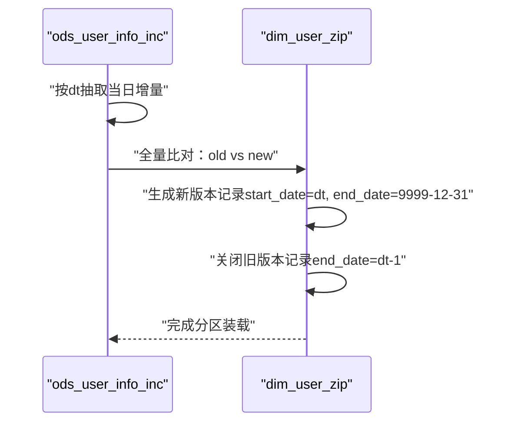
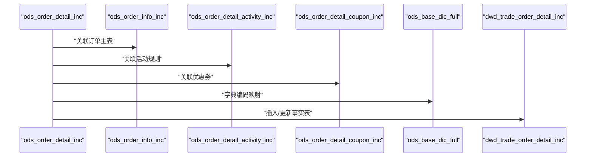
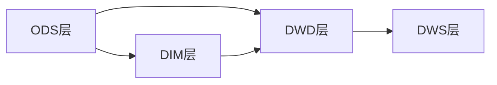

# 维度建模

<cite>
**本文引用的文件**
- [basic.sql](file://basic.sql)
- [console.sql](file://console.sql)
- [gmall-0906.sql](file://gmall-0906.sql)
- [high.sql](file://high.sql)
- [middle.sql](file://middle.sql)
</cite>

## 目录
1. [引言](#引言)
2. [项目结构](#项目结构)
3. [核心组件](#核心组件)
4. [架构总览](#架构总览)
5. [详细组件分析](#详细组件分析)
6. [依赖分析](#依赖分析)
7. [性能考量](#性能考量)
8. [故障排查指南](#故障排查指南)
9. [结论](#结论)
10. [附录](#附录)

## 引言
本文件系统化梳理仓库中的维度建模实践，围绕星型模型的设计与实现展开，覆盖事实表与维度表的关系设计、各类维度表（商品、用户、地区、时间）的建模要点、缓慢变化维度（SCD）处理策略（类型1/2/3），并结合仓库中的真实建模脚本，给出规范化与反规范化决策依据、常见陷阱与最佳实践，以及可复用的实际案例。

## 项目结构
仓库包含多个SQL文件，分别演示了通用SQL技巧、业务示例、以及电商仓维表的完整建模流程：
- basic.sql：基础函数与开窗函数示例，体现维度建模中常用的聚合、排序、窗口计算能力。
- console.sql：教学示例，涵盖日期函数、连接、子查询、排名等，为维度建模中的时间维度与事实表聚合提供基础。
- gmall-0906.sql：电商仓维度建模的完整实现，包含ODS层、DIM层（维度表）、DWD层（事务事实表）、DWS层（主题宽表）等，是本文件的核心参考。
- high.sql：直播/在线人数场景，展示窗口函数在连续性判断中的应用，体现维度建模中时间维度与事实表的组合使用。
- middle.sql：订单、登录、会话等场景，强调连续登录、会话划分、累计消费等维度建模与事实表聚合的典型用法。

图表来源
- [gmall-0906.sql](file://gmall-0906.sql#L1-L200)
- [basic.sql](file://basic.sql#L1-L120)
- [console.sql](file://console.sql#L1-L120)
- [high.sql](file://high.sql#L1-L60)
- [middle.sql](file://middle.sql#L1-L60)

章节来源
- [gmall-0906.sql](file://gmall-0906.sql#L1-L200)
- [basic.sql](file://basic.sql#L1-L120)
- [console.sql](file://console.sql#L1-L120)
- [high.sql](file://high.sql#L1-L60)
- [middle.sql](file://middle.sql#L1-L60)

## 核心组件
- 星型模型核心要素
  - 事实表：存储度量指标（如下单件数、金额、退单件数等），通常以维度键为主外键。
  - 维度表：存储描述性属性（如商品、用户、地区、时间等），用于过滤与分组分析。
- 本仓库中事实表与维度表的映射关系
  - 商品维度表 dim_sku_full：提供商品、品牌、品类、属性等维度信息，被事务事实表（如订单明细、退单）引用。
  - 用户维度表 dim_user_zip：提供用户画像维度，支撑用户粒度的分析。
  - 地区维度表 dim_province_full：提供省/地区维度，支撑地域分析。
  - 时间维度表 dim_date：提供日期、周、季度、工作日等维度，支撑时间序列分析。
  - 事务事实表：如 dwd_trade_order_detail_inc、dwd_trade_order_refund_inc 等，承载业务事件的原子度度量。

章节来源
- [gmall-0906.sql](file://gmall-0906.sql#L460-L950)
- [gmall-0906.sql](file://gmall-0906.sql#L850-L950)
- [gmall-0906.sql](file://gmall-0906.sql#L908-L1100)
- [gmall-0906.sql](file://gmall-0906.sql#L1170-L1480)

## 架构总览
电商仓维度建模采用“ODS-DIM-DWD-DWS”分层架构：
- ODS层：抽取原始日志/增量/全量数据，保持与源系统一致的结构。
- DIM层：构建维度表，沉淀稳定的维度属性，支持历史追溯。
- DWD层：构建事务事实表，面向业务事件，记录原子度度量。
- DWS层：构建主题宽表，面向分析主题，减少跨表关联成本。

图表来源
- [gmall-0906.sql](file://gmall-0906.sql#L1-L200)
- [gmall-0906.sql](file://gmall-0906.sql#L850-L1100)
- [gmall-0906.sql](file://gmall-0906.sql#L1170-L1480)
- [gmall-0906.sql](file://gmall-0906.sql#L3650-L3999)

章节来源
- [gmall-0906.sql](file://gmall-0906.sql#L1-L200)
- [gmall-0906.sql](file://gmall-0906.sql#L850-L1100)
- [gmall-0906.sql](file://gmall-0906.sql#L1170-L1480)
- [gmall-0906.sql](file://gmall-0906.sql#L3650-L3999)

## 详细组件分析

### 星型模型设计与实现
- 设计原则
  - 事实表以“最小粒度的业务事件”为单位，存储度量；维度表以“描述性属性”为单位，提供上下文。
  - 维度表与事实表通过维度键建立一对一或多对一关系，避免事实表冗余。
- 实现要点
  - 事实表的度量字段应尽量原子化，便于后续聚合与分析。
  - 维度表应包含必要的派生字段（如品类层级、品牌名称、时间维度），减少查询时的连接成本。
  - 采用分区策略（如按日期分区）提升查询性能与维护效率。

章节来源
- [gmall-0906.sql](file://gmall-0906.sql#L1170-L1480)
- [gmall-0906.sql](file://gmall-0906.sql#L3650-L3999)

### 维度表设计模式

#### 商品维度表（dim_sku_full）
- 设计要点
  - 聚合商品、SPU、品牌、品类（三级/二级/一级）等信息，形成商品维度的完整视图。
  - 通过收集属性与销售属性，支持多维分析。
- 实现路径
  - 从 ODS 层的 SKU/SPU/品牌/品类/属性表中抽取并拼接，生成维度表。
  - 通过分区 dt 实现每日装载与历史保留。

图表来源
- [gmall-0906.sql](file://gmall-0906.sql#L460-L605)

章节来源
- [gmall-0906.sql](file://gmall-0906.sql#L460-L605)

#### 用户维度表（dim_user_zip）
- 设计要点
  - 采用缓慢变化维度（SCD）类型2：通过 start_date/end_date 标识有效时间段，支持历史追溯。
  - 通过全量装载与增量更新，维护用户维度的历史版本。
- 实现路径
  - 首日装载：将 bootstrap-insert 数据作为永久有效的版本。
  - 每日增量：基于新旧数据比对，生成新的有效区间，并关闭旧版本的 end_date。

图表来源
- [gmall-0906.sql](file://gmall-0906.sql#L908-L1100)

章节来源
- [gmall-0906.sql](file://gmall-0906.sql#L908-L1100)

#### 地区维度表（dim_province_full）
- 设计要点
  - 聚合省/地区编码、ISO编码、地区名称等信息，支撑地域分析。
- 实现路径
  - 从 ODS 的省表与地区表中关联，生成维度表并按 dt 分区。

章节来源
- [gmall-0906.sql](file://gmall-0906.sql#L800-L848)

#### 时间维度表（dim_date）
- 设计要点
  - 提供日期、周、季度、工作日等维度属性，支撑时间序列分析。
- 实现路径
  - 通过预置的日期维度表或动态生成，填充时间维度字段。

章节来源
- [gmall-0906.sql](file://gmall-0906.sql#L850-L906)

### 事务事实表与主题宽表

#### 事务事实表（以订单明细为例）
- 设计要点
  - 订单明细事实表包含用户、商品、地区、时间等维度键，以及下单件数、原始金额、优惠分摊、最终金额等度量。
  - 通过字典表（ods_base_dic_full）将编码转换为可读名称，提升可读性。
- 实现路径
  - 首日与每日装载逻辑分离，确保 bootstrap-insert 与 insert/update 的正确性。
  - 通过多表关联（订单、订单详情、活动、优惠券、支付）生成事实表。

图表来源
- [gmall-0906.sql](file://gmall-0906.sql#L1280-L1480)

章节来源
- [gmall-0906.sql](file://gmall-0906.sql#L1280-L1480)

#### 主题宽表（以用户-商品粒度订单1日/ND为例）
- 设计要点
  - 将事实表与维度表聚合，形成面向分析的主题宽表，减少查询时的连接成本。
  - 支持最近N日聚合，便于趋势分析与同比环比。
- 实现路径
  - 1日宽表：按用户+商品聚合，产出当日下单次数、件数、金额等。
  - ND宽表：基于1日宽表按日期窗口聚合，产出最近7日/30日指标。

章节来源
- [gmall-0906.sql](file://gmall-0906.sql#L3650-L3999)

### 缓慢变化维度（SCD）处理策略

- 类型1：直接覆盖旧值，不保留历史。适用于不关心历史、且维度变更频率极低的场景。
- 类型2：保留历史版本，通过开始/结束日期标识有效区间，适用于用户、商品等需要历史追溯的维度。
- 类型3：在现有记录上增加新列保存变更历史，适用于少量维度属性的渐进式变更。

本仓库中用户维度表采用类型2策略，通过 start_date/end_date 标识有效区间，实现历史版本管理与回溯。

章节来源
- [gmall-0906.sql](file://gmall-0906.sql#L908-L1100)

### 规范化与反规范化决策依据
- 规范化（拆分维度表）
  - 优点：减少冗余，降低存储与更新成本。
  - 适用：维度属性稳定、查询频繁跨表关联的场景。
- 反规范化（维度表冗余）
  - 优点：查询性能高，减少连接。
  - 适用：分析型查询频繁、维度属性相对静态、查询路径固定的场景。
- 本仓库实践
  - 商品维度表将品类层级、品牌名称等冗余到维度表，减少分析时的连接。
  - 用户维度表通过类型2冗余历史版本，满足审计与回溯需求。

章节来源
- [gmall-0906.sql](file://gmall-0906.sql#L460-L605)
- [gmall-0906.sql](file://gmall-0906.sql#L908-L1100)

### 实际案例

#### 案例1：商品维度与订单明细的组合分析
- 业务目标：按品牌/品类/商品分析近7日/30日下单次数、件数、金额。
- 实施路径
  - 使用 dim_sku_full 与 dwd_trade_order_detail_inc 聚合，生成 dws_trade_user_sku_order_nd。
  - 通过日期维度与字典表增强可读性。

章节来源
- [gmall-0906.sql](file://gmall-0906.sql#L3650-L3999)

#### 案例2：用户维度与登录/下单的综合统计
- 业务目标：统计用户注册日期、登录次数、2021年登录次数、订单数与订单总额。
- 实施路径
  - 使用 dwd_user_login_inc 与 dwd_user_register_inc，结合 order_info 进行聚合统计。

章节来源
- [gmall-0906.sql](file://gmall-0906.sql#L3050-L3199)

#### 案例3：连续登录与会话划分
- 业务目标：识别连续登录天数、划分用户会话。
- 实施路径
  - 使用 row_number/lag/datediff 等窗口函数与日期函数，打标并分组统计。

章节来源
- [high.sql](file://high.sql#L1-L120)
- [middle.sql](file://middle.sql#L1-L120)

## 依赖分析
- 维度表依赖
  - dim_sku_full 依赖 ODS 的 SKU/SPU/品牌/品类/属性表。
  - dim_user_zip 依赖 ODS 的用户增量表。
  - dim_province_full 依赖 ODS 的省/地区表。
  - dim_date 依赖预置或生成的日期维度表。
- 事实表依赖
  - dwd_trade_order_detail_inc 依赖订单明细、订单主表、活动、优惠券、字典表。
  - dwd_trade_order_refund_inc 依赖退单明细与订单主表。
- 主题宽表依赖
  - dws_trade_user_sku_order_1d/nd 依赖 dwd 事务事实表与 dim_sku_full。

图表来源
- [gmall-0906.sql](file://gmall-0906.sql#L1-L200)
- [gmall-0906.sql](file://gmall-0906.sql#L1170-L1480)
- [gmall-0906.sql](file://gmall-0906.sql#L3650-L3999)

章节来源
- [gmall-0906.sql](file://gmall-0906.sql#L1-L200)
- [gmall-0906.sql](file://gmall-0906.sql#L1170-L1480)
- [gmall-0906.sql](file://gmall-0906.sql#L3650-L3999)

## 性能考量
- 分区策略
  - 事实表与维度表均按 dt 分区，便于按日期裁剪与增量装载。
- 存储格式
  - 维度表与事实表采用 ORC 存储，压缩比高，查询性能佳。
- 连接与聚合
  - 将常用维度属性冗余到维度表，减少分析时的连接。
  - 使用窗口函数与派生字段，避免复杂子查询与多层嵌套。
- 日期与时间维度
  - 提前构建 dim_date，统一时间维度口径，减少重复计算。

章节来源
- [gmall-0906.sql](file://gmall-0906.sql#L850-L906)
- [gmall-0906.sql](file://gmall-0906.sql#L1170-L1480)

## 故障排查指南
- 常见问题
  - 字段类型不匹配：日期函数对格式敏感，需确保输入格式与期望一致。
  - 空值处理：coalesce/nvl 等函数用于消除空值影响，避免统计偏差。
  - 连接顺序与条件：先筛选再关联，可显著提升性能。
  - 窗口函数与聚合：避免在 where 子句中直接使用窗口函数，应在子查询中完成。
- 诊断建议
  - 使用 explain 查看执行计划，定位热点与瓶颈。
  - 对高频维度属性进行冗余，减少连接与排序成本。
  - 对时间维度进行统一口径（如统一使用 dim_date），避免重复计算。

章节来源
- [basic.sql](file://basic.sql#L1-L120)
- [console.sql](file://console.sql#L1-L120)
- [high.sql](file://high.sql#L1-L120)
- [middle.sql](file://middle.sql#L1-L120)

## 结论
本仓库展示了电商仓维度建模的完整实践：从 ODS 到 DIM、DWD、DWS 的分层架构，配合星型模型的事实表与维度表设计，以及 SCD 类型2的用户维度管理，形成了可扩展、可维护、高性能的分析体系。通过冗余维度属性、分区与 ORC 存储、窗口函数与派生字段等手段，有效平衡了查询性能与维护成本。建议在实际项目中遵循本仓库的建模思路，结合业务场景选择合适的规范化/反规范化策略，并持续完善时间维度与字典表的治理。

## 附录
- 术语
  - ODS：操作数据存储层，存放原始数据。
  - DIM：维度层，存放维度表。
  - DWD：数据仓库明细层，存放事务事实表。
  - DWS：数据仓库汇总层，存放主题宽表。
- 参考路径
  - 商品维度表构建：[gmall-0906.sql](file://gmall-0906.sql#L460-L605)
  - 用户维度表（SCD类型2）：[gmall-0906.sql](file://gmall-0906.sql#L908-L1100)
  - 订单明细事务事实表：[gmall-0906.sql](file://gmall-0906.sql#L1280-L1480)
  - 主题宽表（用户-商品粒度）：[gmall-0906.sql](file://gmall-0906.sql#L3650-L3999)
  - 连续登录与会话划分：[high.sql](file://high.sql#L1-L120)、[middle.sql](file://middle.sql#L1-L120)