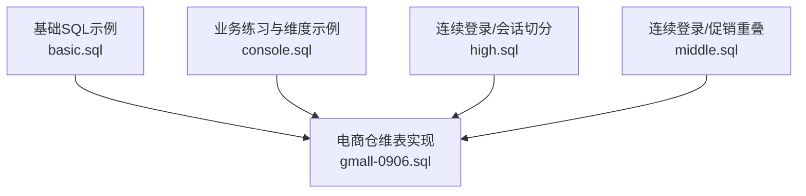
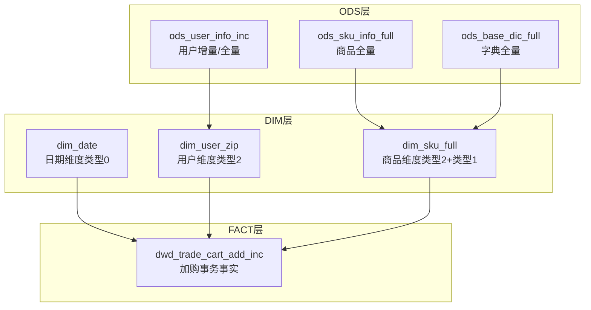
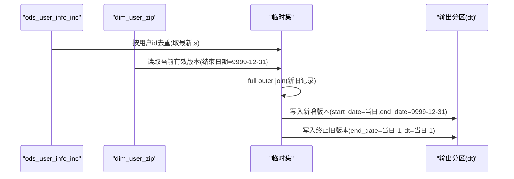
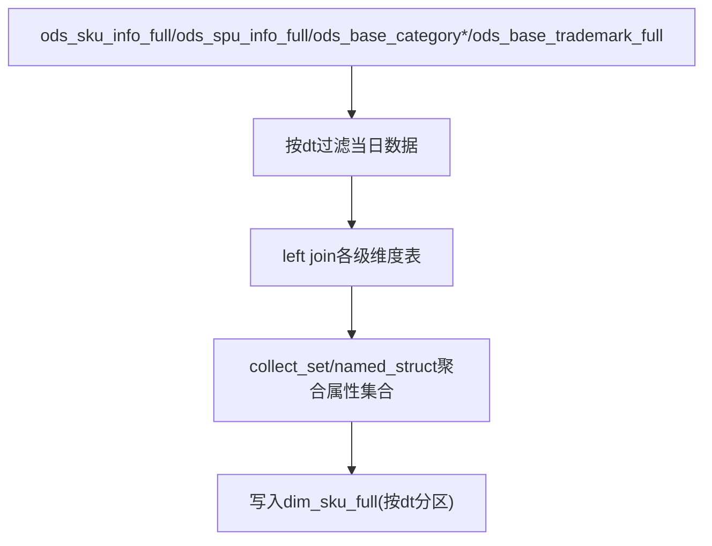
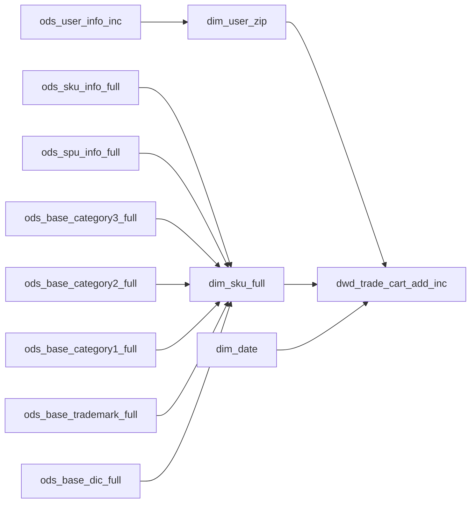

# 缓慢变化维度处理

<cite>
**本文引用的文件**
- [basic.sql](file://basic.sql)
- [console.sql](file://console.sql)
- [gmall-0906.sql](file://gmall-0906.sql)
- [high.sql](file://high.sql)
- [middle.sql](file://middle.sql)
</cite>

## 目录
1. [引言](#引言)
2. [项目结构](#项目结构)
3. [核心组件](#核心组件)
4. [架构总览](#架构总览)
5. [详细组件分析](#详细组件分析)
6. [依赖分析](#依赖分析)
7. [性能考量](#性能考量)
8. [故障排查指南](#故障排查指南)
9. [结论](#结论)
10. [附录](#附录)

## 引言
本文件围绕“缓慢变化维度（Slowly Changing Dimension, SCD）”展开，系统梳理仓库中与维度建模、版本化维度、历史数据保留相关的实现与最佳实践。重点覆盖：
- SCD三种类型：类型1覆盖更新、类型2版本历史、类型3并行历史
- 在用户维度、商品维度等业务维度中的落地策略
- SCD标识位设计、版本控制、历史数据保留的技术细节
- 对查询性能的影响与优化方法
- 最佳实践与常见问题的解决方案

## 项目结构
该仓库包含多个SQL脚本，涵盖基础函数示例、业务场景练习、电商仓维表（GMALL）建模与加载逻辑、连续登录与会话切分等分析场景。与SCD直接相关的核心文件为：
- gmall-0906.sql：包含用户维度（类型2版本历史）的完整实现，以及商品维度、活动维度、地区维度等的建模与装载
- console.sql：包含日期维度、用户活跃、订单等维度与事实表的示例
- middle.sql、high.sql：包含连续登录、会话切分、累计金额等分析场景，体现开窗与维度结合的查询模式

图示来源
- [gmall-0906.sql](file://gmall-0906.sql#L850-L1243)
- [console.sql](file://console.sql#L150-L250)
- [high.sql](file://high.sql#L1-L120)
- [middle.sql](file://middle.sql#L1-L120)

章节来源
- [gmall-0906.sql](file://gmall-0906.sql#L850-L1243)
- [console.sql](file://console.sql#L150-L250)
- [high.sql](file://high.sql#L1-L120)
- [middle.sql](file://middle.sql#L1-L120)

## 核心组件
- 用户维度（类型2版本历史）
  - 采用“开始日期/结束日期”标识位，配合“当前有效标记”，实现维度版本化与历史保留
  - 通过全外连接（full outer join）合并新旧记录，生成“新增版本”和“终止旧版本”的两条记录
  - 通过分区字段（dt）实现按日期装载与回放
- 商品维度（类型0/1/2混合）
  - 商品维度表以全量装载为主，部分字段采用覆盖更新（类型1），部分字段采用版本化（类型2）
  - 通过多表关联与集合函数构建维度宽表
- 日期维度（类型0）
  - 预置静态维度表，提供周、季度、节假日等派生属性
- 事实表与维度表的关联
  - 通过维度主键与时间维度键进行关联，支撑各类分析查询

章节来源
- [gmall-0906.sql](file://gmall-0906.sql#L908-L1243)
- [gmall-0906.sql](file://gmall-0906.sql#L466-L665)
- [gmall-0906.sql](file://gmall-0906.sql#L850-L906)

## 架构总览
SCD在本仓库中的实现遵循典型的“ODS -> DIM/FACT -> DWS/DWT/ADS”分层思想：
- ODS层：抽取增量/全量的业务表（如用户信息、订单明细、日志等）
- DIM层：维度表（用户维度采用类型2版本历史；商品维度采用类型2+类型1组合；日期维度为类型0）
- FACT层：事务/快照事实表（如加购、支付、退款等）
- DWS/DWT/ADS层：面向主题的宽表与汇总表

图示来源
- [gmall-0906.sql](file://gmall-0906.sql#L908-L1243)
- [gmall-0906.sql](file://gmall-0906.sql#L466-L665)
- [gmall-0906.sql](file://gmall-0906.sql#L850-L906)
- [gmall-0906.sql](file://gmall-0906.sql#L1174-L1243)

## 详细组件分析

### 用户维度（类型2版本历史）实现
- 设计要点
  - 标识位：start_date、end_date（类型2核心字段）
  - 当前有效标记：通过end_date是否为“永久有效”（如9999-12-31）判断
  - 分区字段：dt（按日期装载，便于回放与增量）
- 数据流程
  - 首日装载：将ods_user_info_inc中bootstrap-insert的数据作为初始版本，end_date设为“永久有效”
  - 每日增量：对ods_user_info_inc按用户id去重（取最新ts），与dim_user_zip当前有效版本进行full outer join
  - 生成两条记录：
    - 新增版本：来自ods的新记录，start_date为当天，end_date为“永久有效”
    - 终止旧版本：来自dim_user_zip的旧记录，end_date回溯到前一天
- 关键SQL位置
  - 首日装载与每日增量逻辑见以下路径
    - [首日装载](file://gmall-0906.sql#L932-L952)
    - [每日增量（方案一）](file://gmall-0906.sql#L1044-L1078)
    - [每日增量（方案二）](file://gmall-0906.sql#L1081-L1168)

图示来源
- [gmall-0906.sql](file://gmall-0906.sql#L932-L952)
- [gmall-0906.sql](file://gmall-0906.sql#L1044-L1078)
- [gmall-0906.sql](file://gmall-0906.sql#L1081-L1168)

章节来源
- [gmall-0906.sql](file://gmall-0906.sql#L908-L1243)

### 商品维度（类型2+类型1组合）
- 设计要点
  - 类型2：spu_name、category系列、tm_name等随时间变化的属性采用版本化
  - 类型1：部分字段（如价格、是否在售）采用覆盖更新
  - 通过多表关联（spu、category、brand等）与集合函数构建宽表
- 数据流程
  - 以ods层全量表为源，按dt过滤当日数据
  - 通过left join关联各级维度，并收集属性集合
  - 写入dim_sku_full，按dt分区
- 关键SQL位置
  - [商品维度建表与装载](file://gmall-0906.sql#L466-L665)

图示来源
- [gmall-0906.sql](file://gmall-0906.sql#L466-L665)

章节来源
- [gmall-0906.sql](file://gmall-0906.sql#L466-L665)

### 日期维度（类型0）
- 设计要点
  - 预置静态维度表，包含周、季度、节假日等派生属性
  - 通过临时表装载后写入正式表
- 关键SQL位置
  - [日期维度建表与装载](file://gmall-0906.sql#L850-L906)

章节来源
- [gmall-0906.sql](file://gmall-0906.sql#L850-L906)

### SCD类型说明与适用场景
- 类型1：覆盖更新
  - 适用：属性变化无需历史追踪，或历史可由其他渠道补充
  - 示例：商品维度中的价格、是否在售等字段
- 类型2：版本历史
  - 适用：需要追踪属性随时间的变化轨迹，支持“历史快照”分析
  - 示例：用户维度（start_date/end_date）、商品维度（spu_name、分类、品牌等）
- 类型3：并行历史
  - 适用：仅保留最新与上一次两个版本，减少存储与查询成本
  - 本仓库未直接给出类型3实现，但可通过开窗函数（如lag/lead）在查询侧模拟“上一次值”

章节来源
- [gmall-0906.sql](file://gmall-0906.sql#L908-L1243)
- [gmall-0906.sql](file://gmall-0906.sql#L466-L665)

## 依赖分析
- 维度表依赖
  - 用户维度依赖ods_user_info_inc（增量/全量）
  - 商品维度依赖ods_sku_info_full、ods_spu_info_full、ods_base_category*、ods_base_trademark_full、ods_base_dic_full
  - 日期维度依赖临时表预置数据
- 事实表依赖
  - dwd_trade_cart_add_inc依赖dim_user_zip、dim_sku_full、dim_date等维度
- 查询依赖
  - 开窗函数广泛用于连续登录、会话切分、累计金额等分析

图示来源
- [gmall-0906.sql](file://gmall-0906.sql#L466-L665)
- [gmall-0906.sql](file://gmall-0906.sql#L908-L1243)
- [gmall-0906.sql](file://gmall-0906.sql#L1174-L1243)

章节来源
- [gmall-0906.sql](file://gmall-0906.sql#L466-L665)
- [gmall-0906.sql](file://gmall-0906.sql#L908-L1243)
- [gmall-0906.sql](file://gmall-0906.sql#L1174-L1243)

## 性能考量
- 存储与压缩
  - 维度表采用ORC格式并启用snappy压缩，提升IO与查询性能
- 分区策略
  - 维度表按dt分区，便于按日期装载与回放，减少扫描范围
- 查询优化
  - 使用开窗函数（如rank/dense_rank/row_number/lag/lead）替代复杂子查询，提升可读性与性能
  - 在连续登录、会话切分等场景中，先去重再开窗，避免重复计算
- 写入优化
  - 使用full outer join合并新旧版本，避免多次扫描与重复写入
  - 通过临时集（CTE/子查询）减少中间表的物理存储

章节来源
- [gmall-0906.sql](file://gmall-0906.sql#L466-L494)
- [gmall-0906.sql](file://gmall-0906.sql#L908-L931)
- [high.sql](file://high.sql#L1-L120)
- [middle.sql](file://middle.sql#L1-L120)

## 故障排查指南
- 常见问题
  - 维度版本冲突：当同一用户在同一天出现多条记录时，需确保ods层按ts去重后再写入dim
  - 日期边界问题：终止旧版本的end_date应为“当日-1”，防止跨日重叠
  - 分区缺失：装载时未指定dt分区，导致后续查询无法定位数据
- 排查建议
  - 核对ods层数据质量（去重、格式、空值）
  - 核对full outer join条件与字段映射
  - 核对分区dt与日期标识位（start_date/end_date）的一致性
  - 使用explain/执行计划定位热点子查询与重复扫描

章节来源
- [gmall-0906.sql](file://gmall-0906.sql#L1044-L1078)
- [gmall-0906.sql](file://gmall-0906.sql#L1081-L1168)

## 结论
本仓库在用户维度上实现了标准的类型2版本历史（start_date/end_date），在商品维度上采用类型2+类型1组合，辅以日期维度与事务事实表，形成完整的维度建模与分析体系。通过分区、ORC压缩、开窗函数与full outer join等手段，在保证数据准确性的同时兼顾了查询性能与维护成本。建议在实际项目中：
- 明确各维度属性的SCD类型，统一治理策略
- 规范分区与标识位命名，确保可追溯性
- 在查询侧充分利用开窗函数，减少子查询与重复扫描
- 对历史数据保留周期进行评估，平衡存储与查询需求

## 附录
- SCD类型对照与选择建议
  - 类型1：适合无需历史追踪的属性（如价格、状态）
  - 类型2：适合需要历史轨迹的属性（如用户资料、商品名称）
  - 类型3：适合仅需最新与上一次值的场景（可用开窗函数模拟）
- 相关实现参考路径
  - [用户维度类型2实现](file://gmall-0906.sql#L908-L1243)
  - [商品维度类型2+类型1实现](file://gmall-0906.sql#L466-L665)
  - [日期维度类型0实现](file://gmall-0906.sql#L850-L906)
  - [连续登录/会话切分示例](file://high.sql#L1-L120)
  - [促销重叠/连续登录示例](file://middle.sql#L1-L120)