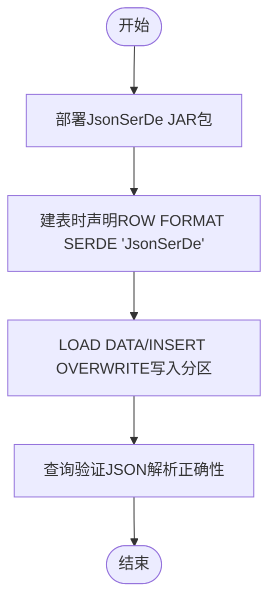
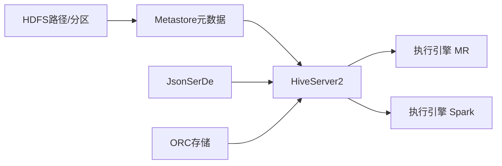

# Hive环境配置

<cite>
**本文引用的文件**
- [basic.sql](file://basic.sql)
- [console.sql](file://console.sql)
- [gmall-0906.sql](file://gmall-0906.sql)
- [high.sql](file://high.sql)
- [middle.sql](file://middle.sql)
</cite>

## 目录
1. [引言](#引言)
2. [项目结构](#项目结构)
3. [核心组件](#核心组件)
4. [架构总览](#架构总览)
5. [详细组件分析](#详细组件分析)
6. [依赖分析](#依赖分析)
7. [性能考虑](#性能考虑)
8. [故障排查指南](#故障排查指南)
9. [结论](#结论)
10. [附录](#附录)

## 引言
本文件面向Hive环境配置与运维，结合仓库中的HQL脚本，系统化梳理Hadoop集群与HDFS存储、Hive服务安装与配置（含Metastore、HiveServer2、Beeline）、Hive SQL执行环境优化（内存、并发、引擎选择）、SerDe插件（尤其是JsonSerDe）的安装与使用、分区表与ORC存储格式的配置要点，并提供常见问题排查与解决方案。内容以仓库现有SQL脚本为依据，确保可落地、可验证。

## 项目结构
仓库包含多个SQL示例文件，涵盖Hive基础语法、窗口函数、分区与存储格式、SerDe使用、以及完整的电商主题建模流程（ODS/DWD/DWS/ADS），这些均可作为Hive环境配置与验证的参考素材。


图表来源
- [basic.sql](file://basic.sql#L1-L120)
- [console.sql](file://console.sql#L150-L220)
- [gmall-0906.sql](file://gmall-0906.sql#L1-L120)
- [high.sql](file://high.sql#L1-L60)
- [middle.sql](file://middle.sql#L1-L60)

章节来源
- [basic.sql](file://basic.sql#L1-L120)
- [console.sql](file://console.sql#L150-L220)
- [gmall-0906.sql](file://gmall-0906.sql#L1-L120)
- [high.sql](file://high.sql#L1-L60)
- [middle.sql](file://middle.sql#L1-L60)

## 核心组件
- Hadoop/HDFS：作为底层分布式存储，承载Hive外部表数据与分区目录；仓库中多处出现HDFS路径定义与分区加载。
- Hive Metastore：管理表结构、分区元数据；仓库未直接展示配置，但通过建表与分区加载体现其作用。
- HiveServer2：对外提供交互式查询能力；仓库未直接展示配置，但通过SerDe与存储格式体现其执行环境。
- Beeline：命令行客户端；仓库未直接展示配置，但通过SerDe与存储格式体现其执行环境。
- SerDe插件：JsonSerDe用于解析JSON日志；仓库中多处显式声明ROW FORMAT SERDE。
- 存储格式：ORC用于列式存储与压缩；仓库中大量使用STORED AS ORC与TBLPROPERTIES。

章节来源
- [gmall-0906.sql](file://gmall-0906.sql#L24-L66)
- [gmall-0906.sql](file://gmall-0906.sql#L459-L462)
- [gmall-0906.sql](file://gmall-0906.sql#L467-L494)
- [gmall-0906.sql](file://gmall-0906.sql#L2563-L2566)
- [gmall-0906.sql](file://gmall-0906.sql#L2979-L2980)

## 架构总览
下图展示Hive在仓库场景中的典型数据流：原始JSON日志经ODS层外部表加载至HDFS分区目录，随后通过DWD/DWS/ADS层逐步构建宽表与汇总表，最终以ORC格式落盘，便于后续查询与分析。

```mermaid
graph TB
subgraph "数据源"
RAW["JSON日志<br/>ods_log_inc"]
end
subgraph "Hive ODS层"
ODS["外部表<br/>ods_log_inc<br/>ROW FORMAT SERDE 'JsonSerDe'"]
end
subgraph "Hive DWD/DWS/ADS层"
DWD["dwd_traffic_page_view_inc<br/>PARTITIONED BY(dt)<br/>STORED AS ORC"]
DWS["dws_trade_province_order_1d<br/>PARTITIONED BY(dt)<br/>STORED AS ORC"]
ADS["ads_xxx<br/>分区表<br/>ORC存储"]
end
subgraph "HDFS"
HDFS["/warehouse/gmall/...<br/>分区目录"]
end
RAW --> ODS --> DWD --> DWS --> ADS --> HDFS
```

图表来源
- [gmall-0906.sql](file://gmall-0906.sql#L24-L66)
- [gmall-0906.sql](file://gmall-0906.sql#L2563-L2566)
- [gmall-0906.sql](file://gmall-0906.sql#L4282-L4286)
- [gmall-0906.sql](file://gmall-0906.sql#L4288-L4327)

章节来源
- [gmall-0906.sql](file://gmall-0906.sql#L24-L66)
- [gmall-0906.sql](file://gmall-0906.sql#L2563-L2566)
- [gmall-0906.sql](file://gmall-0906.sql#L4282-L4327)

## 详细组件分析

### Hadoop集群与HDFS存储配置
- 分区表与路径：仓库中大量使用PARTITIONED BY与LOCATION指定HDFS路径，体现HDFS作为Hive外部表存储介质的使用方式。
- 数据装载：通过LOAD DATA INPATH或INSERT OVERWRITE将数据写入分区目录，验证HDFS写入与权限。
- 路径规范：建议统一前缀/warehouse/gmall/，按层（ODS/DWD/DWS/ADS）分目录管理，便于运维与权限控制。

章节来源
- [gmall-0906.sql](file://gmall-0906.sql#L24-L66)
- [gmall-0906.sql](file://gmall-0906.sql#L459-L462)
- [gmall-0906.sql](file://gmall-0906.sql#L467-L494)
- [gmall-0906.sql](file://gmall-0906.sql#L2563-L2566)
- [gmall-0906.sql](file://gmall-0906.sql#L4282-L4286)

### Hive Metastore配置
- 表结构与分区：仓库通过CREATE EXTERNAL TABLE与PARTITIONED BY定义表结构与分区键，体现Metastore对表元数据的管理。
- 建议：生产环境采用独立Metastore服务，确保HA与备份；仓库中未直接展示配置，但可通过建表语句验证其功能。

章节来源
- [gmall-0906.sql](file://gmall-0906.sql#L24-L66)
- [gmall-0906.sql](file://gmall-0906.sql#L467-L494)

### HiveServer2与Beeline配置
- SerDe与存储：仓库通过ROW FORMAT SERDE与STORED AS ORC体现HiveServer2对不同格式的支持。
- 引擎切换：仓库中使用SET hive.execution.engine=mr/spark切换执行引擎，反映HiveServer2对不同执行引擎的适配。
- 建议：生产环境启用HiveServer2 Thrift服务，Beeline通过JDBC连接；仓库未直接展示配置，但可通过SerDe与存储格式验证其执行环境。

章节来源
- [gmall-0906.sql](file://gmall-0906.sql#L2979-L2980)
- [gmall-0906.sql](file://gmall-0906.sql#L3048-L3049)
- [gmall-0906.sql](file://gmall-0906.sql#L459-L462)
- [gmall-0906.sql](file://gmall-0906.sql#L2563-L2566)

### Hive SerDe插件安装与配置（JsonSerDe）
- 安装：将JsonSerDe相关JAR包放置于Hive lib目录或通过Hive配置引入。
- 配置：在建表时通过ROW FORMAT SERDE 'org.apache.hadoop.hive.serde2.JsonSerDe'启用。
- 示例：ods_log_inc、ods_user_info_inc等外部表均使用JsonSerDe解析JSON日志。



图表来源
- [gmall-0906.sql](file://gmall-0906.sql#L24-L66)
- [gmall-0906.sql](file://gmall-0906.sql#L459-L462)

章节来源
- [gmall-0906.sql](file://gmall-0906.sql#L24-L66)
- [gmall-0906.sql](file://gmall-0906.sql#L459-L462)

### 分区表与ORC存储格式配置
- 分区表：ods_log_inc等表通过PARTITIONED BY(dt)实现按日期分区，便于数据维护与查询裁剪。
- ORC存储：dim_sku_full、dwd_traffic_page_view_inc等表使用STORED AS ORC与TBLPROPERTIES设置压缩策略，提升查询性能与存储效率。
- 建议：分区键选择高选择性字段；ORC压缩建议使用snappy/zstd；开启向量化与桶化（如适用）进一步优化。

章节来源
- [gmall-0906.sql](file://gmall-0906.sql#L24-L66)
- [gmall-0906.sql](file://gmall-0906.sql#L467-L494)
- [gmall-0906.sql](file://gmall-0906.sql#L2563-L2566)
- [gmall-0906.sql](file://gmall-0906.sql#L4282-L4286)

### Hive SQL执行环境优化
- 执行引擎：仓库通过SET hive.execution.engine=mr/spark切换执行引擎，体现对不同执行后端的适配。
- 动态分区：仓库使用set hive.exec.dynamic.partition.mode=nonstrict进行动态分区装载，需谨慎配置以避免数据倾斜。
- 建议：根据数据规模与查询模式选择合适引擎；合理设置mapreduce与Spark参数；开启向量化与谓词下推。

章节来源
- [gmall-0906.sql](file://gmall-0906.sql#L2979-L2980)
- [gmall-0906.sql](file://gmall-0906.sql#L3048-L3049)
- [gmall-0906.sql](file://gmall-0906.sql#L3076-L3076)

## 依赖分析
- 组件耦合：HDFS路径与分区键决定表的物理布局与查询性能；SerDe与存储格式影响解析成本与压缩比。
- 外部依赖：JsonSerDe JAR包为SerDe插件依赖；执行引擎（MR/Spark）为执行后端依赖。
- 潜在风险：动态分区未严格限制分区数量可能导致OOM；ORC压缩过度可能增加CPU开销。



图表来源
- [gmall-0906.sql](file://gmall-0906.sql#L24-L66)
- [gmall-0906.sql](file://gmall-0906.sql#L2979-L2980)
- [gmall-0906.sql](file://gmall-0906.sql#L3048-L3049)
- [gmall-0906.sql](file://gmall-0906.sql#L2563-L2566)

章节来源
- [gmall-0906.sql](file://gmall-0906.sql#L24-L66)
- [gmall-0906.sql](file://gmall-0906.sql#L2979-L2980)
- [gmall-0906.sql](file://gmall-0906.sql#L3048-L3049)
- [gmall-0906.sql](file://gmall-0906.sql#L2563-L2566)

## 性能考虑
- 内存参数：根据查询规模调整JVM堆大小与Shuffle内存；结合仓库中大表ORC存储与分区裁剪，减少扫描数据量。
- 并发控制：限制并发查询数量，避免资源争用；对大查询启用队列与优先级。
- 引擎选择：MR适合稳定批处理；Spark适合迭代与流式场景；仓库中两种引擎切换示例可作为参考。
- 存储优化：ORC snappy压缩；分区裁剪；列裁剪；谓词下推；向量化执行。

章节来源
- [gmall-0906.sql](file://gmall-0906.sql#L2979-L2980)
- [gmall-0906.sql](file://gmall-0906.sql#L3048-L3049)
- [gmall-0906.sql](file://gmall-0906.sql#L2563-L2566)
- [gmall-0906.sql](file://gmall-0906.sql#L4282-L4286)

## 故障排查指南
- JSON解析失败：检查ROW FORMAT SERDE是否为JsonSerDe；确认输入JSON格式与字段映射一致。
- 分区缺失：核对分区键dt值与分区目录是否存在；动态分区需确保分区模式与数量限制。
- ORC读取异常：检查TBLPROPERTIES压缩配置与Hive版本兼容性；必要时重建表。
- 执行引擎问题：确认SET hive.execution.engine设置是否生效；检查MR/Spark后端可用性。
- 权限问题：HDFS路径写入权限不足会导致装载失败；核对HDFS目录权限与Hive运行用户。

章节来源
- [gmall-0906.sql](file://gmall-0906.sql#L24-L66)
- [gmall-0906.sql](file://gmall-0906.sql#L2979-L2980)
- [gmall-0906.sql](file://gmall-0906.sql#L3048-L3049)
- [gmall-0906.sql](file://gmall-0906.sql#L2563-L2566)

## 结论
本仓库以电商主题建模为主线，展示了Hive在真实场景中的典型配置与使用方式：HDFS作为存储底座、分区表与ORC存储优化、JsonSerDe解析JSON日志、以及通过HiveServer2与Beeline进行交互式查询。结合仓库脚本，可快速搭建并验证Hive环境，后续可根据业务规模与性能需求进一步细化参数与架构。

## 附录
- 建议的Hive配置清单（基于仓库实践）
  - SerDe：ROW FORMAT SERDE 'org.apache.hadoop.hive.serde2.JsonSerDe'
  - 存储：STORED AS ORC，TBLPROPERTIES ('orc.compress' = 'snappy')
  - 分区：PARTITIONED BY(dt)，按日期组织
  - 引擎：SET hive.execution.engine=mr/spark
  - 动态分区：set hive.exec.dynamic.partition.mode=nonstrict

章节来源
- [gmall-0906.sql](file://gmall-0906.sql#L24-L66)
- [gmall-0906.sql](file://gmall-0906.sql#L2563-L2566)
- [gmall-0906.sql](file://gmall-0906.sql#L2979-L2980)
- [gmall-0906.sql](file://gmall-0906.sql#L3048-L3049)
- [gmall-0906.sql](file://gmall-0906.sql#L3076-L3076)