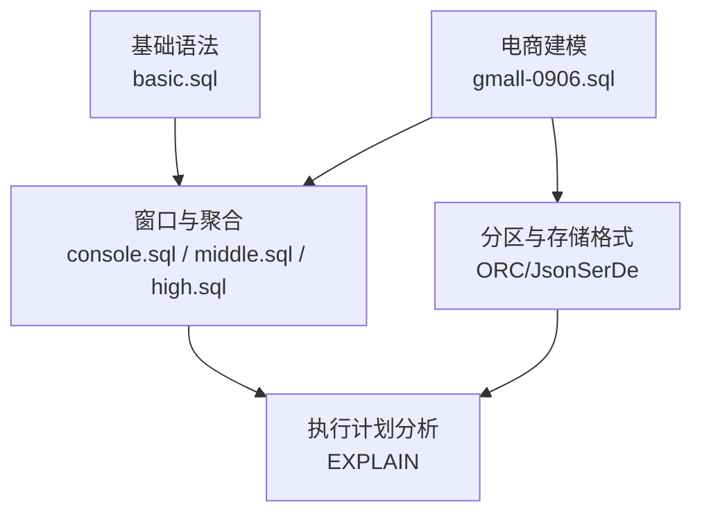
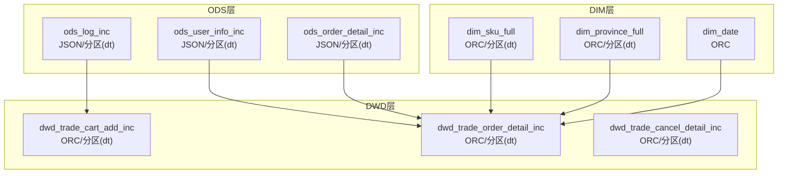
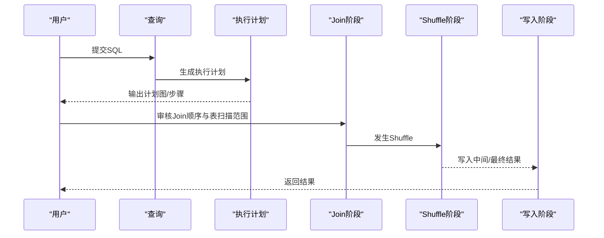
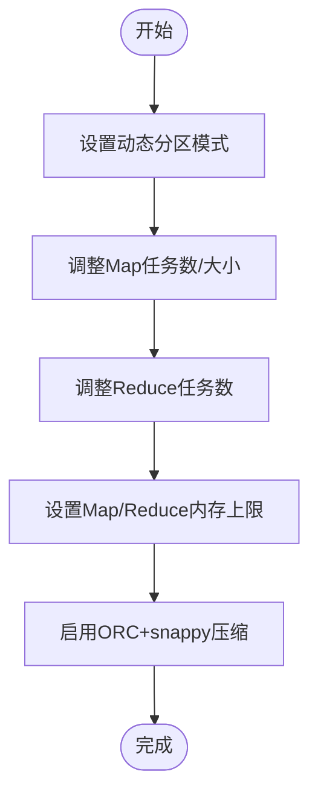
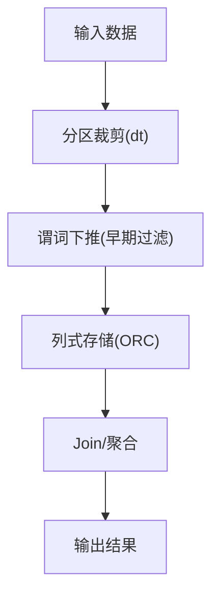
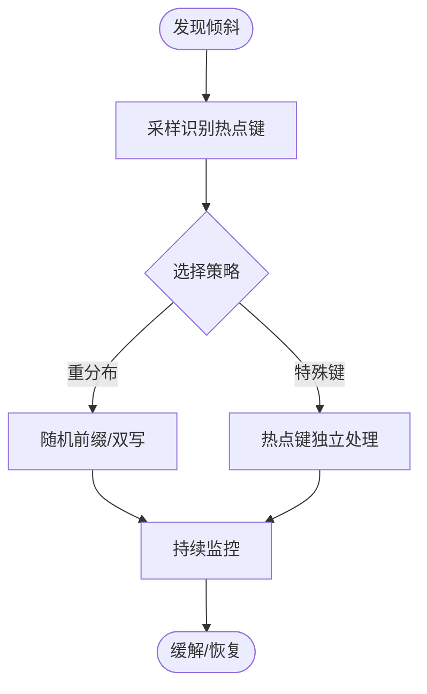
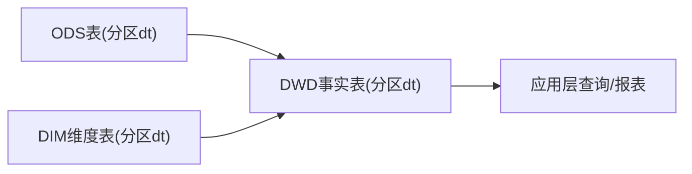

# 性能监控与调优

<cite>
**本文引用的文件**
- [basic.sql](file://basic.sql)
- [console.sql](file://console.sql)
- [gmall-0906.sql](file://gmall-0906.sql)
- [high.sql](file://high.sql)
- [middle.sql](file://middle.sql)
</cite>

## 目录
1. [简介](#简介)
2. [项目结构](#项目结构)
3. [核心组件](#核心组件)
4. [架构总览](#架构总览)
5. [详细组件分析](#详细组件分析)
6. [依赖分析](#依赖分析)
7. [性能考量](#性能考量)
8. [故障排查指南](#故障排查指南)
9. [结论](#结论)
10. [附录](#附录)

## 简介
本指南围绕Hive查询性能的监控与调优展开，结合仓库中的SQL示例与建模实践，系统阐述以下主题：
- Hive查询性能监控方法：执行计划分析、资源使用监控、慢查询识别
- Hive参数调优：MapReduce任务参数、内存分配、并行度设置
- 数据优化策略：分区裁剪、谓词下推、列式存储优势
- 数据倾斜问题：识别与解决方案（重分布、特殊处理）
- 索引与物化视图：适用场景与配置要点
- 性能基准测试：方法与工具建议

本指南面向不同技术背景读者，既提供高层策略，也给出可落地的实践步骤与可视化流程。

## 项目结构
仓库包含多类SQL脚本，覆盖基础语法、实战练习、电商主题建模与复杂分析场景，便于对照学习与迁移至生产环境：
- 基础语法与开窗函数：basic.sql
- 练习与窗口函数应用：console.sql、middle.sql、high.sql
- 电商主题建模（ODS/DWD/DIM/事实表）：gmall-0906.sql

**章节来源**
- file://basic.sql#L238-L293
- file://console.sql#L1-L120
- file://middle.sql#L1-L120
- file://high.sql#L20-L84
- file://gmall-0906.sql#L20-L120

## 核心组件
- 执行计划分析：通过执行计划定位扫描范围、Join顺序、Shuffle阶段与中间结果规模
- 资源监控：结合执行计划观察Map/Reduce阶段耗时、Shuffle输出、序列化开销
- 慢查询识别：对比不同写法的执行计划，识别不必要的子查询、重复聚合与宽依赖链
- 参数调优：控制Map/Reduce任务数量、内存上限、压缩策略与并行度
- 数据优化：合理分区、列式存储、谓词下推与分区裁剪
- 倾斜治理：重分布、随机前缀、特殊键处理
- 索引与物化视图：在Hive中以预聚合表或物化视图形式实现加速

**章节来源**
- file://basic.sql#L238-L293
- file://gmall-0906.sql#L955-L1000

## 架构总览
下图展示典型电商主题建模的分层与数据流向，强调分区裁剪、列式存储与事实表聚合对性能的影响。

**图表来源**
- [gmall-0906.sql](file://gmall-0906.sql#L20-L120)
- [gmall-0906.sql](file://gmall-0906.sql#L955-L1000)
- [gmall-0906.sql](file://gmall-0906.sql#L1174-L1210)
- [gmall-0906.sql](file://gmall-0906.sql#L1280-L1310)
- [gmall-0906.sql](file://gmall-0906.sql#L1481-L1510)

**章节来源**
- file://gmall-0906.sql#L20-L120
- file://gmall-0906.sql#L955-L1000
- file://gmall-0906.sql#L1174-L1210
- file://gmall-0906.sql#L1280-L1310
- file://gmall-0906.sql#L1481-L1510

## 详细组件分析

### 组件A：执行计划分析与慢查询识别
- 使用执行计划对比不同SQL写法，识别重复聚合、子查询展开与宽依赖链
- 关注扫描范围、分区裁剪命中率、Join顺序与Shuffle阶段
- 通过执行计划定位慢查询，优先优化大表Join、重复聚合与跨分区传输

**图表来源**
- [basic.sql](file://basic.sql#L238-L293)

**章节来源**
- file://basic.sql#L238-L293

### 组件B：参数调优（MapReduce任务、内存与并行度）
- 动态分区模式：允许非严格模式以简化分区插入
- 任务并行度：通过设置Map/Reduce任务数与块大小控制并行度
- 内存分配：限制Map/Reduce内存上限，避免OOM
- 压缩策略：ORC列式存储与snappy压缩提升I/O与CPU效率

**图表来源**
- [gmall-0906.sql](file://gmall-0906.sql#L955-L1000)

**章节来源**
- file://gmall-0906.sql#L955-L1000

### 组件C：分区裁剪与谓词下推
- 分区裁剪：按dt分区过滤，显著减少扫描数据量
- 谓词下推：尽量在上游层（ODS/DWD）提前过滤，减少下游传输与处理
- 列式存储：ORC列式存储降低I/O与解析成本

**图表来源**
- [gmall-0906.sql](file://gmall-0906.sql#L20-L120)
- [gmall-0906.sql](file://gmall-0906.sql#L1174-L1210)

**章节来源**
- file://gmall-0906.sql#L20-L120
- file://gmall-0906.sql#L1174-L1210

### 组件D：数据倾斜识别与治理
- 识别：GroupBy/Join中某些键值出现频率极高
- 治理策略：
  - 重分布：随机前缀打散热点键
  - 特殊键处理：对热点键单独处理
  - 采样与阈值：基于采样识别热点并制定策略

**图表来源**
- [middle.sql](file://middle.sql#L120-L200)

**章节来源**
- file://middle.sql#L120-L200

### 组件E：索引与物化视图
- Hive不支持传统B-Tree索引，可通过预聚合表或物化视图实现加速
- 适用场景：高频查询维度组合、固定口径指标
- 配置要点：定期刷新、分区维护、存储格式与压缩策略

**章节来源**
- file://gmall-0906.sql#L1174-L1210
- file://gmall-0906.sql#L1280-L1310

### 组件F：窗口函数与复杂分析的性能影响
- 窗口函数涉及排序与滑动，需关注分区键设计与排序字段
- 通过执行计划评估窗口函数的代价，避免不必要的开窗与重复聚合

**章节来源**
- file://basic.sql#L120-L220
- file://high.sql#L20-L84
- file://console.sql#L200-L320

## 依赖分析
- 表依赖：DWD层事实表依赖DIM层维度表与ODS层增量/全量表
- 分区依赖：按dt分区，上游ODS按dt装载，下游按dt消费
- 存储依赖：ORC列式存储与snappy压缩提升整体性能

**图表来源**
- [gmall-0906.sql](file://gmall-0906.sql#L20-L120)
- [gmall-0906.sql](file://gmall-0906.sql#L1174-L1210)
- [gmall-0906.sql](file://gmall-0906.sql#L1280-L1310)

**章节来源**
- file://gmall-0906.sql#L20-L120
- file://gmall-0906.sql#L1174-L1210
- file://gmall-0906.sql#L1280-L1310

## 性能考量
- 扫描范围控制：优先使用分区裁剪与早期过滤
- Join顺序：小表广播或就近Join，减少Shuffle
- 内存与并行：根据集群资源与数据规模调参
- 存储格式：ORC列式存储与snappy压缩
- 窗口函数：谨慎使用，避免重复开窗与无序扫描

[本节为通用指导，无需具体文件引用]

## 故障排查指南
- 执行计划异常：检查分区是否存在、分区裁剪是否生效、Join顺序是否合理
- OOM/超时：降低并行度、增加内存上限、优化Shuffle
- 数据倾斜：采样识别热点键，采用重分布或特殊键处理
- 存储格式问题：确认ORC列式与snappy压缩配置正确

**章节来源**
- file://gmall-0906.sql#L955-L1000
- file://gmall-0906.sql#L1174-L1210
- file://gmall-0906.sql#L1280-L1310

## 结论
通过执行计划分析、参数调优、分区裁剪与列式存储等手段，可显著提升Hive查询性能；结合数据倾斜治理与预聚合策略，进一步保障稳定性与可扩展性。建议在生产环境中建立规范的建模与调优流程，持续监控与迭代。

[本节为总结，无需具体文件引用]

## 附录
- 性能基准测试方法与工具建议
  - 方法：固定数据规模与查询集，对比不同参数/存储格式下的吞吐与延迟
  - 工具：Hive CLI/Beeline、Tez/Spark执行器（如使用）、YARN资源队列监控
  - 建议：以分区裁剪、列式存储、并行度与内存上限为主线进行A/B测试

[本节为通用指导，无需具体文件引用]